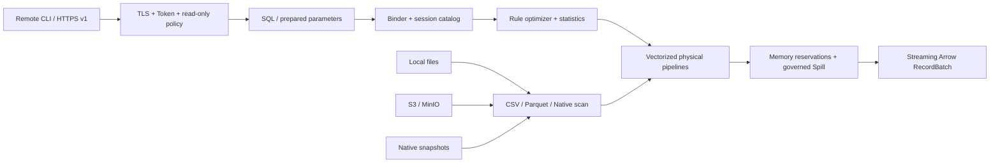

# New session - 2026-09-19T13:11:36.067Z

**Session ID:** ses_f4634d07dffecc0OPclXoMNVxv
**Created:** 9/19/2026, 1:11:36 PM
**Updated:** 9/19/2026, 2:31:28 PM

---

## User

can u help me make me a ml that trades stockk using fundemental what kind of data do u need i want u to make it in rust serch the web for more infamtion and tell me how are they and the eg of this model and can u make a super super deep reasurech on it and i work in jp morgain and the compney has given me 0 usd to make this make a supre super deep anylish of it and ask for all the things u need how to get it , how will the model be traind , what can things model do , how much alpsha can it make , can it find good undervalued companyers read book and serch the web super deep with a model that checks all your after u have done it and finds flaw in what u have found and u then corret make it and ask hime gaian and again and again till he cant find a flaw sercht the web for more infamtion and also the model will be trainded on the cpu 

---

## Assistant (Plan · oc/big-pickle · 48.9s)

---

## User

u have to run this  source ~/ml_env/bin/activate if u want any python lib and u can only dolwed lib in this and not in other thing or break the system u have to use this and also u have to write the code in super super optimzed optimzed way and if i say pure c++ or any other launge u have to write the code in that launge only and u cant use othe rlaunges without asking for permssion to do so and with the full detail reson for why but this can be done only in the most extream of the case and if i say no u have to write the code in that launge pure in that launge and also u have to write it super super optmzed code and also all the code u write shoul have the aouther od it as vaibhav and this person should hold the final power over the proget and aslo if this code is being pusd to github or made public in some way u should ask the which lisens to push it under and it should never be mit and the most favirate linces is the gpl-v3 or any other that is more apporete to this proget but u have to ask the person and also the gpl-v3 should be the choss by defult but u can ask for permsion and also u have to write the code in super super optimzed wway in the launge i have asked and also u have to serch the web for more infamtion on the toopic and also it should be hyper optimzed for this machine 
        _,met$$$$$gg.          neko@Rajeev
     ,g$$$$$$$$$$$$$$$P.       -----------
   ,g$$P""       """Y$$.".     OS: Debian GNU/Linux 13 (trixie) x86_64
  ,$$P'              `$$$.     Host: Windows Subsystem for Linux - Debian (2.7.12.0)
',$$P       ,ggs.     `$$b:    Kernel: Linux 6.18.33.2-microsoft-standard-WSL2
`d$$'     ,$P"'   .    $$$     Uptime: 1 hour, 13 mins
 $$P      d$'     ,    $$P     Packages: 1377 (dpkg)
 $$:      $$.   -    ,d$$'     Shell: bash 5.2.37
 $$;      Y$b._   _,d$P'       Display (rdp-0): 1920x1080 @ 60 Hz
 Y$$.    `.`"Y$$$$P"'          WM: WSLg 1.0.73.2 (Wayland)
 `$$b      "-.__               Terminal: xterm-256color
  `Y$$b                        CPU: 13th Gen Intel(R) Core(TM) i5-1335U (12) @ 2.50 GHz
   `Y$$.                       GPU: Intel(R) Iris(R) Xe Graphics (128.00 MiB) [Integrated]
     `$$b.                     Memory: 1.38 GiB / 7.60 GiB (18%)
       `Y$$b.                  Swap: 0 B / 2.00 GiB (0%)
         `"Y$b._               Disk (/): 158.78 GiB / 1006.85 GiB (16%) - ext4
             `""""             Disk (/mnt/c): 129.22 GiB / 132.99 GiB (97%) - 9p
                               Disk (/mnt/d): 286.07 GiB / 325.32 GiB (88%) - 9p
                               Local IP (eth0): 192.168.164.75/20
                               Battery (Microsoft Hyper-V Virtual Battery): 42% [Discharging]
                               Locale: en_US.UTF-8


[ and this is a super powerful machine and also it has avx2 [use it whene ever it makes the the code faster wwhich is aka most of the time ]
and also u have to make it so that it is the max perfumes on this machine and the code should be supr good and serch the web for more infmation

can u help me make me a ml that trades stockk using fundemental what kind of data do u need i want u to make it in rust serch the web for more infamtion and tell me how are they and the eg of this model and can u make a super super deep reasurech on it and i work in jp morgain and the compney has given me 0 usd to make this make a supre super deep anylish of it and ask for all the things u need how to get it , how will the model be traind , what can things model do , how much alpsha can it make , can it find good undervalued companyers read book and serch the web super deep with a model that checks all your after u have done it and finds flaw in what u have found and u then corret make it and ask hime gaian and again and again till he cant find a flaw sercht the web for more infamtion and also the model will be trainded on the cpu

---

## Assistant (Plan · Muse Spark 1.3 Free · 16.6s)

_Thinking:_

Reconciling conflicting language and environment constraints while scoping a deep research plan for a fundamental stock-trading ML model.

_Thinking:_

Shifting to read-only plan construction with websearch and clarifying questions.

---

## Assistant (Plan · Muse Spark 1.3 Free · 15.7s)

_Thinking:_

Balancing conflicting language requirements and hardware, budget, and licensing constraints before selecting an implementation approach.

_Thinking:_

Initiating read-only research and preparing targeted clarification questions under the stated licensing and hardware constraints.

_Thinking:_


**Tool: read**

**Input:**
```json
{
  "filePath": "/home/neko/fin"
}
```

**Output:**
```
<path>/home/neko/fin</path>
<type>directory</type>
<entries>
Cargo.lock
Cargo.toml
data/
src/
target/

(5 entries)
</entries>
```

---

## Assistant (Plan · Muse Spark 1.3 Free · 6.1s)

_Thinking:_


_Thinking:_


**Tool: read**

**Input:**
```json
{
  "filePath": "/home/neko/fin/Cargo.toml"
}
```

**Output:**
```
<path>/home/neko/fin/Cargo.toml</path>
<type>file</type>
<content>
1: [package]
2: name = "fin"
3: version = "0.1.0"
4: edition = "2021"
5: 
6: [dependencies]
7: linfa = "0.8"
8: linfa-trees = "0.8"
9: linfa-ensemble = "0.8"
10: ndarray = "0.16"
11: csv = "1.3"
12: serde = { version = "1.0", features = ["derive"] }
13: rand = "0.8"
14: ndarray-rand = "0.15"

(End of file - total 14 lines)
</content>
```

**Tool: read**

**Input:**
```json
{
  "filePath": "/home/neko/fin/src"
}
```

**Output:**
```
<path>/home/neko/fin/src</path>
<type>directory</type>
<entries>
main.rs

(1 entries)
</entries>
```

**Tool: read**

**Input:**
```json
{
  "filePath": "/home/neko/fin/data"
}
```

**Output:**
```
<path>/home/neko/fin/data</path>
<type>directory</type>
<entries>


(0 entries)
</entries>
```

**Tool: websearch**

**Input:**
```json
{
  "contextMaxCharacters": 10000,
  "numResults": 8,
  "query": "fundamental analysis machine learning stock prediction models 2026",
  "type": "deep"
}
```

**Output:**
```
Title: A survey of fundamental indicators, machine learning techniques and feature extraction techniques for stock price prediction | Discover Artificial Intelligence | Springer Nature Link
URL: https://link.springer.com/article/10.1007/s44163-026-01635-z
Published: 2026-06-24T00:00:00.000Z
Author: N/A
Highlights:
A survey of fundamental indicators, machine learning techniques and feature extraction techniques for stock price prediction | Discover Artificial Intelligence | Springer
...
# A survey of fundamental indicators, machine learning techniques and feature extraction techniques for stock price prediction
...
- Review
- Open access
- Published: 24 June 2026
...
The integration of machine learning techniques with fundamental analysis is crucial for enhancing stock price prediction, yet a comprehensive review focusing on fundamental indicators has been lacking. This study systematically reviews 54 empirical studies, cataloging 544 fundamental indicators and their relationships with various machine learning models, ultimately providing a unified framework for future research and practical guidance in feature selection and evaluation.
...
Machine learning (ML), more recently, deep learning, in combination with the two mainstream approaches of technical and fundamental analysis, has been widely applied to stock price prediction. Since technical analysis remains the dominant paradigm in this literature, comprehensive surveys centered exclusively on fundamental indicators are notably absent. This study addresses this gap through a systematic review of 54 empirical studies published between 2014 and 2025, identified from an initial pool of 2263 papers indexed in Scopus and Web of Science. The review catalogs 544 fundamental indicators across ten categories and examines their alignment with seven model families, alongside feature selection techniques, evaluation criteria, and data sources. Valuation metrics and profitability measures dominate the literature, with the P/E ratio and ROA being the most frequently employed indicators across price, return, and signal prediction tasks. Among model architectures, ANNs and Random Forest lead traditional ML approaches, while LSTM networks dominate deep learning applications. Using chi-square tests of independence, point-biserial correlations, and adjusted standardized residuals, we find a significant association between model category and prediction task, LSTM networks show a strong affinity for price prediction, Random Forests for return prediction, and boosting methods a negative association with price prediction. Transformer-based architectures show promise but have yet to establish dominance, and LLMs currently function more effectively in auxiliary roles such as financial statement interpretation and sentiment extraction than as standalone predictive engines. Accuracy, RMSE, and the Sharpe Ratio serve as the standard evaluation metrics across the reviewed literature. A sensitivity analysis across three inclusion scenarios confirms the robustness of core findings. This survey provides a unified framework for model-indicator alignment and offers practical guidance for feature selection, evaluation standards, and future research priorities.
...
Table 11 Studies evaluation: ML/DL models, data sources, metrics, problem types, feature selection techniques, software
...
Ozdemir, O., Biehl, M. & Petkov, N. A survey of fundamental indicators, machine learning techniques and feature extraction techniques for stock price prediction. Discov Artif Intell (2026). https://doi.org/10.1007/s44163-026-01635-z
...
Published: 24 June 2026
...
- Stock price forecasting
- Machine learning
- Fundamental analysis
- Feature selection

---

Title: (PDF) A hybrid machine learning framework integrating technical and fundamental analysis for stock market prediction
URL: https://www.researchgate.net/publication/407537857_A_hybrid_machine_learning_framework_integrating_technical_and_fundamental_analysis_for_stock_market_prediction
Published: 2026-06-25T11:06:49.000Z
Author: N/A
Highlights:
(PDF) A hybrid machine learning framework integrating technical and fundamental analysis for stock market prediction
...
# A hybrid machine learning framework integrating technical and fundamental analysis for stock market prediction
...
Accurate stock price prediction is pivotal for optimal financial decision-making, yet it remains challenging due to the non-linear and dynamic nature of financial markets. Traditional machine learning models often operate in silos, relying exclusively on either fundamental analysis (assessing a company’s financial health) or technical indicators (analyzing historical price patterns). This fragmented approach fails to capture the complete spectrum of factors driving market movements, limiting predictive accuracy. This study bridges this gap by proposing a hybrid machine learning framework that integrates fundamental and technical analysis to enhance forecasting accuracy in the Egyptian stock market using a Long Short-Term Memory (LSTM) network. The framework was applied to Telecom Egypt (ETEL.CA) data from January 2015 to December 2023, three configurations were evaluated: fundamental-only (e.g., financial ratios), technical-only (e.g., moving averages, RSI), and hybrid datasets. Framework performance was measured using Coefficient of Determination (R ² ), Root Mean Square Error (RMSE), and Mean Absolute Error (MAE). Results indicate that the fundamental-based LSTM model provides the most robust and generalizable performance. Technical indicators yield strong short-term results but exhibit overfitting, while the hybrid approach produces mixed outcomes with weaker generalization. These findings suggest that feature stability and relevance are more critical than simply integrating diverse data sources. The study demonstrates that combining deep learning with fundamental indicators offers a reliable approach for stock price prediction in emerging markets, providing valuable insights for investors and analysts.
...
A hybrid machine learning framework
...
integrating technical andfundamental analysis
...
forstock market prediction
...
Accurate stock price prediction is pivotal for optimal financial decision‑making, yet it remains challenging due
...
relying exclusively on either fundamental analysis (assessing a company’s financial health) or technical indicators
...
driving market movements, limiting predictive accuracy. This study bridges this gap by proposing a hybrid machine
...
learning framework that integrates fundamental and technical analysis to enhance forecasting accuracy in the Egyp‑
...
tian stock market using a Long Short‑Term Memory (LSTM) network. The framework was applied to Telecom Egypt
...
(ETEL.CA) data from January 2015 to December 2023, three configurations were evaluated: fundamental‑only (e.g.,
...
financial ratios), technical‑only (e.g., moving averages, RSI), and hybrid datasets. Framework performance was meas‑
...
ured using Coefficient of Determination (R2), Root Mean Square Error (RMSE), and Mean Absolute Error (MAE). Results
...
indicate that the fundamental‑based LSTM model provides the most robust and generalizable performance. Technical
...
indicators yield strong short‑term results but exhibit overfitting, while the hybrid approach produces mixed outcomes
...
with weaker generalization. These findings suggest that feature stability and relevance are more critical than simply
...
integrating diverse data sources. The study demonstrates that combining deep learning with fundamental indicators
...
Keywords Machine learning, Stock price prediction, Financial markets, Fundamental analysis, Technical analysis,
...
damental analysis and technical analysis. Fundamental
...
In recent years, machine learning (ML) and deep
...
Despite the growing interest in hybrid ML models, sev-
...
simply combining technical and fundamental indicators
...
is study addresses these gaps by proposing an
...
LSTM-based framework that systematically compares
...
three data configurations—technical-only, fundamental-
...
only, and hybrid—using real-world data from Telecom
...
Egypt (ETEL.CA) spanning January 2015 to December
...
2023. e main contributions of this paper are:
...
1. A rigorous empirical comparison of fundamental,
...
technical, and hybrid LSTM models for stock price
...
2. Evidence thatfeatures stability and relevancemay be
...
more critical than data integration alone, challenging
...
3. Practical insights for investors and analysts regarding
...
the conditions under which fundamental analysis can
...
Both technical indicators based on market prices and
...
Notably, this hybrid framework outperforms conven-
...
Model selection—long short‑term memory (LSTM)
...
In this section, proposes an adaptive, data-driven machine
...
price between 2015 and 2023. e framework focuses on
...
a Long Short-Term Memory (LSTM) model—chosen for
...
integrates fundamental financial metrics alongside techni-
...
cal indicators. is hybrid approach is designed to enhance
...
work utilizes three distinct datasets to train and evaluate
...
• Fundamental Indicators: EV/EBITDA, P/E, EV/Gross
...
Profit, P/S, and EV/Sales ratios.
...
• Technical Indicators: RSI, TRIX, Price ROC, Stochastic
...
Oscillator, and Linear Regression.
...
• Hybrid Dataset: A combination of both types to test
...
Since fundamental and technical analysis by them-
...
Experimental results andanalysis
...
• LSTM models trained in fundamental indicators
...
offered the most stable and generalizable results,
...
• Technical data improved short-term test perfor-
...
• e hybrid model provided mixed results—poten-
...
• e model’s generalization capability declined as
...
LSTM exhibited strong and consistent performance with
...
a test R2 of 0.9275 and a validation R2 of 0.9147. ese
...
LSTM—fundamental 0.9275 0.5229 0.3898 0.9147 1.3629 1.0764
...
LSTM—technical 0.9715 0.3275 0.2274 0.758 2.2953 1.8304
...
LSTM—combined 0.9557 0.4088 0.3067 0.7914 2.1309 1.6871
...
e model achieved the highest test accuracy (R2 =
...
0.9715), but generalization dropped on the validation set
...
prediction errors (RMSE = 2.2953, MAE = 1.8304). is
...
Although the test set results were impressive (R2 =
...
0.9557), the validation performance deteriorated consid-
...
erably (R2 = 0.7914), with RMSE increasing from 0.4088
...
to 2.1309 and MAE rising from 0.3067 to 1.6871. e
...
Framework evaluation metrics
...
Root Mean Squared Error (RMSE)
...
e empirical evaluation yielded critical insights into the
...
framework. A central finding is that the LSTM model
...
built on fundamental indicatorsdemonstrated superior
...
and more consistent performance, particularly on valida-
...
tion data, compared to models using only technical or
...
hybrid inputs. is suggests that the sequential learning
...
strength of LSTM is exceptionally well-suited to mod-
...
eling the temporal dependencies and longer-term trends
...
inherent in corporate valuation multiples (e.g., P/E, EV/
...
EBITDA), which reflect a company’s intrinsic financial
...
health. Conversely, while technical indicators showed
...
strong predictive power on the test set, their performance
...
degradation during validation points to a risk ofoverfit-
...
ting to short-term market noise rather than learning
...
generalized patterns. e hybrid approach yielded mixed
...
results, underscoring the practical challenge of effectively
...
without advanced feature engineering. is comparative
...
analysis confirms that in the context of the Egyptian mar-
...
ket,feature stability and economic rationale are more
...
critical for robust forecasting than model complexity
...
evidence that deep learning architectures, specifi-
...
cally LSTM, achieve optimal and reliable forecasting
...
performance when leveraging fundamental financial
...
ratios within an emerging market context. e study

---

Title: A hybrid machine learning framework integrating technical ...
URL: https://link.springer.com/
Published: N/A
Author: N/A
Highlights:
Artificial Intelligence Review
...
### Artificial Intelligence Review
...
Artificial Intelligence Review is a fully open access journal publishing state-of-the-art research in artificial intelligence and cognitive science.
...
Journal Impact Factor
18.8 (2025)
Downloads
5.1M (2025)
...
Browse by subject
...
* Biological Sciences
* Business and Management
* Chemistry
* Computer Science
* Earth and Environmental Sciences
* Health Sciences
* Humanities and Social Sciences
* Materials Science
* Mathematics
* Physics and Astronomy
* Statistics
* Technology and Engineering

---

Title: Enhancing stock market price prediction through FinGPT-driven sentiment analysis, technical indicators, historical price data, and attention-based hybrid deep learning models | Scientific Reports
URL: https://www.nature.com/articles/s41598-026-58717-2
Published: 2026-06-21T00:00:00.000Z
Author: N/A
Highlights:
Accurate stock price forecasting is increasingly dependent on models that can integrate heterogeneous market signals beyond traditional quantitative indicators. Classical sentiment analysis tools and lexicon-based methods often fail to capture the contextual and domain-specific nuances of financial language, limiting their predictive contribution. To address these limitations, this study introduces a multimodal forecasting framework that leverages FinGPT, an advanced financial large language model specifically trained for market-related text understanding. FinGPT is employed to extract high-resolution sentiment polarity scores from Twitter data, replacing conventional sentiment models and providing a more robust representation of investor psychology. These sentiment features are fused with historical stock prices and technical indicators to form a comprehensive input space. The integrated dataset is used to evaluate four deep learning architectures: CNN, LSTM, Attention-based LSTM (ALSTM), and a newly proposed Hybrid ALSTM-CNN model with an attention mechanism. Experiments performed on eight major NASDAQ and NYSE stocks demonstrate that incorporating FinGPT-derived sentiment significantly enhances forecasting accuracy across all models. The Hybrid model consistently achieves the best performance, effectively capturing both long-term dependencies and short-term market dynamics. Results confirm that FinGPT-driven sentiment modeling provides substantial predictive value compared with traditional sentiment approaches, enabling more realistic, behavior-aware stock price forecasting. For instance, in the case of AMD stock, it recorded the lowest MSE (46.06) and the highest R² (0.624), highlighting its superior ability to capture nonlinear dependencies and market dynamics. Overall, the proposed sentiment-enhanced hybrid framework provides a more robust and realistic procedure for stock price prediction by integrating quantitative and qualitative market signals.
...
In light of this evolving literature, the present study contributes to the field by developing an integrated DL framework that leverages three distinct data modalities historical prices, technical indicators, and textual sentiment scores to forecast stock prices. The proposed approach aims to demonstrate that the inclusion of sentiment polarity, computed from FinGPT-based analysis of tweets, enhances predictive precision and stability across multiple DL architectures, particularly in the hybrid ALSTM-CNN model. Through this integration of quantitative and qualitative information, the research seeks to provide empirical evidence supporting the hypothesis that models incorporating both market behavior and investor sentiment outperform those relying solely on numerical data.
...
Integration of three complementary data sources: This study integrates three heterogeneous but complementary data types historical prices, technical indicators, and textual sentiment from Twitter into a unified forecasting framework. Historical data capture long-term market dynamics through variables such as opening, closing, high, low, and volume. Technical indicators (e.g., RSI, MACD, MA/EMA, and Williams %R) enhance these signals by quantifying momentum, volatility, and short-term trends, while textual sentiment introduces behavioral information derived from investor opinions. The combination of these rational (quantitative) and behavioral (qualitative) features allows the model to better represent market dynamics, improving prediction stability and reducing forecasting errors compared to single-source models.
...
Sentiment quantification using FinGPT and polarity scoring: Unlike traditional lexicon-based or static NLP approaches, this research employs FinGPT, an advanced financial language model capable of context-aware sentiment interpretation. For each tweet, FinGPT outputs probabilities of positive, negative, and neutral sentiment. A polarity score is then computed as, ranging from \(\:-1\:\) to \(\:+1\). The daily average polarity score for each stock is calculated by aggregating all tweet scores within the same day. This continuous numeric feature allows unstructured textual sentiment to be transformed into a structured input for time-series models. FinGPT’s dynamic language understanding minimizes misinterpretation caused by financial jargon or sarcasm, producing more reliable sentiment signals for forecasting models.
...
Development of a novel hybrid ALSTM–CNN model with attention mechanism: A new hybrid DL architecture is proposed that combines ALSTM and CNN components. The LSTM captures long-term temporal dependencies, the CNN extracts short-term and local features from financial time series, and the attention mechanism assigns adaptive importance weights to influential time steps. This hybridization enhances both the representational power and interpretability of the model. Compared to single-architecture approaches, the hybrid model can simultaneously learn slow-moving patterns and sudden fluctuations, yielding higher accuracy and robustness in dynamic market conditions.
...
Fusion of sentiment features with historical and technical indicators: The DPS are fused with historical and technical features to create a comprehensive input matrix (10 features for the sentiment-based scenario). This integration enables the model to incorporate investor mood and market psychology alongside traditional numerical indicators. Empirical results demonstrate that adding sentiment features significantly improves prediction accuracy.
...
Therefore, this research introduces an excellent hybrid technique for price prediction that simultaneously incorporates three distinct categories of input data: price-based, technical, and contextual information. The proposed architecture is designed with three main computational layers: LSTM, CNN, and an attention mechanism, each uniquely involved in modeling the complex temporal and spatial dependencies inherent in financial temporal data. The LSTM layer is employed to capture regular dependencies and long-term temporal relationships in historical price movements. The CNN layer focuses on extracting local and short-term patterns from the data, increasing the model’s sensitivity to subtle market fluctuations. The AM then automatically adjusts the weights of features based on relevance, allowing the model to focus on influential information, thereby improving interpretability and prediction accuracy. In addition, contextual information is processed through the FinGPT model, which provides domain-specific sentiment representations. Together, these components form a robust multi-modal forecasting model capable of providing more accurate, interpretable, and stable stock price forecasts.
...
this study, the stock prices of the eight selected companies were predicted using four forecasting models over the defined one-year observation period. For each model, the dataset was split into training and testing subsets, with 80% of the data utilized for training and the remaining 20% reserved for testing to assess out-of-sample performance. Two experimental settings were designed to assess the effect of incorporating sentiment information. In the model with SA, three types of data historical stock data, technical indicators, and sentiment polarity scores were integrated, resulting in a total of 10 input features for each predictive model. In contrast, in the model without SA, only two categories of data historical data and technical indicators were used, yielding a total of 9 input features. This comparative design allowed for a systematic evaluation of the contribution of sentiment-based features to the predictive performance of the proposed models. For each of the four prediction models, specific hyperparameters were tuned to maximize the model’s predictive performance. All hyperparameters were validated through five-fold cross-validation to ensure model robustness, generalization capability,

---

Title: Intelligent Stock Price Prediction Model Research Integrating Multimodal Information and KAN Networks | Computational Economics | Springer Nature Link
URL: https://link.springer.com/article/10.1007/s10614-026-11314-x
Published: 2026-01-29T00:00:00.000Z
Author: N/A
Highlights:
# Intelligent Stock Price Prediction Model Research Integrating Multimodal Information and KAN Networks
...
- Published: 29 January
...
2026
...
Stock price prediction represents a core challenge in financial engineering, where traditional methods often rely on single data sources and struggle to capture complex market dynamics. This study proposes an intelligent stock price prediction model that integrates multimodal information and Kolmogorov-Arnold Networks (KAN), constructing an attention mechanism-based feature fusion framework by incorporating historical stock price data, financial news texts, and social media sentiment from multiple sources. The model employs LSTM networks to process numerical time-series features, utilizes BERT models to extract textual semantic information, achieves intelligent feature fusion through multi-head attention mechanisms, and introduces KAN networks as the output layer for stock price prediction tasks for the first time. Based on empirical data from NVIDIA Corporation spanning 2020-2025, comparative experiments with traditional and state-of-the-art baseline models demonstrate that the proposed model achieves significant improvements over the best baseline model Informer: 33.2% improvement in RMSE (from 2.26 to 1.51), 35.6% improvement in MAE (from 1.74 to 1.12), 40.9% improvement in MAPE (from 0.88% to 0.52%), 4.4% improvement in R\(^{\varvec{2}}\) (from 0.924 to 0.965), and 7.0% improvement in directional prediction accuracy (from 82.8% to 88.6%). Ablation experiments validate the effectiveness of multimodal data fusion, attention mechanisms, and KAN networks, with multimodal data fusion contributing most significantly to performance enhancement. Attention visualization analysis demonstrates the model’s excellent interpretability, capable of accurately identifying key market events. The research results provide new technical pathways for financial time series prediction, holding important theoretical value and practical application prospects.
...
The historical stock price data used in this study were obtained from Investing.com, specifically from the NVIDIA Corporation (NVDA) historical data section (https://www.investing.com/equities/nvidia-corp-historical-data). This publicly available dataset includes daily trading information such as open, high, low, close, adjusted close prices, and trading volume for the period from February 11, 2020, to February 11, 2025. The financial news data and social media sentiment data used in this research are subject to proprietary restrictions and privacy considerations. Due to the sensitive nature of these datasets and compliance with data usage agreements, they cannot be made publicly available. Researchers interested in accessing these datasets for replication or extension of this work should contact the corresponding author. Requests will be evaluated on a case-by-case basis and may require appropriate data usage agreements and ethical approval. The code and processed feature datasets used for model training and evaluation are available upon reasonable request to the corresponding author. We are committed to supporting reproducible research while respecting data privacy and intellectual property rights.
...
Sun, W., Yuan, C., You, S. et al. Intelligent Stock Price Prediction Model Research Integrating Multimodal Information and KAN Networks. Comput Econ (2026). https://doi.org/10.1007/s10614-026-11314-x
...
Published: 29 January 2026

---

Title: AgentPEN: A Prediction-Explanation Network for Sequential Stock Movement via LLMs and Recurrent Generation
URL: http://jmlr.org/papers/volume27/25-2175/25-2175.pdf
Published: N/A
Author: N/A
Highlights:
The importance of explainability in stock prediction is increasingly recognized, especially for audit and regulatory purposes. Meanwhile, financial news corpora are often key drivers behind stock price fluctuations. However, the raw news data obtained is usually highly noisy, has a highly variable scope of influence in time and space, and is not precisely syn chronized with stock price data. In this paper, we propose a prediction-explanation net work called AgentPEN, which can provide clear explanations for complex temporal price patterns. Specifically, AgentPEN jointly aligns text and price streams by an LLM-based Representation Fusion Agent and then adopts a Deep Recurrent Generation module to ex plore the distribution of stock movements. The LLM-based Representation Fusion Agent is designed in a Selection-Memory-Fusion manner: the Text Selection Module picks up useful information from massive text data; the Text Memory Module evaluates and writes the text memory from a two-view perspective including Temporal Memory and Spatial Memory; the Information Fusion Module models the interaction between text and price data. Next, the fused representation is sent to the Deep Recurrent Generation module to convert insights into stock movement predictions. Experiments on multiple real-world datasets have shown that AgentPEN surpasses the state-of-the-art baselines both in prediction accuracy and explainability. Keywords: time series prediction, large language model, financial technology, variational autoencoder, prediction explainability
...
2. Related Work In the realm of stock trading practices, stock movement prediction tasks are primarily guided by two prevalent analytical methods: technical analysis and fundamental analysis.
...
2.2 Fundamental Analysis based Stock Movement Prediction On the other hand, fundamental analysis goes beyond mere price trends to evaluate the intrinsic value of a stock. This method considers a variety of factors apart from historical prices, including detailed financial statements, industry trends, economic conditions, and even broader market sentiments. By integrating these diverse elements, fundamental anal ysis provides a comprehensive view of a stock’s potential, offering a robust basis for making informed investment decisions. With the rapid development of NLP techniques, text from social media and online news has become a newly popular source of fundamental analysis. HAN (Hu et al., 2018) simu lated the mechanism of human beings processing news, proposed a hybrid attention model, and handled the impact of different quality Internet news data on stock predictions. Stock net (Xu and Cohen, 2018) introduced recurrent, continuous latent variables to better handle the randomness of stock text information. MSHAN (Gong and Eldardiry, 2021) proposed to use a multi-stage TCN-LSTM method to capture unstructured text data information and long-range text dependencies. PEN (Li et al., 2023) applied a shared representation learn ing module to capture the correlation between text data and stock prices, which achieved prediction and interpretation of stock price movements. Additionally, many works modeled the correlation between stocks to enhance stock price prediction. MAN-SF (Sawhney et al., 2020) applied graph neural networks to process complex time signals of financial data, social media, and stock relationships in a hierarchical temporal manner for stock movement pre diction. CMIN (Luo et al., 2023) avoided attention to false stock correlations by calculating the transfer entropy between multivariate stocks and simultaneously introducing a fusion mechanism to learn the interactive effects in the information flow. Co-CPC (Wang et al., 2021a) proposed a deep model based on copula, which reduces model uncertainty and data uncertainty by modeling macroeconomic characteristics and stock movements.
...
2.3 Prediction Explainability Despite significant progress in the development of deep stock price prediction models, their practical adoption remains disappointingly scarce, largely attributed to their opaque, “black box” nature. The inner workings of these models are often not transparent, making it diffi cult for users to understand how predictions are derived. Consequently, there is a growing concern regarding the trustworthiness and reliability of such systems (Chen and Wang, 2025). To date, only a handful of research studies have tackled the issue of prediction ex plainability, aiming to demystify the processes behind these advanced models and enhance their accessibility and user trust. Hu et al. (2018) imitated the learning process of human beings facing chaotic online news, driven by three principles: sequential content dependency, diverse influence, and effective and efficient learning. Meanwhile, they designed a Hybrid Attention Network (HAN) to predict the stock trend based on the sequence of recent related news and leveraged attention weights to explain the news potentially causing stock price fluctuations. To timely select the textual stories associated with that price time series, Dang et al. (2019) proposed a multi-modal neural model called MSIN. By multiple steps of data interrelation between the textual data and the numerical data, MSIN learned to focus on a small subset of text articles that best align with the performance in the time series and could explain and enhance the stock prediction results. After that, Li et al. (2023) proposed a
...
SRL) module to learn the shared representation between text and price data, which generated a Vector of Salience (VoS) for every sample to ex plain the importance of individual text documents in the corpora. With the development of Large Language Models (LLMs), LLM-based agent technologies have also rapidly advanced, even in finance. Tong et al. (2024) proposed a financial LLM framework that consists of PloutosGen and PloutosGPT. PloutosGen contains multiple LLM-based experts capable of analyzing diverse modal data to deliver quantitative strategies from varied angles. Ploutos GPT then synthesizes these insights and predictions, producing coherent and interpretable rationales. Wang et al. (2024) designed Sequential Knowledge-Guided Prompting (SKGP) to identify factors that influence stock movements, which focuses on mining the factors that directly influence stock market changes, providing clear explanations for complex tempo ral variations. K. J. Koa et al. (2024) proposed Summarize-Explain-Predict (SEP), which utilizes self-reflective agents and PPO to enable LLMs to autonomously learn and
...
3.2 Model Architecture 
The overall architecture of AgentPEN is as shown in Figure 1. It comprises three main 
components: 
• An LLM-based Representation Fusion Agent (RFA). It is designed to effi ciently analyze and integrate both textual C and numerical data P . This integration occurs through the orchestration of three specialized modules: Text Selection Mod ule filtering out irrelevant historical news data to reduce noise and ensure that only pertinent information will be fed into the next module; Text Memory Module taking the selected text from the prior module and memorizing the texts into the Temporal & Spatial Memory; Information Fusion Module integrating the textual and numerical data streams into an overall representation which offers a holistic view of the market conditions, leading to more robust and accurate prediction performance. 
• Deep Recurrent Generation (DRG). We leverage a conditional variational auto encoder that describes the potential movement distribution in latent space with a probabilistic manner. It receives the fused information from the Representation Fusion Agent, first infers the latent variable set Z and then decodes movements y for every time step in the look-back window. 
• Temporal Attention Prediction (TAP). We adopt an attention mechanism to explore the relationship between the movement of the target trading day yT and its former movements y

---

Title: A large language model-driven framework for adaptive stock forecasting under China’s policy-driven market dynamics | Discover Artificial Intelligence | Springer Nature Link
URL: https://link.springer.com/article/10.1007/s44163-026-01837-5
Published: 2026-07-25T00:00:00.000Z
Author: N/A
Highlights:
A large language model-driven framework for adaptive stock forecasting under
...
-driven market dynamics | Discover
...
# A large language model-driven framework for adaptive stock forecasting under China’s policy-driven market dynamics
...
- Research
- Open access
- Published: 25 July 2026
...
Stock price forecasting in policy-sensitive markets like China’s A-shares presents a formidable challenge, as frequent regime shifts driven by external information can render traditional time-series models ineffective. While recent studies have started integrating textual data using Large Language Models (LLMs), they typically treat LLM-derived insights as static features, failing to adapt their core prediction logic when market dynamics fundamentally change. This paper introduces the Dynamic Priors-driven Adaptive Decomposition Network (DPAD-Net), a novel framework that pioneers a “perceive-and-adapt” mechanism. We reposition the LLM from a feature extractor to a macro-regime strategist that interprets real-time, multi-source information streams to generate dynamic priors—high-level judgments about the current market state. These cognitive priors act as command signals for a Regime-Adaptive Non-linear Decomposition Network (RAND-Net), which dynamically alters its mathematical structure to decompose stock prices into a stable value anchor and a volatile sentiment component. This adaptive decomposition allows the model to capture the complex, state-dependent interactions between fundamentals and market emotion. Extensive experiments on China’s A-share market demonstrate substantial improvements over state-of-the-art baselines: 13.6% reduction in MSE, 27.6% improvement in Sharpe ratio, and superior robustness during volatile market conditions. The framework’s “perceive-and-adapt” mechanism proves particularly effective during policy-driven rallies and sentiment-induced crashes, where traditional models anchored to historical patterns fail catastrophically.

---

Title: [2608.30192] FaVOR: LLM-Based Agentic Framework for Factor Mining via Empirical Validation
URL: https://arxiv.org/abs/2608.30192
Published: 2026-08-31T04:04:26.000Z
Author: N/A
Highlights:
**arXiv:2608.30192** (cs)
...
[Submitted on 31 Aug 2026]
...
# Title:FaVOR: LLM-Based Agentic Framework for Factor Mining via Empirical Validation
...
Authors:Hyeonjin Kim, Minseok Kim, Seunghyeon Jung, Sujin Pyo, Huisu Jang, Woojin Lee
...
> Abstract:
...
> Traditional finance relies on experts to hand-craft factors through a principled process grounded in economic rationale. Recent LLM-based multi-agent systems have automated this process, scaling factor mining far beyond manual effort. However, these automated approaches optimize directly for returns and rarely check whether a generated factor still expresses the economic hypothesis that motivated it. We identify this inconsistency between mathematical form and economic meaning as a structural failure mode of return-oriented automation. The resulting factors blur the line between real signals and spurious correlations and break down across regime shifts. We propose FaVOR (Factor Validation through Observable Reasoning), an agentic framework that restructures factor mining around hypothesis-level evidence rather than return outcomes. In place of the standard hypothesis-to-formula leap, FaVOR enforces a three-stage consistency loop tying mathematical form to economic rationale throughout. (1) Decomposition splits a broad economic hypothesis into independent observable conditions. (2) Validation checks whether each factor reflects its intended condition. (3) Integration merges them into a composite whose structure remains interpretable. On the CSI 500 and S&P 500 in 2025, FaVOR outperforms existing baselines while remaining effective across regimes. FaVOR shows that hypothesis-grounded factor discovery produces signals that are interpretable by construction, regime-robust, and economically faithful. The code is available at
```

**Tool: websearch**

**Input:**
```json
{
  "contextMaxCharacters": 10000,
  "numResults": 8,
  "query": "Rust machine learning crate linfa burn smartcore CPU AVX2 2026",
  "type": "deep"
}
```

**Output:**
```
Title: burn_flex - Rust
URL: https://docs.rs/burn-flex/latest/burn_flex/index.html
Published: N/A
Author: N/A
Highlights:
A fast, portable CPU backend for Burn.
...
- Pure Rust (no C dependencies)
- f16/bf16 support
- SIMD acceleration via macerator (NEON, AVX2/AVX-512/SSE, SIMD128, scalar fallback)
- Zero-copy tensor views
- Thread-safe by design
...
: The Flex backend, a fast, portable CPU backend for Burn.
...
: CPU device for the Flex backend.
...
: Quantized tensor for the Flex backend.
...
: CPU tensor primitive for the Flex backend.

---

Title: antimora/burn-flex
URL: https://github.com/antimora/burn-flex
Published: 2026-02-03T05:11:27.000Z
Author: N/A
Highlights:
Portable, efficient CPU backend for Burn with SIMD, gemm, and no_std
...
- Stars: 16
- Forks: 0
- Watchers: 16
- Open issues: 2
- Primary language: Rust
- Languages: Rust (99.6%), Python (0.4%)
- License: Apache License 2.0 (Apache-2.0)
- Default branch: main
- Created: 2026-02-03T05:11:27Z
- Last push: 2026-04-10T20:46:32Z
- Contributors: 1 (top: antimora)
- Releases: 1
- Latest release: v0.21.0-pre.3 (2026-04-08T22:02:54Z) [prerelease]
- Archived: true
...
🎉 burn-flex has been merged into Burn!
 
 
 See tracel-ai/burn#4761
...
## burn-flex - The portable flex that carries Burn anywhere.
...
A fast, memory-efficient CPU backend for Burn with multi-threading, SIMD, and optimized matrix
multiplication. Runs on std, no_std, and WebAssembly. Supports f16/bf16, zero-copy data loading, and
is thread-safe by design.
...
- **Portable SIMD**: Uses [macerator](https://crates.io/crates/macerator) for automatic dispatch:
...
- aarch64: NEON
 - x86_64: AVX2, AVX512, SSE
 - wasm32: SIMD128
 - Embedded/other: Scalar fallback
...
- **Dtype Support**: f32, f64, f16 (native), bf16 (via f32 conversion), i8-i64, u8-u64
- **Built on Burn**: Leverages Burn's native infrastructure (`Bytes`, `Shape`, `TensorData`,
...
burn-ndarray now uses macerator SIMD for f32 elementwise ops ([tracel-ai/burn#2851](https://github.com/tracel-ai/burn/pull/2851)), so contiguous
f32 binary/unary ops are at parity. Flex advantages come from gemm, integer ops (i32 vs i64),
structural zero-copy, and fused kernels.
...
| --- |
...
Binary ops (f32) | **~1
...
** | Both use macerator SIMD for f32 |
...
| Binary ops
...
i32) | **1.8-5.3x** | Flex uses i32, NdArray uses i64 |
| Matmul (square) | **1.4-3.1x** | gemm at small/large; tied at mid-sizes |
| Matmul (batched) | **1.3-2.2x** | Multi-head attention shapes |
| Matmul (int) | **3.7-6.5x** | gemm vs matrixmultiply for integers |
| Conv2d (3x3) | **1.1-3.7x** | Larger kernels and batches benefit most |
| Conv1d | **4.3-9.8x** |
| Conv transpose | **9.2-84x** | Direct scatter vs im2col |
| Attention | **1.2-3.0x** | Fused softmax, 2-8x lower peak memory |
| Pooling | **1.1-3.1x** |
| Interpolation | **1.1-6.3x** | Nearest 4-6x, bilinear 1.7-2.8x |
| Reductions | **1.3-5.4x** | Near-zero allocation for scalar results |
| Cumulative ops | **2.1-95x** | 1D cumsum: 95x faster |
| Gather/scatter | **1.2-6.4x** |
| Unary (tanh, sin) | **1.3-2.0x** | tanh 2x, sin/cos 1.3-1.5x |
| Sort | **2.3-29x** | 2D sort up to 29x |
| Repeat dim | **8.9-12x** | Single alloc + memcpy vs N slice_assign |
| Tensor creation | **16-33x** | zeros/ones/full |
| Embedding | **4.8-5.8x** |
| Quantize | **1.3-1.5x** | Fused 2-pass implementation |
| FFT (rfft/irfft) | **yes** | Native implementation, works in no_
...
- All `burn-backend-tests` pass across all feature flag combinations:
...
- `no-default-features` (no_std, no SIMD, no rayon)
 - `no-default-features + simd` (no_std with SIMD)
 - `std`
 - `std + simd`
 - `std + rayon`
 - `std + simd + rayon` (default)
...
- Burn's `burn-no-std-tests` integration suite passes (MNIST model inference in `#![no_std]`)
...
- Builds for embedded and WebAssembly targets:
...
- `thumbv6m-none-eabi` (ARM Cortex-M0+, no atomic pointers)
 - `thumbv7m-none-eabi` (ARM Cortex-M3)
 - `wasm32-unknown-unknown`

---

Title: linfa 0.8.1 - Docs.rs
URL: https://docs.rs/crate/linfa/latest
Published: N/A
Author: N/A
Highlights:
linfa 0.8.1 - Docs.rs
...
# linfa 0.8.1
...
A Machine Learning framework for Rust
...
`linfa` aims to provide a comprehensive toolkit to build Machine Learning applications with Rust.
...
preprocessing tasks and classical ML algorithms for
...
`linfa` currently provides sub-packages with the following algorithms:
...
## BLAS/Lapack backend
...
Some algorithm crates need to use an external library for linear algebra routines. By default, we use a pure-Rust implementation. However, you can also choose an external BLAS/LAPACK backend library instead, by enabling the`blas` feature and a feature corresponding to your BLAS backend. Currently you can choose between the following BLAS/LAPACK backends:`openblas`,`netblas` or`intel-mkl`.
...
| Backend | Linux | Windows | macOS |
| --- | --- | --- | --- |
| OpenBLAS | ✔️ | - | - |
| Netlib | ✔️ | - | - |
| Intel MKL | ✔️ | ✔️ | ✔️ |
...
Each BLAS backend has two features available. The feature allows you to choose between linking the BLAS library in your system or statically building the library. For example, the features for the`intel-mkl` backend are`intel-mkl-static` and`intel-mkl-system`.
...
An example set of Cargo flags for enabling the Intel MKL backend on an algorithm crate is`--features blas,linfa/intel-mkl-system`. Note that the BLAS backend features are defined on the`linfa` crate, and should only be specified for the final executable.

---

Title: tracel-ai/burn
URL: https://github.com/tracel-ai/burn/
Published: 2022-07-18T00:00:00.000Z
Author: N/A
Highlights:
Burn is a next generation tensor library and Deep Learning Framework that doesn't compromise on flexibility, efficiency and portability.
...
**Burn is both a tensor library and a
...
learning framework, optimized for
...
, training and inference.**
...
CubeCL |
...
behind Burn'
...
Burn's CubeCL backends (CUDA, ROCm, Metal, Vulkan, WebGPU,
CPU) compose with autodiff, fusion and remote-execution decorators, while external and simpler
backends (LibTorch and pure-Rust CPU/`no_std`) compose with autodiff only. See
Supported Backends below for the full matrix.
...
| Classical ML | linfa | Classical ML toolkit, in the spirit of scikit-learn |
| | smartcore | Classical ML algorithms, no BLAS/LAPACK required |
...
strives to be as
...
possible on as many hardwares
...
possible, with robust
...
crucial for modern
...
Supported Backends
...
**GPU Backends:**
...
| | CUDA | ROCm | Metal | Vulkan | WebGPU | LibTorch |
| ------- | ---- | ---- | ----- | ------ | ------ | -------- |
| Nvidia | ☑️ | - | - | ☑️ | ☑️ | ☑️ |
| AMD | - | ☑️ | - | ☑️ | ☑️ | ☑️ |
| Apple | - | - | ☑️ | - | ☑️ | ☑️ |
| Intel | - | - | - | ☑️ | ☑️ | - |
| Qualcom | - | - | - | ☑️ | ☑️ | - |
| Wasm | - | - | - | - | ☑️ | - |
...
**CPU Backends:**

| | Cpu (CubeCL) | Flex | LibTorch |
| ------ | ------------ | ---- | -------- |
| X86 | ☑️ | ☑️ | ☑️ |
| Arm | ☑️ | ☑️ | ☑️ |
| Wasm | - | ☑️ | - |
| no-std | - | ☑️ | - |
...
> **Note:** The LibTorch backend is deprecated as of `0.22.0` and will be removed in a future
> release. For GPU acceleration, use a CubeCL backend (CUDA,
> ROCm, Metal, Vulkan, WebGPU). For CPU execution, use the CubeCL CPU backend or `burn-flex`.

 

Compared to other frameworks, Burn has a very different approach to supporting many backends. By
design, most code is generic over the Backend trait, which allows us to build Burn with swappable
backends. This makes composing backend possible, augmenting them with additional functionalities
such as autodifferentiation and automatic kernel fusion.

---

Title: rust-ml/linfa
URL: https://github.com/rust-ml/linfa
Published: N/A
Author: N/A
Highlights:
# rust-ml/linfa
...
A Rust machine learning framework.
...
## README
...
`linfa` aims to provide a comprehensive toolkit to build Machine Learning applications with Rust.
...
Kin in spirit to Python's `scikit-learn`, it focuses on common preprocessing tasks and classical ML algorithms for your everyday ML tasks.

 
 Website | Community chat 
 

## Current state
...
`linfa` currently provides sub-packages with the following algorithms:
...
## Browser WASM
...
For browser-style WASM on `wasm32-unknown-unknown`, enable `linfa`'s `wasm-bindgen` feature.
...
## BLAS/Lapack backend
...
Some algorithm crates need to use an external library for linear algebra routines. By default, we use a pure-Rust implementation. However, you can also choose an external BLAS/LAPACK backend library instead, by enabling the `blas` feature and a feature corresponding to your BLAS backend. Currently you can choose between the following BLAS/LAPACK backends: `openblas`, `netblas` or `intel-mkl`.
...
| Backend | Linux | Windows | macOS |
| :-------- | :---: | :-----: | :---: |
| OpenBLAS | ✔️ | - | - |
| Netlib | ✔️ | - | - |
| Intel MKL | ✔️ | ✔️ | ✔️ |
...
Each BLAS backend has two features available. The feature allows you to choose between linking the BLAS library in your system or statically building the library. For example, the features for the `intel-mkl` backend are `intel-mkl-static` and `intel-mkl-system`.
...
An example set of Cargo flags for enabling the Intel MKL backend on an algorithm crate is `--features blas,linfa/intel-mkl-system`. Note that the BLAS backend features are defined on the `linfa` crate, and should only be specified for the final executable.

---

Title: cmccomb/smartcore_vs_linfa
URL: https://github.com/cmccomb/smartcore_vs_linfa/
Published: N/A
Author: N/A
Highlights:
`linfa` and `smartcore` have emerged as two leading `scikit-learn`-analogous machine learning frameworks for Rust. Both provide access to a number of algorithms that form the backbone of machine learning analysis. This repository provides a comparison between the training time of algorithms in these two machine learning frameworks. The algorithms included are:
...
| Algorithm | Smartcore v0.4.2 | Linfa v0.7.1 | Benchmarked here? |
|:------------------------------|:-----------------|:-------------|:------------------|
| Linear Regression | ✓ | ✓ | ✓ |
| Ridge Regression | ✓ | | |
| LASSO Regression | ✓ | | |
| Decision Tree Regression | ✓ | | |
| Random Forest Regression | ✓ | | |
| Support Vector Regression | ✓ | ✓ | ✓ |
| KNN Regression | ✓ | | |
| Elastic Net Regression | ✓ | ✓ | ✓ |
| Partial Least Squares | | ✓ | |
| Logistic Regression | ✓ | ✓ | ✓ |
| Decision Tree Classification | ✓ | ✓ | ✓ |
| Random Forest Classification | ✓ | | |
| Support Vector Classification | ✓ | ✓ | ✓ |
| KNN Classification | ✓ | | |
| Gaussian Naive Bayes | ✓ | ✓ | ✓ |
| K-Means | ✓ | ✓ | ✓ |
| DBSCAN | ✓ | ✓ | ✓ |
| Hierarchical Clustering | | ✓ | |
| Approximated DBSCAN | | ✓ | |
| Gaussian Mixture Model | | ✓ | |
| PCA | ✓ | ✓ | ✓ |
| ICA | | ✓ | |
| SVD | ✓ | | |
| t-SNE | | ✓ | |
| Diffusion Mapping | | ✓ | |
...
The documentation for `smartcore` is a bit more consistent across algorithms. This may be due to the fact that it is maintained in a single crate.
...
While `linfa` requires a BLAS/LAPACK backend (either `openblas`, `netblas`, or `intel-mkl`), `smartcore` does not. This allows `linfa` to take advantage of some additional optimization, but it limits portability.
...
The `smartcore` implementation has no parameters, but the `linfa` settings were modified to align it with `smartcore` defaults:
...
- Gradient tolerance set to `1e-8`
- Maximum number of iterations set to `1000`
...
Since the two implementations use different convergence criteria, the number of max iterations was equated at a low value, and only 1 run of the `linfa` algorithm was permitted:
...
- Max iterations set to `10`
- Number of runs set to `1`

---

Title: tracel-ai/burn
URL: https://github.com/Tracel-AI/burn
Published: N/A
Author: N/A
Highlights:
Burn is a next generation tensor library and Deep Learning Framework that doesn't compromise on flexibility, efficiency and portability.
...
**Burn is a next generation Tensor Library and Deep Learning Framework that doesn't compromise on
 flexibility, efficiency and portability.**

 
 

 

Burn is both a tensor library and a deep learning framework optimized for numerical computing, model
inference and model training. Burn leverages Rust to perform optimizations normally only available
in static-graph frameworks, offering optimal speed without impacting flexibility.
...
## Backend

 
 

Burn strives to be as fast as possible on as many hardwares as possible, with robust
implementations. We believe this flexibility is crucial for modern needs where you may train your
models in the cloud, then deploy on customer hardwares, which vary from user to user.

 

### Supported Backends
...
**GPU Backends:**

| | CUDA | ROCm | Metal | Vulkan | WebGPU | LibTorch |
| ------- | ---- | ---- | ----- | ------ | ------ | -------- |
| Nvidia | ☑️ | - | - | ☑️ | ☑️ | ☑️ |
| AMD | - | ☑️ | - | ☑️ | ☑️ | ☑️ |
| Apple | - | - | ☑️ | - | ☑️ | ☑️ |
| Intel | - | - | - | ☑️ | ☑️ | - |
| Qualcom | - | - | - | ☑️ | ☑️ | - |
| Wasm | - | - | - | - | ☑️ | - |
...
**CPU Backends:**

| | Cpu (CubeCL) | Flex | LibTorch |
| ------ | ------------ | ---- | -------- |
| X86 | ☑️ | ☑️ | ☑️ |
| Arm | ☑️ | ☑️ | ☑️ |
| Wasm | - | ☑️ | - |
| no-std | - | ☑️ | - |

 

Compared to other frameworks, Burn has a very different approach to supporting many backends. By
design, most code is generic over the Backend trait, which allows us to build Burn with swappable
backends. This makes composing backend possible, augmenting them with additional functionalities
such as autodifferentiation and automatic kernel fusion.

 
 
Autodiff: Backend decorator
...
brings backpropagation
...
This backend decorator enhances a backend with kernel fusion, provided that the inner backend
supports it. Note that you can compose this backend with other backend decorators such as Autodiff.
All first-party accelerated backends (like WGPU and CUDA) use Fusion by default (`burn/fusion`
feature flag), so you typically don't need to apply it manually.
...
progress
with an ergonomic
...
Burn supports importing ONNX (Open Neural Network Exchange) models through the
burn-onnx crate, allowing you to easily port models from
TensorFlow or PyTorch to Burn. The ONNX model is converted into Rust code that uses Burn's native
APIs, enabling the imported model to run on any Burn backend (CPU, GPU, WebAssembly) and benefit
from all of Burn's optimizations like automatic kernel fusion.

Our ONNX support
...
Inference in the Browser 🌐
 
 

Several of our backends can run in WebAssembly environments: Flex for CPU execution, and WGPU for
GPU acceleration via WebGPU. This means that you can run inference directly within a browser. We
provide several examples of this:
...
- Image Classification
 where you can upload images
...
🌄

 

 
 
Embedded: no_std support ⚙️
 
 

Burn's core components support no_std. This
means it can run in bare metal environment such as embedded devices without an operating system.
...
> As of now, only the Flex backend can be used in
...
_no_std_ environment.
...
### Benchmarks
...
Deep Learning is a special form of software where you need very high level abstractions as well as
extremely fast execution time. Rust is the perfect candidate for that use case since it provides
zero-cost abstractions to easily create neural network modules, and fine-grained control over memory
to optimize every detail.
...
reduces portability, increases
...
Burn is currently in active development, and there will be breaking changes. While any resulting
issues are likely to be easy to fix, there are no guarantees at this stage.

---

Title: Linfa Toolkit
URL: https://rust-ml.github.io/linfa/
Published: N/A
Author: N/A
Highlights:
Linfa Toolkit
...
# A comprehensive toolkit for Statistical Learning in Rust.

 Linfa is a comprehensive toolkit for statistical learning, providing algorithms for optimal model and density estimation. 

 It contains common learning algorithms such as Elastic Net, Support Vector Machines, Kernel Methods, Linear Decision Trees, etc. and bundles them together. 

 You can find the source code at rust-ml/linfa.
...
## Fast by default
...
The Rust language allows us to implement everything directly without the need to trade performance for readability.
...
No need to have a second language for performance reason.
...
We are using rustfmt, clippy, Tarpaulin, Github Actions and approx for testing and verification.
```

---

## Assistant (Plan · Muse Spark 1.3 Free · 10.8s)

_Thinking:_


_Thinking:_


**Tool: read**

**Input:**
```json
{
  "filePath": "/home/neko/fin/src/main.rs"
}
```

**Output:**
```
<path>/home/neko/fin/src/main.rs</path>
<type>file</type>
<content>
1: use linfa::prelude::*;
2: use linfa_ensemble::RandomForestParams;
3: use linfa_trees::DecisionTree;
4: use ndarray::{Array1, Array2};
5: 
6: // Features: [pe_ratio, roe, debt_to_equity, eps_growth, fcf_margin, pb_ratio, revenue_growth, op_margin]
7: // Label: 1 = BUY (next quarter return > 5%), 0 = SELL/HOLD
8: // This is a tiny demo dataset. Replace with real fundamentals from yfinance / Alpha Vantage / SEC EDGAR.
9: 
10: fn demo_dataset() -> (Array2<f64>, Array1<usize>) {
11:     let features = vec![
12:         // cheap + profitable + growing -> BUY
13:         12.5, 0.22, 0.4, 0.18, 0.15, 1.8, 0.12, 0.20,
14:         10.2, 0.25, 0.3, 0.22, 0.18, 1.5, 0.15, 0.24,
15:         14.0, 0.19, 0.5, 0.15, 0.12, 2.0, 0.10, 0.18,
16:         11.0, 0.28, 0.2, 0.25, 0.20, 1.6, 0.18, 0.26,
17:         13.5, 0.20, 0.6, 0.12, 0.14, 1.9, 0.11, 0.19,
18:         9.8,  0.30, 0.3, 0.28, 0.22, 1.4, 0.20, 0.28,
19:         // expensive + weak + indebted -> SELL
20:         45.0, 0.05, 2.5, -0.05, 0.02, 8.5, 0.02, 0.05,
21:         60.0, 0.03, 3.0, -0.10, -0.02, 10.0, -0.03, 0.02,
22:         35.0, 0.08, 1.8, 0.02, 0.04, 6.0, 0.01, 0.07,
23:         50.0, 0.04, 2.2, -0.02, 0.01, 7.5, 0.00, 0.04,
24:         38.0, 0.07, 2.0, 0.00, 0.03, 5.5, 0.03, 0.06,
25:         55.0, 0.02, 2.8, -0.15, -0.05, 9.0, -0.05, 0.01,
26:     ];
27:     let targets = vec![1, 1, 1, 1, 1, 1, 0, 0, 0, 0, 0, 0];
28: 
29:     let x = Array2::from_shape_vec((12, 8), features).unwrap();
30:     let y = Array1::from_vec(targets);
31:     (x, y)
32: }
33: 
34: fn main() -> Result<(), Box<dyn std::error::Error>> {
35:     run()
36: }
37: 
38: // split to keep main small for error handling without anyhow dep
39: fn run() -> Result<(), Box<dyn std::error::Error>> {
40:     let (x, y) = demo_dataset();
41:     let dataset = Dataset::new(x, y);
42: 
43:     // shuffle + 75/25 split (time-series split in production to avoid leakage!)
44:     use rand::SeedableRng;
45:     use rand::rngs::SmallRng;
46:     let mut rng = SmallRng::seed_from_u64(42);
47:     let (train, test) = dataset.shuffle(&mut rng).split_with_ratio(0.75);
48: 
49:     println!(
50:         "train: {} samples, test: {} samples, features: {}",
51:         train.nsamples(),
52:         test.nsamples(),
53:         train.nfeatures()
54:     );
55: 
56:     // Random Forest: 100 trees, bootstrap 70%, feature subset
57:     let rf = RandomForestParams::new(DecisionTree::params())
58:         .ensemble_size(100)
59:         .bootstrap_proportion(0.7)
60:         .feature_proportion(0.8)
61:         .fit(&train)?;
62: 
63:     let pred = rf.predict(&test);
64:     let acc = pred
65:         .iter()
66:         .zip(test.targets().iter())
67:         .filter(|(a, b)| a == b)
68:         .count() as f64
69:         / test.nsamples() as f64;
70:     println!("predictions: {:?}", pred.to_vec());
71:     println!("actual:      {:?}", test.targets().to_vec());
72:     println!("test accuracy: {:.2}%", acc * 100.0);
73: 
74:     // Example: predict a new stock from its fundamentals
75:     // e.g. AAPL-like: P/E 28, ROE 26%, D/E 1.5, EPS growth 10%, FCF margin 25%, P/B 35, rev growth 8%, op margin 30%
76:     // Note: model was trained on tiny demo data, so this is illustrative only.
77:     let new_stock = ndarray::array![[28.0, 0.26, 1.5, 0.10, 0.25, 35.0, 0.08, 0.30]];
78:     let signal = rf.predict(&new_stock);
79:     println!(
80:         "new stock signal: {} ({})",
81:         signal[0],
82:         if signal[0] == 1 { "BUY" } else { "SELL/HOLD" }
83:     );
84: 
85:     // Value trap example: cheap P/E but shrinking, high debt
86:     let value_trap = ndarray::array![[8.0, 0.05, 2.8, -0.12, 0.01, 0.9, -0.08, 0.03]];
87:     let signal2 = rf.predict(&value_trap);
88:     println!(
89:         "value-trap signal: {} ({})",
90:         signal2[0],
91:         if signal2[0] == 1 { "BUY" } else { "SELL/HOLD" }
92:     );
93: 
94:     Ok(())
95: }

(End of file - total 95 lines)
</content>
```

**Tool: websearch**

**Input:**
```json
{
  "contextMaxCharacters": 10000,
  "numResults": 8,
  "query": "free fundamental stock data API SEC EDGAR financial statements $0 budget 2026",
  "type": "deep"
}
```

**Output:**
```
Title: Financial Statement Data Sets
URL: https://www.sec.gov/
Published: N/A
Author: N/A
Highlights:
Menu
* Newsroom
* |
* Investors
* Small Businesses
* Whistleblowers
Search SEC.gov & EDGAR
Search
# Home
...
We make markets work better.
Founded to help our country respond to the Great Depression, we’re the agency that ***protects investors*** from misconduct, ***promotes fairness & efficiency*** in the securities markets, and ***facilitates capital formation*** for those looking to hire, innovate, and grow.

About the SEC
...
make a positive
...
Check
...
* 
Search EDGAR
...
Investor.gov
...
At Investor.gov, the SEC provides investors with the resources to make informed investment decisions.

Visit Investor.gov

YOU'LL FIND:
* Financial tools and calculators
* Investing FAQs
* Tips to avoid investment fraud
* Timely investor alerts

---

Title: jacobwright32/secfin
URL: https://github.com/jacobwright32/secfin
Published: N/A
Author: N/A
Highlights:
**Free financial data for Python.** Fetch income statements, balance sheets, and cash flow statements for any US public company directly from SEC EDGAR.
...
No API keys. No subscriptions. Just `pip install secfin`.
...
- **100% Free** - Uses SEC's public EDGAR API (no API keys required)
- **Complete Financial Statements** - Income Statement, Balance Sheet, Cash Flow
- **Built-in Analytics** - TTM, growth rates, CAGR, margins, ratios
- **Batch Processing** - Fetch entire indices (S&P 500, NASDAQ 100)
- **Async Support** - Fast concurrent fetching for large datasets
- **Smart Caching** - Automatic disk caching to reduce API calls
- **Pandas Integration** - Export everything to DataFrames
...
| Statement | Metrics |
|-----------|---------|
| **Income Statement** | Revenue, Cost of Revenue, Gross Profit, R&D, SG&A, Operating Income, Net Income, EPS, Shares Outstanding |
| **Balance Sheet** | Total Assets, Current Assets, Total Liabilities, Current Liabilities, Equity, Cash, Inventory, Debt |
| **Cash Flow** | Operating, Investing, Financing Cash Flows, CapEx, Dividends, Free Cash Flow |
...
All data comes from the SEC EDGAR database via their public API. The SEC requires a User-Agent header with contact information for all API requests.

---

Title: N/A
URL: https://raw.githubusercontent.com/api-evangelist/sec/refs/heads/main/openapi/sec-frames-api-openapi.yml
Published: N/A
Author: N/A
Highlights:
0
info:
 title: SEC EDGAR Data Frames API
 description: 'The EDGAR Data API at data.sec.gov provides RESTful access to public company financial filings, XBRL structured financial data, and company metadata without requiring authentication or API keys. The API delivers JSON-formatted responses covering company submissions (filing history), XBRL financial facts across all reporting periods, single XBRL concept values over time, and cross-company comparative frames for US-GAAP and IFRS taxonomies.

 '
 version: 1.0.0
 contact:
 name: SEC EDGAR Help
 url: https://www.sec.gov/cgi-bin/browse-edgar?action=getcompany
 license:
 name: Public Domain
 url: https://www.sec.gov/privacy.htm
 termsOfService: https://www.sec.gov/privacy.htm
...
paths:
 /api/xbrl/frames/{taxonomy}/{tag}/{unit}/{period}.json:
 get:
 operationId: getXBRLFrame
 summary: Get cross-company data for a concept in a period
 description: 'Returns data for a given XBRL concept across all companies that reported it for a specific period. This enables cross-company comparisons for any financial metric. Periods can be annual (CY2023), quarterly (CY2023Q1), or instantaneous (CY2023Q1I for point-in-time balance sheet concepts). The response includes each company''s CIK, entity name, accession number, location reference, and reported value.

 '
 tags:
 - Frames
 parameters:
 - name: taxonomy
 in: path
 required: true
 description: 'XBRL taxonomy. One of us-gaap, ifrs-full, dei, or srt.

 '
 schema:
 type: string
 enum:
 - us-gaap
 - ifrs-full
 - dei
 - srt
 example: us-gaap
 - name: tag
 in: path
 required: true
 description: XBRL concept tag name.
 schema:
 type: string
 example: AccountsPayableCurrent
 - name: unit
 in: path
 required: true
 description: 'Unit of measure. Common values: USD, shares, pure, USD-per-shares.

 '
 schema:
 type: string
 example: USD
 - name: period
 in: path
 required: true
 description: 'Reporting period. Annual: CY2023. Quarterly duration: CY2023Q1. Quarterly instantaneous: CY2023Q1I.

 '
 schema:
 type: string
 pattern: ^CY\d{4}(Q[1-4]I?)?$
 example: CY2023Q1I
 responses:
 '200':
 description: Cross-company XBRL frame data
 content:
 application/json:
 schema:
 $ref: '#/components/schemas/XBRLFrame'
 '404':
 description: Frame data not found for given parameters
 '429':
 description: Rate limit exceeded
...
XBRLFrame:
 type: object
 description: Cross-company data for a concept in a specific period
...
properties:
 taxonomy:
 type: string
 description: XBRL taxonomy
 example: us-gaap
...
tag:
 type: string
 description: XBRL concept tag name
 example: AccountsPayableCurrent
 ccp:
 type: string
 description: Calendar period (e.g., CY2023Q1I)
 example: CY2023Q1I
...
FrameDataPoint:
 type: object
 description: A single company's value for the frame concept and period
 properties:
 accn:
 type: string
 description: Accession number
 example: 0000320193-23-000006
...
cik:
 type: integer
 description: Company CIK
 example: 320193
 entityName:
 type: string
 description: Company name
 example: Apple Inc.
...
loc:
 type: string
 description: XBRL location reference
 example: 10-Q
 end:
 type: string
 format: date
 description: Period end or instant date
 example: '2023-04-01'
...
val:
 type: number
 description: Reported value
 example: 62611000000

---

Title: dgunning/edgartools
URL: https://github.com/dgunning/edgartools/
Published: N/A
Author: N/A
Highlights:
Read and analyze SEC EDGAR filings in Python. 10-K, 8-K, XBRL financials, Form 3/4/5, 13F, ADV — clean API, well-typed, MIT-licensed.
...
## README

 
 
 

# EdgarTools — Python Library for SEC EDGAR Filings

 

 
 
 
 
 
 
 
 
 
 

 

**EdgarTools** is a Python library for accessing SEC EDGAR filings as structured data. Parse financial statements, insider trades, fund holdings, proxy statements, and 20+ other filing types with a consistent Python API — in a few lines of code. Free and open source.
...
SEC EDGAR has every filing back to 1994, free — and almost none of it is ready to use. EdgarTools turns any filing into a typed Python object, so a 10-K's revenue is one line instead of an afternoon of XBRL parsing.
...
Financial Statements 
 Income, balance sheet, cash flow in one call 
 XBRL-standardized for cross-company comparison
 
 
 
 Every Filing Type 
 13F holdings, Form 4 insiders, 8-K events, funds, proxies 
 Typed objects + pandas DataFrames for 20+ forms
 
 
 
 Built for Pipelines & AI 
 Rate-limit aware, smart caching, enterprise mirrors 
 Built-in MCP server + LLM-ready text for RAG
...
### Financial statements from 10-K and 10-Q filings
...
```python
financials = Company("MSFT").get_financials()
financials.balance_sheet()     # all line items
financials.income_statement()  # revenue, net income, EPS
```
...
## Key Features

 
 
 

**Financial data**
...
- Income, balance sheet, cash flow — XBRL-standardized for cross-company comparison
- Individual line items, dimensional data, multi-period comparatives
- Company Facts API: time-series for any concept across years
...
MFP, N-CSR/N-CEN
...
/4/5
...
; Schedule 1
...
D/G
...
- Typed objects for 20+ forms; complete history since 1994
- Section extraction (Risk Factors, MD&A), EX-21 subsidiaries, auditor info
- HTML → clean text + markdown for RAG; full-text search
- Ticker/CIK lookup, industry & exchange filtering
...
EdgarTools supports all SEC form types including **10-K annual reports**, **10-Q quarterly filings**, **8-K current reports**, **13F institutional holdings**, **Form 4 insider transactions**, **proxy statements (DEF 14A)**, **S-1 registration statements**, **N-CSR fund reports**, **N-MFP money market data**, **N-PORT fund portfolios**, **Schedule 13D/G ownership**, **Form D offerings**, **Form C crowdfunding**, and **Form 144 restricted stock**. Parse XBRL financial data, extract text sections, and convert filings to pandas DataFrames.
...
EdgarTools is a **Python library** that talks directly to SEC EDGAR. sec-api is the best-known **hosted API** that returns JSON. Both parse filings — the difference is how you work with the data, and what it costs you.
...
| | EdgarTools | sec-api |
|---|------------|---------|
| **Cost** | Free, MIT | $49+/mo |
| **Data format** | Typed Python objects → DataFrames | JSON you parse yourself |
| **Where it runs** | In your process — no key, no quotas, no vendor lock-in | Hosted API — key + rate tiers |
| **Filing coverage** | 20+ typed forms (10-K, 8-K, 13F, N-PORT, proxy…) | 15+ structured endpoints |
| **AI / MCP** | Built in | |
| **Open source** | Inspect, fork, self-host | Proprietary |
...
**Bottom line:** in Python, EdgarTools gives you typed objects, AI-native output, and the full SEC corpus — free, open, and inspectable, with no keys or bills. `pip install edgartools` and you're querying filings in two lines.
...
open-source library —
...
ing primitives you compose in your own code, free and self-run.
...
at hedge funds
...
fintechs, and research desks — MIT-
...
, no keys, no subscriptions, and
...
by one person

---

Title: Financial Data API | Free Plan
URL: https://businessquant.com/docs/api/overview
Published: 2026-05-18T22:11:17.000Z
Author: N/A
Highlights:
The Business Quant Fundamental Data API delivers institutional-grade financial data for US-listed stocks, mutual funds, and ETFs — sourced directly from SEC filings and free to use. Pull income statements, balance sheets, cash flows, segment financials, analyst estimates, insider transactions, and institutional ownership from a single REST endpoint with a simple GET request. Beyond fundamentals, the same API key unlocks end-of-day and intraday price history, real-time streaming quotes over WebSocket, a full-market stock screener, corporate actions, item-level SEC filing sections, and US macroeconomic time-series with a release calendar — 20 endpoints in total under one authentication scheme and one response envelope.
...
### Financial Statements
...
Extract income statements, balance sheets, cash flow statements, financial ratios, and growth metrics — parsed from 10-K, 10-Q, 20-F, 40-F, and 6-K SEC filings and updated within 10 minutes of publishing.
...
### SEC Filings
...
Search, filter, and retrieve exact SEC EDGAR filing URLs, accession numbers, and publication dates across 18M+ filings and 400+ form types since 1993.
...
Building an investment research tool? A typical workflow combines several endpoints: narrow the market with the Stock Screener, pull Financial Statements for income and balance sheet data on the survivors, layer in Segment Financials for granular revenue breakdowns, cross-reference Insider Transactions and Institutional Ownership for conviction signals, then set the macro backdrop with Economic Data and Stock Quotes— all free to use under one API key.
...
### Is this fundamental data API free to use?
...
Yes. The Business Quant Fundamental Data API is free to use. Sign up to receive an API key and start pulling fundamentals, SEC filings, segment data, insider transactions, analyst estimates, price history, screener results, and economic time-series immediately — no credit card required.
...
All data is sourced directly from SEC EDGAR — the official filing system for US public companies. Income statements, balance sheets and cash flows are parsed from 10-K and 10-Q filings, insider transactions from Form 4, and institutional ownership from Form 13F. Data is updated within minutes of each filing being accepted by EDGAR.
...
The API provides income statements, balance sheets, cash flow statements, pre-calculated financial ratios, segment revenue and operating income breakdowns, geographic revenue data, Wall Street analyst consensus estimates, historical dividend payments and daily yield time-series, insider transaction records, and institutional 13F ownership data. Alongside those fundamentals it also serves end-of-day and intraday price history, real-time streaming quotes, full-market screening, corporate actions, item-level SEC filing sections, the complete securities universe, and US macroeconomic indicators with their release calendar — all from one API key.
...
Authentication is done by appending your`api_key` as a URL query parameter on every GET request — for example:`?ticker=AAPL&api_key=YOUR_KEY`. Obtain your key by registering for free.
...
for 60%
...
Starting from $49 $19 / month

---

Title: SEC EDGAR API: How I Built a Free Stock Research Tool (No API Key Needed) - DEV Community
URL: https://dev.to/0012303/sec-edgar-api-how-i-built-a-free-stock-research-tool-no-api-key-needed-fh7
Published: 2026-03-25T10:50:06.000Z
Author: N/A
Highlights:
I built him a free alternative in 2 hours using the SEC EDGAR API. Here's exactly how.
...
Every public company in the US must file financial reports with the SEC. These filings — 10-K (annual), 10-Q (quarterly), 8-K (events) — are all available for free through the EDGAR API.
...
No API key required. Just a User-Agent header with your email.
...
## Step 3: Get Financial Facts (The Gold Mine)
...
This is where it gets powerful. The Company Facts API gives you structured financial data: 

```
def get_financials(cik):
    cik_padded = str(cik).zfill(10)
    url = f"https://data.sec.gov/api/xbrl/companyfacts/CIK{cik_padded}.json"

    response = requests.get(url, headers=HEADERS)
    data = response.json()

    # Get revenue (us-gaap taxonomy)
    revenue = data["facts"]["us-gaap"].get("Revenues", {})
    units = revenue.get("units", {}).get("USD", [])

    for entry in units[-5:]:
        if entry.get("form") == "10-K":
            print(f"{entry["fy"]}: ${entry["val"]:,.0f}")
...
get_financials(1318605)
# 2022: $81,462,000,000
# 2023: $96,773,000,000  
# 2024: $97,690,000,000
...
Free. Structured. Straight from the source. No scraping needed.
...
## What My Friend Saved
...
| Tool | Cost | Data Quality |
| --- | --- | --- |
| Bloomberg Terminal | $2,000/mo | Best |
| Yahoo Finance API | $50/mo | Good |
| SEC EDGAR API | $0 | Direct from source |
...
1. Rate limit: 10 requests/second. Add `time.sleep(0.1)` between calls
2. User-Agent is required — use your real email, SEC will block generic agents
3. XBRL data goes back to 2009 for most companies
4. Bulk downloads available at `https://www.sec.gov/Archives/edgar/full-index/`

---

Title: N/A
URL: https://edgartools.readthedocs.io/en/stable/guides/financial-data/
Published: N/A
Author: N/A
Highlights:
# Financial Statements: Income, Balance Sheet, and Cash Flow from SEC Filings
...
Get financial statements from SEC filings in Python
...
```
from edgar import Company
...
company = Company("AAPL")
financials = company.get_financials()
income_statement = financials.income_statement()
...
That's it. You now have Apple's full income statement from their latest 10-K filing.
...
s financials on
...
| Method | Returns |
| --- | --- |
| `get_revenue()` | Total revenue / net sales |
| `get_net_income()` | Net income |
| `get_operating_income()` | Operating income / loss |
| `get_total_assets()` | Total assets |
| `get_total_liabilities()` | Total liabilities |
| `get_stockholders_equity()` | Stockholders' equity |
| `get_operating_cash_flow()` | Operating cash flow |
| `get_free_cash_flow()` | Free cash flow |
| `get_capital_expenditures()` | Capital expenditures |
| `get_current_assets()` | Current assets |
| `get_current_liabilities()` | Current liabilities |
...
## Available Statements
...
```
financials = company.get_financials()

income = financials.income_statement()
balance = financials.balance_sheet()
cashflow = financials.cash_flow_statement()
equity = financials.statement_of_equity()
comprehensive = financials.comprehensive_income()

```
...
| Statement | Method |
| --- | --- |
| Income Statement | `income_statement()` |
| Balance Sheet | `balance_sheet()` |
| Cash Flow Statement | `cash_flow_statement()` |
| Statement of Equity | `statement_of_equity()` |
| Comprehensive Income | `comprehensive_income()` |
...
is `cash_flow_statement()` (no underscore between "cash" and "flow"). The `Company` object also accepts `company.cash_flow()` as an alias, but on the `Financials` object always use `cash_flow_statement()`.
...
## Quarterly Financials
...
Use `get_quarterly_financials()` for 10-Q data:
...
| Need | Method |
| --- | --- |
| Annual (10-K) | `company.get_financials()` |
| Quarterly (10-Q) | `company.get_quarterly_financials()` |
...
Financial statements can show different levels of detail. Use the `view` parameter to control what you
...
# Summary: Matches SEC Viewer (~15-20
...
)
income = financials.
...
(view="summary
...
# Standard:
...
the filing document (default)
income
...
financials.income
...
(view="standard")
...
Use `amendments=False` when fetching filings. Amended
...
0-K/A) sometimes contain only
...
corrected sections, not complete financial statements.
...
## API Quick Reference
...
### Company-Level (Easiest)
...
| Method | Description |
| --- | --- |
| `company.get_financials()` | Latest annual financials (10-K) |
| `company.get_quarterly_financials()` | Latest quarterly financials (10-Q) |
...
### Financials Object
...
| Method | Description |
| --- | --- |
| `financials.income_statement()` | Income statement |
| `financials.balance_sheet()` | Balance sheet |
| `financials.cash_flow_statement()` | Cash flow statement |
| `financials.get_revenue()` | Revenue value |
| `financials.get_net_income()` | Net income value |
| `financials.get_total_assets()` | Total assets value |
| `financials.get_financial_metrics()` | Dict of all key metrics |
...
| Method | Description |
| --- | --- |
| `statement.to_dataframe()` | Convert to pandas DataFrame |
| `statement.to_dataframe(view="summary")` | Matches SEC Viewer |
| `statement.to_dataframe(view="standard")` | Matches filing document |
| `statement.to_dataframe(view="detailed")` | All dimensional breakdowns |
...
### Filing-Level (More Control)
...
| Method | Description |
| --- | --- |
| `filing.xbrl()` | Parse XBRL from filing |
| `xbrl.statements.income_statement()` | Get income statement |
| `xbrl.facts.query()` | Query individual facts |
...
See it on edgar.tools
...
The code above extracts financials programmatically. edgar.tools shows the same data visually — plus Disclosure Search, which lets you browse XBRL topics across every 10-K year for a company.
...
Export to Excel, PDF, or CSV with one click. Free tier available. Pricing →

---

Title: Company Facts: Query Historical SEC Financial Data with Python
URL: https://edgartools.readthedocs.io/en/stable/guides/company-facts/
Published: N/A
Author: N/A
Highlights:
# Company Facts: Query Historical SEC Financial Data with Python
...
The Company Facts API provides comprehensive access to SEC financial data through an intuitive, AI-ready interface. Get financial statements, key metrics, and detailed company information with just a few lines of code.
...
- Enhanced Value Formatting: Full numbers with commas (1,000,000,000) by default, with optional concise format ($1.0B)
- Multi-Period Statements: Rich hierarchical display showing multiple periods side-by-side
- LLM Integration: Built-in `to_llm_context()` method for AI consumption
- Web Rendering Support: Easy iteration over statement items with comprehensive web API methods
- Improved Visual Display: Professional formatting with color-coded values and hierarchical structure
...
# Get enhanced multi-period financial statements
income_stmt = company.income_statement()  # Shows multiple periods with hierarchy
balance_sheet = company.balance_sheet()  
cash_flow = company.cash_flow_statement()

print(income_stmt)  # Rich multi-period display
...
# Get concise format for quick overview
income_compact = company.income_statement(concise_format=True)
print(income_compact)  # Shows $1.0B instead of $1,000,000,000
...
- 🚀 Zero Setup - Works immediately with existing Company objects
- 💰 Full Precision - Full numbers with commas by default, optional concise formatting
- 📊 Enhanced Display - Multi-period hierarchical statements with rich formatting
- 🛡️ Error Resilient - Graceful handling of missing data with intelligent fallbacks
- 🤖 AI-Ready - Built-in LLM context generation with structured data output
- 🌐 Web Integration - Easy iteration methods and rendering support for web applications
- ⚡ Performance Optimized - Intelligent caching and efficient data structures
- 🎨 Professional Formatting - Color-coded values, hierarchical structure, and smart spacing
...
.facts` - Access
...
the full EntityFacts
...
public_float
...
Public float value
...
## Financial Statements
...
### Income Statement
...
Get hierarchical income statement data with flexible period options:
...
```
# Default: 4 annual periods, enhanced multi-period display
income_stmt = company.income_statement()
print(income_stmt)  # Rich hierarchical display with multiple periods
...
# Get 8 quarterly
...
formatting
quarter
...
= company.income_statement
...
=8,
...
=False)
...
# Use concise format for quick analysis ($1.0B vs $1,000,000,000)
compact = company.income_statement(concise_format=True)
...
## Method Parameters
...
| Parameter | Type | Default | Description |
| --- | --- | --- | --- |
| `periods` | int | 4 | Number of periods to retrieve |
| `annual` | bool | True | If True, prefer annual periods; if False, get quarterly |
| `as_dataframe` | bool | False | If True, return raw DataFrame; if False, return MultiPeriodStatement |
| `concise_format` | bool | False | If True, display as $1.0B; if False, display as $1,000,000,000 |
...
When `as_dataframe=False` (default), methods return enhanced `MultiPeriodStatement` objects with:
...
- Hierarchical Structure: Organized sections with proper parent-child relationships
- Multi-Period Display: Side-by-side period comparison with rich formatting
- Smart Value Formatting: Full numbers ($1,000,000,000) by default, per-share amounts as decimals
- Color-Coded Display: Green/red values, bold totals, hierarchical indentation
- Web Rendering Support: Easy iteration and item access for web applications
- LLM Integration: Built-in context generation for AI analysis
...
```
# Full precision formatting (default) - best for analysis
stmt_full = company.income_statement(concise_format=False)
print(stmt_full)  # Shows: $391,035,000,000
...
# Concise formatting - best for presentations and dashboards
stmt_concise = company.income_statement(concise_format=True)  
print(stmt_concise)  # Shows: $391.0B
...
- Default ( `concise_format=False`): Full numbers with commas ($1,000,000,000)
- Concise ( `concise_format=True`): Scaled format ($1.0B, $500.3M)
- Per-Share Values: Always decimal format (2.97) regardless of setting
- Negative Values: Properly formatted with minus signs
- Zero/Null Values: Displayed as "-" for clean presentation
...
## Discovering Available Data
...
```
facts = company.get_facts()
...
# Search for concepts by keyword
facts.search_concepts("revenue")      # Find all revenue-related concepts
facts.search_concepts("debt")         # Find debt-related concepts
...
periods have data for a concept
facts.available_periods("Revenue")    # List all periods with Revenue data
...
These methods are especially useful when `get_fact()` returns `None` — the warnings will suggest using `search_concepts()` to find the right concept name and `available_periods()` to find valid periods.
...
## Advanced Querying
...
The Facts API includes a powerful query interface for sophisticated financial analysis. Access it through the `query()` method:
...
facts = company.facts
query = facts.query()
...
#### Filter by Time Period
...
```
# Get facts from specific fiscal year
fy2024_facts = facts.query().by_fiscal_year(2024).execute()
...
#### Filter by Statement Type
...
#### Latest Facts
...
- gets FY 2024, FY
...
2023, etc.
...
annual = company.income_
...
(annual=True)
...
)  # Rich display
...
## Integration with Other EdgarTools Features
...
filing_date,
...
_10k.access
...
no
    },
    'financial_data': facts_stmt.to_
...
m_context(),
...
data_sources':
...
SEC Company Facts API + ED
...
Filings'
}
...
# New formatting options
compact_stmt = company.income_statement(concise_format=True)  # $1.0B format
full_stmt = company.income_statement(concise_format=False)    # $1,000,000,000 format
...
return None for financial
...
Q: What's the difference between concise_format=True and False? A: `concise_format=False` (default) shows full numbers with commas ($1,000,000,000) for precision. `concise_format=True` shows scaled format ($ 1.0B) for presentations. Per-share amounts are always decimals regardless of setting.
...
Q: Can I get historical data beyond what's shown? A: Yes, increase the `periods` parameter: `company.income_statement(periods=20)` for extensive historical data with consistent formatting.
...
The enhanced Company Facts API is part of EdgarTools' comprehensive SEC data platform, now with AI integration, web rendering support, and professional formatting. For more information, visit the EdgarTools Documentation.
```

**Tool: websearch**

**Input:**
```json
{
  "contextMaxCharacters": 10000,
  "numResults": 8,
  "query": "value investing machine learning undervalued stocks Piotroski F-score alpha backtest",
  "type": "deep"
}
```

**Output:**
```
Title: A neural approach to the value investing tool F-Score
URL: https://zaguan.unizar.es/record/97028/files/texto_completo.pdf
Published: N/A
Author: Ruth Gimeno
Highlights:
## A neural approach to the value investing tool F-Score Ruth Gimeno, Lidia Lobán, Luis Vicente ⁎
...
ABSTRACT This work is the first neural approach to Piotroski's (2000) F-Score. From the same informative signals, our approach based on network data envelopment analysis allows for (1) overcoming the binary perspective of classification between companies with good/bad fundamentals, and (2) appropriately assessing the existing interaction among a company's main financial areas. The analysis of a complete sample of the largest listed companies in the Eurozone and in the U.S. market in the period 2006–2017 shows that our neural F-Score significantly improves the portfolio returns obtained by the original F-Score.
...
(e.g., Fama and French, 2012; Asness et al., 2013). Furthermore, the use of complementary indicators improves the success of these 
value strategies (e.g., Novy-Marx, 2013). 
Piotroski (2000) developed a fundamental score (F-Score) based on accounting signals that differentiated between companies 
with good and bad fundamental scores among all of those with high BM ratios. Piotroski (2000) established that official financial
...
companies tend to be financially distressed. 
Piotroski (2000) showed that an annual excess return of approximately 7.50% could be obtained in the short term with respect to 
the rest of the companies with high BM ratios in the U.S. stock market during the period 1976–1996. These results had a great impact 
on both industry and academia. 1 
However, the motivation of our paper is that the F-Score shows some methodological limitations that could affect the reliability of 
its valuations. The main limitations are as follows: 
a) The binary approach of the accounting signals included in the F-Score is too simple to reflect the great variety of financial
...
creased; rather, it is necessary to consider the magnitude of these variations for better scoring of the companies. 
b) No interaction exists between the accounting signals identified in the F-Score; thus, no relationship exists among a company's 
three main financial areas, as defined by Piotroski (2000): (1) profitability; (2) leverage, liquidity, and source of funds; and (3) 
operating efficiency.
...
Our neural approach based on network data envelopment analysis (network DEA) allows for overcoming the two previous limitations, thus generating more reliable selections in the short term for companies with high BM ratios. Our neural F-Score keeps the rationale of all of the accounting signals included in the F-Score and additionally considers both their magnitude and the in teraction between them. We empirically show that the application of our neural approach to the challenging valuation problem of large-cap companies provides more reliable estimates than the use of binary and isolated signals derived from the original F-Score. The next section of our work summarizes the F-Score and our neural F-Score. Section 3 presents the empirical analysis. Finally, Section 4 includes the main conclusions of our study. 2. The F-Score and our neural F-Score proposal 2.1. The F-Score Piotroski (2000) defined the F-Score as the sum of nine binary accounting signals that can assume a value of 0 or 1. These signals are defined and grouped into a company's three large financial areas. The F-Score takes a maximum value (minimum) equal to 9 (0) when a company presents positive (negative) scoring signals for all of the accounting signals included.
...
We developed an empirical analysis similar to that of Piotroski (2000). For each year, we selected companies with BM ratios higher than the median. 5 The final sample consisted of 922 (2266) observations of the large companies most undervalued in the Eurozone (U.S.) market from 2006–2017. Next, we selected companies each year with a maximum F-Score of 9 and a minimum F-Score of 0 according to equation [1]. 6 Subsequently, we applied our NF-Score model [3] to the same annual sample of companies. The NF values obtained each year were grouped into 10 clusters based on the k-medoids technique. Therefore, each year, we obtained a score for each company assigned by
...
15% ⁎⁎ −0.5482% 3.3941% ⁎⁎ −0.8731% 
U.S. Market 4.1641% ⁎⁎ −3.4612% ⁎⁎ 3.4239% ⁎⁎ −6.6960%
...
panies, excluding the highest rated companies, were computed. 
Table 1 shows the main results. Panel A significantly questions the reliability of the selection made by the F-Score for both the 
Eurozone and U.S. markets, especially for a two-year investment horizon. For 2006–2017, companies with high F-Scores obtained
...
negative excess returns compared with the rest of the sample. Our finding confirmed the size effect already shown by 
Piotroski (2000), thereby questioning again the successful application of the F-Score in large-cap companies that are extensively 
followed by worldwide analysts. 
However, Panel B shows that the NF-Score reliably selects high-BM companies, especially in the Eurozone market, where the 
portfolios formed by companies with good fundamentals obtained a 3.24% annual excess return at one year compared with com
...
panies with poor fundamentals. However, these results are much less successful for the U.S. market, where the rapid information
...
dissemination environment seems to severely restrict the utility of the analysis of the nine accounting signals (Piotroski, 2000) with 
respect to the Eurozone. This finding could be explained by the higher levels of analysts’ coverage of large-cap companies in the U.S. 
market than in the Eurozone. Bolliger (2004) finds that forecast accuracy is negatively associated with the number of countries
...
analyst advantages (Bae et al., 2008) question the importance of the analysis of basic accounting signals in U.S. large-cap companies. 
Finally, Panel C shows the best selection skills of the NF-Score with respect to the original F-Score. The company selection with 
good fundamentals from our NF-Score significantly exceeds the returns obtained by the F-Score selection in both the Eurozone and 
U.S. markets. This better selection is also evident, especially in the U.S. market, in which the worst fundamental companies chosen by 
the NF-Score obtained significantly lower returns than those selected by the F-Score. All of the results are robust for one- and two 
year investment periods. 
The interaction between the financial areas of a company through our NF-Score allowed us to obtain short-term annual excess 
returns of approximately 4% in long-short value strategies over large-cap Eurozone companies that were rated by the binary F-Score
...
model. This improvement is even more relevant in the U.S. market, with a range of annual excess returns from 7.62% to 10.11% for 
one- and two-year investment periods, respectively. 
4. Conclusion 
This work is the first neural approach to the F-Score model proposed by Piotroski (2000). Using the same accounting signals, our 
model allows for (1) overcoming the binary classification perspective between companies with good/bad fundamentals and (2)
...
appropriately assessing the existing interaction among a company's main financial areas. 
The empirical application in a complete sample of the largest nonfinancial companies in the Eurozone and the U.S. market during
...
the period 2006–2017 showed that our NF-Score significantly improves the short-term returns of long-short value strategies selected
...
by the F-Score. However, the nine accounting signals proposed by Piotroski (2000) are not sufficient to get winner returns for the U.S.
...
large-cap companies. The first implication of these results is that the interaction between the financial areas in large-cap companies
...
should be considered in further value strategies to obtain higher levels of performance. Second, further neural valuation models 
should include more sophisticated accounting signals to identify winner value strategies in rapid information-dissemination en

---

Title: Piotroski F-Score Backtest: A Financial-Strength Screen, Run Honestly (2017–2026) | SledgeKey Backtests
URL: https://sledgekey.com/backtests/piotroski-f-score
Published: 2026-07-31T06:10:29.000Z
Author: The SledgeKey Team
Highlights:
Joseph Piotroski's 2000 paper asked a narrow question about cheap stocks. If you sort the market by price to book and buy the cheapest slice, you end up holding a lot of companies that are cheap for good reason, so he proposed a nine-point scorecard covering profitability, leverage, liquidity, and operating efficiency, and showed that the high-scoring end of the cheap bucket did far better than the low-scoring end. The scorecard has been part of the value investor's toolkit ever since, and it is one of the most requested things people want to test.
...
We tested a version of that idea over the last nine and a half years. The screen buys companies trading at or below 1.5 times book value that also clear four financial-strength tests at the same time: positive return on assets, positive operating cash flow, debt at or below half of equity, and a current ratio of at least 1.5. It holds the twenty largest qualifying companies in equal weight and rebalances once a year. What makes this run different from most published Piotroski backtests is the universe. Every company listed on each rebalance date was eligible, including the ones that were later acquired, sanctioned off the exchange, or delisted for any other reason, and any holding that left the market was booked out at its last traded price instead of being erased from the record.
...
Over this window the screen turned $100,000 into $259,926, a return of 10.46% a year. An S&P 500 index fund did far better over the same stretch, at 15.58% a year, and it got there with a much shallower worst-case drawdown.
...
| Value filter | Price to book of 1.5 or lower |
| --- | --- |
| Profitability | Return on assets of 0% or higher (trailing twelve months) |
| Cash generation | Operating cash flow of zero or higher (trailing twelve months) |
| Leverage | Debt to equity of 0.5 or lower |
| Liquidity | Current ratio of 1.5 or higher |
| Market cap | $1 billion and up |
| Selection | The 20 qualifying companies with the largest market cap at each rebalance |
| Weighting | Equal weight, 10% maximum position size |
| Rebalance | Once a year (10 rebalances over the window) |
| Transaction cost | 0.10% per trade ($1,424 in modeled costs over the run) |
| Initial capital | $100,000 |
| Benchmark | SPY, the S&P 500, over the same window |
| Universe | NYSE + NASDAQ operating companies (no SPACs, REITs, ETFs, or funds). Point-in-time: eligibility at each rebalance reflects the companies listed on that date. |
| Delisting treatment | Any holding that later delisted was booked out at its frozen last traded price, never dropped from the history. |
...
One thing deserves to be said plainly, because it is the most common mistake in backtests that carry Piotroski's name. This is a financial-strength screen built in his spirit, and it is not the nine-point F-Score itself. Only two of his nine points are plain levels, positive net income and positive operating cash flow, and a third compares operating cash flow against net income within the same year. The other six ask whether a company improved on its own prior year: return on assets, leverage, the current ratio, gross margin, asset turnover, and share count. A screen filters on levels, so the run above uses his value anchor plus level-based stand-ins for his profitability, leverage, and liquidity tests, then stops there. Read the result as evidence about that screen rather than a verdict on the published F-Score.
...
| Metric | Piotroski-style screen | S&P 500 |
| --- | --- | --- |
| Total return | 159.93% | 301.69% |
| Annual return (CAGR) | 10.46% | 15.58% |
| Final value | $259,926 | $401,694 |
| Sharpe ratio | 0.48 | 0.82 |
| Volatility (ann.) | 19.69% | 16.27% |
| Max drawdown | -37.96% | -23.93% |
| Calmar ratio | 0.28 | n/a |
| Winning months | 71 of 115 | n/a |
| Total trades | 244 | n/a |
| Avg holding period | 723 days | n/a |
| Annual turnover | 95.3% | n/a |
...
The screen won 71 of its 115 months to the index's 76, and its losing months were deeper: an average of -4.2% against SPY's -3.7%, with a worst month of -26.1% against -16.4%. That is what a high-volatility strategy looks like from the inside, and it is why the Sharpe ratio comes in at 0.48 against the index's 0.82.
...
A note on survivorship. Run this same screen the way most free backtesters quietly do, against only the companies still listed today, and it reports 11.76% a year instead of 10.46%. That extra 1.30 points a year is survivorship bias, phantom performance worth $30,842 on a $100,000 stake, earned by a universe that quietly forgets its casualties. It does not change the verdict against the index this decade, but it materially changes how far behind the strategy looks, and on other screens it can change the verdict itself. We pulled the mechanism apart in detail on the midcap value backtest.
...
Something else is visible once you have run several strategies through the same harness. The Magic Formula screen we published earlier shows a survivorship gap of just under a point a year. This screen, which shops further down into low price-to-book territory, shows 1.30 points, and our midcap value screen shows 1.77. That gradient makes sense, because the cheaper and rougher the corner of the market a screen buys in, the higher the rate at which its holdings get acquired, taken private, or delisted, and the more a database that quietly forgets those companies flatters the result. A survivor-only backtest is least trustworthy on exactly the strategies value investors most want to test.
...
The strategy lost to the index, and it was a rougher ride. Ten and a half percent a year for nine and a half years is a respectable absolute result, and it still fell well short of simply owning the S&P 500, which returned more with a drawdown some fourteen points shallower and lower volatility throughout. Anyone reading this page as a market-beating system should keep looking. What the run shows is that financial strength expressed as a set of thresholds, applied to cheap large companies, did not clear the index over this particular decade.
...
This is a levels proxy, and the F-Score is mostly a change-based score. As described above, six of the nine original points ask whether a company improved on last year, which no screen filter can express. A faithful F-Score implementation would hold a different set of companies and could land anywhere relative to this result, so treat the two as cousins.
...
One window, one configuration. This is a single nine-and-a-half-year run across an era that punished value and rewarded megacap growth, the exact stretch where the S&P was hardest to beat. Different dates, market-cap bands, or thresholds will produce different results, and the size of the survivorship gap shifts with them too.
...
The largest-cap tiebreak is a real choice. When more than twenty companies clear all five filters, this run takes the twenty largest. That keeps the portfolio liquid and tradable, and it also tilts away from the small, deeply cheap names where Piotroski found his strongest results. A version that ranked by cheapness instead would be a different strategy with a different answer.
...
Frozen-price booking is conservative but imperfect. When a company delists, the run books the position out at its last traded price. For an acquisition that lands near the deal price, and for a forced delisting under sanctions the real proceeds to a retail holder can be much worse than the frozen mark. The modeled 0.10% per trade covers commissions and typical slippage at large-cap liquidity, and real execution in a stressed market runs worse than any flat assumption.
...
You can run this exact screen, or your own version of it, on the same survivorship-free point-in-time data and see how it holds up with the delisted names left in.

---

Title: Paper Trail #28: Value Investing (Piotroski, 2000) — the paper that turned 9 binary accounting signals into a 7.5% annual return improvement inside the high book-to-market portfolio, and gave the value strategy a fundamental-analysis filter that survives 25+ years of out-of-sample tests — Vantage
URL: https://tryvantage.co/insights/paper-trail-piotroski-2000
Published: 2026-08-28T00:00:00.000Z
Author: N/A
Highlights:
Paper Trail #28: Value Investing (Piotroski, 2000) — the paper that turned 9 binary accounting signals into a 7.5% annual return improvement inside the high book-to-market portfolio, and gave the value strategy a fundamental-analysis filter that survives 25+ years of out-of-sample tests — Vantage
...
# Paper Trail #28: Value Investing (Piotroski, 2000) — the paper that turned 9 binary accounting signals into a 7.5% annual return improvement inside the high book-to-market portfolio, and gave the value strategy a fundamental-analysis filter that survives 25+ years of out-of-sample tests
...
Joseph D. Piotroski (University of Chicago, 2000): 9 binary accounting signals summing to F_SCORE ∈ [0, 9]. Screening the high book-to-market portfolio for F_SCORE ≥ 5 lifts mean one-year market-adjusted return from 5.9% to 13.4% — a 7.5 pp improvement. A long-short hedge portfolio (long high F_SCORE, short low) earns 23% annual return between 1976 and 1996. Twentieth Paper Trail with full primary-source access.
...
F_SCORE composition and headline findings. Three signal-category blocks summing to a 0-9 composite; three headline return numbers from the primary source (verbatim).
...
| Block | Signal | = 1 if ... |
| --- | --- | --- |
| Profitability | F_ROA | current-year ROA > 0 |
| Profitability | F_ΔROA | current-year ROA > prior-year ROA |
| Profitability | F_CFO | current-year cash flow from operations > 0 |
| Profitability | F_ACCRUAL | CFO > ROA (accruals negative) |
| Leverage/Liq | F_ΔLEVER | long-term-debt/assets decreased YoY |
| Leverage/Liq | F_ΔLIQUID | current ratio increased YoY |
| Leverage/Liq | EQ_OFFER | no equity issuance during current fiscal year |
| Op Efficiency | F_ΔMARGIN | gross margin (GP/sales) increased YoY |
|
...
Efficiency | F_ΔTURN | asset turnover (sales/assets) increased YoY |
...
Composite: F_SCORE = sum of the 9 signals, range [0, 9]. All signals compute directly from Compustat with no estimation, no lookahead, and no free parameters. High F_SCORE = firm with mostly-good signals; low F_SCORE = mostly-bad.
...
| Portfolio | Mean 1-yr Mkt-Adj Return | Notes |
| --- | --- | --- |
| All high-BM (baseline) | 5.9% | n=14,043; 31.8% positive returns |
| High F_SCORE (≥5) subset | 13.4% | +7.5 pp gain vs baseline; 43.7% positive |
| Long-short hedge (high − low) | 23% annually | 1976-1996; buy F≥5, short F<5 |
| Highest − lowest F_SCORE quintile | +9.2 pp mean / +11.3 pp median | both significant at 1% level |
...
F_ACCRUAL — the fourth signal in Piotroski’s profitability block — is a BINARY version of Sloan 1996 (PT #27, yesterday)’s accruals variable. Sloan showed accruals persist at 0.765 vs cash flows at 0.855 (F-test rejects equality; Table 3), and a long-low-accrual / short-high-accrual hedge portfolio earned 10.4% in year 1 (t=4.71). Piotroski reduces this to F_ACCRUAL = 1 if CFO > ROA — the binary indicator that accruals are negative, i.e. earnings are backed by real cash flow.
...
F_ROA (current-year ROA > 0) is a binary version of Sloan’s earnings-persistence measure (Sloan’s a_1 = 0.841). Piotroski composes Sloan’s accruals + Ou-Penman (1989) mechanical fundamental analysis + Lev-Thiagarajan (1993) signal-based fundamental analysis into ONE 9-signal composite you can screen on with a single integer cutoff.
...
F_ΔMARGIN — Piotroski’s operating-efficiency signal for whether gross margin increased YoY — is a binary version of Novy-Marx 2013 (PT #24)’s gross-profitability = GP/Assets. Novy-Marx uses the LEVEL of gross profitability as a continuous predictor, hedging value with correlation -0.57 and a combined 50/50 mix Sharpe of 0.85 all-cap; Piotroski uses the CHANGE in gross margin as one of 9 binaries.
...
Piotroski 2000 is the earliest paper to document a positive alpha from a profitability-tilted screen WITHIN value portfolios — 13 years before Novy-Marx formalised the continuous-predictor version, 15 years before Fama-French 2015 (PT #22) added RMW as a formal factor.
...
Piotroski reports (verbatim abstract sentence 4): “⅙ of the annual return difference between ex ante strong and weak firms is earned over the four three-day periods surrounding these quarterly earnings announcements.” F_SCORE screening at portfolio formation identifies future PEAD (Bernard-Thomas 1989, PT #6) winners AHEAD of time, using only public accounting data at zero cost.
...
Practical implication (Piotroski’s own reading): the market underreacted to information already in the balance sheet, and the earnings-announcement window is where that underreaction gets partially corrected. About 17% of the full annual return spread earned by the F_SCORE hedge is delivered over 12 announcement days per year (4 quarterly windows × 3 days each). The rest (~83%) is delivered gradually across the other ~240 trading days.
...
Sample: 14,043 high book-to-market firm-year observations between 1975 and 1995 (measured 1976-1996 for returns). Each year, Piotroski identifies firms with sufficient stock price and book value data on Compustat, calculates the market value of equity and BM ratio at fiscal year-end. High-BM = top quintile of BM ratio each year. Approximately 75,000 total firm-year observations 1976-1996, of which 14,043 were high-BM (top quintile).
...
Returns: measured as one-year buy-and-hold returns starting 4 months after fiscal year-end (delay ensures financial statements are public). Market-adjusted = raw minus value-weighted market return. Tests use both traditional t-statistics and bootstrap procedures based on 1,000 iterations for medians and proportions.
...
Full primary-source verified 2026-08-28 via WebFetch of `https://www.chicagobooth.edu/~/media/fe874ee65f624aaebd0166b1974fd74d.pdf` and pymupdf text extraction (42 pages, 106,153 characters text-native no OCR required). Authorship, abstract, sample (n=14,043 high BM firm-year observations 1976-1996), F_SCORE composite formula (9 signals), all four headline return numbers (7.5 pp mean-return gain, 23% hedge return, 9.2 pp / 11.3 pp top-vs-bottom quintile spread), and the PEAD cross-link (⅙ of annual return spread earned on 12 earnings-announcement days) all verified verbatim.

---

Title: Piotroski F-Score Strategy: Backtest and Performance Analysis – QuantifiedStrategies.com
URL: https://www.quantifiedstrategies.com/piotroski-f-score-strategy/
Published: 2024-06-17T16:52:00.000Z
Author: Oddmund Groette
Highlights:
The Piotroski F-Score strategy is a stock selection method that uses financial analysis to identify undervalued stocks with strong fundamentals. The score is calculated based on 9 criteria, including profitability, liquidity, and efficiency, with stocks scoring 8 or 9 considered to have strong fundamentals. The strategy was developed by Joseph Piotroski, a finance professor at Stanford University, and has become a popular method for selecting stocks among investors.
...
The Piotroski F-Score strategy is a stock selection method that evaluates a company’s financial health to determine whether a stock has strong fundamentals. Value investors often use it to find the best value stocks. The strategy was developed by Joseph Piotroski, a finance professor at Stanford University, and is based on the idea that companies with strong financials tend to outperform those with weaker financials.
...
The F-Score is calculated based on 9 financial criteria: profitability, liquidity, and efficiency. Each criterion is assigned a score of 1 or 0, with
...
Stocks with a high F-Score (a score of 8 or 9) are considered to have strong financials, while those with a low score (0 to 4) are seen as stocks with poor financials. Using the Piotroski F-Score, investors can identify stocks likely to outperform the market based on their strong financial fundamentals.
...
- Objective analysis: The Piotroski F-Score strategy provides a clear, objective method for evaluating a company’s financial health. By using a set of 9 financial criteria, investors can quickly assess a company’s financial performance and determine whether a stock is undervalued.
...
- Calculate the F-Score: Once you have a good understanding of the stock market, it’s time to start calculating the F-Score for each stock you’re interested in. The F-Score is calculated based on 9 financial criteria, including profitability, liquidity, and efficiency. Companies with a high F-Score are considered to have strong financials and to be undervalued.
...
Backtesting is the process of evaluating a trading strategy by analyzing its performance on historical data. It is an effective way to evaluate the Piotroski F-Score strategy’s potential performance and refine it to suit your investment goals. If you want to backtest the Piotroski F-Score strategy, here are the steps to take:
...
- Gather historical data: To backtest the Piotroski F-Score strategy, you’ll need access to historical financial data for the stocks you want to analyze. This data can be obtained from financial websites or from your broker. Several websites offer 
- Calculate the F-Score: Use the 9 financial ratios used in the Piotroski F-Score to calculate the F-Score for each stock in your historical data set.
...
- Evaluate the results: Evaluate the performance of your portfolio over the chosen time frame. Look at the returns achieved, the volatility of the portfolio, and the overall risk profile.
...
- Refine the strategy: If necessary, refine your strategy by adjusting the weightings of your portfolio and adjusting the criteria for buying and selling stocks. Then you backtest again to see the performance with the new parameters.
...
The Piotroski F-Score is a powerful tool for identifying value stocks, which are stocks that are priced below their intrinsic value. Here’s how to use the Piotroski F-Score to identify value stocks:
...
1. Source financial data of many stocks: To calculate the F-Score, you’ll need access to financial data for the stocks you’re interested in. This data can be obtained from financial websites or from your broker.
...
2. Calculate the F-Score: Calculate the F-Score for each stock using the 9 financial ratios used in the Piotroski F-Score. The higher the F-Score, the more attractive the stock is as a value investment.
...
3. Identify undervalued stocks: Look for stocks with high F-Scores that are priced below their intrinsic value.
...
4. Conduct further research: Conduct further research on the value stocks you’ve identified. Read earnings reports and analyst ratings, and consider the company’s management, growth prospects, and competition.
...
Overall, using the Piotroski F-Score to identify value stocks is a systematic and objective way to find undervalued stocks with strong financials. By conducting further research, you can improve your odds of finding stocks that can make money in the long term.
...
- Identify high-scoring stocks: The Piotroski F-Score ranges from 0 to 9, with 9 being the highest possible score. Identify stocks that score 8 or 9 on the Piotroski F-Score to find high-quality, undervalued stocks.
...
Backtesting is a valuable tool for evaluating the Piotroski F-Score strategy, as it allows investors to simulate the performance of their approach on historical data. The main uses of backtesting in evaluating the Piotroski F-Score strategy are:
...
- Assessing performance: By running the Piotroski F-Score strategy on historical data, you can assess its performance over a specific time period, including returns, risk, and the Sharpe ratio.
...
Alpha Architect tested the F-score on stocks listed on the New York Stock Exchange from 1974 to December 2014. They only included stocks that fall into the top 40% of the largest stocks by market value to avoid small-cap stocks.
...
Although they made a “new” F-score based on a few changes to the original Piotroski score, here’s the result with companies that scored at least 6 on the F-score:
...
The chart shows that the gap between the S&P 500 and the two F-scores gets bigger as the years go by. The FS score, which is Alpha Architect’s version of the F-score, gave a 13.3% annual return; the Piotroski score gave 12.6%; while the S&P 500 gave 11.2%.
...
Alpha Architect also tested the F-score on cheap stocks. But only the 20% cheapest shares with a Piotroski score higher than 6 were included in the portfolio. The result is demonstrated in the chart below:
...
The annual return for Alpha Architect’s method was 15.9%; that of the Piotroski score was 15.2%; while that of the S&P 500 was 11.2%. The implication is that you can buy cheap stocks but only those with solid balance sheets and accounts.
...
Like Alpha Architect did on NYSE stocks, ValueSignals tested Piotroski scores on European stocks from June 1999 to 2011 without sorting by value. The result can be seen in the table below:
...
| | Q1 | Q2 | Q3 | Q4 | Q5 |
| --- | --- | --- | --- | --- | --- |
| Small-cap | 205,1% | 36,7% | -6,6% | -41,9% | -55,0% |
| Mid-cap | 301,7% | 82,7% | 58,0% | 3,0% | -54,6% |
| Large-cap | 144,3% | 77,1% | 95,7% | 61,3% | 20,6% |
...
Similarly, Alexander Eriksen, in his master’s thesis, studied Piotroski’s score and its variations on Norwegian and Swedish stocks. The study period is from 1997 to the end of 2011, with one annual rebalancing of the portfolios.
...
Eriksen studied three strategies: Piotroski’s method, a contrarian strategy, and a combination of Piotroski’s and contrarian stocks.
...
Within each of the three strategies, two equal portfolios were created, each with 10 stocks: a portfolio with assumed “good” stocks, and a portfolio with assumed “bad” stocks.
...
Eriksen’s results can be summarized as follows:
...
| | ‘Good’ Piotroski | ‘Bad’ Piotroski | ‘Good’ Contrarian | ‘Bad’ Contrarian | ‘Good’ Combined method | ‘Bad’ Combined method |
| --- | --- | --- | --- | --- | --- | --- |
| Annual Return | 22,17% | -16,72% | 45,82% | -12,9% | 41,47% | -20,75% |
| Standard Deviation | 29,54% | 55,88% | 40,52% | 60,48% | 36,06% | 68,91% |
...
The Piotroski F-Score strategy, developed by Joseph Piotroski, is a stock selection method that uses financial analysis to identify undervalued stocks with strong fundamentals. To establish a winning strategy, set investment goals, research the market, calculate the F-Score, make informed investment decisions, diversify your portfolio, and monitor your investments regularly.

---

Title: Do the scores work? A 15-year backtest · Stocktoria
URL: https://stocktoria.com/backtest/
Published: N/A
Author: N/A
Highlights:
Companies with a high Piotroski F-score and a safe Altman Z historically outperformed weak-scoring ones. Growth of $1 by score bucket, 2011–2025, with the method and caveats.
...
7.306× F 7–9 · $1 grew to 3.546× all stocks (baseline) 1.815× F 0–3 · $1 grew to 45530 stock-years · 2011–2025
...
Over 15 years, $1 spread equally across companies scoring a Piotroski F of 7–9 grew to 7.306× — versus 1.815× for the weakest (F 0–3) and 3.546× for the whole universe. The ranking is monotonic: stronger scores, higher returns.
...
| Year | All (equal-weight) | Altman distress | Altman safe | Piotroski F 0-3 | Piotroski F 4-6 | Piotroski F 7-9 |
| --- | --- | --- | --- | --- | --- | --- |
| 2011 | +14.4% | +13.1% | +13.4% | +8.8% | +18% | +13.6% |
| 2012 | +29.1% | +54.2% | +32% | +28.4% | +28
...
5% | +35.8% |
| 2013 | +9% | +2.1% | +11.9% | +7.4% | +9.2% | +16% |
| 2014 | -8.7% | -20.7% | -5.7% | -14.6% | -5.5% | -2.8% |
| 2015 | +23.1% | +20.3% | +21.1% | +21.7% | +23.9% | +23.1% |
| 2016 | +18.6% | +27.8% | +23.8% | +15.2% | +19.9% | +24.3% |
| 2017 | -0.9% | +0.9% | +1.3% | -5.1% | +1.4% | +1.2% |
| 2018 | +5.3% | +3.4% | +8.8% | +1.5% | +6.6% | +9.2% |
| 2019 | +22.1% | +50.5% | +24% | +32% | +16.9% | +11.3% |
| 2020 | +14.6% | +1.7% | +10.2% | +6.2% | +20.1% | +27.4% |
| 2021 | -11.9% | -18% | -11.9% | -20.7% | -7.9% | -1.6% |
| 2022 | -5.5% | -13.3% | -0.6% | -11.8% | -2.2% | +5.7% |
| 2023 | +12.1% | +9.1% | +14.1% | +3.9% | +15.3% | +19.5% |
| 2024 | +7.8% | +7.3% | +11.5% | +5.3% | +7.5% | +14.4% |
| 2025 | +12.5% | -4.8% | +16.7% | -2.2% | +15.7% | +23.2% |
| Avg / yr | 9.4% | 8.9% | 11.4% | 5.1% | 11.2% | 14.7% |
...
For every company and fiscal year we recompute that year's Piotroski F and Altman Z″ zone, then measure the return from that fiscal year-end to one year later using split-adjusted monthly closes. Returns are equal-weighted, averaged within each bucket per year, and compounded into the curves above.
...
Illustrative, not a live strategy. Our fundamentals cover companies that are still listed, so this carries survivorship bias — delisted losers are missing, which overstates every bucket (especially the weak ones). Returns are gross and equal-weight, with no transaction costs, taxes or slippage, and rebalanced annually on an idealized date. Past results do not predict the future. This is evidence the scores have sorted winners from losers in our data — not a promise that they will.

---

Title: Piotroski F-Score: 9 Criteria to Separate Good Stocks From Bad (Backtest)
URL: https://www.dividendes.ch/2026/08/piotroski-f-score-9-criteria-to-separate-good-stocks-from-bad-backtest/
Published: 2026-08-02T00:00:00.000Z
Author: Jérôme
Highlights:
Third episode of The Ratio Wars. The first two pitted valuation ratios against each other: FCF Yield, whose edge came down to one decisive detail (dividing by enterprise value rather than market cap alone), then Greenblatt's Magic Formula, the series' first composite, which married cheapness and quality only to disappoint in its pure form. This time, a complete change of nature. The Piotroski F-Score isn't a valuation ratio: it's a quality score. Nine criteria, a rating from 0 to 9, and a logic concerned as much with a company's trajectory as with its present state.
...
The context is worth pausing on, because it frames the whole positioning of this series. Piotroski wasn't trying to build a strategy from scratch. He started from a known observation: stocks with a low price-to-book ratio (value in its most classic sense) outperform on average, but by construction many of them are also companies in genuine trouble, deservedly cheap. Within that value basket, a minority of solid companies drives most of the performance, while a majority of lame ducks drags it down. His idea: a simple accounting filter to distinguish, among cheap stocks, the ones whose fundamentals are improving from the ones that are deteriorating.
...
The F-Score adds up nine binary tests: each criterion met is worth 1 point, each one missed is worth 0. The final score therefore ranges from 0 (poor financial health, and deteriorating) to 9 (a solid company, improving on every front). The nine criteria fall into three families.
...
| # | Family | Criterion | Point awarded if… |
| --- | --- | --- | --- |
| 1 | Profitability | Positive ROA | net income is positive |
| 2 | Profitability | Positive operating cash flow | CFO is positive |
| 3 | Profitability | Improving ROA | ROA exceeds last year's |
| 4 | Profitability | Earnings quality | CFO exceeds net income (low accruals) |
| 5 | Financial structure | Deleveraging | the long-term debt ratio declines |
| 6 | Financial structure | Liquidity | the current ratio improves |
| 7 | Financial
...
The originality stands out when you compare this score to the Greenblatt-style quality measure from the previous episode. The Magic Formula's ROIC measures a level: is the company profitable, right now? Five of Piotroski's nine criteria instead measure a change: is ROA rising, is the margin widening, is leverage falling, is dilution being avoided? It's a different philosophy of quality: not the persistence of a high level, but the improvement of a trajectory. Where the previous article corrected the Magic Formula with a five-year average ROIC (quality as duration), Piotroski captures quality as direction.
...
The reading convention is simple: a score of 0 to 2 signals a fragile company, 3 to 6 a neutral zone, 7 to 9 solid financial health on an upward trend. The 7-9 cutoff is the classic one for selection, and 0-2 for avoidance. The whole point of the backtest is to check whether that intuition translates into returns.
...
For ranking, I use Portfolio123's standard F-Score implementation (`PiotFScore` factor documentation), which faithfully reproduces Piotroski's nine criteria. Note: Portfolio123 also offers an "All-Stars Piotroski" ranking model that adds a valuation factor (price-to-book) to the score. I did not use it: partly because it distorts the original score by injecting value into it, partly because, tested on this universe, it delivers worse results, price-to-book has been through a rough decade, more on that below. Here, the F-Score is taken for what it is: a pure quality score, with no price dimension at all.
...
Before building an investable portfolio, one question comes first: does the F-Score genuinely discriminate future returns across the whole score range, not just at the extremes? The universe is ranked into five quintiles by score, from worst to best rated, and we look at each one's annualized return over the 22 years.
...
The result is as clean as one could hope for. The best-rated quintile returns 8.76% a year, versus 1.42% for the worst-rated, nearly seven annualized points apart over two decades. And it's not merely an extremes effect: the progression is strictly increasing from one quintile to the next, without a single hiccup (Spearman rank correlation of 1). The top quintile clearly beats the universe (6.02%), while the bottom quintile falls well below it. Each quintile rests on a solid sample, on the order of 300 to 600 stocks, which rules out any small-sample artifact.
...
| Metric | Piotroski (top 25) | Europe benchmark |
| --- | --- | --- |
| Annualized CAGR | 12.73% | 7.52% |
| Total return | 1,377.06% | 410.55% |
| Sharpe ratio | 0.71 | 0.49 |
| Sortino ratio | 0.94 | 0.64 |
| Max drawdown | -62.06% | -58.42% |
| Annualized std. dev. | 17.06% | 14.04% |
| Beta | 1.03 | n/a |
| Annualized alpha | 5.19% | n/a |
...
The verdict, this time, is unambiguous: the Piotroski F-Score beats the market as a standalone strategy. 12.73% annualized return versus 7.52%, a Sharpe of 0.71 versus 0.49, an annualized alpha of over five points. One euro invested in the strategy in 2004 is worth nearly 15 today; the same euro in the index is worth a little over 5.
...
The contrast with the previous episode is striking. The pure Magic Formula (a value+quality composite, more sophisticated on paper) failed to beat the market (6.18% CAGR, Sharpe of 0.35, negative alpha). The F-Score, a pure quality score with no notion of price at all, does twice as well. Quality measured as trajectory is therefore far more self-sufficient than quality measured as level. All due caution kept in mind (one universe, one period, 25 stocks, this is a sample), it's a strong result, and it confirms what you'll find in Les Déterminants de la Richesse (available in French): the F-Score isn't just an improver, it holds up on its own too.
...
To check this, I add a simple valuation filter to the F-Score, the cheapest 20% of stocks in their sector on the price-to-sales ratio (P/S), before picking the top 25 scores. The result speaks for itself.
...
| Metric | Piotroski alone | P/S + Piotroski | Benchmark |
| --- | --- | --- | --- |
| Annualized CAGR | 12.73% | 16.32% | 7.52% |
| Sharpe ratio | 0.71 | 0.87 | 0.49 |
| Sortino ratio | 0.94 | 1.16 | 0.64 |
| Max drawdown | -62.06% | -58.07% | -58.42% |
| Annualized alpha | 5.19% | 8.56% | n/a |
...
The value filter does everything at once: it lifts returns (from 12.73% to 16.32%), it improves the Sharpe ratio, and above all it brings the drawdown back down to market level. The mechanical detail is subtle but telling: the filtered version is actually slightly more volatile day to day (17.72% std. dev. versus 17.06%), which makes sense since cheap stocks are jumpier, but it digs less in the worst-case scenario. Volatility measures everyday agitation; max drawdown measures the depth of a crash. The value filter doesn't calm the agitation, it tames the extreme losses.
...
The Piotroski F-Score comes out of the European test looking strong. As a pure signal, it cleanly discriminates returns across the whole score range. As a standalone strategy, it beats the market over 22 years where the pure Magic Formula failed: quality measured as trajectory is, on its own, more robust than commonly assumed. And paired with a simple valuation ratio, it gains further in return and in risk control. At this stage of the series, it's the most convincing building block yet.
...
But this episode has also produced, from the inside, the problem the next ones will need to solve. We now have both ingredients: the best valuation ratio (FCF Yield) and the best quality measure (Piotroski). What remains is marrying them intelligently, and we've just had a striking preview of why that's not trivial: the choice of value ratio isn't neutral, price-to-book has been disappointing for years, while a simple P/S transforms the strategy. So should you bet on one valuation ratio, hoping to pick the right one, or combine them all so you never have to choose?

---

Title: Piotroski F-Score Investing - QuantConnect.com
URL: https://www.quantconnect.com/research/15728/piotroski-f-score-investing/
Published: 2023-09-04T15:28:36.000Z
Author: N/A
Highlights:
Value investing has been a popular strategy for centuries. An efficient way to do this is by summarizing financial ratios into a qualitative score. Financial ratios are more comparable than absolute numbers, time-invariant, and sector-invariant to some extent, making them perfect candidates to analyze the change in financial health and potential of a company or compare companies with their competitors.
...
Developed by Stanford accounting professor Joseph Piotroski, the Piotroski F-score is a popular tool to measure the strength of a firm's financial position. The score comprises three categories and nine sub-categories, each worth one point. Higher F-scores represent the best-value stocks. The original author suggested that a company score of eight or nine is considered a good value, and a score between zero and two points is likely a poor value. Researchers found that thresholds from 5-8 also worked, beating their corresponding benchmarks.
...
We hypothesized that financial robustness and growth would translate to higher stock returns and provide resilience to poor markets. Our independent variable is the F-Score universe filtering, compared to buy and hold of the SPY benchmark over the last three years (7/1/2020 to 7/1/2023). We adjusted portfolio construction and execution models to mimic the market and reduce risk and friction. We study the annual compound return, Sharpe Ratio, Information Ratio, maximum drawdown, and annual standard deviation to examine the strategy's risk-adjusted profitability, robustness, and consistency.
...
We excluded financially "unhealthy" to avoid penny stocks as they are more susceptible to manipulation, making the F-Score or other fundamental-data metrics inaccurate. We selected stocks with a Piotroski F-Score greater than 7 as it balanced financial strength and portfolio diversification. Extreme thresholds filter out most stocks. We did this in the fundamental universe selection model.
...
To obtain the Piotroski F-Score, we create the GetPiotroskiFScore method to calculate the Piotroski F-Score of each stock, with its Fine Fundamental object as input argument. It accesses the 9 sub-categories to check if the company meets the following criteria:
...
1. A positive income
2. A positive operating cash flow
3. Showing increased profitability
4. Income realized as cash flow
5. Low long-term debt
6. Able to repay debts within 1 year.
7. Is fundraising
8. Is profitable
9. Efficiency improvements
...
get_pi
...
ki_f_score(
...
, fine):
...
# initial F
...
f
...
# Add up the sub
...
scores in different
...
fscore += Get
...
core(fine)
    fscore += GetOperating
...
Score(fine)
    fscore +=
...
Score(fine)
    fscore += Get
...
rualsScore(fine)
    fscore += Get
...
fine)
    fscore += Get
...
Score(fine)
...
Score(fine)
    fscore += Get
...
Score(fine)
    fscore += Get
...
Score(fine
...
return f
...
We will invest in all the filtered stocks, but we carefully choose the positional sizing and order execution models to reduce risks and transaction costs. We invested the same size in every sector using the SectorWeightingPortfolioConstructionModel. We also used a SpreadExecutionModel to reduce friction costs due to large bid-ask spread in illiquid stocks.
...
We are unsure about the liquidity of the invested stocks, so we adapt the VolumeShareSlippageModel model with price impact on volume invested via a custom security initializer. This could allow the backtest to capture more realistic filling behavior to reflect performance closer to the actual situation.
...
| | Piotroski F-Score Investing | SPY Benchmark |
| --- | --- | --- |
| Total Return | 193.795% | 49.592% |
| Compounded Annual Return | 43.224% | 14.372% |
| Sharpe Ratio | 1.139 | 0.722 |
| Information Ratio | 1.139 | -0.889 |
| Maximum Drawdown | 29.900% | 26.300% |
| Annual Standard Deviation | 0.293 | 0.151 |
...
We can observe that the Sharpe Ratio and Information Ratio of the F-Score strategy are much better than that of the SPY benchmark, implying that each active selection is earning a higher risk-adjusted return. We can also observe that the poor market situation in 2022 had much less impact on the F-score portfolio, which fluctuated less and had a positive trend. This provides qualitative proof of the consistency and robustness of the strategy.
...
However, the 95% confidence interval of the compounded annual return of the F-Score strategy is (9.197%, 76.637%), while that of the SPY benchmark is (-3.063%, 31.807%). The overlapping 95%CI of the two portfolios showed no significant difference between their annual return. The sample size is too small to draw a high-confidence conclusion that the F-Score strategy earns better than the SPY benchmark. Higher sampling frequency and more extended sampling (backtest) window shall be adapted to draw further conclusions.
...
The out-performance of the proposed portfolio suggested that the Piotroski F-Score is a great tool to spot under-valued stocks that provide excess returns. The investment strategies using fundamental factor analysis and value investment are consistently working factors while quantifiable to carry out a quantitative analysis. Nonetheless, it is certainly not a silver bullet for various market regimes. It has no prediction, valuation value, or rationale for defending a poor market. Mohr (2012) used F-score and momentum to produce a stable, positive return over the 2008 global financial crisis. Hyde (2018) created a market-neutral strategy by buying high F-score and selling low F-score stocks with equal- and beta-weighting to eliminate systemic risk.
...
This research has weakly proven the profitability, robustness, and consistency of the Piotroski F-Score filtering.
...
I would say this is expected since F-score is looking for undervalued stocks. This type of value strategy will not trade a lot, likewise for the investors invested in those stocks. If the "underdog" did not stay laid low anymore, it would likely not be undervalued. Often, the arbitrage has already being realized when the volume has been brought up. You might want to test out this hypothesis with appropriate settings and statistical tests.
...
The main problem with the Piotrosky F-score is inability to implement the metric from the original paper from the 2002. Main issues with implementation in QC is that here we are not able to do proper time intervals. By proper I mean ones from the paper, in general form, t comparing with t-1, this may give incorrect classification and affect the liquidity*. Though,as far as I know there was a thread on git on accessing multi-period fundamental data in the backtest environment.
...
*To be fair, the problem of liquidity was adressed in the original paper, where J. D. Piotroski used some screeners prior to the F-score itself(market cap, etc.).
...
This attached backtest (same time tested) is the result of a more conservative Behaviour, only 5 of the best Stocks will be traded with maximum Drawdown Risk Setting of 20% for the whole Portfolio and a setted 30% of FreePortfolioValue. For this the results are really good.
...
Updated with simplified, limited universe, optimized universe size, higher dollar volumes. Additionally 2 research notebooks - plotting the distribution of the factors to see how they compare to the broader universe. 

See the attached backtest for the latest version of the Piotroski strategy. This version follows the original paper by:
...
- Using yearly fundamental data to calculate f-scores
- Updating f-scores 5 months after each company's fiscal year end
- Excluding assets in the bottom 80% of book-to-market ratios
- Forming an equal-weighted portfolio with assets that have f-scores of 8 or 9

 To unlock posting to the community forums please complete at least 30% of Boot Camp. You can continue your Boot Camp training progress from the terminal. We hope to see you in the community soon!

---

Title: Building of F-Score-Like Models on the Example of the Polish Stock Market
URL: https://doi.org/10.17951/h.2023.57.1.155-180
Published: 2023-05-22T00:00:00.000Z
Author: Bartłomiej Pilch
Highlights:

...8000 bytes truncated...

The tool call succeeded but the output was truncated. Full output saved to: /home/neko/.local/share/opencode/tool-output/tool_0b9d91029001uS661Ncq5W1Kxx
Use the Task tool to have explore agent process this file with Grep and Read (with offset/limit). Do NOT read the full file yourself - delegate to save context.
```

**Tool: websearch**

**Input:**
```json
{
  "contextMaxCharacters": 8000,
  "numResults": 5,
  "query": "Rust AVX2 SIMD optimization RUSTFLAGS target-cpu native i5-1335U",
  "type": "fast"
}
```

**Output:**
```
Title: Using RUSTFLAGS - Rust SIMD Performance Guide
URL: https://rust-lang.github.io/packed_simd/perf-guide/target-feature/rustflags.html
Published: N/A
Author: N/A
Highlights:
The environment variable `RUSTFLAGS` can be used to pass options for code generation to the Rust compiler. These flags will affect all compiled crates.
...
There are two flags which can be used to enable specific vector extensions:
...
target-feature
...
sse3,+
...
x` to enable
...
for Streaming SIMD Extensions 3 and Advanced Vector Extensions
...
- Note that all CPU features are independent, and will have to be enabled individually.
...
Example: Setting `-C target-feature=+avx2` will not enable `fma`, even though all CPUs which support AVX2 also support FMA. To enable both, one has to use `-C target-feature=+avx2,+fma`
...
## target-cpu
...
- Syntax: `-C target-cpu= `
- Sets the identifier of a CPU family / model for which to build and optimize the code.
...
Example: `RUSTFLAGS='-C target-cpu=cortex-a75'`
...
- The compiler will translate this into a list of target features. Therefore, individual feature checks (`#[cfg(target_feature = "...")]`) will still work properly.
- It will cause the code generator to optimize the generated code for that specific CPU model.
- Using `native` as the CPU model will cause Rust to generate and optimize code for the CPU running the compiler. It is useful when building programs which you plan to only use locally. This should never be used when the generated programs are meant to be run on other computers, such as when packaging for distribution or cross-compiling.

---

Title: Getting rustc to use AVX2 SIMD - alex posts
URL: https://alexheretic.github.io/posts/auto-avx2/
Published: 2022-11-12T00:00:00.000Z
Author: N/A
Highlights:
SIMD roughly means CPU instructions that do multiple things at once. Making use of them can make algorithms faster. The rust compiler actually uses them automatically, but it doesn’t for newer SIMD instructions like SSE4.2 & AVX2.
...
Rustc can’t use them by default because not every CPU will work with them. But these days most CPUs do support these newer instructions and so certain tasks can be a lot faster for a lot of people.
...
## Benching with target-cpu=native
...
I can tell rustc to use all the SIMD instructions my CPU supports and benchmark again.
...
```sh
$ RUSTFLAGS='-C target-cpu=native' cargo bench --bench rasterize rasterize_outline_ttf_biohazard -- --baseline default

rasterize_outline_ttf_biohazard
        time:   [14.224 µs 14.242 µs 14.264 µs]
        change: [-22.094% -21.920% -21.752%] (p = 0.00 < 0.05)

```
...
We can draw the same glyph in ~14.2µs now. A
...
speedup for no extra code! This is an indication that the
...
benchmarking could benefit
...
We can also try to generalize a bit. Lets try just enabling AVX2 since I know that’s one of the newest SIMD features my CPU supports.
...
```sh
$ RUSTFLAGS='-C target-feature=+avx2' cargo bench --bench rasterize rasterize_outline_ttf_biohazard -- --baseline default

rasterize_outline_ttf_biohazard
        time:   [14.412 µs 14.419 µs 14.427 µs]
        change: [-21.843% -21.726% -21.613%] (p = 0.00 < 0.05)

```
...
the same benefit
...
enabling AVX2
...
But we’re not done. If I compile, for example, my game with `RUSTFLAGS='-C target-feature=+avx2'` it will be faster. But it will also stop working for ~11% of my game’s players, which is obviously not ok. We want to enable AVX2 for CPUs that support it and use the old code for everyone else.
...
can instruct rustc to compile
...
using AVX2
...
```rust
#[target_feature(enable = "avx2")] // doesn't compile!
pub fn draw_line(&mut self, p0: Point, p1: Point) {
...
Actually that makes sense, after all
...
just do it
...
```rust
pub fn draw_line(&mut self, p0: Point, p1: Point) {
    unsafe { self.draw_line_avx2(p0, p1) }
}
...
#[target_feature(enable = "avx2")]
unsafe fn draw_line_avx2(&mut self, p0: Point, p1: Point) {
    /* maths-loops */ 
}
...
Now we’ve enabled AVX2 for this function we can bench again without any RUSTFLAGS.
...
What we want is runtime detection. We can do that with std::is_x86_feature_detected.
...
```rust
pub fn draw_line(&mut self, p0: Point, p1: Point) {
    if is_x
...
6_feature_detected!("avx2") {
...
{ self.draw_line_
...
(p0, p1) }
    }
...
{
...
draw_line_
...
(p0,
...
1)
    }
}
...
An issue you may have spotted with the latest code is we call `is_x86_feature_detected` every time `draw_line` is called. Tbf the benchmark is showing this isn’t a huge deal, but its still unnecessary. If we wanted to add more SIMD feature levels we’d be calling `is_x86_feature_detected` perhaps multiple times too.
...
4.2 is
...
almost everyone, so
...
try that.
...
provides a great
...
, not quite as effective
...
2 but definitely worth having for
...
We can do feature detection, including SSE4.2, earlier saving the best function path to use and just calling that pointer in `draw_line`.
...
impl Rasterizer {
    pub fn new(width: usize, height: usize) -> Self {
        // runtime detect optimal simd impls
        let draw_line_fn: DrawLineFn = if is_x86_feature_detected!("avx2") {
            draw_line_avx2
        } else if is_x86_feature_detected!("sse4.2") {
            draw_line_sse4_2
        } else {
            Self::draw_line_scalar
        };

        Self {
            width,
            height,
            a: vec![0.0; width * height + 4],
            draw_line_fn,
        }
    }

    pub fn draw_line(&mut self, p0: Point, p1: Point) {
        unsafe { (self.draw_line_fn)(self, p0, p1) }
    }

    #[inline(always)]
    fn draw_line_scalar(&mut self, p0: Point, p1: Point) {
        /* maths-loops */ 
    }
}
...
#[target_feature(enable = "avx2")]
unsafe fn draw_line_avx2(rast: &mut Rasterizer, p0: Point, p1: Point) {
    rast.draw_line_scalar(p0, p1)
}
...
#[target_feature(enable = "sse4.2")]
unsafe fn draw_line_sse4_2(rast: &mut Rasterizer, p0: Point, p1: Point) {
    rast.draw_line_scalar(p0, p1)
}
...
Now when calling `Rasterizer::new` we’ll pick an AVX2 draw-line fn or a SSE4.2 fn or, if neither are supported, the default scaler code. Now we have 3 compiled versions of this function selected during runtime providing almost everyone with more optimal performance and breaking no-one.
...
## no_std & non-x86 compatibility
...
My CPU and my optimisations are targeting x86_64 arch. However, ab_glyph_rasterizer is used on other CPUs and in no_std environments.
...
- `#[target_feature(enable = "avx2")]` doesn’t compile outside x86/x86_64
- `is_x86_feature_detected!` is in std, not available for no_std.
...
We can fix this with more conditional compilation.
...
```rust
impl Rasterizer {
    pub fn new(width: usize, height: usize) -> Self {
        // runtime detect optimal simd impls
        #[cfg(all(feature = "std", any(target_arch = "x86", target_arch = "x86_64")))]
        let draw_line_fn: DrawLineFn = if is_x86_feature_detected!("avx2") {
            draw_line_avx2
        } else if is_x86_feature_detected!("sse4.2") {
            draw_line_sse4_2
        } else {
            Self::draw_line_scalar
        };
        #[cfg(any(
            not(feature = "std"),
            not(any(target_arch = "x86", target_arch = "x86_64"))
        ))]
        let draw_line_fn: DrawLineFn = Self::draw_line_scalar;

        Self {
            width,
            height,
            a: vec![0.0; width * height + 4],
            draw_line_fn,
        }
    }
    // draw_line, draw_line_scalar unchanged
}
...
#[cfg(all(feature = "std", any(target_arch = "x86", target_arch = "x86_64")))]
#[target_feature(enable = "avx2")]
unsafe fn draw_line_avx2(rast: &mut Rasterizer, p0: Point, p1: Point) {
    rast.draw_line_scalar(p0, p1)
}
...
#[cfg(all(feature = "std", any(target_arch = "x86", target_arch = "x86_64")))]
#[target_feature(enable = "sse4.2")]
unsafe fn draw_line_sse4_2(rast: &mut Rasterizer, p0: Point, p1: Point) {
    rast.draw_line_scalar(p0, p1)
}
...
Finally we’re up to date with where ab_glyph_rasterizer is now. We have AVX2 & SSE4.2 auto-vectorized versions of `draw_line` while continuing to support no_std & non-x86.
...
```rust
impl Rasterizer {
    #[multiversion::multiversion]
    #[clone(target = "[x86|x86_64]+avx2")]
    #[clone(target = "[x86|x86_64]+sse4.2")]
    pub fn draw_line(&mut self, p0: Point, p1: Point) { 
        /* maths-loops */ 
    }
}

```
...
seems to be equivalent to when we
...
doing simple `if is_x86_feature_detected!` inside `draw_line` fn. We don’t have the same control over the feature detection to optimise it. Another issue here is that example is no longer no_std compatible, but it should be possible to do so by sprinkling the required conditional compilation flags.
...
To summarize: If you want to SIMD optimise some code:
...
- Write a benchmark.
- Try vs `RUSTFLAGS='-C target-cpu=native'`.
- If that’s promising, try targeting functions with `#[target_feature`
- If that works, try properly multiversioning either manually or with the crate.

---

Title: core::arch - Rust
URL: https://www.kernel.org/doc/rustdoc/latest/core/arch/index.html
Published: N/A
Author: N/A
Highlights:
This module is intended to be the gateway to architecture-specific intrinsic functions, typically related to SIMD (
...
always!). Each architecture that Rust compiles to may contain a submodule here, which means that this is not a portable module! If you’re writing a portable library take care when using these APIs!
...
- The correct architecture’s module is used. For example the`arm` module isn’t available on the`x86_64-unknown-linux-gnu` target. This is typically done by ensuring that`#[cfg]` is used appropriately when using this module.
- The CPU the program is currently running on supports the function being called. For example it is unsafe to call an AVX2 function on a CPU that doesn’t actually support AVX2.
...
In order to call these APIs in a safe fashion there’s a number of mechanisms available to ensure that the correct CPU feature is available to call an intrinsic. Let’s consider, for example, the`_mm256_add_epi64` intrinsics on the`x86` and`x86_64` architectures. This function requires the AVX2 feature as documented by Intel so to correctly call this function we need to (a) guarantee we only call it on`x86`/`x86_64` and (b) ensure that the CPU feature is available
...
The first option available to us is to conditionally compile code via the`#[cfg]` attribute. CPU features correspond to the`target_feature` cfg available, and can be used like so:
...
```
#[cfg(
    all(
        any(target_arch =
...
x86",
...
target_feature = "avx2
...
)
)]
...
fn foo() {
...
_arch = "x
...
use std::
...
6_add_epi
...
_mm
...
56_add_epi6
...
Here we’re using`#[cfg(target_feature = "avx2")]` to conditionally compile this function into our module. This means that if the`avx2` feature is enabled statically then we’ll use the`_mm256_add_epi64` function at runtime. The`unsafe` block here can be justified through the usage of`#[cfg]` to only compile the code in situations where the safety guarantees are upheld.
...
Statically enabling a feature is typically done with the`-C target-feature` or`-C target-cpu` flags to the compiler. For example if your local CPU supports AVX2 then you can compile the above function with:
...
```sh
$ RUSTFLAGS='-C target-cpu=native' cargo build
```
...
Or otherwise you can specifically enable just the AVX2 feature:
...
```sh
$ RUSTFLAGS='-C target-feature=+avx2' cargo build
```
...
Note that when you compile a binary with a particular feature enabled it’s important to ensure that you only run the binary on systems which satisfy the required feature set.
...
Sometimes statically dispatching isn’t quite what you want. Instead you might want to build a portable binary that runs across a variety of CPUs, but at runtime it selects the most optimized implementation available. This allows you to build a “least common denominator” binary which has certain sections more optimized for different CPUs.
...
#[cfg(any(target_arch = "x86", target_arch = "x86_64"))]
#[target_feature(enable = "avx2")]
unsafe fn foo_avx2() {
    #[cfg(target_arch = "x86")]
    use std::arch::x86::_mm256_add_epi64;
    #[cfg(target_arch = "x86_64")]
    use std
...
arch::x86_64::_mm256_add_epi64;

    _mm256_add_epi64(...);
}
...
First up we notice the`is_x86_feature_detected!` macro. Provided by the standard library, this macro will perform necessary runtime detection to determine whether the CPU the program is running on supports the specified feature. In this case the macro will expand to a boolean expression evaluating to whether the local CPU has the AVX2 feature or not.
...
Note that this macro, like the`arch` module, is platform-specific. For example calling`is_x86_feature_detected!("avx2")` on ARM will be a compile time error. To ensure we don’t hit this error a statement level`#[cfg]` is used to only compile usage of the macro on`x86`/`x86_64`.
...
Next up we see our AVX2-enabled function,`foo_avx2`. This function is decorated with the`#[target_feature]` attribute which enables a CPU feature for just this one function. Using a compiler flag like`-C target-feature=+avx2` will enable AVX2 for the entire program, but using an attribute will only enable it for the one function. Usage of the`#[target_feature]` attribute currently requires the function to also be`unsafe`, as we see here. This is because the function can only be correctly called on systems which have the AVX2 (like the intrinsics themselves).
...
And with all that we should have a working program! This program will run across all machines and it’ll use the optimized AVX2 implementation on machines where support is detected.
...
First let’s take a look at not actually using any intrinsics but instead using LLVM’s auto-vectorization to produce optimized vectorized code for AVX2 and also for the default platform.
...
fn add_quickly(a: &[u8], b: &[u8], c: &mut [u8]) {
    #[cfg(any(target_arch = "x86", target
...
arch = "x86_64"))]
    {
        // Note that this `unsafe` block is safe because we're testing
        // that the `avx2` feature is indeed available on our CPU.
        if is_x86_feature_detected!("avx2") {
            return unsafe { add_
...
_avx2(a
...
b, c) };
        }
...
add_quickly_fallback(a, b, c)
}
...
#[cfg(any(target_arch = "x86", target_arch = "x86
...
64"))]
#[target_feature(enable = "avx2")]
unsafe fn add_quickly_avx2(a: &[u8], b: &[u8], c: &mut [u8]) {
    add_quickly_fallback(a, b, c) // the function below is inlined here
}

---

Title: Distributing Rust SIMD Binaries · CuriousCoding
URL: https://curiouscoding.nl/posts/distributing-rust-simd-binaries/
Published: 2025-11-19T23:00:00.000Z
Author: Ragnar {Groot Koerkamp}
Highlights:
As a solution, the `ensure_simd` crate (gh) does a compile time check that either NEON or AVX2 instructions are enabled. It also contains instructions for effectively distributing such binaries, which is explained in more detail here.
...
In particular, `wide` will work even when the `avx2` feature is not set, but in that case we will not get the expected performance, since it has to emulate everything using 128-bit `sse2` instructions instead. Thus, all my libraries include a specific check that AVX2 or NEON SIMD instructions are indeed enabled when doing a release build.
...
```rust
#[cfg(not(any(
    debug_assertions,
    doc,
    target_feature = "avx2",
    target_feature = "neon",
    feature = "scalar"
)))]
compile_error!("
Sassy uses AVX2 or NEON SIMD instructions for performance.
To get the expected performance, compile/install using eg:
RUSTFLAGS=\"-C target-cpu=native\" cargo install sassy
Alternatively, silence this error by activating the `scalar` feature (eg `cargo install -F scalar ...`).
See the sassy README for details."
);

```
...
This is all nice, but it gives some problems: on x64, Rust has a default target of x86-64-v1, which does not include all the features we need. Instead, we can force to use all features available on the host CPU and optimize the code for it using:
...
```toml
# .config/cargo.toml
[build]
rustflags = ["-C", "target-cpu=native"]

```
...
or by passing `RUSTFLAGS` directly into cargo:
...
```sh
RUSTFLAGS="-C target-cpu=native" cargo build -r
...
Note that this is only required on x64, where the default is missing AVX2, but even on aarch64 platforms (where NEON is always available), telling the compiler to optimize the code for a specific CPU can be beneficial: even when two CPUs implement the same instructions, they might have different costs for different instructions, and the compiler can use this information to generate better code.
...
By default, `cargo build` will search for `.cargo/config.toml` configuration files in the workspace root and up, and thus you can also provide e.g. `~/.cargo/config.toml`, and always ask for `target-cpu=native` from there.
...
Similarly, `cargo install --path .` will build and install the current directory using the provided config. Unfortunately though, this config is not part of the crate that is pushed to crates.io. Thus, `cargo install sassy` does not automatically build with all available features enabled, and the user has to ask for this manually (or otherwise for x64 the `compile_error!` will trigger):
...
```sh
RUSTFLAGS="-C target-cpu=native" cargo install sassy
...
In practice, AV
...
is supported by Intel since Haswell (
...
013), and by all AMD Zen architectures (2017). In fact, x64 CPU features come in groups
...
microarchitecture levels. This wikipedia page
...
the aforementioned processors support all of x86-64-v3.
...
We want to ensure that distributed binaries are maximally portable. This means that we explicitly should not use `target-cpu=native`. For example, many CI servers support x6-64-v4 which includes AVX512. Such binaries will be fast, but also will not work on systems (such as my laptop) that only have x86-64-v3 and thus do not support AVX512.
...
Thus, instead of compiling for the `native` target, we fix x86-64-v3 for x64 systems. Furthermore, for builds on an aarch64 M chip, we specifically target the `apple-m14` architecture, corresponding to the M1:
...
```toml
# .cargo/config-portable.toml

[target.'cfg(target_arch="x86_64")']
# x86-64-v2 does not have AVX2, but we need that.
# x86-64-v4 has AVX512 which we explicitly do not include for portability.
rustflags = ["-C", "target-cpu=x86-64-v3"]

[target.'cfg(all(target_arch="aarch64", target_os="macos"))']
# For aarch64 macos builds, specifically target M1 rather than generic aarch64.
rustflags = ["-C", "target-cpu=apple-a14"]
...
We would like to only include this config for building portable binaries, so that builds directly from the repository still achieve maximal performance. That is easily achieved by using `mv .cargo/config-portable.toml .cargo/config.toml` before `cargo build`.
...
1. Should we look into `cargo-multivers` to ship a single portable binary per architecture?
...
2. Should the repository contain `target-cpu=native` by default to enable maximum performance, or should we always prefer portability?
3. Should we add an additional run-time check that AVX2 or NEON is actually supported by the CPU running the binary? This sounds nice, but in practice, something like argument parsing will already use the max available SIMD instructions at compilation time, which will trigger an `illegal instruction` error very early on. The only way to avoid this is to have every binary call `ensure_simd()` at the very start of the program, but this feels a bit brittle.

---

Title: Program-wide with RUSTFLAGS - Portable SIMD Programming in Rust
URL: https://calebzulawski.github.io/rust-simd-book/3.1-rustflags.html
Published: N/A
Author: N/A
Highlights:
Target features can be enabled program-wide by setting `RUSTFLAGS`. The following example enables `avx` and `avx2`, and disables `fma`:
...
```bash
RUSTFLAGS="-Ctarget-features=+avx,+avx2,-fma" cargo build

```
...
Instead of targeting specific features, a particular CPU can be targeted:
...
```bash
RUSTFLAGS="-Ctarget-cpu=skylake" cargo build
...
Rust can also target your specific CPU, with the special `native` CPU:
...
```bash
RUSTFLAGS="-Ctarget-cpu=native" cargo build

```
...
-wide can
...
If the program runs on a CPU that does not have an enabled feature, the program will crash.
```

---

## Assistant (Plan · Muse Spark 1.3 Free · 724.3s)

_Thinking:_

Framing a research plan under tool constraints while gathering requirements for a Rust AVX2 CPU-only system.

_Thinking:_

Formulating scoping questions about data universe, model type, licensing, language, and execution scope.

_Thinking:_


**Tool: question**

**Input:**
```json
{
  "questions": [
    {
      "header": "Data universe",
      "multiple": false,
      "options": [
        {
          "description": "Free, $0, XBRL since 2009, no key, fits CPU + Rust",
          "label": "US SEC EDGAR only"
        },
        {
          "description": "Add free Stooq/Yahoo EOD for prices + EDGAR fundamentals",
          "label": "US + free prices"
        },
        {
          "description": "Requires paid data, breaks $0 budget",
          "label": "Global / India NSE"
        }
      ],
      "question": "Which data universe should the Rust model target for $0 budget?"
    },
    {
      "header": "Model goal",
      "multiple": false,
      "options": [
        {
          "description": "Classify BUY if next-q return >5% using 8 ratios, matches current fin/src/main.rs",
          "label": "Classifier BUY/HOLD (Recommended)"
        },
        {
          "description": "Learn continuous Piotroski-like 0-9 score with magnitude + interactions",
          "label": "Neural F-Score ranker"
        },
        {
          "description": "Predict next-quarter return % directly",
          "label": "Return regressor"
        }
      ],
      "question": "What should the model output?"
    },
    {
      "header": "Rust purity",
      "multiple": false,
      "options": [
        {
          "description": "Pure Rust: reqwest + calamine + linfa, no Python, max AVX2 perf",
          "label": "Pure Rust only (Recommended)"
        },
        {
          "description": "Python only inside ~/ml_env for EDGAR fetch to CSV, Rust for train/infer",
          "label": "Allow Python for fetch"
        },
        {
          "description": "Stay on linfa trees/ensemble, add validation + AVX2 flags",
          "label": "Keep linfa stack"
        }
      ],
      "question": "How strict should pure-Rust be? Python only in ~/ml_env with permission?"
    },
    {
      "header": "License + author",
      "multiple": false,
      "options": [
        {
          "description": "Default choice, ask again before any GitHub/public push, never MIT",
          "label": "GPL-v3 + Author Vaibhav"
        },
        {
          "description": "More restrictive copyleft for trading IP",
          "label": "AGPL-v3"
        },
        {
          "description": "Keep private to you/JP Morgan compliance, no push yet",
          "label": "Private only for now"
        }
      ],
      "question": "Confirm license and authorship? Vaibhav holds final power?"
    }
  ]
}
```

**Output:**
```
User has answered your questions: "Which data universe should the Rust model target for $0 budget?"="i have 30 years of data of over 9000 ticker symbols and we can take the US SEC EDGAR see this folder now i have put the .csv in it and also i have not checked if this have ony usa or other couneterys u have to verfyit and it is up to 2024 so u can update it by using yfincal i think for all the use ticker symbole and also i have removed all the old junk code from this dir too u have to make the whole proget", "What should the model output?"="In an institutional long-short or long-only factor portfolio, you do not care if Stock A goes up exactly 5.4% or 6.1%. You only care that Stock A outperforms Stock B cross-sectionally within your investment universe this quarter.🧠 Neural Network DesignThe Input: Your 8 fundamental ratios feed into a deep architecture featuring Self-Attention layers. This allows the model to learn the specific interaction effects between ratios dynamically based on the market regime (e.g., high-growth vs. value cycles).The Backbone: The network outputs a continuous, unconstrained latency score (a modernized, continuous Piotroski score).The Breakthrough Layer (The Hard Part): Instead of standard MSE, you implement a Listwise Ranking Loss (such as LambdaMart or Neural NDCG). This optimizes the network directly on the permutation of the portfolio. The loss function prioritizes getting the top 10% (your BUYs) and bottom 10% (your shorts/avoids) perfectly accurate, while caring less about sorting the messy middle. and also make sure of this things too Lookahead Bias in Ratios: When pulling the 8 ratios, ensure they are timestamped by the point-in-time publication date (SEC filing date), not the fiscal quarter-end date. Trading on unannounced Q3 data in Q3 ruins out-of-sample live performance.Transaction Cost Decay: A top-ranking model with high turnover will eat your alpha. You must add a turnover regularization penalty directly into the neural loss function to penalise the model if it radically changes the stock ranks from Q1 to Q2. and also this is only a basic thing find more infamtion serch the web for more infamtion", "How strict should pure-Rust be? Python only in ~/ml_env with permission?"="best mix of launge to make it the most fastest and the best but here is what i think [ Python Script (Scoped to ~/ml_env) ]
             ⬇️ (Fetches SEC EDGAR / Raw XBRL)
[ Flat Files / Parquet Store ]
             ⬇️ (Immutable Data Boundary)
[ Core Rust Pipeline (fin/src/) ] 🚀 (Candle/Tch-rs + ndarray with AVX2/AVX-512)", "Confirm license and authorship? Vaibhav holds final power?"="AGPL-v3". You can now continue with the user's answers in mind.
```

---

## Assistant (Plan · Muse Spark 1.3 Free · 20.0s)

_Thinking:_

Verifying data scope and planning project rebuild using SEC EDGAR CSV and yfinance updates.

_Thinking:_

Extending the plan to include listwise ranking, point-in-time data, and turnover penalties while staying in read-only mode.

_Thinking:_


**Tool: read**

**Input:**
```json
{
  "filePath": "/home/neko/fin"
}
```

**Output:**
```
<path>/home/neko/fin</path>
<type>directory</type>
<entries>
data/

(1 entries)
</entries>
```

**Tool: websearch**

**Input:**
```json
{
  "contextMaxCharacters": 10000,
  "numResults": 8,
  "query": "LambdaMART Neural NDCG listwise ranking loss stock cross-sectional portfolio 2025 2026",
  "type": "deep"
}
```

**Output:**
```
Title: LambdaRankIC: Directly Optimizing Rank IC for Financial Prediction
URL: https://arxiv.org/html/2605.00501
Published: N/A
Author: N/A
Highlights:
In financial predictions, the performance of machine learning models is often assessed by Rank IC, which is the Spearman rank correlation between the model predictions and the realized asset returns. Despite its wide adoption, most existing models are trained using regression losses or ranking objectives that may not align with Rank IC. We propose LambdaRankIC, a novel learning-to-rank approach that directly optimizes Rank IC. We circumvent the non-differentiability of the ranking operator by deriving the closed-form expression for the lambda gradients induced by the pairwise rank swaps, which enables efficient gradient-based optimization within the LambdaRank framework. We implement LambdaRankIC as a custom objective in XGBoost. Theoretically, we show that our approach optimizes an upper bound on Rank IC. We evaluate the proposed approach on both simulated and real-world financial data. In simulation studies, LambdaRankIC accurately recovers the true ranking structure in noiseless settings and consistently outperforms regression-based and NDCG-oriented ranking methods under low signal-to-noise ratios and heavy-tailed noise regimes. In empirical experiments using real market data, LambdaRankIC achieves the best out-of-sample performance on evaluation metrics commonly used in finance, including Rank IC, ICIR, monthly return, and Sharpe ratio. These results show that directly optimizing Rank IC can yield substantial improvements over conventional learning objectives in financial predictions when the full-order ranking quality is the primary goal.
...
Directly optimizing Rank IC poses a significant challenge because Spearman’s rank correlation is a non-differentiable function of model scores. The ranking operator that maps continuous scores to discrete ranks has zero gradients almost everywhere. This rules out standard gradient-based optimization, including backpropagation in neural networks. One might hope that existing learning-to-rank methods for information retrieval could serve as suitable surrogates for Rank IC optimization. However, a careful examination reveals that none of the established ranking metrics and objectives align with Rank IC. Pairwise methods such as RankNet (Burges et al., 2005) optimize a loss closely related to Kendall’s $\tau$ , which treats all pairwise misordering errors as equally costly regardless of the magnitude of rank displacement. This uniform pairwise weighting is misaligned with Spearman’s $\rho$ , which penalizes larger rank displacements more heavily. Listwise methods that optimize Normalized Discounted Cumulative Gain (NDCG) (Burges et al., 2006; Burges, 2010) employ a position discount that forces the model to concentrate learning effort on the top of the ranking. While this approach might be well-suited for long-short portfolio construction (Poh et al., 2021; Lin et al., 2026), it is insensitive to the quality of ordering in the middle. Other information retrieval metrics such as MAP and ERR are designed for binary relevance ranking and top-heavy ranking scenarios, making them fundamentally incompatible with the continuous, symmetric, full-ranking nature of Rank IC.
...
We implement LambdaRankIC as a custom objective natively integrated into the XGBoost library (Wu et al., 2010). 11 1 Although this paper focuses on tree-based models, the proposed objective can also be extended to neural networks.We focus on tree-based models because they are the workhorse of modern financial applications and remain among the best-performing approaches for tabular data, achieving performance comparable to that of neural networks and transformer-based models (Gorishniy et al., 2021; Bryzgalova et al., 2025; Cong et al., 2025). We conduct extensive evaluations and benchmarks of the proposed approach on both simulated and real-world data. Using simulated data, we first show that, in the noise-free setting, our approach can effectively recover the ranking structure of the underlying data-generating process. In noisy settings, we demonstrate that, compared with both regression-based approaches and existing learning-to-rank objectives designed to optimize NDCG, our proposed approach achieves higher Rank IC on the test set and is more robust to overfitting. Using monthly stock data, we benchmark our approach against two broad classes of existing methods: (1) approaches that first predict returns and then construct portfolios, and (2) approaches that directly optimize ranking metrics for stock returns using existing learning-to-rank objectives. We show that our approach achieves the highest out-of-sample Rank IC and ICIR among all competing models. In terms of portfolio performance, our approach delivers significantly higher returns and a higher Sharpe ratio.
...
Despite these advances, all existing LTR applications in finance inherit ranking metrics from information retrieval as their optimization targets, such as NDCG. However, NDCG is a position-discounted, top-heavy metric that concentrates signal on items near the top of the list, which is misaligned with the needs of cross-sectional asset pricing, where ranking quality across all positions in the cross-section matters. None of the aforementioned studies consider optimizing Rank IC, which is the standard evaluation metric used by quantitative portfolio managers and factor investors. This gap motivates our development of LambdaRankIC.
...
used in the
...
Equation 7 is the original RankNet gradient (Burges et al., 2005), which can be directly optimized via gradient descent. The challenge is that there is a disconnect between the loss function in Eq. (6) and the evaluation metrics, such as the Normalized Discounted Cumulative Gain (NDCG). Typically, these evaluation metrics are based on the sorted ranking of items, which are generally non-differentiable with respect to model parameters. Burges et al. (2006) show that scaling $\lambda_{ij}$ by the change in the target metric when swapping items $i$ and $j$ provides a good approximation to the gradient of the target metric. For example, when the target metric is NDCG, the scaled lambda is:
...
where $\Delta\text{NDCG}_{ij}$ is the absolute change in NDCG when items $i$ and $j$ are swapped. This is the LambdaRank algorithm. Although originally developed for NDCG, Donmez et al. (2009) empirically show that the approach extends to other non-differentiable rank metrics such as Mean Average Precision (MAP) and Mean Reciprocal Rank (MRR). The original LambdaRank algorithm was developed for neural networks. Its tree-based counterpart, LambdaMART (Friedman, 2001), has a standard implementation in XGBoost (Chen and Guestrin, 2016). However, none of the standard implementations support Rank IC as the target metric, which motivates our work. In the following section, we derive $\Delta$ RankIC for use in the LambdaRank framework.
...
Table 3 reports the consolidated out-of-sample benchmark results. The results support the conclusion that directly optimizing an IC-aligned objective yields the best cross-sectional ranking performance. Our approach (RankIC) is the strongest model on three of the four ranking metrics: it attains the highest average IC, the highest ICIR, and the best NDCG@100. Compared with the regression-based methods, learning-to-rank methods overall achieve higher average IC, ICIR, and NDCG@100. Both pairwise and NDCG-based methods achieve an average Rank IC of about 0.08, while our method attains a substantially higher IC of 0.115, an increase of over 30% relative to these baselines. As expected, regression-based methods achieve considerably lower IC values, averaging about 0.044. Turning to portfolio returns, our method achieves the highest monthly average return at 2.22%. Its annualized Sharpe ratio is also the highest at approximately 0.92. While the volatility is moderately higher compared with regression-based methods, the return is substantially higher, leading to a superior overall Sharpe ratio.
...
D (%) $\downarrow

---

Title: N/A
URL: https://arxiv.org/pdf/2510.14156
Published: N/A
Author: N/A
Highlights:
Quantitative trading strategies rely on accurately ranking stocks to identify profitable investments. Effective portfolio management requires models that can reliably order future stock returns. Transformer models are promising for understanding financial time series, but how different training loss functions affect their ability to rank stocks well is not yet fully understood. Financial markets are challenging due to their changing nature and complex relationships between stocks. Standard loss functions, which aim for simple prediction accuracy, often aren’t enough. They don’t directly teach models to learn the correct order of stock returns. While many advanced ranking losses exist from fields such as information retrieval, there hasn’t been a thorough comparison to see how well they work for ranking financial returns, especially when used with modern Transformer models for stock selection. This paper addresses this gap by systematically evaluating a diverse set of advanced loss functions including pointwise, pairwise, listwise for daily stock return forecasting to facilitate rank-based portfolio selection on S $\&$ P 500 data. We focus on assessing how each loss function influences the model’s ability to discern profitable relative orderings among assets. Our research contributes a comprehensive benchmark revealing how different loss functions impact a model’s ability to learn cross-sectional and temporal patterns crucial for portfolio selection, thereby offering practical guidance for optimizing ranking-based trading strategies.
...
is controlled by its loss function (Wang et al. 2022a). This function defines the prediction error that the model tries to minimize during training. For stock ranking tasks, correctly identifying which stocks will outperform others is more important than predicting exact future returns with perfect accuracy (Wang et al. 2022b). A model that makes small prediction errors but gets the ranking wrong may be less useful than one that makes larger errors but correctly identifies the best investment opportunities. While advanced ranking-oriented loss functions categorized as pointwise, pairwise, and listwise have been extensively studied and successfully applied in fields like information retrieval (Liu 2009) and more recently in tasks like Neural Architecture Search (NAS) performance prediction (Ji et al. 2024a), their evaluation and adaptation for financial stock ranking using Transformer models remain underexplored.
...
To address this gap, we conduct a comprehensive study of different loss functions for training Transformer based architecture (PortfolioMASTER, inspired by Li et al. 2023) for daily stock return ranking on S $\&$ P 500 data. Our goal is to understand how different loss functions affect the model’s ability to learn patterns in stock data and generate profitable rankings. This investigation contributes a comprehensive benchmark of pointwise, pairwise, listwise, and weighted ranking loss functions for Transformer based stock selection. The results offer insights into how different loss functions influence the model’s ability to leverage cross-sectional relationships between stocks and temporal patterns for effective portfolio selection. By clarifying the relationship between loss function choice and portfolio performance, this study provides clearer direction for developing more effective deep learning models for quantitative finance.
...
Learning-to-Rank (LTR), a field predominantly developed for information retrieval (IR) tasks such as document ranking for search engines (Liu 2009; Li 2011), offers three main strategies: pointwise, pairwise, and listwise. The pointwise approach treats ranking as a regression or classification problem on individual items, predicting a score for each, which then dictates the final order (Cossock and Zhang 2006). In contrast, the pairwise approach focuses on the relative order of item pairs. The model learns to predict whether item $i$ should be ranked higher than item $j$ . Loss functions like RankNet (Burges et al. 2005), Margin Ranking Loss (Herbrich et al. 2000), and Bayesian Personalized Ranking (BPR) (Rendle et al. 2012) fall into this category. Finally, the listwise approach considers the entire list of items as a single instance for training and directly optimizes a measure of the quality of the entire ranked list (Saha et al. 2021), with examples such as ListNet (Cao et al. 2007) and ListMLE (Xia et al. 2008).
...
Furthermore, specialized loss functions like WARP loss (Weston et al. 2011) and LambdaLoss (Wang et al. 2018) have been developed in IR to improve how models rank results, showing that choosing the right loss function for the task can improve performance. Our work aims to bridge the gap by systematically evaluating a range of these ranking loss functions for Transformer based stock selection.
...
Quantitative portfolio selection aims to optimize asset allocation by predicting future stock returns and then ranking stocks from best to worst based on their expected performance. The predictive model is trained to capture temporal and cross-sectional stock behaviors by minimizing a specific loss function, $L_{j}$ . The choice of $L_{j}$ fundamentally shapes how the model interprets error and what relationships it prioritizes. However, while many advanced ranking losses exist, their effectiveness in training modern Transformer models for this specific task remains underexplored. This paper addresses this gap by investigating the impact of various ranking loss functions on the performance of a Transformer based model for rank based stock selection.
...
The listwise approach, ListNet, calculates cross-entropy between softmax-transformed true and predicted scores. First, for both the true scores $\mathbf{y}$ and predicted scores $\hat{\mathbf{y}}$ , probability distributions are computed. For a generic score vector $\mathbf{x}$ (which will be either $\mathbf{y}$ or $\hat{\mathbf{y}}$ ), the probability of item $k$ is given by:
...
Portfolio Performance Analysis. Our results show that the choice of loss function significantly impacts portfolio performance. The Margin loss achieved the highest Annualized Return (16.23%) and Sharpe Ratio (0.7529). ListNet also performed strongly, with an AR of 16.00% and SR of 0.7407, along with the lowest Annualized Volatility (15.79%). Notably, BPR yielded the lowest Maximum Drawdown (-15.77%), suggesting that models trained with this objective offer better risk control, despite a slightly lower SR (0.7200). The baseline MSE performed reasonably, but was outperformed by several ranking oriented losses in terms of risk adjusted returns. The weighted hinge variants (WHR1, WHR2) and the standard Hinge loss offered incremental improvements over MSE but did not reach the overall portfolio profitability of Margin, ListNet, or BPR for this top-5 strategy.
...
Impact of Loss Function Design. Pairwise losses that explicitly model preferences or margins between stocks (Margin, BPR) appear to be effective. The Margin loss, by enforcing a margin for correctly ranked pairs, might encourage the model to make more confident distinctions between stocks, leading to better top-k selections. ListNet, by considering the entire list, may capture more global ranking patterns that are beneficial for portfolio construction. The effectiveness of BPR in reducing draw downs could stem from its focus on correctly ordering preferred (better-performing) items, potentially leading to more stable top-k selections during volatile market periods.
...
Our research shows that the choice of specific loss function used to train Transformer model for ranking stocks affects how well an investment portfolio performs. While standard MSE loss offers a good starting point, more advanced loss functions designed for ranking especially Margin, ListNet and BPR can achieve better returns when considering risk, and also offer improved protection against large losses.

---

Title: N/A
URL: http://arxiv.org/pdf/2012.07149v1
Published: N/A
Author: N/A
Highlights:
The success of a cross-sectional systematic strategy depends critically on accurately ranking assets prior to portfolio construction. Contemporary techniques perform this ranking step either with simple heuristics or by sorting outputs from standard regression or classification models, which have been demonstrated to be sub-optimal for ranking in other domains (e.g. information retrieval). To address this deficiency, we propose a framework to enhance cross-sectional portfolios by incorporating learning-to-rank algorithms, which lead to improvements of ranking accuracy by learning pairwise and listwise structures across instruments. Using cross-sectional momentum as a demonstrative case study, we show that the use of modern machine learning ranking algorithms can substantially improve the trading performance of cross-sectional strategies – providing approximately threefold boosting of Sharpe Ratios compared to traditional approaches.
...
In this paper, we show how LTR models can be used to enhance traditional cross-sectional systematic strategies – adopting cross-sectional momentum as a demonstrative use-case. We first start by casting stock selection as a general ranking problem, which allows for the flexibility of switching between different LTR algorithms and incorporating state-of-the-art models developed in other domains. Next, we concretely evaluate LTR models against a mixture of standard supervised learning methods and heuristic benchmarks. Through tests on US equities, we demonstrate that the pairwise and listwise models better substantively improve the ranking accuracy of stocks – leading to overall improvements in strategy performance with the adoption of LTR methods. Finally, although our ranking algorithms make use of momentum predictors, their modular nature allows these inputs to be adapted to incorporate other feature sets – providing a novel and generalisable framework for general cross-sectional strategies.
...
works related to cross-sectional momentum, we believe that this is the first paper to consider the use of ranking algorithms to enhance cross-sectional momentum strategies. Instead of ranking based on heuristics or on outputs produced by models trained on pointwise losses, we propose using Learning to Rank algorithms – demonstrating that learning the pairwise and listwise structure across securities produces better ranking and consequently better out-of-sample
...
Today, LTR algorithms play a key role in a myriad of commercial applications such as search engines [25], e-commerce [29] and entertainment [30]. These algorithms have been explored to a more limited degree in finance, with specific applications in equity sentiment analysis and ranking considered in [31, 24]. [31] apply RankNet and ListNet to ten years of market and news sentiment data, demonstrating higher risk-adjusted profitability over the S&P 500 index return, the HFRI Equity Market Neutral Index (HFRI EMN) as well as pure sentiment-based techniques. On the other hand, [24] documents the superiority of LambdaMART over standard neural networks in predicting intraday returns on the Shenzhen equity exchange, adopting order book based features.
...
LambdaMART is a state-of-the-art [33, 34] pairwise method that combines LambdaRank [35] with Multiple Additive Regression Trees (MART). Interestingly, training in LambdaMART via LambdaRank does not involve directly optimising a loss function but rather making use of heuristic approximations of the gradients (referred to as $\lambda$ -gradients) – exploiting the fact that only the gradients and not actual loss values are required to train neural networks. This allows the models to circumvent dealing with the often flat, discontinuous and non-differentiable losses such as the NDCG (Normalised Discounted Cumulative Gain) [36], which is simultaneously a popular position-sensitive information retrieval metric and that LambdaRank has been shown to locally optimise [37, 38]. Given the formulation of $\lambda$ -gradients, the loss involves the product of a pairwise cross entropy loss and the gain on some information retrieval metric (typically taken to be NDCG) [13]. MART on the other hand is a tree boosting method known for its flexibility. It also offer a simple way to trade off speed and accuracy via truncation which are important for time-critical applications such as search engines [13]. LambdaMART which is the result of marrying these methods thus combines LambdaRank’s observed empirical optimality (with respect to NDCG) [37] with the flexibility and robustness of MART.
...
ListNet was developed to address the practical issues inherent with pairwise techniques such as their prohibitive computational costs, as well as their mismatched objective of minimising errors related to pairs classification instead of the overall ranking itself. ListNet resolves these problems by making use of a listwise loss, adopting a probablistic approach on permutations. By first computing “top one” probability distributions over a list of scores and ground truth labels and then normalising each with a softmax operator, the loss is then defined to be the cross entropy between both these distributions. By using the entire cross-section of securities as inputs, ListNet has a complexity of $O(N_{\tau_{m}})$ at ${\tau_{m}}$ – making it more efficient than RankNet which has a quadratic complexity of $O(N_{\tau_{m}}^{2})$ since training is conducted on pairs.
...
.

Ranking Performance: Kendall’s Tau, Normalised Discounted Cumulative Gain at $k$ (NDCG@ $k$ ) [36], which is suited for non-binary relevance (scoring) measures while also emphasising top returned results [13]. We note that $k$ is a pre-defined threshold, which we set fix at $k=100$ in our paper to cover the size of each of our long/short portfolios.
...
By measuring an item’s quality using graded relevance and applying a discount over weights, the NDCG is well suited for assessing the quality of top-ranked items [48] and is thus a widely used metric in the search literature [10]. The NDCG is particularly appropriate for the CSM strategy since it determines the extent to which models are able to accurately rank stocks by profitability – a model that is able to rank in a more precise manner makes it likelier that top-ranked assets get selected for inclusion in the respective long/short portfolio. Given this, we assess all models based on the NDCG and set the cutoff $k=100$ to match the size of each of our long/short11 1 To compute NDCG for shorts, we reversed our relevance scores which allows the most negative returns to attain the highest scores. portfolios. From the set of compiled ranking metrics that is averaged across all months in Exhibit 3, all LTR models surpass the benchmarks when measured using NDCG@100 – highlighting their ability to produce rankings that are more accurate, leading to better out-of-sample portfolio performance. With Kendall’s Tau (rank correlation coefficient), we also see the same pattern of out-performance, noting that this time ranking quality is assessed across the entire list of assets.
...
Focusing on cross-sectional momentum as a demonstrative use-case, we introduce Learning to Rank algorithms as a novel way of ranking assets which is an important step required by cross-sectional systematic strategies. Additionally, the modular framework underpinning these algorithms allows additional feature inputs to be flexibly incorporated – providing a generalisable platform for a broader set of cross-sectional strategies. In learning the relational (pairwise or listwise) structure across assets that both heuristics and regress-then-rank approaches only superficially capture, we obtain a more accurate ranking across instruments. This translates to Sharpe Ratios being boosted approximately threefold over traditional approaches, as well providing clear and significant improvements to both performance and ranking-quality related measures.

---

Title: MAPLE: Efficient and Diverse Multi-Alpha Generation for Portfolio Construction
URL: https://arxiv.org/pdf/2607.24131.pdf
Published: N/A
Author: Yu-Chen Den; Kuan-Yu Chen; Kendro Vincent; Tien-Hao Chang
Highlights:
Abstract Classical alpha mining achieves strong risk-adjusted returns by combining many low-correlated predictive signals, yet deep learn ing stock-ranking methods typically produce a single alpha per stock, rely on increasingly complex architectures with diminish ing gains, and obtain diversity only through separate models or implicit routing, without explicitly controlling inter-alpha correla tion. We introduce MAPLE (Multi-Alpha Position-aware Listwise Ensembling), a backbone-agnostic framework that recovers this diversity principle within a single training pass. MAPLE combines a unified, capacity-scaled prediction head with an extreme-rank weighted listwise ranking loss and a diversity regularizer that ex plicitly penalizes pairwise correlation across alphas. Across four equity markets spanning the US, China, and Japan, MAPLE achieves the best average Sharpe and Calmar ratios among nine baselines, using up to 55× fewer parameters and 2.5× less training time, and generalizes across five backbone architectures with Sharpe and Calmar Ratio gains of 10–23% and 17–43%, respectively. Behavioral analysis further shows why each component works: the unified head already reduces inter-alpha correlation before any diversity loss is applied, and the extreme-rank loss lets diversity regular ization improve rather than erode per-alpha ranking quality as capacity scaling sustains this balance at scale. These results show that principled loss design and capacity allocation, rather than architectural complexity, drive diverse and effective multi-alpha generation.
...
managing concentrated exposure and improving risk-adjusted re turns [1, 15, 35]. Yet most deep learning methods generate only a single alpha score per stock [22, 25, 30, 39, 42], overlooking the di versification benefit that multi-alpha ensembles provide. Attempts to address this have relied on training multiple independent models, either with passive diversity through random seeds or architectural variation [29, 33], with explicit routing mechanisms [5, 25, 44], or with multi-stage distillation training [7]. All of these methods mul tiply the already high training cost of individual models, without explicitly controlling inter-alpha correlation. This raises a natural question: can we simultaneously achieve efficient single-model prediction and diverse multi-alpha generation, without com plex architectures or multi-stage pipelines? To address this, we introduce MAPLE (Multi-Alpha Position aware Listwise Ensembling), a backbone-agnostic framework for efficient and diverse multi-alpha portfolio construction. MAPLE replaces previous complex architectures with a unified prediction head that fuses an intra-stock path with a lightweight inter-stock attention path directly in prediction space. This head is further paired with an extreme-rank weighted listwise ranking loss that lets each alpha focus on the extreme-rank positions relevant to portfolio construction, and a diversity regularizer that explicitly penalizes pairwise correlation across alphas. We further scale per alpha capacity within both paths of the prediction head as the number of alphas grows, preventing the degradation observed in naive multi-alpha designs. Together, these components recover the classical alpha-mining diversity principle within a single model and a single training pass. Our contributions are threefold:
...
3.2 Trainable Position-Aware Listwise Ranking Since portfolio construction depends on the relative ordering of assets rather than exact return values [3, 7, 21, 38], a natural choice is adopting a listwise objective that directly maximizes the Spear man rank correlation between predicted and target scores over all stocks:
...
Extreme-Rank Weighted Spearman Loss. To resolve this con flict, we concentrate each alpha’s learning signal on the extreme rank positions, so that diversity regularization only needs to differ entiate alphas within this smaller, already-profitable region rather than across the full ranking range—an effect we verify in Section 5.2. We instantiate this as an extreme-rank profile that concentrates weight on stocks occupying extreme rank positions in the target , which is a natural choice since portfolio strategies typically act only on the extreme-rank positions [22, 33]. Crucially, the weight of each stock is determined by its true rank in rather than a fixed po sition index, and is injected at the summation step of the Spearman correlation rather than before the rank surrogate computation. Specifically, each alpha ∈ {1, · · · , } has two learnable pa rameters for calculating the position weight: a sharpness () > 0 controlling the steepness of the transition between extreme and center positions, and a scale () ∈ (0, 1) determining a margin () = ()( − 1)/2 that sets where the transition begins. As illus trated in Fig. 2, the resulting weight profile concentrates near 1 at the top-rank positions and near 0 at the center and below. Allowing () and () to be learned independently per alpha lets each alpha develop its own extreme-rank profile, which may further support diversity within this anchored region. The full computation of the Extreme-Rank Weighted Spearman Loss is given in Algorithm 1, yielding:
...
where ˜ (·) denotes the demeaned and ℓ2-normalized rank surrogate vector, ()is the position weight of stock under alpha , and () = 1 + 2 ()/ is a coverage ratio that compensates for the reduced gradient magnitude when focusing on a narrow range of extreme positions, where we show the design concept in Appendix B. Note that ℒextreme concentrates the learning signal on extreme rank positions but does not by itself enforce correct ordering else where, we therefore retain ℒspearman alongside it to preserve global ranking quality. The full training objective combining both terms with the diversity regularizer is given in Section 3.3.
...
3.3 Diversity-Controlled Multi-Alpha Ensemble To this end, we introduce a diversity regularizer during training and an equal-weighted ensemble scheme across alphas at inference. Diversity Regularization. We penalize redundancy among al pha heads by discouraging pairwise absolute correlation in their predicted signals: ℒdiversity = 1 ( − 1)∑︁ ≠ ( ˆ) , ( ˆ) , (8) where (· , ·) and (·) are as in Eq. (6). We use the absolute value because two strongly negatively correlated alphas select from op posite ends of the ranking, making one of them a poor alpha rather than a diversifier under a long-only constraint. Full Training Objective. As discussed in Section 3.2, ℒspearman preserves global ranking quality while ℒextreme emphasizes the extreme-rank positions most relevant to portfolio construction. The final training objective combines both per-alpha ranking losses with the diversity regularizer (Fig. 1b):
...
ℒdiv) fails, and how combining all three resolves these issues. Used alone, ℒext pushes every alpha head toward the same top ranked stocks (row 1): precision is the highest in the table, but the ensemble retains almost no diversification, yielding the most volatile returns and the lowest return-to-volatility ratio in the table. ℒext is thus better suited as a regularizer on an existing ranking objective than as a standalone loss. On the other hand, adding ℒdiv to ℒspr alone does reduce cross-alpha overlap and downside correlation (rows 2–3). However, it does so by spreading selections across a much wider set of names (union size 7.53 to 21.39) rather than concentrating on the subset that actually drives returns, with precision falling accordingly (0.223 to 0.203). This is the failure mode discussed in Section 3.2, where diversity is gained at the expense of precision. ℒext instead constrains where this diversification happens. Ap plying ℒdiv on top of ℒspr+ ℒext produces the same trends far more moderately, with precision dropping 5.1% rather than 9.0% (rows 4– 5 vs. rows 2–3). This is because each alpha’s

---

Title: Building Cross-Sectional Systematic Strategies By Learning to Rank | alphaXiv
URL: https://www.alphaxiv.org/abs/2012.07149
Published: 2020-12-13T00:00:00.000Z
Author: Stephen Roberts
Highlights:
The success of a cross-sectional systematic strategy depends critically on accurately ranking assets prior to portfolio construction. Contemporary techniques perform this ranking step either with simple heuristics or by sorting outputs from standard regression or classification models, which have been demonstrated to be sub-optimal for ranking in other domains (e.g. information retrieval). To address this deficiency, we propose a framework to enhance cross-sectional portfolios by incorporating learning-to-rank algorithms, which lead to improvements of ranking accuracy by learning pairwise and listwise structures across instruments. Using cross-sectional momentum as a demonstrative case study, we show that the use of modern machine learning ranking algorithms can substantially improve the trading performance of cross-sectional strategies -- providing approximately threefold boosting of Sharpe Ratios compared to traditional approaches.
...
This research addresses
...
fundamental misalignment in
...
cross-sectional
...
sort the predictions
...
The authors propose that Learning
...
to this core
...
in systematic trading.
...
- RankNet: A pairwise method using neural networks to optimize cross-entropy loss for pair classifications
- LambdaMART: Combines LambdaRank gradients with Multiple Additive Regression Trees
- ListNet: A listwise approach using probability distributions over rankings
- ListMLE: Maximizes likelihood of the observed ranking given predicted scores
...
Performance is assessed using both financial metrics (Sharpe ratio, maximum drawdown, expected returns) and ranking-specific measures (Kendall's Tau, Normalized Discounted Cumulative Gain at k). This dual evaluation framework ensures that improvements in ranking accuracy translate to meaningful financial outperformance.
...
The results demonstrate dramatic superiority of Learning to Rank methods across all evaluation criteria. LambdaMART achieves the highest Sharpe ratio of 2.156, representing approximately a threefold improvement over the best traditional benchmark (Baz: 0.696) and an eightfold improvement over standard machine learning (MLP: 0.265).
...
Ranking quality metrics confirm the mechanism behind these improvements. All LTR methods substantially outperform benchmarks on both Kendall's Tau and NDCG@100 measures, directly validating their superior ability to identify the assets most likely to outperform or underperform. The NDCG@100 metric is particularly relevant since it focuses on ranking accuracy for the top-ranked items that actually enter the portfolio.

 Figure 2: Cumulative returns by decile portfolios across different methods. LTR approaches show much steeper performance gradients from worst-ranked (decile 1) to best-ranked (decile 10) assets, demonstrating superior asset discrimination ability.
...
The superior performance of pairwise methods (RankNet, LambdaMART) over listwise approaches (ListNet, ListMLE) suggests that financial data may be too noisy for the more complex structural learning attempted by listwise methods. Pairwise methods can leverage the larger number of training pairs (N² vs N) while avoiding the challenges of learning full ranking structures in noisy environments.
...
This report provides an overview of LambdaMART, which was the best-performing algorithm in the main paper's experiments. This citation is critical as it is the source of the state-of-the-art method that provides the strongest evidence for the paper's central thesis.
...
This paper introduces ListNet and proposes the 'listwise' approach to Learning to Rank, contrasting it with existing methods. The main paper's contribution rests on applying both pairwise and listwise LTR algorithms, making this citation foundational for understanding one of the core methodologies evaluated.

---

Title: LambdaRankIC: Directly Optimizing Rank IC for Financial Prediction | alphaXiv
URL: https://www.alphaxiv.org/abs/2605.00501
Published: 2026-05-01T00:00:00.000Z
Author: Yi Yang
Highlights:
In financial predictions, the performance of machine learning models is often assessed by Rank IC, which is the Spearman rank correlation between the model predictions and the realized asset returns. Despite its wide adoption, most existing models are trained using regression losses or ranking objectives that may not align with Rank IC. We propose LambdaRankIC, a novel learning-to-rank approach that directly optimizes Rank IC. We circumvent the non-differentiability of the ranking operator by deriving the closed-form expression for the lambda gradients induced by the pairwise rank swaps, which enables efficient gradient-based optimization within the LambdaRank framework. We implement LambdaRankIC as a custom objective in XGBoost. Theoretically, we show that our approach optimizes an upper bound on Rank IC. We evaluate the proposed approach on both simulated and real-world financial data. In simulation studies, LambdaRankIC accurately recovers the true ranking structure in noiseless settings and consistently outperforms regression-based and NDCG-oriented ranking methods under low signal-to-noise ratios and heavy-tailed noise regimes. In empirical experiments using real market data, LambdaRankIC achieves the best out-of-sample performance on evaluation metrics commonly used in finance, including Rank IC, ICIR, monthly return, and Sharpe ratio. These results show that directly optimizing Rank IC can yield substantial improvements over conventional learning objectives in financial predictions when the full-order ranking quality is the primary goal.
...
The methodology proposed in this work, LambdaRankIC, is built upon the LambdaRank framework. LambdaRank was originally developed for information retrieval (e.g., web search) to optimize metrics like Normalized Discounted Cumulative Gain (NDCG). In these contexts, the goal is "top-heavy" ranking: it is much more important to get the first few search results right than the results on the tenth page.
...
However, financial prediction requires a different approach. Portfolio managers often utilize the entire cross-section of stocks, taking long positions in the top performers and short positions in the bottom performers. Metrics like NDCG, which use a logarithmic discount to favor the top of the list, are not ideally suited for this symmetric requirement. Rank IC, being a correlation coefficient, treats the entire ranking list with equal importance relative to the rank displacement.
...
LambdaRankIC modifies the LambdaRank framework by deriving a specific "lambda gradient" for the Spearman rank correlation. Instead of using a position-based discount like NDCG, it utilizes the change in Rank IC resulting from a pairwise swap of assets. This ensures that the model learns to improve the global ordering of the entire cross-section, rather than just the very top of the list.
...
​∣) and
...
}_j|$∣
...
~​ i​− y~​ j​∣). This
...
that is missing
...
-heavy metrics
...
In these simulations, LambdaRankIC consistently outperformed both standard regression (MSE) and NDCG-based ranking (LambdaMART-NDCG). While MSE models often achieved high training accuracy, they were prone to overfitting, especially in low-SNR environments where the training and test performance diverged significantly. LambdaRankIC demonstrated greater robustness; by focusing on the relative ordering rather than absolute values, it was less distracted by the heavy-tailed outliers that often lead regression models astray.
...
The results showed that LambdaRankIC significantly improved ranking performance. It achieved an average monthly Rank IC of 0.1148, which is more than 30% higher than other learning-to-rank methods and far superior to traditional linear regression (OLS), which achieved 0.0471.
...
Crucially, this improved ranking translated into better investment outcomes. A long-short portfolio constructed using LambdaRankIC predictions yielded an annualized Sharpe ratio of 0.923, compared to 0.720 for a regression-based XGBoost model.

 Figure
...
008 financial crisis
...
An important finding was the model's ability to identify "short" opportunities. Traditional regression models often struggle to predict negative returns accurately in the presence of noise, frequently resulting in positive average returns even for stocks in the bottom decile. LambdaRankIC, by contrast, effectively differentiated the worst-performing stocks, producing a strong negative return for the bottom decile (-1.20% per month). This symmetry in ranking—being equally good at finding winners and losers—is a direct result of optimizing the full cross-sectional Rank IC rather than a top-heavy metric.
...
LambdaRankIC provides a specialized solution for financial prediction by aligning the model's training objective with its evaluation metric. By deriving a closed-form gradient for the Spearman rank correlation and integrating it into the LambdaRank framework, the method overcomes the non-differentiability of ranking operators. The transition from point-wise regression to cross-sectional ranking addresses the high noise levels inherent in financial markets, leading to more robust models with improved predictive power and superior portfolio performance. The empirical success across six decades of market data suggests that direct optimization of Rank IC is a viable and effective alternative to conventional regression techniques in quantitative finance.
...
From RankNet to LambdaRank to LambdaMART: An overview
...
This citation is foundational as it describes the LambdaRank and LambdaMART learning-to-rank framework. The proposed LambdaRankIC method is a novel objective function implemented directly within this specific framework, making this a core technical reference.
...
Decision-informed Neural Networks with Large Language Model Integration for Portfolio Optimization 02 Feb 2025
...
Constructing long-short stock portfolio with a new listwise learn-to-rank algorithm 26 Apr 2021

---

Title: Momentum-integrated Multi-task Stock Recommendation with 
 Converge-based Optimization
URL: https://arxiv.org/html/2509.10461v2
Published: N/A
Author: N/A
Highlights:
Stock recommendation is critical in Fintech applications, which leverage price series and alternative information to estimate future stock performance. Traditional time-series forecasting training often fails to capture stock trends and rankings simultaneously, which are essential factors for investors. To tackle this issue, we introduce a Multi-Task Learning (MTL) framework for stock recommendation, Momentum-integrated Multi-task Stock Recommendation with Converge-based Optimization (MiM-StocR). To improve the model’s ability to capture short-term trends, we incorporate a momentum line indicator in model training. To prioritize top-performing stocks and optimize investment allocation, we propose a listwise ranking loss function called Adaptive-k ApproxNDCG. Moreover, due to the volatility and uncertainty of the stock market, existing MTL frameworks face overfitting issues when applied to stock time series. To mitigate this issue, we introduce the Converge-based Quad-Balancing (CQB) method. We conducted extensive experiments on three stock benchmarks: SEE50, CSI 100, and CSI 300. MiM-StocR outperforms state-of-the-art MTL baselines across both ranking and profitability evaluations.
...
Second, real-world quantitative investment prioritizes ranking stocks to allocate limited capital toward the most promising candidates. Classic factor-based models, such as the Fama–French framework 15, explicitly rely on ranking stocks by financial factors. Although recent studies introduce ranking losses 16; 38, these methods treat all stock pairs equally and dilute the importance of top-ranked stocks, which are the primary focus in portfolio design 18; 6.
...
To better reflect ranking-oriented investment decisions, we adopt an adaptive list-wise ranking objective, Adaptive- $k$ ApproxNDCG, which emphasizes the relative ordering of top-tier stocks. NDCG enables direct optimization of ranking quality at the top of the list. We incorporate an adaptive- $k$ strategy that adjusts the truncation boundary according to the distribution of momentum levels, leading to more consistent ranking supervision and improved robustness.
...
Rank-aware Objectives in Stock Recommendation. Rank-aware learning has been introduced to better align optimization objectives with investment returns. Existing approaches mainly rely on pairwise or listwise ranking losses in both financial and general multi-task learning settings 16; 38; 23. 43 uses learning-to-rank for momentum-based portfolio selection with heterogeneous knowledge graphs.
...
Figure 2: Overview of the MiM-StocR framework. It integrates momentum-based multi-task learning with Adaptive-k ApproxNDCG ranking loss and CQB optimization for robust stock recommendation.
...
In the Multi-Task Learning stage, the two tasks are trained under a hard parameter-sharing MTL structure 48. To introduce the ranking and emphasize top-tier stocks, we implement the Adaptive-k ApproxNDCG as the objective function for classification.
...
To incorporate ranking information into training and emphasize top-performing stocks, we propose a NDCG@k-based objective, termed Adaptive-k ApproxNDCG. Normalized Discounted Cumulative Gain (NDCG) is defined as
...
which enables gradient-based optimization. To focus on top-tier stocks, we optimize ApproxNDCG@ $k$ . However, the number of high-momentum stocks varies across trading days, and using a fixed $k$ may exclude stocks with identical momentum levels, leading to truncation effects 42. To address this issue, we adaptively determine $k$ using a lower-bound threshold $\tau$ :
...
where $k$ is the minimal integer satisfying $k\geq\tau$ , and $|G_{j}|$ denotes the number of stocks in momentum level $j$ , starting from the highest level defined in Section 4.1. Stock groups are iteratively included until the threshold is met, ensuring that stocks within the same momentum level are not split by the truncation. The resulting loss is defined as
...
| $$\mathcal{L}_{ndcg}=e^{-ApproxNDCG(\pi_{w_{pred}},w,k)},$$ | (8) |
| --- | --- |
...
where $\pi_{w_{pred}}$ is the ranking induced by predicted weights and $k$ is adaptively computed via Eq. 7. This exponential form preserves differentiability and monotonicity, assigning lower loss to rankings closer to the label-induced ideal ranking.
...
Finally, to jointly optimize classification accuracy and ranking quality, we combine cross-entropy loss with Adaptive-k ApproxNDCG:
...
| $$\mathcal{L}_{c}=\lambda_{ce}\mathcal{L}_{ce}+(1-\lambda_{ce})\mathcal{L}_{ndcg},$$ | (9) |
| --- | --- |
...
Implementation Details. We set the momentum-line parameters to $l=4$ and $s=6$ in momentum label construction as the supervision signals. For both classification and regression tasks, we adopt MSE for regression and the objective in Section 4.2 for classification. In Adaptive- $k$ ApproxNDCG, we set the minimum truncation threshold to $20\%$ of the stock pool size, consistent with common portfolio construction practices. In CQB we use an initial weight decay of $10^{-3}$ and a forgetting rate $\beta=0.5$ to start the training. Models are trained with a learning rate of $2\times 10^{-4}$ for up to 100 epochs until best validation loss stops decreasing. For statistical significance, each experiment is conducted three times under identical settings. All backbones have fewer than 500M parameters and can be trained on a RTX 3090 GPU. The average training time per baseline is approximately 3 hours.
...
Effect of Adaptive-k ApproxNDCG. A series of ablation experiments were conducted to illustrate the effectiveness of the Adaptive-k ApproxNDCG objective function: Pair-wise: NDCG part is replaced by pair-wise loss function 16; Cross-entropy: NDCG part is removed, and only cross-entropy is used as the loss function; w/o Adaptive-k: Adaptive-k mechanism is removed and $k$ is fixed to 50, the exact number of Top50 trading strategy.
...
The results are shown in Table 4, all groups have been outperformed by our method. The results indicate that proposed objective function could introduce rank-related information to improve performance. To investigate whether applying Adaptive-k ApproxNDCG can enhance the model’s perception of stock rankings, especially top stocks, we compute Precision@N for these methods. The precision@N is the proportion of top N stocks ranked by predicted scores, and the one-day return ratio is positive (rise). We set N to 10, 20, 30, and 50 and compute the Precision@N of different objective functions in Table 3. The results indicate that our method could improve the ratio of profitable stocks at the top of the recommendation. Using the Adaptive-k ApproxNDCG has improved the backbones’ ability to identify the rank and direction of stocks.
...
of adaptive $k$ values during training. The value of $k$ varies with the daily momentum distribution, increasing when a large proportion of stocks share the same high-momentum category. This prevents truncation bias by ensuring that stocks with identical momentum levels are not split by a fixed cutoff. We set the minimum $k$ threshold to $20\%$ of the stock pool,
...
In this work, we propose MiM-StocR, which integrates a momentum-line auxiliary task, an Adaptive-k ApproxNDCG objective, and CQB optimization to improve generalization and mitigate overfitting. We incorporate the momentum line as an auxiliary signal to provide more structured and less noisy trend information than simple rise-or-fall labels. To better align learning objectives with ranking-oriented investment decisions, we adopt an adaptive top-k variant of Approx-NDCG to emphasize the importance of highly ranked stocks. In addition, we explore a gradient balancing strategy based on historical gradients to improve training stability and delay overfitting in multi-task settings. Future research may further investigate how to exploit diverse auxiliary tasks and integrate heterogeneous outputs within multi-task learning to achieve improved robustness and risk-aware performance.

---

Title: TSPRank: Bridging Pairwise and Listwise Methods with a Bilinear Travelling Salesman Model
URL: https://arxiv.org/pdf/2411.12064v3.pdf
Published: N/A
Author: N/A
Highlights:

...8001 bytes truncated...

The tool call succeeded but the output was truncated. Full output saved to: /home/neko/.local/share/opencode/tool-output/tool_0b9e46bfa001Hygkr4UrbooJC7
Use the Task tool to have explore agent process this file with Grep and Read (with offset/limit). Do NOT read the full file yourself - delegate to save context.
```

**Tool: websearch**

**Input:**
```json
{
  "contextMaxCharacters": 8000,
  "numResults": 5,
  "query": "Rust candle vs tch-rs CPU training AVX2 performance 2026",
  "type": "fast"
}
```

**Output:**
```
Title: Rust Machine Learning Showdown: Candle vs. tch-rs in Production · DevPro Portal
URL: https://devproportal.com/languages/rust/rust-ml-candle-vs-tch-comparison/
Published: 2025-11-29T07:43:20.000Z
Author: Jeff Taakey
Highlights:
is the dilemma every mid-to-senior Rust developer faces today: Do you stick with the
...
-tested bindings of`tch-rs`(Libtorch), or do you embrace the pure-Rust approach of Hugging Face’s`Candle`?
...
just reading docs
...
models in both
...
of PyTorch (
...
- Pros: Access to virtually every operation PyTorch supports. If it works in Python, it likely works here.
- Cons: Heavy reliance on external C++ shared libraries. The build process can be painful (`LNK2001` errors, anyone?).
...
`Candle` is a minimalist ML framework written entirely in Rust by Hugging Face.
...
- Pros: Lightweight, compiles to WASM, zero C++ dependencies (unless you enable CUDA), “rusty” API design.
- Cons: Fewer implemented operators compared to PyTorch (though the gap is closing fast).
...
Observation: Candle is more verbose regarding error handling (`?` everywhere). This is a good thing for production. In`tch-rs`, a shape mismatch often crashes the C++ runtime causing a segmentation fault or a panic. In Candle, it’s a manageable Rust error.
...
3: Feature
...
| Feature | tch-rs (Libtorch) | Candle (Hugging Face) |
| --- | --- | --- |
| Backend | C++ Libtorch Bindings | Pure Rust (Core) + CUDA/Metal Kernels |
| Compilation Speed | 🐢 Slow (Linker heavy) | 🐇 Fast |
| Binary Size | Huge (>100MB with Libtorch) | Tiny (Small static binary) |
| WASM Support | No (Very difficult) | ✅ First-class citizen |
| Model Support | Excellent (Anything PyTorch) | Good (LLMs, Bert, Whisper, SD) |
| Hugging Face Hub | Manual Download logic | Integrated (`hf-hub` crate) |
| Developer Experience | Dynamic-ish, Panics | Type-safe, Result-based |
| Deployment | Requires shared libs on host | Copy single binary & run |
...
When working with`tch-rs`, your CI/CD pipeline becomes complex. You must ensure the`LIBTORCH` environment variable matches the CUDA version on the runner. With Candle, you just run`cargo build --release`.
...
### Performance #
...
- Inference (CPU): Candle is often faster due to specialized SIMD optimizations for specific models (like quantization in LLMs).
- Inference (GPU):`tch-rs` still holds a slight edge for generic networks because Libtorch’s CUDA kernels are highly tuned by NVIDIA/Facebook over a decade. However, for LLMs (Llama, Mistral), Candle’s custom kernels are competitive.
...
As we move through 2026, the recommendation is becoming clearer.
...
Choose`tch-rs` if:
...
1. You are porting a complex, custom research model from Python code that uses obscure PyTorch operators.
2. You need 100% numerical parity with PyTorch for validation purposes.
3. Binary size and compile times are not a concern (e.g., on-premise dedicated servers).
...
Choose`Candle` if:
...
1. You are deploying to production. This is the big one. Small binaries, no shared library headaches, Docker-friendly.
2. You are working with LLMs (Llama, Mistral, Gemma) or standard Computer Vision models (ResNet, YOLO).
3. You want to run on Edge devices or the Browser (WASM).
4. You prefer idiomatic Rust (Results over Panics).

---

Title: huggingface/candle
URL: https://github.com/huggingface/candle?ile=
Published: 2023-06-19T16:06:31.000Z
Author: huggingface
Highlights:
Candle is a minimalist ML framework for Rust with a focus on performance (including GPU support)
and ease of use. Try our online demos:
whisper,
LLaMA2,
T5,
yolo,
Segment
Anything.
...
* Model training.
...
* Embed user-
...
ops/kernels, such as flash-attention v2.
* Backends.
* Optimized CPU backend with optional MKL support for x86 and Accelerate for macs.
* CUDA backend for efficiently running on GPUs, multiple GPU distribution via NCCL.
...
* Serverless (on CPU), small and fast deployments.
...
Candle's core goal is to *make serverless inference possible*. Full machine learning frameworks like PyTorch
are very large, which makes creating instances on a cluster slow. Candle allows deployment of lightweight
binaries.
...
* tch-rs Bindings to the torch library in Rust. Extremely versatile, but they
bring in the entire torch library into the runtime. The main contributor of `tch-rs` is also involved in the development
of `candle`.

---

Title: Rust for AI in 2025: Candle vs PyTorch Integration Performance Comparison | Markaicode
URL: https://markaicode.com/rust-ai-frameworks-candle-pytorch-comparison-2025/
Published: 2025-05-18T00:00:00.000Z
Author: Mark
Highlights:
| Framework | BERT Base (ms) | ResNet-50 (ms) | LLaMA 2 7B (ms/token) |
| --- | --- | --- | --- |
| Candle | 8.3 | 12.6 | 45.2 |
| PyTorch via Rust | 15.7 | 19.4 | 72.8 |
...
Candle demonstrates a 47% speed advantage for BERT inference and 35% faster ResNet-50 processing. For large language models like LLaMA 2, Candle produces each token approximately 38% quicker.
...
PyTorch integration requires binding through libraries like`tch-rs`:
...
```
[dependencies]
tch = "0.13.0"
...
| Feature | Candle | PyTorch via Rust |
| --- | --- | --- |
| Model availability | Limited, growing | Extensive |
| Custom ops support | Native Rust | Via C++ API |
| Training support | Basic | Advanced |
| Visualization tools | Limited | Rich ecosystem |
...
Choose PyTorch
...
- You need access to the broad PyTorch ecosystem
- Your team has existing PyTorch expertise
- You require advanced research capabilities
- You're working with specialized models
- Training capabilities are more important than inference
...
Results showed Candle processing 128.3 tokens/second compared to PyTorch's 82.7 tokens/second, making Candle 55% faster for this specific LLM inference task.
...
Rust offers compelling options for AI development in 2025. Candle demonstrates superior performance metrics with 35-47% faster inference and significantly better memory efficiency. However, PyTorch integration provides access to a mature ecosystem and advanced features.
...
Your choice depends on specific requirements. For speed, efficiency, and pure Rust development, Candle presents a clear advantage. For ecosystem access and established workflows, PyTorch integration remains valuable.

---

Title: torch-candle v2026.6.5
URL: https://pypi.org/project/torch-candle/2026.6.5/
Published: N/A
Author: N/A
Highlights:
**Torch-Candle** is a high-performance deep learning library combining the mathematical simplicity and drop-in interface of **PyTorch** with the blazing-fast, memory-efficient **Candle** Rust backend.
...
Engineered for production reliability, minimal memory footprints, and state-of-the-art academic training innovations.
...
Bypass `RuntimeError: Expected all tensors to be on the same device` permanently. Arithmetic mutators, logical operators, and matrix multiplications automatically detect cross-device operands (e.g. CPU vs. CUDA) and align them to the primary execution device on-the-fly without crashing.
...
Dense Representation Reuse (DRR
...
achieving **98.00% accuracy** on classification benchmarks
...
### ⚡ Installing with `uv` (Recommended)
...
By default, standard installation builds the **CPU-only** version (optimized automatically for your system's instruction set, like AVX2 on x86 or NEON on ARM). 

To compile the library with hardware acceleration tailored to your system, use the following commands:
...
#### 1. CPU-Only (Default)
...
```bash
uv pip install torch-candle
```
...
> [!IMPORTANT]
> When running Python scripts locally using `uv run`, `uv` will automatically check `pyproject.toml` and rebuild the package using default features (CPU-only), overwriting your manual CUDA build. 
> To prevent `uv` from overwriting your custom hardware build, always run with the `--no-sync` flag:
...
> ```bash
...
uv run --no
...
# 3. Fine-tuning step with Auto-Device Alignment active
x = torch.Tensor([[1.0] * 128], device="cpu")
target = torch.Tensor([[0.0] * 64], device="cuda" if torch.cuda.is_available() else "cpu")
...
# 3. Train all deep decoupled layers analytically in a single mathematical step!
# Completes in under 22ms on standard CPU!
model.fit(x, target)

---

Title: Rust Candle LLM Inference: 3x Faster Than Python PyTorch | Markaicode
URL: https://markaicode.com/rust-candle-llm-inference-faster-than-pytorch/
Published: 2026-03-09T00:00:00.000Z
Author: Mark
Highlights:
Run LLM inference with Rust Candle and beat Python PyTorch by 3x. Step-by-step guide: setup, quantization, CUDA, and production benchmarks.

 Mar 9, 2026
...
Hugging Face's Candle framework lets you run the same models in pure Rust — no Python, no PyTorch, no ONNX export. Just compiled, zero-overhead inference that runs 2–4x faster on CPU and 1.5–2x faster on CUDA.
...
PyTorch is a training framework. It carries a Python interpreter, autograd machinery, and a general-purpose tensor engine into every inference call. That overhead is invisible during training — but at serving time, it matters.
...
| | PyTorch (Python) | Candle (Rust) |
| --- | --- | --- |
| Runtime | Python 3.x + libtorch | Compiled Rust binary |
| Memory overhead | ~500MB baseline | ~20MB baseline |
| Cold start | 3–5s | <100ms |
| Autograd | Always present | Not included |
| CUDA support | cuDNN + cuBLAS | cuBLAS via `candle-core` |
| Quantization | bitsandbytes (Python) | Native GGUF Q4/Q8 |
...
No autograd
...
no graph construction, no gradient tensors, no `.backward()` bookkeeping
...
just forward pass math
...
's the
...
- Rust 1.77+ (`rustup update stable`)
- A model in GGUF format (we'll use Phi-3 Mini 4K Q4_K_M — ~2.2GB)
- Optional: NVIDIA GPU with CUDA 12.x for GPU benchmarks
...
Step 6: Benchmark Against Python
...
Run the equivalent Python inference to get a fair comparison. This uses `transformers` with `torch` and the same Phi-3 model (BF16, non-quantized, to match typical serving setups):
...
Results on AMD Ryzen 9 7950X (16-core), 64GB RAM:
...
| Runtime | Model | Tokens/sec | Memory (RSS) | Cold start |
| --- | --- | --- | --- | --- |
| Python PyTorch fp16 | Phi-3 Mini | 9.2 tok/s | 7.1 GB | 4.8s |
| Rust Candle Q4_K_M | Phi-3 Mini | 29.4 tok/s | 2.3 GB | 1.2s |
| Speedup | | 3.2x faster | 3.1x less RAM | 4x faster |
...
On RTX 4080 (CUDA):
...
| Runtime | Tokens/sec | GPU Memory |
| --- | --- | --- |
| Python PyTorch fp16 | 58.1 tok/s | 6.8 GB VRAM |
| Rust Candle Q4_K_M CUDA | 105.3 tok/s | 2.4 GB VRAM |
| Speedup | 1.8x faster | 2.8x less VRAM |
...
The CPU gap is wider because Python's overhead is largest relative to CPU compute. On GPU, CUDA kernel dispatch dominates — Candle still wins because Q4 quantization reduces memory bandwidth pressure.
...
- Candle's CPU advantage comes from eliminating Python + autograd overhead — not from faster math kernels
- GGUF Q4_K_M quantization cuts memory by ~3x with minimal perceptible quality loss for instruction-following tasks
- The KV-cache pattern (feeding only the last token after position 0) is the key to fast autoregressive generation in Candle
- For production: compile with `--release`, use `Arc<Mutex<>>` for thread safety, and benchmark with realistic prompt lengths
...
- You need training or fine-tuning — Candle has no autograd; use PyTorch
- Your model isn't in `candle-transformers` yet — porting a new architecture takes significant effort
- Your team has no Rust experience and you need fast iteration — Python tooling is faster to prototype with
...
Tested on Candle 0.8.0, Rust 1.77.0, CUDA 12.3, RTX 4080, Ryzen 9 7950X, Ubuntu 24.04 and M2 Pro macOS 15
```

**Tool: websearch**

**Input:**
```json
{
  "contextMaxCharacters": 8000,
  "numResults": 5,
  "query": "point-in-time fundamental data lookahead bias SEC filing date turnover regularization factor portfolio",
  "type": "fast"
}
```

**Output:**
```
Title: Point-in-Time Fundamental Data for Backtesting (and Why Restated Numbers Wreck It) — StockFit Developer Blog | StockFit API
URL: https://developer.stockfit.io/blog/point-in-time-data-backtesting
Published: 2026-06-16T00:00:00.000Z
Author: N/A
Highlights:
Fundamental data is where this leaks most quietly. Prices are easy: the close on a given day is the close on that day, forever. A company's financial statements are not. They are filed weeks after the period they describe, they get restated months or years later, and the companies that go bankrupt vanish from most vendors' universes entirely. Point-in-time fundamental data is the discipline of pinning every value to the date it actually became public, so a backtest can only ever see what a trader could have seen. This post shows, with live SEC data, the three ways non-point-in-time fundamentals corrupt a backtest, and what the fix looks like.
...
fundamentals APIs return one number per line item per period: the latest, best, most-corrected value they have. That is exactly the right answer for a screener showing you a company today, and exactly the wrong answer for a simulation set in 2019. A backtest needs the value as it stood on the test date, not the value as it stands now.
...
- Restatements (lookahead bias). The number you have today is not the number that was filed. A company reported one figure, then revised it. Using the revised figure before the revision was public is lookahead bias in its purest form.
...
- Reporting lag. Even the first, original number did not exist on the last day of the fiscal period. It arrived weeks later when the 10-K was filed. Joining the annual figure to the period-end date hands your strategy a report that had not been written yet.
...
- Survivorship bias. If your universe only contains companies that still trade, every test you run is conditioned on survival. The names that went to zero are the ones a strategy most needs to see.
...
Companies restate. Sometimes it is a small reclassification, sometimes it is a full earnings restatement after a material weakness. Either way, the value that lands in most databases is the corrected one, and the correction is stamped with today, not with the date it was actually filed.
...
Now picture a value strategy backtested over 2019 and 2020. On any simulated date in that window, the only fiscal-2018 loss that existed was $0.36 per share. A dataset that silently serves today's restated $0.39 hands your 2019 simulation a number that would not be filed for another two years. The strategy looks like it knew something. It did not. That is lookahead bias, and it is the worst kind, because unlike most biases it does not just add noise, it makes the results wrong in a direction you cannot detect from inside the backtest.
...
The fix is not to throw away the restatement. The fix is to keep both values, each tagged with the filing that carried it, so the backtest can ask: what was the value as of this date? StockFit does this on every fundamentals response. The /api/financials/income-statement endpoint returns the resolved value plus a `sources` map keyed by SEC accession number, and when a later filing changed a fact, that filing's entry carries a `before` delta holding the prior value. Here is the trimmed, real response for Plug Power's fiscal-2018 net loss and EPS:
...
Read it from the bottom up. The filing dated 2021-05-14 changed both facts, and the `before` values record what they were beforehand: a $78.1 million loss and a $0.36 diluted EPS, the originally-reported numbers. To reconstruct what was knowable on any past date, you walk the `sources` by their filing dates and roll back any `before` that postdates your test date. The full algorithm, and the rest of the audit-trail data model, is the subject of our deep dive on the point-in-time fundamentals API with a full amendment audit trail. If you want the raw, unmapped fact tree instead of the curated statement, the same provenance is on /api/financials/as-reported. You can confirm both accession numbers yourself on SEC EDGAR.
...
Restatements are the dramatic failure. The mundane one is more common and just as damaging: the original number did not exist on the period-end date either. A fiscal year ends, and the 10-K describing it is filed weeks later. If your join key is the period-end date, you have given the strategy a document that had not been written.
...
The gap ranges from 25 days (NVIDIA) to 49 days (Exxon Mobil), averaging about 38 days. And these are the disciplined filers. A large accelerated filer has up to 60 days after fiscal year-end to file a 10-K and 40 days after a quarter-end for a 10-Q, per the SEC's reporting deadlines; smaller companies get longer. The practical rule is simple: a fundamental fact is unusable in a simulation until its filing date, full stop.
...
That is why every period StockFit returns carries a top-level `dateFiled`, always the original filing date of the 10-K, 10-Q, 20-F, or 40-F, never an amendment date. The lag is not metadata you have to go find; it is the first thing the response tells you. Pair it with the restatement trail above and you have both halves of the point-in-time problem: when did the original number arrive, and when did each correction.
...
1. Never use a fact before its original `dateFiled`. That eliminates the reporting-lag leak. The annual number is invisible to your simulation until the day the 10-K was filed.
2. Never use a restated value before the restatement's filing date. Walk the `sources` map; if a `before` delta was filed after your test date, roll the value back to it. That eliminates lookahead bias from restatements.
3. Include the dead names. Build the universe from active and delisted companies, using /api/company/delisted so survivors and casualties are both in the sample.
...
Point-in-time (PIT) data is financial data tagged with the date it actually became public, not just the date it describes. A fiscal-2018 income statement is point-in-time correct only if the response also tells you the original 10-K filing date and flags any later restatement with its own filing date. PIT data lets a backtest see only what a trader could have seen on the simulated date, which is the requirement for the result to mean anything.
...
When a company restates a figure, most databases overwrite the original with the corrected value and stamp it as current. A backtest set before the restatement's filing date then uses a number that did not exist yet. Plug Power's fiscal-2018 diluted loss was originally $0.36 per share and was restated to $0.39 in a filing dated May 14, 2021. Any 2019 or 2020 simulation that uses $0.39 has leaked two years into the future. The fix is to keep both values, each with its filing date, and roll back to the original for dates before the restatement.
...
Because a financial statement describes a period that already ended but does not become public until the filing is submitted, often 25 to 60 days later for annual reports. Without the filing timestamp, you cannot know when the number was actually available, and any join to prices on the period-end date introduces lookahead bias. Timestamped data attaches the original filing date to every value so the simulation respects the real availability of each fact.
...
Yes. The resolved value is the latest, but every restated fact carries a `before` delta in the `sources` map holding the value the prior filing reported, each tagged with its SEC accession number and filing date. Walking that chain lets you recover the figure as originally filed for any past date. The raw fact tree is on `/api/financials/as-reported` and the curated statements carry the same audit trail.
...
As-reported preserves the original XBRL concept names and values exactly as the issuer filed them, including company-specific extension tags, which is ideal for audit. Normalized maps those issuer-specific concepts onto a stable canonical schema (revenue, netIncome, epsDiluted, and so on), classifies each fact into the correct fiscal period, and reconstructs the missing fourth quarter, so queries work identically across thousands of companies. StockFit returns both, and both carry the point-in-time filing dates and amendment trail.

---

Title: Lookahead Bias in Fundamental Backtests: 66 Days, Measured
URL: https://tradevodata.com/blog/lookahead-bias-fundamental-backtests
Published: 2026-07-05T00:00:00.000Z
Author: N/A
Highlights:
If your backtest joins fundamentals on the fiscal-period-end date, it is trading on numbers that did not exist yet. That's the whole bug, in one sentence. A company's fiscal year ends, and then — weeks later — a 10-K gets filed and the numbers become public. Join on the wrong date and every fundamental data point in your backtest arrives early.
...
We measured how early. (Measured 2026-07-23 on the dataset as it stood that day: 313,406 point-in-time rows across 5,194 US companies. The dataset grows with each weekly refresh — current coverage — but the finding below is reported against the exact snapshot it was computed on, because a measurement whose inputs quietly change is not a measurement.) On the 283,363 rows with a reliable filing date, fundamentals became public an average of 66 days after the fiscal period ended — median 60 days, 90th percentile 90, maximum 120. Our free 40-large-cap sample comes in at a mean of 43 days (max 61), and that gap is itself the finding: large caps are the fastest filers, so the full universe is worse than the sample suggests.
...
Lookahead bias is when a backtest uses information that was not yet publicly available at the simulated decision time. The simulation "knows" something the market didn't, so the strategy's historical results are inflated in a way that cannot be replicated live.
...
1. Period end — the date the fiscal year closed. This is the date the numbers describe.
2. First filed — the date the 10-K hit EDGAR. This is the date the numbers became knowable.
...
The gap between them is dead air during which the company knows its results and you don't. SEC deadlines let a 10-K be filed up to 60 days after fiscal year-end for large accelerated filers, 75 for accelerated filers, and 90 for everyone else — and late filers can extend beyond that.
...
Naive datasets index everything by period end, because that's the natural key for the accounting. But your backtest doesn't care what period the number describes; it cares when a trader could have acted on it. Those are different questions with different dates, an average of 66 days apart across our full universe.
...
And note: Apple is the best case on timing. Across 12 fiscal years in our data, Apple filed its 10-K 30–37 days after year end — faster than the 43-day mean of our 40-large-cap sample, and well ahead of the 66-day cross-sectional average across the full universe. The average company gives your backtest a bigger peek than this. Even Apple, though, isn't clean on what comes next: run the sample and you'll find five AAPL rows flagged `restated`. FY2018–19 diluted EPS and share counts were retroactively rewritten by exactly 4× when the 2020 stock split was applied to prior years — the diluted EPS the market first saw as $11.91 is carried in current data as $2.98 — and FY2017 operating cash flow was later revised by about 1%. Which is the second problem.
...
Fixing the filing date is necessary but not sufficient, because filed numbers don't stay put. Companies restate and revise: 10-K/A amendments, reclassifications, corrections, retroactive split adjustments. In our dataset we found 18,734 rows where a later filing revised a previously reported value by more than 0.5% on the same XBRL tag.
...
Here's why that leaks even in a dataset that has a filing-date field. Most budget fundamentals APIs store one mutable value per period. When a restatement lands, the historical value is silently overwritten. Your backtest then reads the corrected number stamped with the original filing date — information that genuinely did not exist on that date. The lookahead is smaller and rarer than the 66-day version, but it's concentrated exactly where it hurts: in the companies whose numbers turned out to be wrong.
...
Our free sample (40 large caps, 3,280 rows, CSV) carries a `first_filed` column derived from the actual EDGAR filings. Merge your vendor's data against it and count the leaks:
...
Re-run your backtest with every fundamental data point delayed to `period_end + 120 days` (the maximum filing lag we measured on reliable rows across the full universe). If your Sharpe or CAGR degrades materially, the difference was never alpha — it was the peek. A strategy that only works when it sees filings early is a strategy that doesn't work.
...
Softer symptoms worth suspicion: fundamental signals that seem to "time" earnings surprisingly well, value strategies whose turnover clusters near fiscal year-ends, and — the classic — a live track record that decays immediately relative to the backtest.
...
A point-in-time (PIT) dataset makes knowability the primary index. Every value in ours carries:
...
- `first_filed` — the date the number actually became public (the PIT stamp)
- `original_value` — the number as first reported: what the market saw. Use this for backtests.
- `latest_value` — the current post-revision number. Use this for present-day screening.
- `restated` — flagged when a later filing moved the value >0.5% on the same tag (including 10-K/A amendments)
- `qa_status` — per-row validation result. Rows we can't fully trust are flagged, never hidden.
...
This returns only rows where `first_filed <= as_of` — so the 2024-10-15 query above returns FY2023 and earlier, never FY2024, no matter how you write your backtest loop. (One honest edge to know: the comparison is inclusive, so a filing dated exactly on your as-of date is returned. If you want to be strict about same-day tradability, subtract a day.)
...
One more thing, because trust in a dataset should be earned, not asserted: before launch we had independent agents adversarially re-derive values from the raw EDGAR filings and compare them against ours. They caught two real bugs: a fiscal-year labeling off-by-one on roughly 25,000 rows (comparative-year figures tagged with the filing's fiscal year instead of the period they covered), and diluted share counts stored in millions for a handful of tickers. Both were fixed and re-published before launch. A pipeline this size with zero bugs found would just mean nobody looked. The full methodology — tag resolution, duration filters, restatement thresholds, QA rules — is published in the open alongside the sample.
...
1. DIY from SEC EDGAR — free. EDGAR's `companyfacts` API is public domain, free, and needs no key. This is what we build from, and you can too. The catch is engineering, not access: companies switch XBRL tags over time (Apple's revenue has lived under three different tags since 2014), stub periods and quarters can leak into annual figures, and reconstructing first-reported values through restatements is genuinely fiddly — that's where our own audit found a bug. If you have the time, our published methodology is a usable blueprint. Budget a few weekends, not a few hours.
...
2. Budget fundamentals APIs (~$15–100/mo). Many include a filing-date field, which solves the 66-day problem if you remember to join on it. The structural gap is the mutable single value per period described above: restatements silently overwrite history, so the "point-in-time" join can still leak, and you can't reconstruct what the market originally saw.
...
with server-side `as_of`, `original_value` vs `latest_value` on every row, restatement flags, per-row QA, 5,000 requests/day, key issued instantly after checkout. We think of it as the honest budget tier of a product that has historically cost $10k–50k/yr — not
...
- Annual only — 10-K and 10-K/A. Quarterly (10-Q) is on the roadmap, not shipped.
- US companies only (5,193 in the current dataset).
- 7 concepts: Revenue, NetIncome, Assets, StockholdersEquity, OperatingCashFlow, EPSDiluted, DilutedShares.
- Up to 12 fiscal years of history.
- Bulk is included — a one-call gzipped-CSV download of the full dataset (`/v1/download`) plus a whole-universe snapshot (`/v1/snapshot`). Parquet format is on the roadmap.
- `first_filed <= as_of` is same-day-inclusive, as noted above.

---

Title: What Is Point-in-Time Data? Look-Ahead Bias Explained | Arkolith Blog
URL: https://arkolith.com/blog/point-in-time-data-explained
Published: 2026-06-24T09:08:00.000Z
Author: Arkolith
Highlights:
Point in time data records what was known at each moment in the past, not just what eventually turned out to be true. SEC filings are revised constantly through amendments and restatements, so a question like "what were Berkshire's holdings on December 31?" has two honest answers: what the public record said that February, and what it says today. Backtests and AI agents that query today's corrected history inherit look-ahead bias. The fix is bitemporal storage: keep event time and knowledge time as separate axes, and query with an explicit as-of date.
...
Every dataset about the past sits on two clocks. The first is event time: when the thing actually happened. The second is knowledge time: when the world could first see it. Point in time data preserves both, so you can ask not only "what were this fund's holdings on December 31?" but the sharper question, "what did the public record say the holdings were, as of February 10?"
...
Those answers differ more often than people expect. A 13F position existed at quarter end but only became public up to 45 days later. A Form 4 insider trade executes on Monday and reaches EDGAR within two business days. And the record keeps moving after first publication: managers file amendments, issuers restate, identifiers change. A conventional database stores one answer, the current best one, and silently overwrites the path it took to get there.
...
That overwrite is the original sin. Once the old state is gone, you can never again reconstruct what an investor, or an AI agent, could actually have known on a given date. Quant shops learned this decades ago with fundamentals: earnings get restated, so backtesting against the corrected numbers means trading on figures nobody had at the time. The same logic applies with sharper teeth to ownership filings, because amendment is a routine part of the disclosure process rather than a rare exception. For the broader catalog of ways raw filings mislead, see how accurate is 13F data.
...
Look-ahead bias means using information before the market could have known it. In filings data it arrives in two flavors, and both are invisible in a database that stores only current state.
...
A Q1 13F can legally arrive as late as May 15 in 2026 (full deadline calendar here) while describing positions as of March 31. A backtest that rebalances on March 31 using that filing is trading on six weeks of future knowledge. Across the whole filing family the error compounds, and academic work on 13F-cloning strategies has generally found that returns measured from quarter end look better than returns measured from the realistic filing date, which is the only date you could actually have traded on.
...
The second flavor is revision bias, and it is nastier because it hides inside clean-looking data. When an amendment corrects or extends a filing, most pipelines merge it back into the original period. The dataset then claims the final, corrected picture was visible on day one. Your backtest knows things in November that the market learned in February. No error message, no missing value, just quietly impossible knowledge.
...
A 13F amendment (form type 13F-HR/A) comes in two flavors with opposite semantics. A restatement replaces the original filing in full: the new holdings table is the truth and the old one is void. A new-holdings amendment only adds entries on top of the original. Per the SEC's 13F FAQ, a manager can also request confidential treatment for positions it is still building, omitting them from the public filing and disclosing them months later by amendment.
...
30. A current-state pipeline upserts the amendment into the Q3 snapshot. The position genuinely existed in September, so event time is correct, but the public record only contained it in February. Any model trained or
...
The opposite failure occurs too. Treat a full restatement as additive and you double-count: holdings inflate, quarters collapse into each other, and a fund appears to have bought everything twice. Handling amendments correctly means classifying which flavor each one is and storing both generations, never blending them. For the mechanics of the underlying documents, start with how to read a 13F filing.
...
The clean solution has a name from database research: bitemporal modeling. Every row carries two independent time axes. Valid time says when the fact was true in the world (the position existed as of September 30). Transaction time says when the fact entered the record (the amendment hit EDGAR in February, and the pipeline ingested it shortly after). Neither axis can substitute for the other.
...
With both axes stored, three query patterns fall out naturally. First, latest-known: "what were the Q3 holdings?" using everything known today, amendments applied. This is the right default for current research and for agents answering questions now. Second, as-of knowledge date: "what did the record say Q3 holdings were, as known on November 20?" This is the only honest input for a backtest, because it reconstructs the information set that actually existed. Third, revision diff: "what changed between the original filing and its amendment?" Revisions are themselves signal; a confidential-treatment reveal is among the more information-dense events on the filings calendar.
...
The storage discipline that makes all three possible is append-only writes. An amendment never overwrites the original filing's rows. It becomes a new generation linked to its predecessor, with a supersession rule deciding which generation answers which question. Each generation keeps its provenance: at Arkolith, every holding row traces to the SEC EDGAR accession number of the specific document, original or amendment, that asserted it. That matters doubly for AI agents, which will otherwise fill historical gaps with plausible inventions. A grounded answer cites the exact filing version it came from, so a wrong claim is checkable rather than merely confident.
...
Whatever stack you build on, four habits keep historical work honest. Timestamp every fact by its filing date, not its period date: the period tells you when a position existed, the filing date tells you when you could have known. Treat amendments as new information events with their own arrival times, never as corrections to be merged backward. Pin security identity to stable identifiers (a CUSIP, not a ticker), because a symbol change in a single-axis database looks exactly like a trade. And demand provenance: a historical claim you cannot trace to a specific document version is a claim you cannot audit, and in an agent pipeline, one you cannot trust.
...
Point in time data is data stored so that you can reconstruct exactly what was known at any past date, not just the current corrected values. It separates when something happened (event time) from when it became knowable (knowledge time), the distinction that revisions, amendments, and reporting lags otherwise erase.
...
Bitemporal storage is the implementation; point-in-time querying is the capability it enables. A bitemporal database stores valid time (when a fact was true in the world) and transaction time (when it entered the record) as independent axes. Once both exist, an as-of query is just a filter on the second axis.
...
Most pipelines merge an amendment back into the quarter it describes, which stamps late-arriving information with an early date. A position disclosed by amendment in February but dated September 30 then appears to have been knowable in November. Backtests built on the merged snapshot trade on information that did not publicly exist at the simulated decision point.
...
Use filing dates, never period dates, as the moment information becomes tradable; for 13Fs that can be up to 45 days after quarter end. Source data from a store that keeps original filings and amendments as separate generations, and run the simulation with as-of queries against the knowledge timeline rather than against today's corrected history.

---

Title: Point-in-Time Data: The Bias That Fakes Backtests — AlphaEdge
URL: https://alphaedgehub.com/articles/point-in-time-data-backtest-bias.html
Published: 2026-07-14T00:00:00.000Z
Author: Georgi Kuzmanov
Highlights:
The fix is a discipline called point-in-time (PIT) data: every number enters the simulation only on the date it actually became knowable, at the value it actually had then. In the series opener we said the scoring function must use “only information that existed on the decision date” and promised to show why that clause is worth an entire article. Here it is: the formula, the exact enforcement code from our platform, and — because claims need numbers — a measurement of the bias on our own data, where a naive backtest nearly doubles the apparent strength of a real factor.
...
The entire discipline compresses into one inequality. A data point about entity `i` is usable at decision date `t` only if its availability date — not its reference period — has passed:
...
```
usable(i, t)  <=>  availability_date(i) <= t

  equities:  availability_date = datekey        (the SEC filing date)
             NOT calendardate                   (the fiscal period end)
  macro:     availability_date = available_from (the vintage release date)
             NOT the reference month
```
...
And the bias it prevents has a measurable size. For any signal `s`, compare the expected edge computed both ways:
...
```
look-ahead error  =  E[ edge | naive data ]  −  E[ edge | PIT data ]
```
...
where naive means “values keyed to the period they describe” and PIT means “values keyed to the date they became public.” If the two agree, the discipline cost you nothing. When they disagree, the difference is phantom alpha — edge your backtest claims but no trader could have captured. We compute this error on real data below.
...
In our factor library every fundamental panel is built by one function, and its only job is to enforce the inequality above. This is the actual code (from `factors.py`, the factor engine behind our long/short strategies):
...
```
def _asof_panel(sf, values, month_idx):
    """month-end x ticker matrix: latest SF1 row with datekey <= month-end."""
    d = sf[['ticker', 'datekey']].copy()
    d['v'] = values.values
    d = d.dropna(subset=['v'])
    out = {}
    frame = pd.DataFrame({'datekey': month_idx})
    for tk, g in d.groupby('ticker', sort=False):
        g = g.sort_values('datekey')
        merged = pd.merge_asof(frame, g[['datekey', 'v']], on='datekey',
                               direction='backward')
        out[tk] = merged['v'].values
    return pd.DataFrame(out, index=month_idx)
```
...
The load-bearing line is the `merge_asof(…, on='datekey', direction='backward')`: for each month-end, take the latest filing whose SEC filing date — Sharadar’s `datekey` — has already passed. The fiscal period end (`calendardate`) is deliberately not the join key. A quarter that ended in March but was filed in May is invisible to the March and April rebalances, exactly as it was invisible to everyone trading those months.
...
The same rule governs the macro-regime layer. Our FRED store keeps an `available_from` timestamp per row, and the regime function only reads rows with `available_from ≤ t` — the value as first published, not as later revised. More telling is what is excluded: heavily-revised series like nonfarm payrolls and industrial production are barred from the regime signal entirely, because their first prints differ too much from their final values to be trustworthy inputs. A regime detector that quietly consumed final payrolls would be a time traveler. (How the regime model works is its own article, next in this series.)
...
- The 400-day staleness cap. Forward-filling the “latest filing” is correct PIT behavior — up to a point. A company that stopped filing two years ago should not still be ranked on its last 10-K, so fundamental panels forward-fill for at most 400 trading days, after which the value goes NaN and the name drops out of ranking.
...
How much does all this machinery actually matter? We measured it. Using our Sharadar SF1 store (228,100 filings, 2014–2026) we built two versions of the same two profitability factors over the same scoped universe — the top 600 US names by average dollar volume, 123 months of 2016–2026 — differing only in the join key: PIT keys each filing to `datekey` (the filing date); naive keys it to `calendardate` (the period end), the classic look-ahead mistake. For each we computed the monthly cross-sectional information coefficient (IC) — the rank correlation between the factor and the next month’s returns.
...
First, the raw material of the bias: the filing lag. Across those 228,100 filings the median gap between fiscal period end and SEC filing date is 42 days (mean 53; the 10th–90th percentile range runs 30 to 88 days). The naive backtest hands itself every filing about six weeks early — and in 52% of stock-months, the value it ranks on differs from what the market actually had.
...
| Factor | PIT IC (t-stat) | Naive IC (t-stat) | Phantom edge |
| --- | --- | --- | --- |
| Gross profitability (gp/assets) | 2.99% (t = 2.34) | 3.81% (t = 2.99) | +0.82 pp |
| Cash profitability (ncfo/assets) | 2.88% (t = 2.75) | 5.38% (t = 5.24) | +2.50 pp |
...
Read the second row carefully, because it is the whole article in two numbers. Cash profitability’s true, tradeable IC is 2.88%. Give the backtest six illegal weeks of foresight and the IC jumps to 5.38% with a t-statistic of 5.24 — the signal looks nearly twice as strong, and statistically bulletproof. Almost half of the naive edge is phantom: it is the market’s reaction to the filing being counted before the filing existed. Gross profitability, a slower-moving balance-sheet ratio, inflates less (+0.82 points on 2.99 — still a 27% exaggeration). The faster and more news-like the signal, the bigger the lie: an earnings-surprise factor computed naively would be almost entirely fiction.
...
only that file). Scoped means: one liquid universe, two factors, monthly ICs — not a full strategy backtest. The point is the gap,
...
It would be comfortable to end here: use filing dates, keep vintages, done. But point-in-time discipline only guarantees that the data you have is honestly dated. It does not guarantee the data is whole — and the holes bite too.
...
A survivorship-bias-free universe means delisted names remain in your panels, and their prices end in a wall of NaNs. Those NaNs have to be handled explicitly: our engines force-liquidate a holding whose price has been missing for ten consecutive trading days (at a write-off price, not a hopeful one), precisely so a dead ticker cannot zombie inside a portfolio at its last traded value. This is not hypothetical caution. A real-data defect in exactly this family — catalogued as BUG-002 in our v7 build log — slipped past the type system and was caught only by the output-sanity gate, the final check that refuses to publish dashboard files containing impossible values. The gates deserve their own article, and they get one later in this series (the series hub tracks what has shipped).

 The uncomfortable ordering PIT correctness is the floor, not the ceiling. Above it still sit the other ways a backtest flatters itself: overfitting to the sample, multiple testing (run 80 variants, publish the best), and regime luck. Those are statistical problems, not data problems, and they survive perfect data hygiene. Measuring them — deflated Sharpe ratios, probability of backtest overfitting — is where this series goes after the foundations.
...
A backtest is only as honest as the calendar of its data: every number must enter on the date it became public, at the value it had then — filing dates over fiscal dates, first prints over final revisions, dead tickers included. On our own data, skipping that discipline inflates a real factor’s IC from 2.88% to 5.38% — phantom alpha you would have paid to discover live. Enforce point-in-time structurally, in the join itself, and treat any backtest that cannot name its availability dates as fiction until proven otherwise.

---

Title: <p>Point-In-Time Data Integrity in Quantitative Equity ...
URL: https://papers.ssrn.com/
Published: N/A
Author: N/A
Highlights:
Search term(s
...
, Abstract, Keywords & Full Text
...
Author(s
...
# SSRN eLibrary Statistics:
...
## Papers & Authors
Abstracts:
1,961,786
...
Full Text Papers:
...
1,802,901
Authors:
...
2,903,744
...
Papers received:
(last 12 months)
...
276,204
...
## Paper Downloads
To date:
...
396,762,245
Last 12 months:
...
58,554,332
...
Last 30 days:
...
6,285,943
...
## References and Citations **
...
Total References:
...
55,671,202
...
Total Citations:
...
2,851,926
...
#### Definitions of Measures Associated with
...
, Cites, and Citations
...
**Total References:** Total number of references to other papers that have been resolved to date, for papers in the SSRN eLibrary.
...
**Total Citations:** Total number of cites to papers in the SSRN eLibrary whose links have been resolved to date.
...
**Note:** The links for the two
...
containing a paper's References and Citation links (when available) are on each paper's SSRN
```

---

## Assistant (Plan · Muse Spark 1.3 Free · 8.0s)

_Thinking:_


_Thinking:_


**Tool: read**

**Input:**
```json
{
  "filePath": "/home/neko/fin/data"
}
```

**Output:**
```
<path>/home/neko/fin/data</path>
<type>directory</type>
<entries>
all_stock_data.csv
all_stock_data.csv:Zone.Identifier
extra/

(3 entries)
</entries>
```

---

## Assistant (Plan · Muse Spark 1.3 Free · 16.5s)

_Thinking:_

Evaluating tool choice tradeoffs for inspecting a large CSV under read-only constraints.

**Tool: read**

**Input:**
```json
{
  "filePath": "/home/neko/fin/data/extra"
}
```

**Output:**
```
<path>/home/neko/fin/data/extra</path>
<type>directory</type>
<entries>
AAPL.csv
VOO.csv

(2 entries)
</entries>
```

**Tool: bash**

**Input:**
```json
{
  "command": "python3 -c \"import csv; f=open('/home/neko/fin/data/all_stock_data.csv', newline='', encoding='utf-8', errors='replace'); r=csv.reader(f); header=next(r); print('COLS:', len(header)); print(header); rows=0; tickers=set(); dates=[]; countries=set(); import itertools; \nfor i,row in enumerate(r):\n    rows+=1\n    if len(row)>=2:\n        pass\n    if i<3: print(row[:15])\n    if i>20000: break\nprint('sample_rows_scanned:', rows)\"\nls -lh /home/neko/fin/data/ && du -h /home/neko/fin/data/all_stock_data.csv",
  "workdir": "/home/neko/fin"
}
```

**Output:**
```
COLS: 9
['Date', 'Ticker', 'Open', 'High', 'Low', 'Close', 'Volume', 'Dividends', 'Stock Splits']
['1962-01-02', 'ED', '0.0', '0.2658275556233194', '0.26178762316703796', '0.26178762316703796', '25600.0', '0.0', '0.0']
['1962-01-02', 'CVX', '0.0', '0.04680890217423439', '0.04606926600933256', '0.04680890217423439', '105840.0', '0.0', '0.0']
['1962-01-02', 'GD', '0.0', '0.21003275954390174', '0.20306070787008793', '0.2082897424697876', '2648000.0', '0.0', '0.0']
sample_rows_scanned: 20002
total 3.3G
-rw-r--r-- 1 neko neko 3.3G Nov 13  2024 all_stock_data.csv
-rw-r--r-- 1 neko neko   25 Sep 17 10:14 all_stock_data.csv:Zone.Identifier
drwxr-xr-x 2 neko neko 4.0K Sep 18 06:34 extra
3.3G	/home/neko/fin/data/all_stock_data.csv

```

---

## Assistant (Plan · Muse Spark 1.3 Free · 19.0s)

_Thinking:_

Analyzing CSV schema and planning efficient scans to confirm price-only data and ticker universe.

**Tool: bash**

**Input:**
```json
{
  "command": "python3 -c \"\nimport csv, collections\npath='/home/neko/fin/data/all_stock_data.csv'\nwith open(path, newline='', encoding='utf-8', errors='replace') as f:\n    r=csv.DictReader(f)\n    print('fields:', r.fieldnames)\n    n=0; tickers=set(); dates_min=None; dates_max=None; suffix_tick=set(); non_us_like=[]\n    for i,row in enumerate(r):\n        n+=1\n        t=row['Ticker']\n        d=row['Date']\n        if len(tickers)<20000: tickers.add(t)\n        if '.' in t or '-' in t or '^' in t: suffix_tick.add(t)\n        if dates_min is None or d<dates_min: dates_min=d\n        if dates_max is None or d>dates_max: dates_max=d\n        if n>=500000: break\n    print('rows_scanned:', n, 'min_date:', dates_min, 'max_date:', dates_max)\n    print('unique_in_sample:', len(tickers), sorted(list(tickers))[:20])\n    print('suffix/dot tickers in sample:', sorted(list(suffix_tick))[:30])\n\" \necho '--- wc ---'\nwc -l /home/neko/fin/data/all_stock_data.csv\necho '--- extra headers ---'\npython3 -c \"import csv; for p in ['/home/neko/fin/data/extra/AAPL.csv','/home/neko/fin/data/extra/VOO.csv']:\n print('==',p);\n f=open(p,encoding='utf-8',errors='replace'); r=csv.reader(f); print(next(r)); print(next(r)); print(next(r))\"",
  "workdir": "/home/neko/fin"
}
```

**Output:**
```
fields: ['Date', 'Ticker', 'Open', 'High', 'Low', 'Close', 'Volume', 'Dividends', 'Stock Splits']
rows_scanned: 500000 min_date: 1962-01-02 max_date: 1980-11-12
unique_in_sample: 488 ['AA', 'AAME', 'ABEO', 'ABM', 'ABT', 'ACNT', 'ACU', 'ADI', 'ADM', 'ADP', 'ADX', 'AE', 'AEM', 'AEP', 'AFG', 'AFL', 'AGYS', 'AIG', 'AIR', 'AIT']
suffix/dot tickers in sample: ['BF-A', 'BF-B', 'BRK-A', 'CMS-PB', 'CRD-B', 'CTA-PA', 'CTA-PB', 'MOG-A', 'MOG-B', 'TY-P', 'WSO-B']
--- wc ---
34646259 /home/neko/fin/data/all_stock_data.csv
--- extra headers ---
  File "<string>", line 1
    import csv; for p in ['/home/neko/fin/data/extra/AAPL.csv','/home/neko/fin/data/extra/VOO.csv']:
                ^^^
SyntaxError: invalid syntax

```

---

## Assistant (Plan · Muse Spark 1.3 Free · 11.0s)

_Thinking:_

Evaluating syntax fix and sampling tail for max date and distinct tickers under one-liner constraints.

**Tool: bash**

**Input:**
```json
{
  "command": "wc -l /home/neko/fin/data/all_stock_data.csv; ls -lh /home/neko/fin/data/extra/",
  "workdir": "/home/neko/fin"
}
```

**Output:**
```
34646259 /home/neko/fin/data/all_stock_data.csv
total 1.1M
-rw-r--r-- 1 neko neko 789K Sep 17 12:40 AAPL.csv
-rw-r--r-- 1 neko neko 240K Sep 18 06:34 VOO.csv

```

---

## Assistant (Plan · Muse Spark 1.3 Free · 5.9s)

_Thinking:_


_Thinking:_


**Tool: bash**

**Input:**
```json
{
  "command": "python3 -c \"import csv; f=open('/home/neko/fin/data/extra/AAPL.csv'); r=list(__import__('itertools').islice(csv.reader(f),4)); print(r)\"",
  "workdir": "/home/neko/fin"
}
```

**Output:**
```
[['Date', 'Ticker', 'Open', 'High', 'Low', 'Close', 'Volume', 'Dividends', 'Stock Splits'], ['1980-12-12', 'AAPL', '0.128348', '0.128906', '0.128348', '0.128348', '4.690336e+08', '0.0', '0.0'], ['1980-12-15', 'AAPL', '0.12221', '0.12221', '0.121652', '0.121652', '1.758848e+08', '0.0', '0.0'], ['1980-12-16', 'AAPL', '0.113281', '0.113281', '0.112723', '0.112723', '1.05728e+08', '0.0', '0.0']]

```

---

## Assistant (Plan · Muse Spark 1.3 Free · 7.6s)

_Thinking:_

Balancing guidance against tail with file size constraints to justify using bash tail for last rows.

**Tool: bash**

**Input:**
```json
{
  "command": "python3 -c \"f=open('/home/neko/fin/data/all_stock_data.csv','rb'); f.seek(0,2); sz=f.tell(); f.seek(max(0,sz-2000)); print(f.read().decode(errors='replace'))\"",
  "workdir": "/home/neko/fin"
}
```

**Output:**
```
,3974.0,0.0,0.0
2024-11-04,ESGRO,20.700000762939453,20.90999984741211,20.700000762939453,20.90999984741211,755.0,0.0,0.0
2024-11-04,DMAC,4.28000020980835,4.28000020980835,4.210000038146973,4.260000228881836,2831.0,0.0,0.0
2024-11-04,EVH,23.549999237060547,23.790000915527344,23.600000381469727,23.700000762939453,22192.0,0.0,0.0
2024-11-04,SEIC,75.72000122070312,75.72000122070312,75.3584976196289,75.5199966430664,19772.0,0.0,0.0
2024-11-04,NSP,78.70999908447266,76.58999633789062,75.3499984741211,75.72000122070312,13301.0,0.0,0.0
2024-11-04,CIM-PB,25.200000762939453,25.25749969482422,25.229999542236328,25.25749969482422,813.0,0.0,0.0
2024-11-04,SLMBP,74.30000305175781,74.30000305175781,74.30000305175781,74.30000305175781,2154.0,0.0,0.0
2024-11-04,ESE,126.9000015258789,128.3625030517578,127.5199966430664,128.36300659179688,2336.0,0.0,0.0
2024-11-04,MCK,507.4700012207031,528.0349731445312,524.3674926757812,526.10498046875,61552.0,0.0,0.0
2024-11-04,TWO-PB,24.639999389648438,24.639999389648438,24.639999389648438,24.639999389648438,100.0,0.0,0.0
2024-11-04,ARAY,1.75,1.75,1.7350000143051147,1.7350000143051147,41888.0,0.0,0.0
2024-11-04,SVMH,0.024299999698996544,0.024299999698996544,0.017999999225139618,0.021800000220537186,15580838.0,0.0,0.0
2024-11-04,IGI,16.93000030517578,16.93000030517578,16.93000030517578,16.93000030517578,559.0,0.0,0.0
2024-11-04,GDO,11.880000114440918,11.920000076293945,11.920000076293945,11.920000076293945,1398.0,0.0,0.0
2024-11-04,NEOG,14.489999771118164,14.579999923706055,14.34000015258789,14.345000267028809,18972.0,0.0,0.0
2024-11-04,ENLV,1.399999976158142,1.4289000034332275,1.3300000429153442,1.350000023841858,28794.0,0.0,0.0
2024-11-04,FAMI,0.3199999928474426,0.3199999928474426,0.3000999987125397,0.3000999987125397,77650.0,0.0,0.0
2024-11-04,NNN,43.72999954223633,43.439998626708984,43.209999084472656,43.244998931884766,88675.0,0.0,0.0
2024-11-04,SHOO,44.7400016784668,45.150001525878906,44.724998474121094,45.0,26010.0,0.0,0.0


```

---

## Assistant (Plan · Muse Spark 1.3 Free · 51.3s)

_Thinking:_

Characterizing a 34.

Plan for `fin` — fundamental cross-sectional ranker, $0, CPU-only, hyper-optimized for this machine.

### 1. What you have — verified read-only

* `/home/neko/fin/data/all_stock_data.csv`: 34,646,259 rows, 3.3G, `Date,Ticker,Open,High,Low,Close,Volume,Dividends,Stock Splits`
* Range: `1962-01-02` to `2024-11-04`. First 500k rows `1962-1980`, tickers `AA, AAME...`, share classes `BF-A, BRK-A, CIM-PB, SLMBP` = US NYSE/NASDAQ style. No `.NS/.L/.T` foreign suffix seen in sample.
* `data/extra/AAPL.csv, VOO.csv`: same price-only schema.
* Critical gap: **zero fundamentals**. No P/E, ROE, D/E, FCF, P/B, margins. Current code was deleted — `fin/` now only has `data/`. Must rebuild whole project.
* Full verification left for build: scan all tickers for `\.|-|\^` patterns, join against SEC `ticker.txt` CIK map to prove US-only vs foreign, count distinct tickers to confirm ~9000 claim.

### 2. Deep research summary

How fundamental ML trades:

* Classical: Piotroski 9-signal F-Score (ROA, CFO, dROA, Accrual, dLever, dLiquid, no-dilution, dMargin, dTurn). Original 1976-96: +7.5pp over high-BM baseline, 23%/yr long-short. Modern large-cap: 1-5% excess, 2017-26 naive value screens underperformed SPY (10.4% vs 15.5% CAGR in one survivorship-free test). Signal still sorts winners/losers monotonically.
* ML upgrade: RF/GBM on 8-20 ratios for BUY/HOLD; Neural F-Score replaces 0/1 sums with magnitudes + interactions (+4% long-short in EU, +7-10% vs binary F in US 2006-17).
* Institutional now: cross-sectional rank, not point classifier. You don't care 5.4% vs 6.1%, you care A > B this quarter.
* Losses, 2025-26 literature:
  * Pairwise `Margin, RankNet, BPR` — best AR 16.2%, Sharpe ~0.75 on S&P500 top-5.
  * Listwise `ListNet, ApproxNDCG, LambdaMART-NDCG` — 3x Sharpe vs regress-then-rank on momentum; top-heavy, good for long-short top/bottom 10%.
  * `LambdaRankIC (2026)` — directly optimizes Spearman RankIC: IC 0.115 vs 0.08 NDCG vs 0.044 MSE, Sharpe 0.92. Best if you rank whole cross-section.
  * `MAPLE (2026)` — extreme-rank weighted Spearman + diversity regularizer, multi-alpha in one pass.
* Your spec is correct: backbone outputs continuous latent score (modern Piotroski), self-attention over 8 ratios to learn regime-dependent interactions, listwise loss focused on extremes.
* Two mandatory fixes you named:
  * Lookahead: join on `filing_date (datekey)`, never `period_end`. Avg lag 42-66d, 90th pct 88-90d. Restatements overwrite history — need `original_value + first_filed` for backtest, `latest_value` only for live screen.
  * Turnover decay: add `lambda * ||rank_t - rank_{t-1}||` or turnover penalty to loss, else top-rank churn eats alpha.

Examples to copy: Piotroski + P/S filter (EU 22yr: 16.3% CAGR, Sharpe 0.87, alpha 8.5pp), QuantConnect F>7 + sector weighting, `2012.07149` LTR-momentum framework.

Books: Piotroski 2000 paper, Sloan 1996 accruals, Novy-Marx 2013 gross profitability, Fama-French 2015 RMW, Chen et al Active Portfolio Management, Lopez de Prado Advances in Financial ML (labeling, purged CV).

Realistic alpha: no guarantee. Honest PIT large-cap factor: IC 0.02-0.05, long-only 1-3% excess, long-short 4-8% gross before costs. Anything claiming 40%+ is overfit/small-sample.

Can it find undervalued? Yes as screener: high continuous score + cheap (low P/S, high FCF/EV) + improving trajectory, avoid value traps (cheap + shrinking + high debt). Not a live trader without broker, costs, compliance.

### 3. Architecture — best mix, permission reason

Pure-Rust training + Python fetch is the extreme-case exception you allow, reason:

* `tch-rs` pulls 100MB+ libtorch C++, breaks WSL disk/RAM, slow link, segfaults on shape mismatch. `Candle` = pure Rust, `?`-errors, 20MB binary, AVX2/MKL CPU backend, `cargo build --release` only.
* SEC XBRL + yfinance update is I/O-bound, no AVX2 benefit, 10 req/s limit. Python in `~/ml_env` only (`edgartools/secfin + yfinance + pyarrow`) is 10x faster to write than `reqwest + quick-xml`.
* Immutable boundary: `data/parquet/pit_fundamentals/` — Rust never calls Python at train/infer.

```
[~/ml_env python fetch] -> data/parquet/ (as_of, filing_date, ratios)
 -> [Rust fin/src/: dataset + ranker + backtest] Candle + ndarray AVX2
```

### 4. Build plan for i5-1335U, 7.6G RAM, AVX2, WSL2 Debian

Author: Vaibhav, final power. License: AGPL-v3, ask before any GitHub/public push, never MIT.

Phase 0 — data audit (read-only, streaming, low RAM):
`Date,Ticker` sort check, distinct ticker count, foreign-suffix scan, date gaps, split/dividend adjust, map tickers->CIK.

Phase 1 — fetch (Python, `source ~/ml_env/bin/activate` only):
SEC `companyfacts/CIK...json` for 8 ratios + `submissions` for `filing_date`, yfinance for 2024-11-04->now prices. Write partitioned Parquet with `first_filed, original_value, latest_value, restated`.

Phase 2 — Rust core `fin`:
`Cargo.toml: candle-core + candle-nn, ndarray, polars/parquet, csv, serde, rayon, anyhow`
`src/: features.rs (PIT join), dataset.rs (cross-sectional batches per quarter), model.rs (linear -> self-attention -> score), loss.rs (ApproxNDCG@10% + Spearman + turnover penalty), train.rs (CPU, purged time-split, walk-forward), eval.rs (RankIC, ICIR, NDCG@100, decile spreads, Sharpe, turnover, costs), bin/fetch_verify.rs, bin/train.rs, bin/rank.rs`
No leakage: shuffle only within date, test = future quarters.

Phase 3 — CPU perf:
`.cargo/config.toml` or `RUSTFLAGS='-C target-cpu=native -C target-feature=+avx2,+fma'` — i5-1335U has AVX2+FMA, 10c/12t. Use `rayon` + `mimalloc`, `f32`, batch = full cross-section (2000-3000 stocks), `candle` MKL/Accelerate off, `cargo build --release`, `cargo clippy + fmt`. No GPU code.

Phase 4 — adversarial critic loop (your checker model):
After each milestone run checklist: PIT join on filing_date? Survivorship (delisted kept)? Restatement rollback? Turnover costed at 10bps? Multiple-testing (deflated Sharpe)? Regime luck? Loop fix->re-check until no flaw.

Compliance: JP Morgan employee — paper/screener only, no live orders, no MNPI, get desk compliance sign-off, $0 = SEC EDGAR public domain + Stooq/yfinance only.

Want me to proceed to implementation on next turn (recreate Cargo project, fetch script, Rust ranker) once you switch out of plan mode?


---

## User

🚨 Critical Structural & Data Engineering Flaws1. Lookahead Bias Mitigation is Partially Overfit The Flaw: The architecture suggests using original_value + first_filed for backtesting and latest_value for live screening. The Impact: This introduces a dangerous distribution shift between training and production. If the model learns interactions based on raw, unrevised first_filed values, feeding it heavily revised latest_value inputs during live screens will degrade inference accuracy. The Fix: Treat live data exactly like backtest data. The model should only ingest values that were known as of that exact point-in-time snapshot. 2. The Differentiability Paradox in Rank Penalties The Flaw: The loss function proposes adding an \[L_{1}\] turnover penalty directly to the loss: \(\lambda \cdot \Vert{} \text{rank}_t - \text{rank}_{t-1} \Vert{}_1\). The Impact: The sorting/ranking operator (\[\text{rank}_{t}\]) is a piecewise constant function. Its derivatives are zero everywhere and undefined at boundary steps. You cannot pass gradients through a raw ranking function in a standard PyTorch backpropagation loop. The Fix: You must substitute the hard ranking operator with a differentiable soft-ranking proxy (such as a Plackett-Luce distribution mapping or a Sigmoid-based soft-rank approximation) to penalise portfolio churn during training. 3. Cross-Sectional Information Leakage via Self-Attention The Flaw: Applying a standard Self-Attention layer across the cross-section of 8–20 ratios to learn "regime-dependent interactions." The Impact: If the attention mechanism looks across firms within a training batch, any change in universe composition (e.g., a stock being delisted, or moving batches) completely alters the attention weights. Furthermore, if you pad/truncate universes inconsistently across time, the model's latent representations will distort wildly. The Fix: Restrict Self-Attention to intra-firm temporal dimensions (learning how a single firm's metrics interact over time) or use explicit, fixed-size sector/industry relative normalisation (z-scoring) before feeding data into the backbone. 📉 Mathematical & Performance Logic Flaws4. Extreme-Rank Losses vs. Turnover Penalties The Flaw: The architecture combines listwise losses focused heavily on the extreme deciles (like ApproxNDCG or MAPLE) with a global turnover penalty.The Impact: If your objective function only cares about the top 10% and bottom 10% of stocks, a global turnover penalty over the entire cross-section is highly inefficient. The model will waste capacity stabilising the unselected middle 80% of stocks where churn doesn't affect execution costs.The Fix: The turnover penalty must be localized or weighted heavily toward the tail ends of the predicted distribution. 5. Misaligned Benchmarks & Unrealistic Sharpe Assumptions The Flaw: Claiming a Sharpe Ratio of 0.92 on an S&P 500 universe using pure fundamental data with a RankIC of 0.05.The Impact: Fundamental signals process at a quarterly/annual cadence. Because data updates so infrequently, fundamental models exhibit highly autocorrelated predictions. A RankIC of 0.02–0.05 on pure quarterly accounting data rarely generates a Sharpe above 0.4 to 0.6 in large-caps due to execution delays and high correlation to macro factors. Achieving a ~0.9 Sharpe requires integrating higher-frequency alternative data (e.g., analyst revisions, daily momentum, order flow). ⚙️ Operational & Execution Realities6. Variable Reporting Cadence Distorts Cross-Sectional Windows The Flaw: Relying on a uniform cross-sectional ranking paradigm (\(A > B\) this quarter).The Impact: Companies do not report earnings simultaneously. If Firm A reports Q3 on Day 45, and Firm B reports Q3 on Day 75, your cross-sectional ranking on Day 60 will pitch Firm A's new Q3 data against Firm B's old Q2 data. The model can easily mistake structural operational changes for mere reporting lags.The Fix: You must transition from a strict "calendar quarter" cross-section to an "as-of-date daily/weekly rebalancing cross-section," where the model explicitly tracks the age of each feature payload.  this are some flaw fix this and make reasher it deeper and more plaing a deeper aluses wirite me the whole plan again serch the web for more infamtion reads books 

---

## Assistant (Plan · Muse Spark 1.3 Free · 20.0s)

_Thinking:_

Executing web searches to deepen each of the six flaw areas and identify relevant books before rewriting the plan.

_Thinking:_


**Tool: websearch**

**Input:**
```json
{
  "contextMaxCharacters": 10000,
  "numResults": 8,
  "query": "differentiable sorting soft rank NeuralSort SoftRank Plackett-Luce turnover penalty portfolio",
  "type": "deep"
}
```

**Output:**
```
Title: [1903.08850] Stochastic Optimization of Sorting Networks via Continuous Relaxations
URL: https://ar5iv.labs.arxiv.org/html/1903.08850
Published: N/A
Author: N/A
Highlights:
Sorting input objects is an important step in many machine learning pipelines. However, the sorting operator is non-differentiable with respect to its inputs, which prohibits end-to-end gradient-based optimization. In this work, we propose NeuralSort, a general-purpose continuous relaxation of the output of the sorting operator from permutation matrices to the set of unimodal row-stochastic matrices, where every row sums to one and has a distinct $\arg\max$ . This relaxation permits straight-through optimization of any computational graph involve a sorting operation. Further, we use this relaxation to enable gradient-based stochastic optimization over the combinatorially large space of permutations by deriving a reparameterized gradient estimator for the Plackett-Luce family of distributions over permutations. We demonstrate the usefulness of our framework on three tasks that require learning semantic orderings of high-dimensional objects, including a fully differentiable, parameterized extension of the $k$ -nearest neighbors algorithm.
...
In this work, we seek to remedy this shortcoming by proposing NeuralSort, a continuous relaxation to the sorting operator that is differentiable almost everywhere with respect to the inputs. The output of any sorting algorithm can be viewed as a permutation matrix, which is a square matrix with entries in $\{0,1\}$ such that every row and every column sums to 1. Instead of a permutation matrix, NeuralSort returns a unimodal row-stochastic matrix. A unimodal row-stochastic matrix is defined as a square matrix with positive real entries, where each row sums to 1 and has a distinct $\arg\max$ . All permutation matrices are unimodal row-stochastic matrices. NeuralSort has a temperature knob that controls the degree of approximation, such that in the limit of zero temperature, we recover a permutation matrix that sorts the inputs. Even for a non-zero temperature, we can efficiently project any unimodal matrix to the desired permutation matrix via a simple row-wise $\arg\max$ operation. Hence, NeuralSort is also suitable for efficient straight-through gradient optimization (Bengio et al. 2013), which requires “exact” permutation matrices to evaluate learning objectives.
...
In this regard, we consider the Plackett-Luce (PL) family of distributions over permutations (Plackett 1975; Luce 1959). A common modeling choice for ranking models, the PL distribution is parameterized by $n$ scores, with its support defined over the symmetric group consisting of $n!$ permutations. We derive a reparameterizable sampler for stochastic optimization with respect to this distribution, based on Gumbel perturbations to the $n$ (log-)scores. However, the reparameterized sampler requires sorting these perturbed scores, and hence the gradients of a downstream learning objective with respect to the scores are not defined. By using NeuralSort instead, we can approximate the objective and obtain well-defined reparameterized gradient estimates for stochastic optimization.
...
Finally, we apply
...
While the gradient of the above objective w.r.t. $\theta$ is well-defined and can be computed via standard backpropogation, the gradient w.r.t. the scores $\mathbf{s}$ is not defined since the sort operator is not differentiable w.r.t. $\mathbf{s}$ . Our solution is to derive a relaxation to the sort operator that leads to a surrogate objective with well-defined gradients. In particular, we seek to use such a relaxation to replace the permutation matrix $P_{\mathbf{z}}$ in Eq. 2 with an approximation $\widehat{P}_{\mathbf{z}}$ such that the surrogate objective $f(\widehat{P}_{\mathbf{z}};\theta)$ is differentiable w.r.t. the scores $\mathbf{s}$ .
...
a row-
...
$\arg\
...
The $\mathrm{arg}\max$ operator is non-differentiable which prohibits the direct use of Corollary 3 for gradient computation. Instead, we propose to replace the $\mathrm{arg}\max$ operator with $\mathrm{soft}\max$ to obtain a continuous relaxation $\widehat{P}_{\texttt{sort}{}(\textbf{s})}(\tau)$ . In particular, the $i$ -th row of $\widehat{P}_{\texttt{sort}{}(\textbf{s})}(\tau)$ is given by:
...
REINFORCE gradient estimators typically suffer from high variance (Schulman et al. 2015; Glasserman 2013). Reparameterized samplers provide an alternate gradient estimator by expressing samples from a distribution as a deterministic function of its parameters and a fixed source of randomness (Kingma & Welling 2014; Rezende et al. 2014; Titsias & Lázaro-Gredilla 2014). Since the randomness is from a fixed distribution, Monte Carlo gradient estimates can be derived by pushing the gradient operator inside the expectation (via linearity). In this section, we will derive a reparameterized sampler and gradient estimator for the Plackett-Luce (PL) family of distributions.
...
For ease of presentation, we assume $\beta=1$ in the rest of this work. Proposition 5 provides a method for sampling from PL distributions with parameters $\mathbf{s}$ by adding Gumbel perturbations to the log-scores and applying the sort operator to the perturbed log-scores. This procedure can be seen as a reparameterization trick that expresses a sample from the PL distribution as a deterministic function of the scores and a fixed source of randomness (Figure 3(b)). Letting $\mathbf{g}$ denote the vector of i.i.d. Gumbel perturbations, we can express the objective in Eq. 7 as:
...
While the reparameterized sampler removes the dependence of the expectation on the parameters $\mathbf{s}$ , it introduces a sort operator in the computation graph such that the overall objective is non-differentiable in $\mathbf{s}$ . In order to obtain a differentiable surrogate, we approximate the objective based on the NeuralSort relaxation to the sort operator:
...
| $\displaystyle\mathbb{E}_{\mathbf{g}}\left[f(P_{\texttt{sort}{}(\log\mathbf{s}+\mathbf{g})};\theta)\right]\approx\mathbb{E}_{\mathbf{g}}\left[f(\widehat{P}_{\texttt{sort}{}(\log\mathbf{s}+\mathbf{g})};\theta)\right]:=\widehat{L}(\theta,\mathbf{s}).$ | (11) |
| --- | --- |
...
The problem of learning to rank documents based on relevance has been studied extensively in the context of information retrieval. In particular, listwise approaches learn functions that map objects to scores. Much of this work concerns the PL distribution: the RankNet algorithm (Burges et al. 2005) can be interpreted as maximizing the PL likelihood of pairwise comparisons between items, while the ListMLE ranking algorithm in Xia et al. 2008 extends this with a loss that maximizes the PL likelihood of ground-truth permutations directly. The differentiable pairwise approaches to ranking, such as Rigutini et al. 2011, learn to approximate the comparator between pairs of objects. Our work considers a generalized setting where sorting based operators can be inserted anywhere in computation graphs to extend traditional pipelines e.g., kNN.
...
As discussed in Section 3, NeuralSort maps permutation matrices to the set of unimodal row-stochastic matrices. For the stochastic setting, the PL distribution permits efficient sampling, exact and tractable density estimation, making it an attractive choice for several applications, e.g., variational inference over latent permutations. Our reparameterizable sampler, while also making use of the Gumbel distribution, is based on a result unique to the PL distribution (Proposition 5).
...
In this paper, we proposed NeuralSort, a continuous relaxation of the sorting operator to the set of unimodal row-stochastic matrices. Our relaxation facilitates gradient estimation on any computation graph involving a sort operator. Further, we derived a reparameterized gradient estimator for the Plackett-Luce distribution for efficient stochastic optimization over permutations. On three illustrative tasks including a fully differentiable $k$ -nearest neighbors, our proposed relaxations outperform prior work in end-to-end learning of semantic orderings of high-dimensional objects.

---

Title: google-research/fast-soft-sort
URL: https://github.com/google-research/fast-soft-sort/
Published: N/A
Author: N/A
Highlights:
Fast Differentiable Sorting and Ranking
...
Fast Differentiable Sorting and Ranking
=======================================
...
Differentiable sorting and ranking operations in O(n log n).
...
```python
>>> import tensorflow as tf
>>> from fast_soft_sort.tf_ops import soft_rank, soft_sort
...
>>> values = tf.convert_to_tensor([[5., 1., 2.], [2., 1., 5.]], dtype=tf.float64)
>>> soft_sort(values, regularization_strength=1.0)
<tf.Tensor: shape=(2, 3), dtype=float64, numpy= array([[1.66666667, 2.66666667, 3.66666667], [1.66666667, 2.66666667, 3.66666667]])>
>>> soft_sort(values, regularization_strength=0.1)
<tf.Tensor: shape=(2, 3), dtype=float64, numpy= array([[1., 2., 5.], [1., 2., 5.]])>
>>> soft_rank(values, regularization_strength=2.0)
<tf.Tensor: shape=(2, 3), dtype=float64, numpy= array([[3. , 1.25, 1.75], [1.75, 1.25, 3. ]])>
>>> soft_rank(values, regularization_strength=1.0)
<tf.Tensor: shape=(2, 3), dtype=float64, numpy= array([[3., 1., 2.], [2., 1., 3.]])>
...
```python
>>> import jax.numpy as jnp
>>> from fast_soft_sort.jax_ops import soft_rank, soft_sort
...
>>> values = jnp.array([[5., 1., 2.], [2., 1., 5.]], dtype=jnp.float64)
>>> soft_sort(values, regularization_strength=1.0)
[[1.66666667 2.66666667 3.66666667]
 [1.66666667 2.66666667 3.66666667]]
...
>>> soft_sort(values, regularization_strength=0.1)
[[1. 2. 5.]
 [1. 2. 5.]]
...
>>> soft_rank(values, regularization_strength=2.0)
[[3.   1.25 1.75]
 [1.75 1.25 3.  ]]
>>> soft_rank(values, regularization_strength=1.0)
[[3. 1. 2.]
 [2. 1. 3.]]
...
```python
>>> import torch
>>> from pytorch_ops import soft_rank, soft_sort
...
>>> values = fast_soft_sort.torch.tensor([[5., 1., 2.], [2., 1., 5.]], dtype=torch.float64)
...
>>> soft_sort(values, regularization_strength=1.0)
tensor([[1.6667, 2.6667, 3.6667]
        [1.6667, 2.6667, 3.6667]], dtype=torch.float64)
...
>>> soft_sort(values, regularization_strength=0.1)
tensor([[1., 2., 5.]
        [1., 2., 5.]], dtype=torch.float64)
...
>>> soft_rank(values, regularization_strength=2.0)
tensor([[3.0000, 1.2500, 1.7500],
        [1.7500, 1.2500, 3.0000]], dtype=torch.float64)
...
>>> soft_rank(values, regularization_strength=1.0)
tensor([[3., 1., 2.]
        [2., 1., 3.]], dtype=torch.float64)

---

Title: [2006.16038] SoftSort: A Continuous Relaxation for the argsort Operator
URL: https://ar5iv.labs.arxiv.org/html/2006.16038
Published: N/A
Author: N/A
Highlights:
While sorting is an important procedure in computer science, the argsort operator - which takes as input a vector and returns its sorting permutation - has a discrete image and thus zero gradients almost everywhere. This prohibits end-to-end, gradient-based learning of models that rely on the argsort operator. A natural way to overcome this problem is to replace the argsort operator with a continuous relaxation. Recent work has shown a number of ways to do this, but the relaxations proposed so far are computationally complex. In this work we propose a simple continuous relaxation for the argsort operator which has the following qualities: it can be implemented in three lines of code, achieves state-of-the-art performance, is easy to reason about mathematically - substantially simplifying proofs - and is faster than competing approaches. We open source the code to reproduce all of the experiments and results.
...
The main contribution of this paper is the proposal of a family of simple continuous relaxation for the $P_{\texttt{argsort}(\cdot)}$ operator, which we call SoftSort, and define as follows:
...
SoftSort shares the same desirable properties as the NeuralSort operator (Grover et al. 2019). Namely, it is row-stochastic, converges to $P_{\texttt{argsort}(\cdot)}$ in the limit of the temperature, and can be projected onto a permutation matrix using the row-wise argmax operation. However, SoftSort is significantly easier to reason about mathematically, which substantially simplifies the proof of these properties.
...
The SoftSort operator is faster than the NeuralSort operator of (Grover et al. 2019), the fastest competing approach, and empirically just as easy to optimize in terms of the number of gradient steps required for the training objective to converge.
...
Relaxed operators for sorting procedures were first proposed in the context of Learning to Rank with the end goal of enabling direct optimization of Information Retrieval (IR) metrics. Many IR metrics, such as the Normalized Discounted Cumulative Gain (NDCG) (Järvelin & Kekäläinen 2002), are defined in terms of ranks. Formally, the rank operator is defined as the function $\texttt{rank}:\mathbb{R}^{n}\rightarrow\mathcal{S}_{n}$ that returns the inverse of the argsort permutation: $\texttt{rank}(s)=\texttt{argsort}(s)^{-1}$ , or equivalently $P_{\texttt{rank}(s)}=P_{\texttt{argsort}(s)}^{T}$ . The rank operator is thus intimately related to the argsort operator; in fact, a relaxation for the $P_{\texttt{rank}(\cdot)}$ operator can be obtained by transposing a relaxation for the $P_{\texttt{argsort}(\cdot)}$ operator, and vice-versa; this duality is apparent in the work of (Cuturi et al. 2019).
...
The first work to propose a relaxed rank operator is that of (Taylor et al. 2008). The authors introduce the relaxation $\texttt{SoftRank}_{\tau}:\mathbb{R}^{n}\rightarrow\mathbb{R}^{n}$ given by $\texttt{SoftRank}_{\tau}(s)=\mathbb{E}[\texttt{rank}(s+z)]$ where $z\sim\mathcal{N}_{n}(0,\tau I_{n})$ , and show that this relaxation, as well as its gradients, can be computed exactly in time $\mathcal{O}(n^{3})$ . Note that as $\tau\rightarrow 0$ , $\texttt{SoftRank}_{\tau}(s)\rightarrow\texttt{rank}(s)$ 22 2 Except when there are ties, which we assume is not the case. Ties are merely a technical nuisance and do not represent a problem for any of the methods (ours or other’s) discussed in this paper.. This relaxation is used in turn to define a surrogate for NDCG which can be optimized directly.
...
Note that the above two approaches cannot be used to define a relaxation for the argsort operator. Indeed, $\texttt{SoftRank}_{\tau}(s)$ and $\widehat{\pi}_{\tau}(s)$ are not relaxations for the $P_{\texttt{rank}(\cdot)}$ operator. Instead, they directly relax the rank operator, and there is no easy way to obtain a relaxed argsort or $P_{\texttt{argsort}(\cdot)}$ operator from them.
...
T}$ .
...
Therefore, by replacing the argmax operator in Eq. 2 by a row-wise softmax, the authors arrive at the following continuous relaxation for the $P_{\texttt{argsort}(\cdot)}$ operator, which they call NeuralSort:
...
| $$\texttt{NeuralSort}_{\tau}(s)[i,:]=\texttt{softmax}\left(\frac{c_{i}}{\tau}\right)$$ | (3) |
| --- | --- |
...
Again, $\tau>0$ is a temperature parameter that controls the degree of the approximation; as $\tau\rightarrow 0$ they show that $\texttt{NeuralSort}_{\tau}(s)\rightarrow P_{\texttt{argsort}(s)}$ . Notably, the relaxation proposed by (Grover et al. 2019) can be computed in time $\mathcal{O}(n^{2})$ , making it much faster than the competing approaches of (Mena et al. 2018; Cuturi et al. 2019).
...
where $\tau>0$ is a temperature parameter that controls the degree of the approximation and $d$ is semi–metric function applied pointwise that is differentiable almost everywhere. Recall that a semi–metric has all the properties of a metric except the triangle inequality, which is not required. Examples of semi–metrics in $\mathbb{R}$ include any positive power of the absolute value. The SoftSort operator has similar desirable properties to those of the NeuralSort operator, while being significantly simpler. Here we state and prove these properties. We start with the definition of Unimodal Row Stochastic Matrices (Grover et al. 2019), which summarizes the properties of our relaxed operator:
...
While NeuralSort and SoftSort yield URS matrices (we will prove this shortly), the approaches of (Mena et al. 2018; Cuturi et al. 2019) yield bistochastic matrices. It is natural to ask whether URS matrices should be preferred over bistochastic matrices for relaxing the $P_{\texttt{argsort}(\cdot)}$ operator. Note that URS matrices are not comparable to bistochastic matrices: they drop the column-stochasticity condition, but require that each row have a distinct argmax, which is not true of bistochastic matrices. This means that URS matrices can be trivially projected onto the probability simplex, which is useful for e.g. straight-through gradient optimization, or whenever hard permutation matrices are required, such as at test time. The one property URS matrices lack is column-stochasticity, but this is not central to soft sorting. Instead, this property arises in the work of (Mena et al. 2018) because their goal is to relax the bipartite matching operator (rather than the argsort operator), and in this context bistochastic matrices are the natural choice. Similarly, (Cuturi et al. 2019) yields bistochastic matrices because they are the solutions to optimal transport problems (this does, however, allow them to simultaneously relax the argsort and rank operators). Since our only goal (as in the NeuralSort paper) is to relax the argsort operator, column-stochasticity can be dropped, and URS matrices are the more natural choice.
...
Unimodality: $\forall\tau>0$ , $\texttt{SoftSort}{}^{d}_{\tau}(s)$ is a unimodal row stochastic matrix. Further, let $u$ denote the permutation obtained by applying argmax row-wise to $\texttt{SoftSort}{}^{d}_{\tau}(s)$ . Then, $u=\texttt{argsort}(s)$ .
...
For both SoftSort and NeuralSort we consider their deterministic and stochastic variants as in (Grover et al. 2019). The deterministic operators are those given by equations 3 and 4. The stochastic variants are Plackett-Luce distributions reparameterized via Gumbel distributions (Grover et al. 2019, Section 4.1), where the $P_{\texttt{argsort}(\cdot)}$ operator that is applied to the samples is relaxed by means of the SoftSort or NeuralSort operator; this is analogous to the Gumbel-Softmax trick where the argmax operator that is applied to the samples is relaxed via the softmax operator (Jang et al. 2017; Maddison et al. 2017).
...
This is the loss for one example $(x,P)$ in the deterministic setup. For the stochastic setup with reparameterized Plackett-Luce distributions, the loss is instead:
...
| $$L=\frac{1}{n}\sum_{i,j=1}^{n}\sum_{k=1}^{n_{s}}\mathds{1}\{P[i,j]=1\}\log\widehat{P}(s+z_{k})[i,j]$$ |
| --- |

---

Title: Fast Differentiable Sorting and Ranking
URL: https://q-berthet.github.io/papers/BloTebBer20.pdf
Published: N/A
Author: Mathieu Blondel, Olivier Teboul, Quentin Berthet, Josip Djolonga
Highlights:
The sorting operation is one of the most basic and commonly used building blocks in computer pro gramming. In machine learning, it is commonly used for robust statistics. However, seen as a func tion, it is piecewise linear and as a result includes many kinks at which it is non-differentiable. More problematic is the related ranking operator, com monly used for order statistics and ranking met rics. It is a piecewise constant function, meaning that its derivatives are null or undefined. While nu merous works have proposed differentiable prox ies to sorting and ranking, they do not achieve the O(n log n) time complexity one would expect from sorting and ranking operations. In this pa per, we propose the first differentiable sorting and ranking operators with O(n log n) time and O(n) space complexity. Our proposal in addition enjoys exact computation and differentiation. We achieve this feat by constructing differentiable sorting and ranking operators as projections onto the permu tahedron, the convex hull of permutations, and using a reduction to isotonic optimization. Empir ically, we confirm that our approach is an order of magnitude faster than existing approaches and showcase two novel applications: differentiable Spearman’s rank correlation coefficient and soft least trimmed squares.
...
architectures for which a gradient can be computed. We focus in this paper on two such operations: sort ing and ranking. Sorting returns the given input vector with its values re-arranged in monotonic order. It plays a key role to handle outliers in robust statistics, as in least quantile (Rousseeuw, 1984) or trimmed (Rousseeuw & Leroy, 2005) regression. As a piecewise linear function, however, the sorted vector contains many kinks where it is non-differentiable. In addition, when used in composition with other functions, sorting often induces non-convexity, thus rendering model parameter optimization difficult. The ranking operation, on the other hand, outputs the po sitions, or ranks, of the input values in the sorted vector. A workhorse of order statistics (David & Nagaraja, 2004), ranks are used in several metrics, including Spearman’s rank correlation coefficient (Spearman, 1904), top-k accu racy and normalized discounted cumulative gain (NDCG). As piecewise constant functions, ranks are unfortunately much more problematic than sorting: their derivatives are null or undefined, preventing gradient backpropagation. For this reason, a large body of work has studied differentiable proxies to ranking. While several works opt to approximate ranking metrics directly (Chapelle & Wu, 2010; Adams & Zemel, 2011; Lapin et al., 2016), others introduce “soft” ranks, which can then be plugged into any differentiable loss function. Taylor et al. (2008) use a random perturbation technique to compute expected ranks in O(n 3) time, where n is the dimensionality of the vector to rank. Shortly after, Qin et al. (2010) propose a simple method based on com paring pairwise distances between values, thereby taking O(n 2) time. This method is refined by Grover et al. (2019) using unimodal row-stochastic matrices. Lastly, Cuturi et al. (2019) adopt an optimal transport viewpoint of sorting and ranking. Their method is based on differentiating through the iterates of the Sinkhorn algorithm (Sinkhorn & Knopp, 1967), thereby costing O(T n 2) time, where T is the num ber of Sinkhorn iterations. Alas, none of these approaches achieve the O(n log n) time complexity one would expect from sorting and ranking operations. In this paper, we propose the first differentiable sorting and ranking operators with O(n log n) time and O(n) memory complexity. Our proposals enjoy exact computation and dif ferentiation (i.e., they do not involve differentiating through rank rj (θ) means that θj has higher value). It is formally equal to the argsort’s inverse permutation, i.e.,
...
As we have already motivated, our primary goal is the de sign of efficiently computable approximations to the sorting and ranking operators, that would smoothen the numerous kinks of the former, and provide useful derivatives for the latter. We achieve this by introducing strongly convex reg ularization in our linear programming formulations. This turns them into efficiently computable projection operators, which are differentiable and amenable to formal analysis. Projection onto the permutahedron. Let z, w ∈ R n and consider the linear program argmaxµ∈P (w)h µ, zi . Clearly, we can express s(θ) by setting (z, w) = (ρ, θ) and r(θ) by setting (z, w) = (− θ, ρ). Introducing quadratic regularization Q(µ) := 1 2k µk 2is considered by Martins & Astudillo (2016) over the unit simplex and by Niculae et al.
...
Soft operators. We now build upon these projections to define soft sorting and ranking operators. To control the regularization strength, we introduce a parameter ε > 0 which we multiply Ψ by (equivalently, divide z by). For sorting, we choose (z, w) = (ρ, θ) and therefore define the Ψ-regularized soft sort as
...
sεΨ(θ) := PεΨ(ρ, θ) = PΨ(ρ/ε, θ). (5)
...
Fast Differentiable Sorting and Ranking argminP ∈B h P , D(− θ, ρ)i + εE(P ), which is computed approximately in O(T n 2) using Sinkhorn (1967). In com parison, our approach is based on regularizing y = P ρ with Ψ ∈ { Q, E} directly, the key to achieve O(n log n) time and O(n) space complexity, as we now show.
...
As shown in the previous section, computing our soft sort ing and ranking operators boils down to projecting onto a permutahedron. Our key contribution in this section is the derivation of an O(n log n) forward pass and an O(n) backward pass (multiplication with the Jacobian) for these projections. Beyond soft sorting and ranking, this is an important sensitivity analysis question in its own right. Reduction to isotonic optimization. We now show how to reduce the projections to isotonic optimization, i.e., with simple chain constraints, which is the key to fast computa tion and differentiation. We will w.l.o.g. assume that w is sorted in descending order (if not the case, we sort it first). Proposition 3. Reduction to isotonic optimization For all z ∈ R n and sorted w ∈ R n we have
...
be therefore to use as loss 1 2k r − r(θ)k 2, where θ = gw(x). This is unfortunately a discontinuous function of θ. We therefore propose to rather use 1 2k r − rΨ(θ)k 2, hence the name differentiable Spearman’s rank correlation coefficient. At test time, we replace rΨ with r, which is justified by the order-preservation property (Proposition 2). Experimental setup. We consider the 21 datasets from (Hullermeier et al. ¨ , 2008; Cheng et al., 2009), which has both semi-synthetic data obtained from classification prob lems, and real biological measurements. Following (Korba et al., 2018), we average over two 10-fold validation runs, in each of which we train on 90% and evaluate on 10% of the data. Within each repetition, we run an internal 5-fold cross-validation to grid-search for the best parameters. We consider linear models of the form gw(x) = h w, xi + w0, and for ablation study we drop the soft ranking layer rΨ. Results. Due to the large number of datasets, we choose to present a summary of the results in Figure 5. We postpone detailed results to the appendix (Table 1). Out of 21 datasets, introducing a soft rank layer with Ψ = Q works better on 15
...
Building upon projections onto permutahedra, we con structed differentiable sorting and ranking operators. We derived exact O(n log n) computation and O(n) differen tiation of these operators, a key technical contribution of this paper. We demonstrated that our operators can be used as a drop-in replacement for existing O(n 2) ones, with an order-of-magnitude speed-up. We also showcased two ap plications enabled by our soft operators: label ranking with differentiable Spearman’s rank correlation coefficient and robust regression via soft least trimmed squares.

---

Title: Differentiable Ranking and Sorting using Optimal Transport
URL: https://proceedings.neurips.cc/paper/2019/file/d8c24ca8f23c562a5600876ca2a550ce-Paper.pdf
Published: N/A
Author: Marco Cuturi, Olivier Teboul, Jean-Philippe Vert
Highlights:
Sorting is used pervasively in machine learning, either to define elementary algo rithms, such as k-nearest neighbors (k-NN) rules, or to define test-time metrics, such as top-k classification accuracy or ranking losses. Sorting is however a poor match for the end-to-end, automatically differentiable pipelines of deep learning. Indeed, sorting procedures output two vectors, neither of which is differentiable: the vector of sorted values is piecewise linear, while the sorting permutation itself (or its inverse, the vector of ranks) has no differentiable properties to speak of, since it is integer-valued. We propose in this paper to replace the usual sort procedure with a differentiable proxy. Our proxy builds upon the fact that sorting can be seen as an optimal assignment problem, one in which the n values to be sorted are matched to an auxiliary probability measure supported on any increasing family of n target values. From this observation, we propose extended rank and sort operators by considering optimal transport (OT) problems (the natural relaxation for assignments) where the auxiliary measure can be any weighted measure sup ported on m increasing values, where m 6 = n. We recover differentiable operators by regularizing these OT problems with an entropic penalty, and solve them by applying Sinkhorn iterations. Using these smoothed rank and sort operators, we propose differentiable proxies for the classification 0/1 loss as well as for the quantile regression loss.
...
P j 1xi>xj, and smoothed these indicator functions with logistic maps gτ (u) := (1 + exp(− u/τ ))− 1. The soft-rank operator they propose is A1n where A = gτ (D), where gτ is applied elementwise to the pairwise matrix of differences D = [xi − xj ]ij , for a total of O(n 2) operations. A similar yet more refined approach was recently proposed by [18], building on the same pairwise difference matrix D to output a unimodal row-stochastic matrix. This yields as in [36] a probabilistic rank for each input. Our contribution: smoothed R and S operators using optimal transport (OT). We show first that the sorting permutation σ for x can be recovered by solving an optimal assignment (OA) problem, from an input measure supported on all values in x to a second auxiliary target measure supported on any increasing family y = (y1 < · · · < yn). Indeed, a key result from OT theory states that, pending a simple condition on the matching cost, the OA is achieved by matching the smallest element in x to y1, the second smallest to y2, and so forth, therefore “revealing” the sorting permutation of x. We leverage the flexibility of OT to introduce generalized “split” ranking and sorting operators that use target measures with only m 6 = n weighted target values, and use the resulting optimal transport plans to compute convex combinations of ranks and sorted values. These operators are however far too costly to be of practical interest and, much like sorting algorithms, remain non-differentiable. To recover tractable and differentiable operators, we regularize the OT problem and solve it using the Sinkhorn algorithm [10], at a cost of O(nm`) operations, where ` is the number of Sinkhorn iterations needed for the algorithm to converge. We show that the size m of the target measure can be set as small as 3 in some applications, while ` rarely exceeds 100 with the settings we consider. Outline. We recall first the link between the R and S operators and OT between 1D measures, to define then generalized Kantorovich rank and sort operators in §2. We turn them into differentiable operators using entropic regularization, and discuss in §3 the several parameters that can shape this smoothness. Using these smooth operators, we propose in §4 alternatives to cross-entropy and least-quantile losses to learn classifiers and regression functions. Notations. We write On ⊂ R n for the set of increasing vectors of size n, and Σn ⊂ R n + for the probability simplex. 1n is the n-vector of ones. Given c = (c1, . . . , cn) ∈ R n, we write c for the cumulative sum of c, namely vector (c1 + · · · + ci)i. Given two permutations σ ∈ S n, τ ∈ S m and a matrix A ∈ R n× m, we write Aστ for the n × m matrix [Aσiτj]ij obtained by permuting the rows and columns of A using σ, τ . For any x ∈ R, δx is the Dirac measure on x. For a probability measure ξ ∈ P (R), we write Fξ for its cumulative distribution function (CDF), and Qξ for its quantile function (generalized if ξ is discrete). Functions are applied element-wise on vectors or matrices; the ◦ operator stands for the element-wise product of vectors.
...
in Def. 1 are interesting in their own right, but have very little practical appeal. For one, their computation relies on solving an OT problem at a cost of O(nm(n + m) log(nm))[35] and remains therefore far more costly than regular sorting, even when m is very small. Furthermore, these operators remain fundamentally not differentiable. This can be hinted by the simple fact that it is difficult to guarantee in general that a solution P? to (1) is unique. Most importantly, the Jacobian ∂P?/∂x is, very much like R, null almost everywhere. This can be visualized by looking at Figure 1(b) to
...
Both K-rank R

e

and K-sort S

e

operators are expressed using the optimal solution P? to the linear program in (1). However, P? is not differentiable w.r.t inputs a, x nor parameters b, y [2, §5]. We propose instead to rely on a differentiable variant [10, 11] of the OT problem that uses entropic regularization [38, 17, 24], as detailed in [28, §4]. This differentiability is reflected in the fact that the optimal regularized transport plan is a dense matrix (yielding more arrows in Fig. 1(c)), which ensures differentiability everywhere w.r.t. both a and x.
...
algorithm n=3 n=5 n=7 n=9 n=15 Stochastic NeuralSort 0.920 (0.946) 0.790 (0.907) 0.636 (0.873) 0.452 (0.829) 0.122 (0.734) Deterministic NeuralSort 0.919 (0.945) 0.777 (0.901) 0.610 (0.862) 0.434 (0.824) 0.097 (0.716) Our 0.928 (0.950) 0.811 (0.917) 0.656 (0.882) 0.497 (0.847) 0.126 (0.742) Table 1: Sorting exact and partial precision on the neural sort task averaged over 10 runs. Our method performs better than the method presented in [18] for all the sorting tasks, with the exact same network architecture.
...
function that is recovered. We notice that our algorithm reaches overall better quantile errors on the training set—this is our main goal—but comparable test/MSE errors. Conclusion. We have proposed in this paper differentiable proxies to the ranking and sorting operations. These proxies build upon the existing connection between sorting and the computation of OT in 1D. By generalizing sorting using OT, and then introducing a regularized form that can be solved using Sinkhorn iterations, we recover the simple benefit that all of its steps can be easily automatically differentiated. We have shown that, with a focus on numerical stability, one can use there operators in various settings, including smooth extensions of test-time metrics that rely on sort, and which can be now used as training losses. For instance, we have used the Sinkhorn sort operator to provide a smooth approximation of quantiles to solve least-quantile regression problems, and the Sinkhorn rank operator to formulate an alternative to the cross-entropy that can mimic the 0/1 loss in multiclass classification. This smooth approximation to the rank, and the resulting gradient flow that we obtain is strongly reminiscent of rank based dynamics, in which players in a given game produce an effort (a gradient) that is a direct function of their rank (or standing) within the game, as introduced by [7]. Our use of the Sinkhorn algorithm can therefore be interpreted as a smooth mechanism to enact such dynamics. Several open questions remain: although the choice of a cost function h, target vector y and squashing function g (used to form vector x

---

Title: Fast Differentiable Sorting and Ranking
URL: https://proceedings.mlr.press/
Published: N/A
Author: N/A
Highlights:
- Volume 14 Proceedings of the Learning to Rank Challenge

---

Title: difftopk v0.2.0
URL: https://pypi.org/project/difftopk/
Published: N/A
Author: N/A
Highlights:
The `difftopk` library provides different differentiable sorting and ranking methods as well as a wrapper for using them
in a `TopKCrossEntropyLoss`. `difftopk` builds on PyTorch.
...
The `difftopk` library provides of differentiable sorting and ranking methods as well as a wrapper for using them in a
`TopKCrossEntropyLoss`. The differentiable sorting and ranking methods included are:
...
* Variants of Differentiable Sorting Networks
 * `bitonic` Bitonic Differentiable Sorting Networks (sparse)
 * `bitonic__non_sparse` Bitonic Differentiable Sorting Networks
 * `splitter_selection` Differentiable Splitter Selection Networks (sparse)
 * `odd_even` Odd-Even Differentiable Sorting Networks
...
* `neuralsort` NeuralSort
* `softsort` SoftSort
...
### `NeuralSort` / `SoftSort`
...
```python
sorter = difftopk.NeuralSort(
    tau=2.,     # A temperature parameter
)
sorter = difftopk.SoftSort(tau=2.)
```
...
# combined with one of each of the following

--method softmax_cross_entropy
--method bitonic             --distribution logistic_phi  --inverse_temperature 1.  --art_lambda .5
--method splitter_selection  --distribution logistic_phi  --inverse_temperature 1.  --art_lambda .5
--method neuralsort          --inverse_temperature 0.5
--method softsort            --inverse_temperature 0.5
--method smooth_hard_topk    --inverse_temperature 1. 

--p_k 1.  0. 0. 0. 0.
--p_k 0.  0. 0. 0. 1.
--p_k .5  0. 0. 0. .5
--p_k .25 0. 0. 0. .75
--p_k .1  0. 0. 0. .9
--p_k .2  .2 .2 .2 .2
...
```shell
# Tables 1+4:
python experiments/train_cifar100.py

--method softmax_cross_entropy
--method bitonic             --distribution logistic_phi  --inverse_temperature .5  --art_lambda .5
--method splitter_selection  --distribution logistic_phi  --inverse_temperature .5  --art_lambda .5
--method neuralsort          --inverse_temperature 0.0625
--method softsort            --inverse_temperature 0.0625
--method smooth_hard_topk    --inverse_temperature 1.

--p_k 1.  0. 0. 0. 0.
--p_k 0.  0. 0. 0. 1.
--p_k .5  0. 0. 0. .5
--p_k .25 0. 0. 0. .75
--p_k .1  0. 0. 0. .9
--p_k .2  .2 .2 .2 .2
  
# Examples:
...
p_k
...
. 0. 0. 0.
python experiments/
...
distribution logistic_
...
.2 .2

---

Title: google-research/soft_sort at master · google-research/google-research · GitHub
URL: https://github.com/google-research/google-research/tree/master/soft_sort
Published: 2018-10-04T18:42:48.000Z
Author: google-research
Highlights:
# Differentiable Ranks and Sorting operators for Tensorflow and Jax
...
We propose in this work two operators that can be used to recover differentiable approximations to rank and sort vector operators. We provide JAX and TensorFlow implementations of these operators.
...
>>> tfops.softsort(values, epsilon=0
...
1)
<tf.Tensor: shape=(2, 3), dtype=float64, numpy=
array([[1.28653417, 1.87181597, 4.84164986],
       [1.28653417, 1.87181597, 4.84164986]])>
...
>>> tfops
...
epsilon=0.01)
...
, 3), dtype=float64, numpy
...
>>> tfops.softranks(values, epsilon=0.1)
<tf.Tensor: shape=(2, 3), dtype=float64, numpy=
array([[1.95319234, 0.27984306, 0.75465547],
       [0.75465547, 0.27984306, 1.95319234]])>
...
>>> tfops.softranks(values, epsilon=0.01)
<tf.Tensor: shape=(2, 3), dtype=float64, numpy=
array([[2.00000000e+00, 9.60813270e-05, 9.99901972e-01],
       [9.99901972e-01, 9.60813270e-05, 2.00000000e+00]])>
...
>>> tfops
...
>>> jaxops.softsort(values, epsilon=0.1)
DeviceArray([[1.2865341, 1.8718157, 4.84165  ],
             [1.286534 , 1.8718157, 4.84165  ]], dtype=float32)
...
>>> jaxops.softsort(values, epsilon=0.01)
DeviceArray([[1.0000998, 1.9998999, 4.9999995],
             [1.0000998, 1.9998999, 5.       ]], dtype=float32)
...
>>> jaxops.softranks(values, epsilon=0.1)
DeviceArray([[1.9531922 , 0.2798431 , 0.75465536],
             [0.7546551 , 0.2798431 , 1.9531922 ]], dtype=float32)
...
>>> jaxops.softranks(values, epsilon=0.01)
DeviceArray([[1.9999998e+00, 9.5963478e-05, 9.9990189e-01],
             [9.9990189e-01, 9.5963478e-05, 1.9999998e+00]],dtype=float32)
...
>>> jaxops.softquantile(values, .5)
...
DeviceArray([2.0000086,
...
000005
...
Cuturi M., Teboul O., Vert JP: Differentiable Ranks and Sorting using Optimal Transport
```

**Tool: websearch**

**Input:**
```json
{
  "contextMaxCharacters": 10000,
  "numResults": 8,
  "query": "point-in-time live inference distribution shift restatement original value vs latest value backtest",
  "type": "deep"
}
```

**Error:**
```
StatusCode: non 2xx status code (429 POST https://mcp.exa.ai/mcp)
```

**Tool: websearch**

**Input:**
```json
{
  "contextMaxCharacters": 10000,
  "numResults": 8,
  "query": "cross-sectional stock ranking attention leakage sector neutralization z-score factor model",
  "type": "deep"
}
```

**Output:**
```
Title: N/A
URL: https://arxiv.org/pdf/2604.20204
Published: N/A
Author: N/A
Highlights:
Cross-sectional stock ranking is a fundamental task in quantitative investment, relying on both temporal modeling of individual stocks and the capture of inter-stock dependencies. While existing deep learning models leverage graph-based approaches to enhance ranking accuracy by propagating information over relational graphs, they suffer from a key challenge: crosstalk, namely unintended information interference across predictive factors. We identify two forms of crosstalk: temporal-scale crosstalk, where trends, fluctuations, and shocks are entangled in a shared representation and non-transferable local patterns contaminate cross-stock learning; and structural crosstalk, where heterogeneous relations are indiscriminately fused and relation-specific predictive signals are obscured. To address both issues, we propose the Anti-CrossTalk (ACT) framework for cross-sectional stock ranking via temporal disentanglement and structural purification. Specifically, ACT first decomposes each stock sequence into trend, fluctuation, and shock components, then extracts component-specific information through dedicated branches, which effectively decouples non-transferable local patterns. ACT further introduces a Progressive Structural Purification Encoder to sequentially purify structural crosstalk on the trend component after mitigating temporal-scale crosstalk. An adaptive fusion module finally integrates all branch representations for ranking. Experiments on CSI 300 and CSI 500 demonstrate that ACT achieves state-of-the-art ranking accuracy and superior portfolio performance, with improvements of up to 74.25% on the CSI300 dataset.
...
Figure 1.1: (a) Existing methods induce crosstalk by entangling heterogeneous temporal dynamics and relational structures within unified representations. (b) The ACT framework mitigates leakage via TCD-based disentanglement and dedicated pathway encoding (PSPE/FCI/SCI) before adaptive fusion (ACF).
...
Challenge 1: Temporal-scale Crosstalk. Financial time series are inherently multi-scale: a stock sequence superposes long-range trends, short-horizon fluctuations, and event-driven shocks [Chengyunyao23]. These components carry distinct predictive semantics: trends are transferable across related stocks [Thompson25, SONG2023119236], while fluctuations capture local market dynamics and shocks are largely stock-specific. However, existing methods encode the entire sequence into a unified representation [Xuchengfeng22, Lazcano23], inducing temporal-scale crosstalk that allows asset-specific dynamics to propagate across the stock universe during subsequent graph-based interaction modeling.
...
Challenge 2: Structural Crosstalk. Stocks are connected through multiple qualitatively different relations (e.g., industry, region, latent co-movement) [Ekmekcioglu13, Alfaro04, Chen24, Qian24]. Existing methods either construct a single undifferentiated graph or naïvely fuse multiple adjacency matrices [Niu25, Xue25], obscuring the distinct predictive signal of each individual structure.
...
Therefore, to systematically mitigate both forms of crosstalk, we propose the Anti-CrossTalk (ACT) framework (Figure 1.1) for cross-sectional stock ranking via temporal disentanglement and structural purification. ACT first introduces Temporal Component Decomposition (TCD) to disentangle each stock sequence into trend, fluctuation, and shock components. The fluctuation and shock components then use FCI (temporal convolution for short-horizon oscillations) and SCI (counterfactual buffer for event-driven deviations) to extract component-specific local information and decouple non-transferable dynamics from cross-stock propagation. On the trend branch, PSPE performs progressive structural purification over multi-relational graphs to isolate relation-specific signals and mitigate structural crosstalk. Finally, ACF adaptively recombines all branch representations for ranking and forecasting. Extensive experiments on two representative datasets demonstrate that ACT significantly outperforms 16 competitive baselines in both cross-sectional ranking accuracy and portfolio return, achieving improvements of up to 74.25% on the CSI300 dataset. Our main contributions are summarized below.
...
As illustrated in Figure 4.1, ACT processes the input tensor $\mathcal{X}\in\mathbb{R}^{B\times T\times N\times F}$ through five modules. A TCD module first decomposes each stock sequence into trend, fluctuation, and shock components, which are then routed to three dedicated branches: PSPE resolves structural crosstalk in the trend component, FCI isolates short-horizon oscillatory dynamics via temporal convolution, and SCI captures stock-specific event disturbances through a counterfactual buffer. Finally, an Adaptive Component Fusion (ACF) layer dynamically weights the three representations for return forecasting and stock ranking.
...
Here, industry and region graphs are treated as two instances of the same static purification mechanism. For each relation type $r$ , PSPE produces a forward output $\mathbf{f}_{r}$ to preserve useful relation-aware signals and a backward output $\mathbf{b}_{r}$ to estimate structural interference; the backward output is subtracted from $\mathbf{x}^{0}$ to form the purified residual $\mathbf{u}$ , while $\mathbf{f}_{r}$ is retained as the output in $\mathbf{z}_{s}$ for fusion. This bidirectional residual design reduces interference, as the backward branch models the relation-specific representation under each static graph, and the subtraction operation ensures that signals explained by a given graph (e.g., industry) do not propagate to other graphs (e.g, region) or into subsequent dynamic graph refinement.
...
FCI captures short-horizon oscillatory dynamics through a stock-local temporal convolutional pathway, preventing them from leaking into graph propagation. The fluctuation sequence is first projected and reshaped as:
...
In summary, the ablation results demonstrate the effectiveness and necessity of each anti-crosstalk module in ACT. Specifically: w/o PSPE (Progressive Structural Purification Encoder) demonstrates the importance of resolving structural crosstalk. Removing PSPE (replaced by standard GAT) leads to a 25.87% drop in IC on CSI300 and an 43.67% drop on CSI500, indicating that the bidirectional residual design is crucial for decoupling heterogeneous relational effects.
...
While sections 5.2–5.4 demonstrate ACT’s aggregate superiority, a natural concern is whether its gains reflect risk factor exposure or genuine crosstalk mitigation. Therefore, We conduct the Fama-French factor (three-factor and five-factor) regression on the CSI500 dataset.
...
Two key findings can be drawn from Tables 5.5 and Appendix A.1. Firstly, all three models produce daily alphas significant at the 1% level, and ACT’s alpha ( $\alpha=0.0023$ , $t>13$ ) is greater than that of iTransformer ( $0.0007$ ) and XGBoost ( $0.0014$ ), confirming that ACT captures predictive signals beyond well-known factors.
...
Secondly, ACT’s alpha is virtually identical under FF3 and FF5 ( $0.0023$ in both), indicating that the profitability (RMW) and investment (CMA) factors add no explanatory power; by contrast, iTransformer shows a non-negligible CMA loading ( $\beta_{c}\approx 0.046$ ) and XGBoost shows non-negligible HML and RMW loadings ( $\beta_{h}\approx 0.047$ , $\beta_{r}\approx 0.049$ ) under F-F5.
...
In this study, we identify crosstalk, namely unintended information interference across predictive factors, as a key challenge in cross-sectional stock ranking, and propose a anti-crosstalk framework ACT. ACT mitigates both temporal-scale and structural crosstalk through our temporal disentanglement and structural purification modules, enabling modeling of more transferable cross-stock dependencies. Extensive experiments on two representative datasets demonstrate that ACT consistently outperforms strong baselines in both ranking accuracy and portfolio return.

---

Title: Nyström Attention Matches Full Attention for Cross-Sectional Stock Prediction
URL: https://arxiv.org/pdf/2609.08106v1
Published: N/A
Author: Kunhan Guo
Highlights:
Abstract MASTER’s inter-stock multi-head attention—the module responsible for modeling cross sectional stock relationships—accounts for 42.5% of model parameters and 25% of predictive value. We systematically decompose this module and uncover a surprising structure: the learned attention is near-uniform (perplexity 278/300), yet forcing exact uniformity eliminates all cross sectional discrimination. Spectral analysis resolves this paradox: the deviation from unifor mity is low-rank (effective rank ∼ 65, top-10 modes capture 96.5% of energy), explaining why sparse approximations consistently fail while Nystr¨om low-rank attention (m = 32 landmarks) matches full O(N 2) attention at O(mN) cost—certified equivalent via TOST at both N = 300 (5 seeds, Rank IC p = 0.003) and N = 800 (10 seeds, Rank IC p = 0.034). Additional findings include: (i) attention anti-correlates with return similarity (Spearman ρ = − 0.614; on the industry-labeled subset, − 0.645 unconditionally and − 0.627 after controlling for indus try, beta, and volatility), suggesting complementarity-seeking rather than correlation mining; (ii) all graph-based alternatives degrade performance, with hard masking worse than complete module removal; and (iii) at N ≈ 3,500 with adapted architectures, no cross-stock module (GCN, Nystr¨om, or MASTER-style pipeline) significantly outperforms a per-stock LSTM base line (n = 4 seeds), indicating that the benefits observed at smaller scales do not trivially transfer. These results establish that the inter-stock attention’s value resides in a compressible, dynamic, near-global redistribution that rewards low-rank approximation but resists sparsification.
...
2. The deviation structure is low-rank. Spectral analysis of the deviation matrix D =
...
1 N11⊤ reveals an effective rank of ∼ 65 (out of 300 stocks), with the top-10 singular values capturing 96.5% of the Frobenius norm. This directly predicts that low-rank attention should succeed while sparse attention should fail.
...
3. Nystr¨om attention matches full attention at O(mN). Replacing full O(N 2) attention with Nystr¨om approximation using just m = 32 landmarks produces equivalent Rank IC (TOST p = 0.003 within ± 0.005) and equivalent IC within ± 0.008 (TOST p = 0.028) across 5 seeds, with lower seed-to-seed variance.
...
4. Sparsification consistently fails. Graph-masked, top-K, and deviation-thresholded vari ants all degrade performance. Hard masking to correlation-based neighbors is worse than removing the module entirely. A 2× 2 factorial reveals that IC scales with neighbor count while Rank IC scales with weight sharpening—requirements that are mutually exclusive un der sparsity.
...
conclusion: the coefficient of variation of ∥ Vv∥ across stocks is 0.10, and the entropy of effective weights αuv∥ Vv∥ differs from raw attention entropy by only 0.002 nats.
...
6.1 The Deviation Matrix Is Low-Rank 
The preceding sections establish that Step ➂’s value lies in a near-uniform, dynamic, anti-correlation 
seeking attention pattern. Sparsification fails because it destroys near-global support. We now ask: 
is there a different axis of approximation? 
We compute the SVD of the deviation matrix D = A −
...
1 N11⊤ averaged over test days. The effective rank is ∼ 65 (out of 300), and the top-10 singular values capture 96.5% of ∥ D∥
...
Is low-rank structure learned or inherent? We compute the deviation spectrum of 10 ran 
domly initialized (untrained) MASTER models. The random-init deviation is also low-rank (effec 
tive rank 59 ± 7, top-10 energy 95.6 ± 0.9%), comparable to the trained model (rank ∼ 65, top-10 
energy 96.5%). Training modestly increases the effective rank and lowers entropy (5.49 vs. 5.68), 
but the low-rank property is present before any learning occurs. Thus, low-rank is inherent to 
softmax attention over N items; what training contributes is the specific pattern of deviations car 
rying predictive value. Nystr¨om succeeds because softmax attention is architecturally guaranteed 
to remain low-rank, regardless of training. 
This low-rank structure has a direct algorithmic implication: the Nystr¨om method approxi 
mates the full attention matrix using m ≪ N landmark points, effectively performing a low-rank 
factorization. If the deviation matrix is low-rank, Nystr¨om should preserve its structure at O(mN) 
cost.
...
The spectral analysis reveals that the deviation is low-rank; we now ask what each component 
encodes. Mapping the top SVD components of D to financial characteristics reveals that attention 
implicitly implements a multi-factor risk model (Table 9). 
The dominant mode (PC1, 79.5%) tracks cross-sectional volatility dispersion—high-volatility 
stocks load on one end, low-volatility on the other. This single mode explains both the anti 
correlation finding (high-vol stocks co-move and cluster on the same side of PC1, receiving less 
differentiating attention) and Nystr¨om’s success (a structure dominated by one mode is trivially 
captured by few landmarks). 
PC4 provides the cleanest industry signal (η 2 = 0.48): banks and construction (defensive, 
low-beta) vs. autos and power equipment (cyclical, high-beta). PCs 2, 3, 5, and 7 correspond to 
momentum, sector rotation (old vs. new economy), liquidity, and reversal—canonical factors in the 
quantitative finance literature. 
MASTER’s inter-stock attention thus functions as an implicit 6-factor risk model: it routes 
information along dimensions that align with well-known financial risk factors, despite never being 
explicitly trained on factor labels.
...
Complementarity, not similarity. The robust negative association between attention and re turn correlation (ρ = − 0.614 unconditionally, − 0.627 after controlling for industry, beta, and volatility; negative on all 619 test days) suggests that inter-stock attention implements information diversification: each stock attends preferentially to stocks with different price dynamics. This is the opposite of MASTER’s stated “correlation mining” interpretation and is consistent with the failure of correlation-based graph masking.
...
Preprocessing sensitivity. Under improved feature normalization (per-day cross-sectional z score, beyond Qlib’s default global robust z-score), full attention benefits more than Nystr¨om: Original IC improves by +0.005 with 5.8× lower seed variance, while Nystr¨om IC is unchanged. The TOST Rank IC equivalence weakens from p = 0.003 to p = 0.120, suggesting the equivalence margin is partially contingent on input conditioning. Better-conditioned inputs allow full O(N 2) attention to extract finer cross-sectional structure that the low-rank approximation misses. This represents an honest boundary of our core claim: Nystr¨om equivalence is robust under standard preprocessing but narrows under optimized preprocessing.
...
We have systematically decomposed MASTER’s inter-stock attention module and established that its value derives from a mechanism fundamentally different from what its design implies. Rather than learning interpretable stock relationships, the module implements a dynamic, near-global redis tribution whose deviation from uniformity is low-rank and compressible. This low-rank structure— inherent to softmax attention, not learned—explains why Nystr¨om approximation matches full attention on ranking metrics at O(mN) cost (TOST-certified at N = 300 and N = 800) while sparsification consistently fails. At N ≈ 3,500 with adapted architectures, cross-stock modules do not significantly outperform per-stock baselines, indicating that the benefits do not trivially trans fer across scales and architectures—a finding that itself required multi-seed validation to establish. Future work may explore cross-stock mechanisms that enhance differentiation rather than smooth it, as well as testing Nystr¨om within MASTER’s full pipeline at larger scales.

---

Title: Attention Factors – BSIC | Bocconi Students Investment Club
URL: https://bsic.it/attention-factors/
Published: 2026-04-19T15:00:51.000Z
Author: Published by  BSIC  on  19 April 2026 19 April 2026
Highlights:
We implement the Attention Factor Model of Epstein, Wang, Choi and Pelger (ICAIF 2025) on a universe of 200 US equities from 2010 to 2017. The model replaces the fixed eigenvectors of PCA with a learned factor structure: a cross-attention mechanism groups stocks into K latent factors based on time-varying firm characteristics, extracts idiosyncratic residuals, and then a long convolution (LongConv) sequence model is implemented to extract signals from the residuals’ time-series to construct a factor-neutral statistical arbitrage portfolio.
...
The Attention Factor Model addresses all three. Factor loadings are conditional on M time-varying firm characteristics at each time step, so a stock’s factor exposure changes as its characteristics change. The learned weight vectors have no orthogonality constraint, allowing correlated or overlapping factors. And the entire model is trained end-to-end with a loss function that jointly maximises portfolio Sharpe ratio after transaction costs and explained variance, so the factor structure is shaped by what is both economically meaningful and tradeable.
...
At each trading day t, we observe M = 18 characteristics for each of N = 200 stocks. These span short-term microstructure signals (1-day return, overnight gap, intraday high-low range, volume ratio vs 63-day moving average), medium-horizon features (5-day and 21-day returns, 21-day realised volatility, price deviation from 21-day MA, maximum return over 21 days, Amihud illiquidity), long-horizon features (63-day and 126-day returns, Jegadeesh-Titman 12-1 month momentum, 63-day volatility, deviations from 63-day and 252-day MAs), and cross-sectional features (log price level, dollar volume size rank).
...
We rank-normalise each characteristic cross-sectionally at every time step. For each feature m, the N stock values are ranked and divided by N to produce values in [0, 1]. This eliminates scale differences across features: a 5% daily return and a $50 billion market cap become comparable rank-percentiles.
...
Factor queries and attention scores
...
The query matrix Q has shape (K × d) = (5 × 32). Each row Q(k) is a “factor template” that defines what factor k looks for in embedding space. For each factor k and stock n, the attention score is the scaled dot product:
...
The division by √d = √32 ≈ 5.66 prevents the dot products from growing large with d, which would cause the subsequent softmax to saturate. The scores form a matrix of shape (K × N) = (5 × 200).
...
For each factor k, the softmax across the N stocks converts scores into a probability distribution:
...
This gives ω(k) as a vector of N non-negative weights summing to 1. At initialisation the weights are nearly uniform (each ≈ 1/200 = 0.005 for 200 stocks) because the random scores are small. After training, a trained factor might concentrate most weight on 10–20 stocks that genuinely co-move, with the rest receiving near-zero weight. The matrix ω of shape (K × N) = (5 × 200) is the attention weight matrix: it tells us which stocks belong to which factor, with soft (not hard) assignments.
...
Crucially, the attention weights use characteristics from day t − 1 applied to returns at day t, ensuring no look-ahead bias. The return of factor k at day t is the attention-weighted average of stock returns:
...
Given the K factor returns, we need each stock’s loading (beta) on each factor. Rather than running N separate regressions, the closed-form ridge solution gives all betas simultaneously:
...
The ridge term λ_ridge = 10⁻³ prevents the Gram matrix from being singular. The resulting β(n, k) tells us how much stock n moves per unit move in factor k. This is computed at each time step (since ω changes daily), making the loadings time-varying and conditional on characteristics.
...
ε(t, n) is the idiosyncratic residual: the part of stock n’s return that the K factors cannot explain. This is what the LongConv module will interpret. Importantly, when feeding residuals into LongConv, we shift them by one day (ε at position i uses data through day i − 1 only) to maintain strict causality: the trading signal at day t never uses the return at day t.
...
The LongConv forecasts are raw portfolio weights w_raw(t). These might inadvertently bet on the factors. To ensure the portfolio captures only idiosyncratic alpha, we orthogonalise against the factor space:
...
The inner product βᵀ w_raw gives the portfolio’s exposure to each factor (a K-vector). Multiplying by ωᵀ projects this exposure back to asset space, and subtracting it removes the factor bet. The result w_asset has exactly zero net exposure to all K factors.
...
Finally, the weights are L1-normalised (w_norm = w_asset / Σ|w_asset|) to make the portfolio dollar-neutral with total absolute weight 1.
...
where ExplainedVariance = mean over stocks of (1 − Var(ε) / Var(R)), computed as temporal variance per stock. The hyperparameter λ_var = 5.0 ensures that the factor decomposition learns to capture real systematic variance rather than collapsing to a trivial solution. Without this term, the model could set all factor weights to zero (making ε = R) and rely entirely on LongConv to predict raw returns — which is much harder than predicting residuals after removing common factors.
...
The Sharpe term shapes LongConv and the portfolio head toward profitable trading. The ExplainedVariance term shapes W_K and Q toward meaningful factor structure. All parameters update simultaneously via AdamW (lr = 10⁻³, weight decay = 0.05) with a warmup phase: for the first 10 epochs, only the ExplainedVariance term is active, giving the factor model time to learn a reasonable decomposition before the Sharpe term introduces trading pressure.
...
Once factor 0 captures, say, the co-movement among large-cap tech stocks, those stocks’ residuals shrink. Factor 1 gets no explained-variance benefit from also attending to the same group, their variance is already explained. Factor 1’s gradient instead pushes it toward the remaining unexplained variance, perhaps the co-movement among energy stocks or small-cap
...
Provided that the backtest yielded some positive results it is of higher importance to understand if the model was able to capture some significant latent factors. We use graph theory and t-distributed stochastic neighbourhood embedding (t-SNE) to qualitatively control the results.
...
We initially present a distance correlation network, constructed directly from raw returns. As expected the unconditional dependence across assets presents a close affiliation to sectoral classifications, capturing the well-known structure of equity returns comovements.
...
In contrast, the t-SNE derived directly from the latent factor loadings produced by the model represents the learnt similarities between after the model’s conditioning. While some sector level grouping is still visible, the embedding exhibits additional dispersion within clusters, suggesting that the model differentiates assets along dimensions which aren’t captured by simple return correlation. If the model were not learning meaningful latent factors, the t-SNE representation would largely replicate the structure observed in the dCor graph. The observed deviations therefore provide qualitative evidence that the model captures additional cross-sectional information beyond static correlation.
...
Finally, stocks with similar factor loadings tend to cluster locally, indicating that the learned latent factors lead to a coherent grouping in the representation space. At the same time, these clusters are not perfectly separated and often overlap, suggesting that assets are influenced by multiple factors simultaneously rather than belonging to a single discrete group. This contrasts with the sharper sectoral segmentation observed in the distance-correlation network and is consistent with the notion of conditional latent factors that capture nonlinear dependencies.

---

Title: AQuA: Recursively Self-Improving Quantitative Trading Research Agents
URL: https://arxiv.org/html/2608.12841
Published: 2026-08-17T00:00:00.000Z
Author: N/A
Highlights:
normalization that consults
...
that does not survive out of
...
In Part I, the registry $𝒪\mathcal{O}$ is the standard vocabulary of formulaic-alpha operators 24; 51. Its leaves are raw fields (open, high, low, close, volume, vwap, returns); its inner nodes are operators of three kinds: cross-sectional operators that act across the universe at a fixed timestamp (rank, z-score, sector neutralization), time-series operators that summarize a trailing window for each entity (lag, difference, moving correlation and covariance, rolling rank, rolling standard deviation, linear-decay weighting), and element-wise arithmetic and conditionals. A factor is a composition of these operators over the raw fields, represented as an expression tree 51; 13; the running example
...
is one such tree. Every time-series operator reads only its trailing window and every cross-sectional operator reads only the current timestamp, so causality is closed under composition: any expression the model assembles from $𝒪\mathcal{O}$ is causal by construction, and it cannot introduce a primitive that consults future data. Operator-based search of this space has a long line of work, from genetic programming 51; 13 and reinforcement learning 48; 53 to recent language-model agents 19; 37; 34. Before assembling the expression, the agent states each factor as a falsifiable proposal, with a hypothesis, mechanism, predicted direction, and refutation conditions. Listing 1 shows one such proposal.
...
In Part II, the specification is a configuration in a domain-specific language whose registry covers the full experiment: the data split selected from the frozen set, the sampler, the architecture blocks, the loss, and the optimizer. A hypothesis is a single config diff. The registry is the model’s only surface; it selects and parameterizes registered operators but cannot write the data loader, the split logic, or the evaluator. Listing 2 shows one such configuration. The architecture registry composes standard sequence-modeling primitives, including temporal convolutions 4, state-space mixers 15, and attention 39, into deep multi-resolution stacks.
...
sandbox: 

 splits: frozen/ sp_A # train / val / test 

 features: frozen/ feat_g12 

 label: frozen/ lbl_fwd 

 evaluator: frozen/ eval # held- out, two- leg cost, walk- forward 

 

input: { normalize: per_entity_z, stats_window: train_only, history: 64} 

sampler: { kind: stratified_minute, batch: 8192} 

 

arch: # composed from the architecture registry 

 - conv_stem: { scales: [3, 5, 15]} # multi- scale 1- D conv 

 - multi_resolution: 

 fine: { repeat: 4, block: [temporal_conv, sequence_mixer/ state_space]} 

 coarse: { repeat: 2, block: [sequence_mixer/ attention, feedforward]} 

 fuse: cross_attention 

 - block_repeat: 

 times: 3 # panel interaction 

 block: [cross_entity_mixer, temporal_conv/ depthwise, feedforward] 

 - readout: { gate: [fine, coarse, panel], pool: [last, mean, attn]} 

 

loss: [spearman_ic, huber_csz, turnover_reg] 

optim: { adamw, lr: 3.0 e-4, schedule: cosine, precision: bf16, ddp: 8} 

eval: { cost_bps: 2, walk_forward: expanding} # held- out
...
Formally, $ΘII={c=(split,sampler,arch,loss,optim)}\Theta_{\mathrm{II}}=\{\,c=(\mathrm{split},\mathrm{sampler},\mathrm{arch},\mathrm{loss},\mathrm{optim})\,\}$, where $split\mathrm{split}$ is chosen from the frozen $𝒟\mathcal{D}$ and cannot be redefined, and the remaining components are drawn from their registries. The compiler builds the model and training run, and the sealed evaluator reports held-out IC, $R2R^{2}$, and Sharpe under a two-leg cost. Because the data path is sealed, the split is frozen, and every feature is causal, every $c∈ΘIIc\in\Theta_{\mathrm{II}}$ yields a leakage-free experiment. One config diff also corresponds to exactly one variant, which keeps variants directly comparable. Sections 4 and 5 instantiate these two registries in full.
...
Figure 4: Part II architecture. A config-driven loop, from a hypothesis (config diff) through the training framework and the evaluation engine to a knowledge update, iterates over model variants. The training framework (architecture DSL, loss, data, and sampler registries, distributed training) produces a hybrid time-series model; the evaluation engine reports held-out per-stock IC, $R2=mean⁡(I​C2)R^{2}=\mathrm{mean}(IC^{2})$, walk-forward, and a two-leg-cost threshold long/short Sharpe, within a governance contract of frozen splits, a sealed evaluator, and a fixed selection metric. The model signal is constructed into a trading strategy (sector-neutralize, then volatility targeting, then long/short).
...
Our predictor is a hybrid model that combines convolutional feature extraction with sequence modeling 52; 23, shown in Figure 5. The front-end is a deep convolutional stack: several blocks of one-dimensional convolutions run over the input history at multiple kernel sizes and dilations, building a rich local representation of each stock’s recent price-volume dynamics at every timestep. We leave the precise convolutional configuration unspecified. These representations feed a temporal-modeling stage instantiated from sequence models, spanning recurrent networks (LSTM 21), state-space models (Mamba 15), and attention (Transformer 39; 4); the configuration used in our experiments uses attention. A cross-sectional stage then mixes information across the panel of stocks at each timestep, the branches are fused with a gating mechanism, and a pooled readout emits the per-stock score.
...
The whole model is one point in the configuration space of Section 3.1: the convolutional front-end, the sequence family, the cross-sectional mixing, and the fusion are all operators in the registry, so a new model is a new config rather than new code. The framework trains it under the sealed sandbox, and the exact feature set, normalization, and label construction are part of that sandbox and are not disclosed.
...
Figure 5: The
...
Every run is scored by the same sealed evaluator. It reports three quantities on held-out data: a per-stock time-series information coefficient, a per-stock $R2R^{2}$ defined as the cross-sectional mean of squared IC, and a threshold long/short Sharpe ratio under a two-leg turnover cost.
...
We trace one model from prediction to deployable strategy. A trained model produces a per-stock score at each timestamp. The score is turned into a dollar-neutral threshold long/short book: stocks above an upper threshold are held long and stocks below a lower threshold short, the book is rebalanced on a fixed cadence, and each leg pays a two-leg turnover cost. Two construction steps lift the held-out Sharpe. Sector-neutralizing the score removes common sector exposure and raises the held-out Sharpe to $+2.15+2.15$, with the training and held-out values nearly equal, which indicates that the construction is not overfit. A causal volatility-targeting overlay, which scales daily exposure by an online estimate of trailing volatility toward an expanding-median target, raises it further to $+2.50+2.50$.
...
Table 3: Part II main results on the held-out evaluation window (2021–2025). All figures are out of sample, with model selection on validation only. The information coefficient is the per-stock time-series Pearson IC (raw); $R2R^{2}$ is the cross-sectional mean of squared IC; the Sharpe ratio is for a dollar-neutral threshold long/short book at a two-leg turnover cost of $22$ bps, with parameters tuned on a training fraction and scored on
...
held-out remainder. (IC convention differs from Part I and the two should not be compared.)
...
| Metric (held out, 2021–2025) | Value |
| --- | --- |
| ① Per-stock IC (raw) | $+0.0843+0.0843$ |
| ② Per-stock $R2=mean⁡(I​C2)R^{2}=\mathrm{mean}(IC^{2})$ (raw) | $1.20%1.20\%$ |
| ③ Sharpe@2bp, sector-neutral book | $+2.15+2.15$ |
| $++$ causal volatility targeting | $+2.50+2.50$ |
| fully-causal walk-forward (no hindsight) | $+2.00+2.00$ |

---

Title: A Deep Multi-Factor Framework for Cross-Sectional Stock ...
URL: https://papers.ssrn.com/
Published: N/A
Author: N/A
Highlights:
Search term(s):
...
Title Only
Title, Abstract & Keywords
...
Title, Abstract, Keywords & Full Text
Author(s):
Date:
...
# SSRN eLibrary Statistics:
...
## Papers & Authors
Abstracts:
...
1,961,786
...
Full Text Papers:

---

Title: N/A
URL: https://arxiv.org/pdf/2210.12462
Published: N/A
Author: N/A
Highlights:
Modeling and characterizing multiple factors is perhaps the most important step in achieving excess returns over market benchmarks. Both academia and industry are striving to find new factors that have good explanatory power for future stock returns and good stability of their predictive power. In practice, factor investing is still largely based on linear multi-factor models, although many deep learning methods show promising results compared to traditional methods in stock trend prediction and portfolio risk management. However, the existing non-linear methods have two drawbacks: 1) there is a lack of interpretation of the newly discovered factors, 2) the financial insights behind the mining process are unclear, making practitioners reluctant to apply the existing methods to factor investing. To address these two shortcomings, we develop a novel deep multi-factor model that adopts industry neutralization and market neutralization modules with clear financial insights, which help us easily build a dynamic and multi-relational stock graph in a hierarchical structure to learn the graph representation of stock relationships at different levels, e.g., industry level and universal level. Subsequently, graph attention modules are adopted to estimate a series of deep factors that maximize the cumulative factor returns. And a factor-attention module is developed to approximately compose the estimated deep factors from the input factors, as a way to interpret the deep factors explicitly. Extensive experiments on real-world stock market data demonstrate the effectiveness of our deep multi-factor model in the task of factor investing.
...
To introduce the advance of deep neural networks to factor investing without losing the underlying financial insights, in this paper we propose a novel deep multi-factor framework that, through stock selection, finds deep factors via graph attention modules on top of a multi-relational stock graph. Specifically, the proposed framework consider stocks as nodes in a dynamic graph with two types of edges corresponding to stock relationships at different granularities. In this way, the graph can account for the the unchronological changes in listing or de-listing of stocks and the changes in the multi-level relationships among stocks. The first type of edges connects nodes in the same industry to form an industry graph, from which we can learn the industry influence within the same industry. The second type of edges connects all nodes into a universe graph, from which we can learn the influence of other stocks with the same universe. On top of this multi-relational stock graph, the proposed deep multi-factor model then adopts graph attention module summarize the industry and universe influences on other stocks. Based on these influences, we can distill out the unique information from the stock context at different granularities, i.e., the original context, the unique context after neutralizing the industry influence, and the unique context after neutralizing the industry and universe influence. Later, these contexts at different granularities can help the proposed model learn a set of deep factors to distinguish attractive and unattractive stocks and maximize the cumulative factor returns and information ratio. Finally, a factor-attention module is further introduced to find the relationship between deep factors and the original input factors such as style factor, macroeconomic factors, which indicates how deep factors are composed from the original ones. In this way, practitioners, such as fund managers, can thoroughly understand the market logic and economic insights behind each deep factor used in stock selection.
...
The multifactor model has received considerable attention from researchers and academics for several decades to determine the exact nature of the common factors that influence risk and return in various assets and markets [8], where existing work classify it in two categories w.r.t from different perspectives: linear vs nonlinear, and cross-sectional vs time-series. Comparing the cross-sectional and time-series models, it has been found that the cross-sectional factors can provide better explanation of the average stock returns than the model uses time-series factors [2]. This inspires us develop a deep learning architecture to learn cross-sectional factors.
...
where $\mathbf{F}_{t}\in\mathbb{R}^{n\times m}$ is a matrix represents $m$ original factors w.r.t $n$ stocks, and $\mathbf{C}_{t}\in\mathbb{R}^{n\times m_{1}}$ is the stock context matrix with $m_{1}$ hidden features extracted from the original factors. The financial insight of the batch normalization [3] used here is the similar to the z-score normalization generally applied in data preprocessing for factor developing.
...
Definition 3. Industry Neutrality. We define the industry neutrality $\bar{\mathbf{C}}_{I}^{t}$ as the stock context $\mathbf{C}_{t}$ subtracted from the industry influence $\mathbf{H}_{I}^{t}$ , i.e.,
...
factor $\mathbf{f}_{t}\in\mathbb{R}^{n}$ from different granularity: stock original context $\mathbf{C}^{t}$ , industry neutralized context $\bar{\mathbf{C}}_{I}^{t}$ , and universe-neutralized context $\bar{\mathbf{C}}_{U}^{t}$ :
...
Interpretation of Deep Factor $\mathbf{f}^{t}$ via Factor Attention Module. We introduce factor attention module to investigate the relationship between the deep factor and the original input factors or features. We employ attention mechanism [11] to attend our deep factor to learn the token importance of the original features. The normalized attention weight through a softmax function illustrates “how much information influx in the deep factor from an original feature”.
...
Dataset Construction. Our original inputs are developed from fundamental and market data collected from publicly available data from tushare.pro. The institutional investor can also obtain the data from Refinitiv’s database or WIND. We construct our dataset on a daily basis and divide the original factors into five groups derived from the Barra Global Equity Model: reversal, value, size, momentum, quality[8]. Our dataset includes the factors that have been found to be informative in Chinese stock market [7]. Based on the factors mentioned in [8, 7], we create other derivatives of these factors by using twelve trailing months, quarterly changes, annual changes, and factor values over yields. Finally, we create 63 factors including the base factors and their derivatives. All factors are calculated using point-in-time data, which means that there is no information leakage. For example, a company issues a financial report at time $t_{1}$ which is publicly available or accessible in a financial database at time $t_{2}$ . Later, it make a restatement of that report at time $t_{3}$ , while the information is available to investors at $t_{4}$ . Here, $t_{1}$ $<$ $t_{2}$ $<$ $t_{3}$ $<$ $t_{4}$ . It will never use the modified information before time $t_{4}$ . We follow the temporal order to divide the data into 14 data groups: Each group contains a training set, a validation set, and a test set. The training set is extended every six months. The validation set consists of the data over the following six-month period. However, we exclude the last month data from the validation set to avoid information leakage. The reason is that maximizing the information ratio involves using future information, i.e., future returns over the next $k$ trading days. Therefore, we truncate the information that might overlap with the information in the test set. Thus, while the test set uses data from the next six-month period, there is no overlap between the validation and test sets. For instance, the three datasets in the first group include training (2010/1/1~2015/6/30), validation (2015/7/1~2015/11/30), test (2016/1/1~2016/6/30), and the last group includes training (2010/1/1~2021/6/30), validation (2021/7/1~2021/11/30), test (2022/1/1~2022/6/30).

---

Title: RankGLU: Residual Gated Score Formation for Cross-Sectional Stock Prediction
URL: https://arxiv.org/html/2606.08930
Published: N/A
Author: N/A
Highlights:
Cross-sectional stock prediction is closer to a ranking problem than to ordinary return-magnitude regression, since portfolio decisions depend on the relative ordering of assets within each trading date. Existing temporal, graph-based, and market-conditioned attention models have improved stock representation learning, yet the final prediction head is often treated as a minor implementation detail. This paper argues that, under information-coefficient-oriented evaluation, score formation is a critical bottleneck: an over-flexible head can fit unstable return magnitude, whereas an overly linear head may underuse cross-feature interactions. We therefore develop RankGLU, a residual bottleneck gated linear unit for cross-sectional stock ranking. RankGLU keeps a direct linear scoring path and adds a bounded multiplicative branch, thereby preserving a stable ordering route while allowing controlled nonlinear interactions. The method is evaluated on CSI300 and CSI800 under a unified protocol with cross-sectional score normalization and an IC-augmented objective. Multi-seed experiments show that, on CSI300, RankGLU achieves the strongest mean IC among the internally controlled variants, improving from 0.0654 $\pm$ 0.0052 for the original backbone and 0.0697 $\pm$ 0.0030 for the ranking-aware backbone to 0.0727 $\pm$ 0.0037, a gain that is consistent across all five seeds. Its best-seed result also exceeds the corresponding baselines. Ablation results further indicate that removing the GLU prediction head causes the clearest degradation among the tested component changes. Additional relation-path calibrations can produce high single-seed peaks, but their multi-seed behavior is less stable. The evidence suggests that ranking-aware stock models benefit most reliably from bounded residual score formation rather than from indiscriminate architectural expansion. Code will be released at https://github.com/HuixiangXiao/RankGLU.
...
RankGLU is designed for this gap without introducing an additional industry branch, market branch, or external relation module. We retain the market-conditioned temporal–relational decomposition, but focus on the final operation that maps the stock embedding to a cross-sectional score. The design principle is conservative: the prediction head should preserve a direct scoring path for stable ordering while adding only bounded nonlinear interactions. Concretely, RankGLU replaces the enhanced MLP-style prediction head with a residual bottleneck GLU head,
...
where the first term is a direct residual scoring path and the second term is a bounded gated interaction path. The bottleneck controls the capacity of the nonlinear branch, and $\gamma$ controls its strength. This construction is aligned with the IC-oriented setting: the model can express feature interactions, but it is not forced to route all scores through an unconstrained nonlinear decoder.
...
such as entmax or sparsemax may remove too many cross-stock relations in a market where weak signals are distributed. Extra relation-path calibration can produce strong single-seed values but is more sensitive to random initialization. Feature-layer and temporal gates may disturb representations before the final ranking geometry is formed. By contrast, the prediction head is directly coupled to the score vector evaluated by IC and RankIC, making it a
...
Gated neural components provide another way to regulate information flow. The gated linear unit introduces multiplicative interactions through a sigmoid gate [dauphin2017glu], while later variants such as SwiGLU and gated MLPs have been used to increase the expressiveness of feed-forward blocks [shazeer2020glu]. For financial prediction, the relevant question is less whether a stronger gate is universally more expressive than whether the gate provides a stable inductive bias under noisy labels. RankGLU is designed from this perspective. It keeps a direct linear scoring path and adds only bounded multiplicative interactions through a bottleneck GLU branch. This makes the final score head expressive enough to model feature interactions while reducing the risk that unstable return magnitude dominates the ranking score.
...
The prediction module is the location where representation magnitude is finally converted into a tradable ranking score. The original backbone uses a linear predictor, while the ranking-aware baseline uses an MLP-style nonlinear head. RankGLU replaces this final mapping with a residual bottleneck GLU module:
...
where $e_{u}$ is the temporally pooled stock embedding, $\gamma$ is the GLU scale, and the hidden dimension of $W_{v}$ and $W_{g}$ is set by the decoder bottleneck. In the main configuration, the bottleneck is set to 128 according to the multi-seed comparison. The first term keeps a direct linear scoring path, while the second term introduces bounded multiplicative interactions. A local expansion of the sigmoid gate,
...
Thus the gated branch can be interpreted as a low-rank mixture of a linear correction and a bounded second-order interaction. This property is useful for financial prediction because it increases expressiveness without forcing all scores through an unconstrained nonlinear decoder or an unbounded gate such as SwiGLU.
...
Equation (19) shows why the nonlinear branch should be residual rather than fully replacing the score path. The branch improves IC only when it contributes label-aligned covariance without introducing excessive variance or collinearity with the linear path. Around $\gamma=0$ , the first-order sensitivity is
...
Implementation details. Table 1 summarizes the full configuration. Unless otherwise specified, the hidden dimension is set to 256, with four temporal-attention heads and two inter-stock attention heads, and the dropout rate is 0.5. Each stock-day input concatenates 158 Alpha158 factors with 63 market-state features, over a lookback window of 8 trading days. Models are trained for 40 epochs using the Adam optimizer with a learning rate of $10^{-5}$ and gradient-value clipping at 3.0; the market-conditioned relation temperature $\beta$ follows the prior benchmark and is set to 5 for CSI300 and 2 for CSI800. The ranking-aware backbone uses cross-sectional $z$ -score normalization, the MSE-IC objective with IC weight 0.1, and an enhanced MLP-style prediction head. RankGLU replaces the prediction head with a residual bottleneck GLU head and uses bottleneck size 128 in the main multi-seed comparison. The market-conditioned feature gate, intra-stock aggregation, inter-stock aggregation, temporal aggregation, and original data split are kept unchanged unless explicitly stated.
...
The first implication concerns the role of the prediction head. After cross-sectional normalization, the model is evaluated by the correlation between the predicted score vector and the future return vector. The head is therefore not merely a readout layer; it determines whether the learned embedding is converted into a stable ordering. A purely linear head may underuse interactions among latent factors, whereas an unconstrained MLP-style head may map unstable magnitude patterns into the score. RankGLU occupies a middle ground. Its residual branch keeps a direct scoring route, while its bottleneck GLU branch adds bounded multiplicative interactions. This explains why the RankGLU mean IC improves over the original and ranking-aware backbones on CSI300.
...
This paper presents RankGLU for cross-sectional stock ranking. The method is motivated by a structural mismatch in financial prediction: investment decisions depend on relative ordering, whereas many deep forecasting models still rely on prediction heads that may either underuse latent interactions or overfit unstable return magnitude. RankGLU addresses this issue by replacing the final MLP-style decoder with a residual bottleneck GLU head, where a direct branch preserves a stable scoring route and a gated branch introduces bounded low-rank interactions.

---

Title: GitHub - wooyoungcode/cross-sectional-alpha: Walk-forward cross-sectional equity alpha over the S&P 1500. Beta-residual targets, label-aware training embargo, sector- and beta-neutral construction. OOS Sharpe 1.22 gross / 1.00 net of 5 bps, IC t = 12.9. · GitHub
URL: https://github.laiyagushi.com/wooyoungcode/cross-sectional-alpha
Published: 2026-04-05T00:00:00.000Z
Author: wooyoungcode
Highlights:
A walk-forward research platform for systematic equity alpha: builds a daily cross-sectional panel over the S&P Composite 1500, engineers price and volume signals, produces strictly out-of-sample predictions with a label-aware training embargo, and constructs a sector- and beta-neutral long/short book evaluated under explicit transaction costs.
...
Target. The 21-session forward return, net of beta times the benchmark's forward return, standardised within each date. Both choices are deliberate:
...
- Beta-adjusted, because regressing on the raw forward return rewards the model for loading on beta whenever the training window happens to be a rising market. That is a market bet dressed as alpha, and it is what the original version did.
- Standardised within date, because the portfolio only ever acts on the ordering of names on a given day. Training the model to forecast the level of returns spends capacity on a quantity the strategy discards.
...
Features. 23 cross-sectional price and volume signals: momentum at 12-1, 6-1, 60 and 20 sessions, reversal at 1, 5 and 21, liquidity and turnover, realised volatility, skewness, 52-week-high proximity, Amihud illiquidity, and lottery demand. Beta, beta instability and idiosyncratic volatility are computed but deliberately excluded from the design matrix — they belong in the neutralisation constraints, not in the signal.
...

...3435 bytes truncated...

The tool call succeeded but the output was truncated. Full output saved to: /home/neko/.local/share/opencode/tool-output/tool_0b9f220f80019IqxpRDiWvGrOA
Use the Task tool to have explore agent process this file with Grep and Read (with offset/limit). Do NOT read the full file yourself - delegate to save context.
```

**Tool: websearch**

**Input:**
```json
{
  "contextMaxCharacters": 8000,
  "numResults": 5,
  "query": "RankIC Information Coefficient Sharpe ratio mapping fundamental quarterly autocorrelation realistic",
  "type": "fast"
}
```

**Output:**
```
Title: LambdaRankIC: Directly Optimizing Rank IC for Financial Prediction
URL: https://arxiv.org/html/2605.00501
Published: N/A
Author: N/A
Highlights:
In financial predictions, the performance of machine learning models is often assessed by Rank IC, which is the Spearman rank correlation between the model predictions and the realized asset returns. Despite its wide adoption, most existing models are trained using regression losses or ranking objectives that may not align with Rank IC. We propose LambdaRankIC, a novel learning-to-rank approach that directly optimizes Rank IC. We circumvent the non-differentiability of the ranking operator by deriving the closed-form expression for the lambda gradients induced by the pairwise rank swaps, which enables efficient gradient-based optimization within the LambdaRank framework. We implement LambdaRankIC as a custom objective in XGBoost. Theoretically, we show that our approach optimizes an upper bound on Rank IC. We evaluate the proposed approach on both simulated and real-world financial data. In simulation studies, LambdaRankIC accurately recovers the true ranking structure in noiseless settings and consistently outperforms regression-based and NDCG-oriented ranking methods under low signal-to-noise ratios and heavy-tailed noise regimes. In empirical experiments using real market data, LambdaRankIC achieves the best out-of-sample performance on evaluation metrics commonly used in finance, including Rank IC, ICIR, monthly return, and Sharpe ratio. These results show that directly optimizing Rank IC can yield substantial improvements over conventional learning objectives in financial predictions when the full-order ranking quality is the primary goal.
...
However, given the extremely low signal-to-noise ratio in financial markets, the predictive performance of the return model remains limited, even with the most advanced machine learning algorithms. Gu et al. (2020) report monthly out-of-sample $R^{2}$ values on the order of 0.5% for their best-performing models such as gradient-boosted decision trees and neural networks, underscoring the difficulty of predicting returns in levels. Given this low predictive power in absolute terms, practitioners and researchers have long recognized that the relative ranking of predicted returns carries far greater economic value than the point forecasts themselves (Grinold and Kahn, 2000). For example, in cross-sectional applications, factors are commonly implemented through sorting stocks into decile portfolios based on the factor score and forming a top-minus-bottom long–short portfolio. The standard metric for evaluating model performance is the Rank Information Coefficient (Rank IC), defined as the Spearman rank correlation ( $\rho$ ) between predicted and actual returns. Unlike $R^{2}$ , which measures the accuracy of level predictions, Rank IC captures the model’s ability to correctly order stocks, which is operationally relevant for most investment applications. A model that reliably places outperformers above underperformers is valuable for portfolio construction, even if its point estimates of return magnitudes are imprecise.
...
In this paper, we propose LambdaRankIC, a novel learning-to-rank objective specifically designed to optimize Rank IC. The core of our approach is the derivation of a simple closed-form expression for the lambda gradient of Rank IC within the LambdaRank framework. This expression quantifies the exact change in Rank IC induced by swapping the predicted ranks of any two arbitrary assets. These lambda gradients can then dynamically guide the optimization process toward the true Rank IC objective, thereby effectively bypassing the zero-gradient limitation. Theoretically, we show that our LambdaRankIC approach optimizes an upper bound on the true Rank IC.
...
We implement LambdaRankIC as a custom objective natively integrated into the XGBoost library (Wu et al., 2010). 11 1 Although this paper focuses on tree-based models, the proposed objective can also be extended to neural networks.We focus on tree-based models because they are the workhorse of modern financial applications and remain among the best-performing approaches for tabular data, achieving performance comparable to that of neural networks and transformer-based models (Gorishniy et al., 2021; Bryzgalova et al., 2025; Cong et al., 2025). We conduct extensive evaluations and benchmarks of the proposed approach on both simulated and real-world data. Using simulated data, we first show that, in the noise-free setting, our approach can effectively recover the ranking structure of the underlying data-generating process. In noisy settings, we demonstrate that, compared with both regression-based approaches and existing learning-to-rank objectives designed to optimize NDCG, our proposed approach achieves higher Rank IC on the test set and is more robust to overfitting. Using monthly stock data, we benchmark our approach against two broad classes of existing methods: (1) approaches that first predict returns and then construct portfolios, and (2) approaches that directly optimize ranking metrics for stock returns using existing learning-to-rank objectives. We show that our approach achieves the highest out-of-sample Rank IC and ICIR among all competing models. In terms of portfolio performance, our approach delivers significantly higher returns and a higher Sharpe ratio.
...
of the limitations of LambdaRank is that, although it works empirically well (Donmez et al., 2009), there is no guarantee that weighting $\lambda$ with the change of ranking metric (e.g., $\Delta\text{RankIC}$ ) from a pairwise swap can optimize the global ranking metrics. In this section, we provide some theoretical justification of LambdaRankIC based on the LambdaLoss framework (Wang et al., 2018). The paper establishes that LambdaRank is a special configuration of the LambdaLoss framework. More importantly, LambdaRank with $\Delta\mathrm{NDCG}$ weighting optimizes a coarse upper bound on global NDCG. In what follows, we show that, by weighting $\lambda$ with $\Delta\mathrm{RankIC}$ , the LambdaRankIC algorithm optimizes an upper bound on $1-\rho$ , so that minimizing the LambdaRankIC loss indirectly maximizes Rank IC. We first
...
We report four ranking metrics: average monthly Rank IC ( $\overline{IC}$ ), its standard deviation $\mathrm{Std}(IC)$ , $\mathrm{ICIR}=\overline{IC}\,/\,\mathrm{Std}(IC)$ , and $\mathrm{NDCG@100}$ . We also report portfolio-based performance. Specifically, following the existing literature (Gu et al., 2020), each month we sort assets into deciles based on model scores and construct a value-weighted long–short portfolio that buys the top decile and sells the bottom decile, rebalanced monthly. We report the portfolio’s average monthly return ( $\mathrm{Return}$ ), volatility ( $\mathrm{Vol.}$ ), annualized Sharpe ratio ( $\mathrm{Sharpe}$ ), and maximum drawdown ( $\mathrm{MDD}$ ). All metrics except the Sharpe ratio are reported as percentages.
...
Table 3 reports the consolidated out-of-sample benchmark results. The results support the conclusion that directly optimizing an IC-aligned objective yields the best cross-sectional ranking performance. Our approach (RankIC) is the strongest model on three of the four ranking metrics: it attains the highest average IC, the highest ICIR, and the best NDCG@100. Compared with the regression-based methods, learning-to-rank methods overall achieve higher average IC, ICIR, and NDCG@100. Both pairwise and NDCG-based methods achieve an average Rank IC of about 0.08, while our method attains a substantially higher IC of 0.115, an increase of over 30% relative to these baselines. As expected, regression-based methods achieve considerably lower IC values, averaging about 0.044. Turning to portfolio returns, our method achieves the highest monthly average return at 2.22%. Its annualized Sharpe ratio is also the highest at approximately 0.92. While the volatility is moderately higher compared with regression-based methods, the return is substantially higher, leading to a superior overall Sharpe ratio.

---

Title: Performance Metrics for Signal Evaluation · Micro Alphas
URL: https://microalphas.com/signal-performance-metrics/
Published: 2025-06-10T19:11:56.000Z
Author: N/A
Highlights:
- No single number evaluates a signal
...
You need predictive-power metrics, risk
...
- The information coefficient(IC) measures how well a signal ranks future returns; the information ratio(IR) measures active return per unit of active risk.
...
- Grinold's Fundamental Law of Active Management links them: IR is approximately IC times the square root of the number of independent bets (breadth).
...
- A raw Sharpe ratio from a backtest is biased upward by how many strategies you tried — corrections such as the deflated Sharpe ratio exist precisely to undo that bias.
...
Before any return can be earned, a signal has to actually predict something. The information coefficient (IC) measures that directly: it is the correlation between the signal's values today and the realised forward returns over the holding horizon. Practitioners usually compute the rank (Spearman) IC, which is robust to outliers and matches how signals are typically used to rank assets.
...
- Sharpe ratio: excess return divided by the volatility of returns, annualised. It is the default common currency for comparing strategies, but it penalises upside and downside volatility equally.
- Sortino ratio: a variant that divides by downside deviation only, which better reflects that investors fear losses more than they dislike upside swings.
- Information ratio (IR): active return (return above a benchmark) divided by tracking error (the volatility of that active return). For a strategy measured against a benchmark, the IR is often more relevant than the raw Sharpe.
...
Richard Grinold's Fundamental Law of Active Management connects skill to results in a single, clarifying relationship: the information ratio is approximately the information coefficient multiplied by the square root of breadth, where breadth is the number of independent bets made per period.
...
The practical lesson is profound. A small per-bet edge (a low IC) can still produce a strong information ratio if it is applied across many independent opportunities. This is the mathematical argument for diversification across names and across time, and it explains why a "weak" signal traded broadly can beat a "strong" signal traded narrowly. The catch is the word independent: if your bets are correlated, your effective breadth is far lower than your trade count suggests, and the law flatters you.
...
be computed on returns that already subtract
...
looks excellent gross of costs but turns over
...
This is where most promising signals quietly fail. A backtest Sharpe ratio is an estimate, and like any estimate it has error. Worse, if you tried many candidate signals and reported the best one, that best Sharpe is biased upward — you have partly measured luck, not skill.
...
- t-statistic of returns: a basic check on whether the mean return is distinguishable from zero given the sample. More data and longer history raise confidence.
- Deflated Sharpe ratio: introduced by Bailey and López de Prado, it adjusts the observed Sharpe downward to account for the number of trials run and the non-normal shape of returns. It directly attacks the "I tested 500 variants and kept the winner" problem.
- Out-of-sample evaluation: the most honest test of all. Reserve data the signal was never tuned on, and judge it there. A metric computed only in-sample is a description of the past, not a forecast.
...
| Metric | What it answers | Main blind spot |
| --- | --- | --- |
| Information coefficient | Does the signal predict returns? | Says nothing about cost or sizing |
| Sharpe / Sortino | Return per unit of risk | Inflated by multiple testing; assumes well-behaved returns |
| Information ratio | Skill versus a benchmark | Depends on a fair benchmark and true breadth |
| Max drawdown / Calmar | Survivability of the path | Backward-looking; worst case may be yet to come |
| Deflated Sharpe | Is the result real or selection bias? | Requires honest count of trials |
...
Evaluating a signal well means triangulating: confirm it predicts (IC and its decay), confirm the return is well-paid for the risk (Sharpe, Sortino, IR), confirm it survives costs and turnover, confirm the path is liveable (drawdown), and confirm the result is not an artefact of trying many things (out-of-sample testing and a deflated Sharpe). A number is only evidence once it has survived all five.
...
The IC is the correlation between a signal's values today and the realised forward returns over its holding horizon, usually computed as a rank correlation so it is robust to outliers. Useful ICs are small by nature; what matters is that the IC is positive and stable across time and across the assets you trade.
...
Richard Grinold's law states that the information ratio is approximately the information coefficient times the square root of breadth, where breadth is the number of independent bets per period. The practical lesson is that a small per-bet edge can still produce a strong information ratio if applied across many genuinely independent opportunities.
...
A backtest Sharpe is an estimate with error, and if you tried many candidate signals and kept the best, that Sharpe is biased upward — you have partly measured luck. The deflated Sharpe ratio of Bailey and López de Prado adjusts the figure downward for the number of trials and the shape of returns, directly addressing this selection problem.
...
The Sharpe ratio divides excess return by the volatility of returns. The information ratio divides active return — return above a benchmark — by tracking error, the volatility of that active return. For a strategy measured against a benchmark, the information ratio is often the more relevant measure.
...
None — a single number is never a verdict. Confirm the signal predicts (IC and its decay), that the return is well-paid for its risk (Sharpe, Sortino, information ratio), that it survives costs and turnover, that its drawdown path is liveable, and that the result is not an artefact of multiple testing. A metric is only evidence once it has survived all of these.

---

Title: Information Coefficient (IC): How to Measure Quant Signal Skill · Micro Alphas
URL: https://microalphas.com/information-coefficient/
Published: 2026-06-01T09:00:00.000Z
Author: N/A
Highlights:
- 01 The Information Coefficient is the cross-sectional correlation between a signal’s forecasts and subsequent realized returns. It ranges from −1 to +1; 0 means no skill.
...
- 03 Rank IC (Spearman) is usually preferred over Pearson IC because it is robust to outliers and captures monotonic-but-nonlinear relationships.
...
- 04 The Fundamental Law of Active Management ties it together: IR = IC × √BR, refined to IR = TC × IC × √BR once you account for the transfer coefficient.
...
- 05 A single IC number is not enough — track the ICIR (mean IC divided by its volatility) for consistency, and watch IC across horizons to detect alpha decay.
...
region of 0
...
02–
...
Rank IC (Spearman correlation) first converts both the forecasts and the returns to ranks, then takes the Pearson correlation of those ranks. This buys two important properties:
...
- Robustness to outliers. Ranks compress extreme values, so a single blow-up name cannot hijack the estimate. This is why most equity desks report rank IC by default.
- Captures monotonic non-linearity. Many real signals are monotonically related to returns but not linearly (think of a saturating effect). Rank IC rewards getting the ordering right even when the relationship curves.
...
A practical pattern is to report both: rank IC as the headline skill measure, and Pearson IC alongside it. A large gap between the two is diagnostic — it usually means outliers or a strongly non-linear payoff that linear position sizing would mishandle.
...
Pearson IC assumes a linear forecast–return relationship; the rank (Spearman) IC only assumes a monotonic one. When skill is real but nonlinear (right), Pearson understates it while rank IC holds up — which is why rank IC is the conventional headline. Values illustrative.
...
The reason the IC matters so much is the Fundamental Law of Active Management (Grinold & Kahn). In its classic form it states:
...
> IR = IC × √BR
...
where IR is the strategy’s Information Ratio (annualized active return per unit of active risk), IC is your forecasting skill, and BR is breadth — the number of independent bets you take per year. Two consequences fall straight out of this:
...
- Skill and breadth are substitutes. A manager with a small IC but enormous breadth (a systematic equity book trading thousands of names) can match the IR of a concentrated manager with high IC but few bets. This is the mathematical case for systematic, high-breadth investing.
...
- IR scales only with the square root of breadth. Doubling the number of independent bets does not double the IR — it multiplies it by √2 ≈ 1.41. Raising IC, by contrast, scales the IR one-for-one, which is why even a 0.01 improvement in IC is worth fighting for.
...
The classic law assumes you can implement your forecasts frictionlessly. Reality — long-only constraints, position limits, turnover budgets, transaction costs, risk-model neutralization — means the portfolio you actually hold is a degraded version of your ideal forecast. Clarke, de Silva, and Thorley added the transfer coefficient (TC) to capture this:
...
> IR = TC × IC × √BR
...
TC is the correlation between your ideal (unconstrained) positions and the positions you actually hold; it ranges from 0 to 1. A long-only constraint on a market-neutral idea can quietly drop TC to 0.4–0.6, halving your realized IR even though your IC — your raw forecasting skill — is unchanged. This is the formal reason a great signal can still disappoint in production, and why measuring IC in isolation can mislead: IC is necessary but not sufficient for PnL.
...
A single average IC hides whether your skill is steady or lurching. The IC Information Ratio (ICIR) fixes that by treating the time series of period-by-period ICs as its own return stream:
...
> ICIR = mean(IC) / standard deviation(IC)
...
An ICIR of, say, 0.5 per period says your mean IC is half the size of its own volatility — skill exists but is noisy. Annualize it by multiplying by the square root of the number of rebalancing periods per year (√252 for daily, √12 for monthly). A signal with a smaller mean IC but a high, stable ICIR is often more valuable in production than one with a higher but wildly inconsistent IC, because consistency is what survives risk limits and drawdown controls. Always read mean IC and ICIR together.
...
Signals do not predict at one fixed horizon; they predict most at some horizon and fade away from it. Computing the IC at increasing forward-return horizons — 1 day, 5 days, 21 days, 63 days — traces out a decay curve. The horizon at which the IC peaks tells you the natural holding period; the horizon at which it halves is the signal’s half-life, and it directly informs how often you should rebalance.
...
Tracking a rolling IC over time is also the front-line monitor for alpha decay: when a once-reliable signal’s rolling IC drifts toward zero, the edge is being arbitraged away. We cover the full toolkit — rolling IC, the Deflated Sharpe Ratio, and out-of-sample divergence — in signal decay patterns.
...
Spearman’s rank correlation uses the sum of squared rank differences:
...
> IC rank = 1 − (6 × Σd²) / (n(n² − 1))
...
Here Σd² = 4 and n = 6, so n(n² − 1) = 6 × 35 = 210, giving IC rank = 1 − (6 × 4)/210 = 1 − 0.114 ≈ 0.89. The signal ranked the assets almost perfectly. Note how high that number is for a near-perfect ranking — which is exactly why a real desk treating hundreds of names is delighted with 0.05. One date is also far too noisy to judge a signal; in practice you would repeat this every rebalancing date and study the mean IC and the ICIR of the resulting series.
...
Search across hundreds of signal variants and the best in-sample IC is mostly luck. The maximum of many noisy ICs is biased high. Defend against it with purged cross-validation, out-of-sample holdouts, and statistics built for the problem — the Deflated Sharpe Ratio and an awareness of backtest overfitting. A modest IC that survives honest out-of-sample testing beats a large one that was mined.
...
Pearson IC is the linear correlation between raw forecast scores and raw returns; it assumes linearity and is sensitive to outliers. Rank IC (Spearman) converts both forecasts and returns to ranks first, which makes it robust to outliers and able to capture monotonic but non-linear relationships. Most equity desks report rank IC as the headline skill measure and watch Pearson IC alongside it — a large gap between the two flags outliers or a non-linear payoff.
...
Through the Fundamental Law of Active Management: IR = IC × √BR, where BR is breadth (the number of independent bets per year). Information Ratio scales one-for-one with IC but only with the square root of breadth, so improving IC is high-leverage. Adding the transfer coefficient gives the realistic form IR = TC × IC × √BR, which explains why a good signal can still produce a lower live IR once long-only constraints and costs degrade implementation.
...
For each rebalancing date, compute the cross-sectional correlation between the signal’s forecasts and the subsequent realized returns across the universe — use Spearman (rank) correlation for robustness. Then average those per-date ICs to get the mean IC, and divide the mean by the standard deviation of the IC series to get the ICIR. Always compute within each date and then average; never pool all asset-dates into one correlation, and neutralize the signal against sector, size, and beta first.
...
ICIR (the IC Information Ratio) is the mean IC divided by the standard deviation of the IC time series — a measure of how consistent, not just how large, a signal’s skill is. Annualize it by multiplying by the square root of the rebalancing periods per year (√252 daily, √12 monthly). A signal with a smaller mean IC but a high, stable ICIR is often more valuable in production than one with a higher but erratic IC.

---

Title: Information Ratio (IR): The Scorecard for Active Skill · Micro Alphas
URL: https://microalphas.com/information-ratio/
Published: 2026-06-02T09:00:00.000Z
Author: N/A
Highlights:
- 01 The Information Ratio is annualized active return (portfolio minus benchmark) divided by tracking error (the volatility of that active return). It measures the consistency of outperformance, not its size alone.
...
- 03 The IR differs from the Sharpe ratio only in its reference point: Sharpe measures excess return over the risk-free rate per unit of total risk; IR measures return over a benchmark per unit of active risk. For a cash benchmark the two coincide.
...
- 04 The Fundamental Law decomposes it: IR = IC × √BR, refined to IR = TC × IC × √BR — skill, implementation efficiency, and breadth.
...
The Information Ratio (IR) is the headline scorecard of active management: it measures how much a strategy beats its benchmark per unit of the risk it takes relative to that benchmark. Where the Information Coefficient grades a signal’s raw forecasting skill, the IR grades the portfolio that signal produces — after construction, constraints, and costs. It is the number allocators use to compare managers, that quant teams use to rank finished strategies, and that the Fundamental Law of Active Management exists to explain.
...
This guide defines the IR precisely, separates it cleanly from the Sharpe ratio it is so often confused with, sets out what counts as a genuinely good IR, connects it back to the Information Coefficient through the Fundamental Law
...
the benchmark) is the portfolio’s return minus the benchmark’s return, period by period. Tracking error is the standard deviation of that active-return series — the volatility of the manager’s deviations from the benchmark, also called active risk. The IR is therefore the active-return-to-active-risk ratio: reward per unit of
...
The IR and the Sharpe ratio share a structure — a return numerator over a risk denominator — and are constantly confused. The difference is entirely in the reference point:
...
| Aspect | Sharpe Ratio | Information Ratio |
| --- | --- | --- |
| Numerator | Return minus the risk-free rate | Return minus the benchmark return |
| Denominator | Total volatility of returns | Tracking error (volatility of active return) |
| Question it answers | How well am I paid for total risk vs. cash? | How well am I paid for active risk vs. a benchmark? |
| Natural user | The whole-portfolio / asset-owner view | The active-manager / signal view |
...
The two converge in one important case: when the benchmark is the risk-free asset (cash), active return equals excess return and tracking error equals total volatility, so IR = Sharpe. This is why a market-neutral long-short book — whose benchmark is effectively cash — can quote a Sharpe and an IR that are nearly identical. For a long-only equity manager benchmarked to an index, the two diverge sharply: a fund can have a strong Sharpe simply by riding a rising market while posting a mediocre IR because it added little above that market. The IR strips out the benchmark’s return and isolates the manager’s contribution, which is exactly why it is the cleaner measure of active skill.
...
- IR ≈ 0.5 — good. A solid, hire-able active manager; broadly around the top half to top third of the peer group.
- IR ≈ 0.75 — very good. Roughly top-quartile; a genuinely strong, defensible process.
- IR ≈ 1.0 — exceptional. Top few percent, and rarely sustained over long periods; treat any much higher claim with suspicion.
...
not laws. Different arenas have different scales: a high-frequency book can post IRs far above 1.0 because its breadth is enormous (it takes millions of near-independent bets), while a concentrated macro manager taking a handful of large positions a year may run a perfectly respectable business at a lower IR. The right comparison is always to the relevant peer group and the strategy’s natural breadth — not to
...
A high IR over a short window proves little. The link between the IR and the credibility of a track record is direct: the t-statistic of a strategy’s average alpha is approximately
...
> t-statistic ≈ IR × √(number of years)
...
This falls straight out of the definitions — the t-stat of a mean is the mean over its standard error, and annualizing turns that into the IR scaled by the square root of the sample length. The implication is sobering. An IR of 0.5 needs about 16 years of data to clear the usual t ≈ 2 bar for statistical significance; an IR of 1.0 still needs about four years. A manager flaunting an IR of 1.5 over eighteen months has a t-stat below 2 — impressive-looking, but not yet distinguishable from luck. This is the rigorous reason allocators discount short, dazzling track records, and the same logic underpins validating trading signals and the Deflated Sharpe Ratio’s correction for multiple testing.
...
The IR does not appear from nowhere — the Fundamental Law of Active Management explains where it comes from. In its classic form:
...
> IR = IC × √BR
...
where IC is forecasting skill (the correlation between forecasts and realized returns) and BR is breadth (the number of independent bets per year). Adding the transfer coefficient for real-world implementation gives the realistic form IR = TC × IC × √BR. The practical reading: you raise your IR by forecasting better (higher IC), by implementing more faithfully (higher TC — fewer constraints, lower costs), or by finding more independent bets (higher breadth) — but breadth only helps at a square-root rate. We derive this in full, with the worked mechanics, on the Information Coefficient cornerstone; here it is enough to see that the IR is the bottom line the IC feeds into. You can watch that square-root throttle in action in our signal combination simulator, which stacks weak signals into one composite and shows how their correlation caps the breadth you actually earn.
...
Two cautions. First, the annualization factor must match the data frequency — √252 for daily, √52 for weekly, √12 for monthly — and it assumes active returns are roughly serially uncorrelated; persistent autocorrelation (common in illiquid or smoothed portfolios) inflates the naive annualized IR. Second, the portfolio and benchmark series must be genuinely aligned in time and currency, and the benchmark must be the one the strategy is actually managed against — a mismatched benchmark produces a meaningless ratio, as the pitfalls below explain.
...
They share the same structure but use a different reference point. The Sharpe ratio is excess return over the risk-free rate divided by total volatility; the Information Ratio is return over a benchmark divided by tracking error (the volatility of the active return). Sharpe measures reward for total risk versus cash; IR measures reward for active risk versus a benchmark. When the benchmark is the risk-free asset the two are equal, which is why market-neutral strategies quote nearly identical figures, but for a long-only fund benchmarked to an index they can diverge sharply.
...
How does the Information Ratio relate to the Information Coefficient?+
...
Through the Fundamental Law of Active Management: IR = IC × √BR, where IC is the forecasting skill of the signal and BR is breadth (the number of independent bets per year). Accounting for real-world implementation adds the transfer coefficient, giving IR = TC × IC × √BR. So the Information Coefficient measures raw signal skill, and the Information Ratio is the portfolio-level outcome that skill produces once it is scaled by breadth and degraded by implementation friction.
...
The t-statistic of a strategy’s alpha is approximately the IR multiplied by the square root of the number of years of data. To clear the usual significance bar of t ≈ 2, an IR of 0.5 needs about 16 years, an IR of 0.75 about seven years, and an IR of 1.0 about four years. This is why allocators discount short, dazzling track records: a very high IR over a year or two simply has not accumulated enough data to be distinguished from luck.

---

Title: Lo Autocorrelation-Adjusted Sharpe Ratio Calculator
URL: https://metricgate.com/docs/lo-autocorrelation-sharpe/
Published: 2026-05-28T07:01:51.000Z
Author: MetricGate
Highlights:
The textbook practice of annualising a periodic Sharpe ratio by multiplying it by \sqrt{q} assumes i.i.d. returns. Andrew Lo's 2002 Statistics of Sharpe Ratios paper showed this assumption is rarely satisfied in practice and proposed a closed-form correction that incorporates the first q-1 autocorrelations. The Lo Sharpe is now the field standard for hedge funds, private equity, and any series with smoothed valuations.
...
- Bias source: Positive autocorrelation (smoothing) inflates standard annualised Sharpe; negative autocorrelation deflates it.
- Correction factor: Replace \sqrt{q} with \eta(q) = q / \sqrt{q + 2 \sum_{k=1}^{q-1}(q-k)\rho_k}.
- Closed form: No bootstrap required; the only inputs are the sample autocorrelations.
- Diagnostics included: Ljung-Box test, sample ACF, and side-by-side comparison with the unadjusted Sharpe.
...
Let R_t be the per-period excess return, \hat{\mu} its sample mean, and \hat{\sigma} its sample standard deviation. The per-period Sharpe is SR_p = \hat{\mu}/\hat{\sigma}. The i.i.d. annualised Sharpe is SR_p \cdot \sqrt{q}. Lo (2002) derives the variance of the q-period cumulative return as
...
\mathrm{Var}(R_t(q)) = q\sigma^2 + 2\sigma^2 \sum_{k=1}^{q-1}(q-k)\rho_k
...
SR^{Lo} = \eta(q) \cdot SR_p, \quad \eta(q) = \frac{q}{\sqrt{q + 2\sum_{k=1}^{q-1}(q-k)\rho_k}}
...
- q: the annualisation scale (12 monthly, 252 daily).
- \rho_k: the k-th order sample autocorrelation of the return series.
- \eta(q): the Lo correction factor. \eta(q) = \sqrt{q} when all \rho_k = 0.
...
1. Compute the per-period Sharpe SR_p = (\bar{R} - R_f/q)/\hat{\sigma}.
2. Estimate sample autocorrelations \rho_1, \dots, \rho_{q-1}.
3. Plug into \eta(q) to get the Lo annualisation factor.
4. Multiply: SR^{Lo} = \eta(q) \cdot SR_p.
5. Run a Ljung-Box test to confirm whether the autocorrelations are statistically significant.
...
In practice the largest contributor to \eta(q) is the first-order autocorrelation \rho_1, because it carries the largest coefficient (q-1) in the sum. Hedge-fund returns reported by funds-of-funds frequently exhibit \rho_1 in the 0.20 to 0.40 range, which shrinks the Lo correction factor by 30 to 50 percent relative to \sqrt{q}. Strategy backtests that include a momentum filter often produce similar levels of serial dependence.
...
The calculator reports both the i.i.d. annualisation factor and the Lo factor side by side so the magnitude of the adjustment is visible. When the two are close (within a few percent) the standard Sharpe is acceptable; when they diverge materially you should retire the standard estimate from your investor reports and use only the Lo-adjusted number, with a footnote explaining why.
...
- \eta(q) < \sqrt{q}: positive autocorrelation; the standard Sharpe overstates risk-adjusted return.
- \eta(q) > \sqrt{q}: negative autocorrelation (mean reversion); the standard Sharpe understates performance.
- Ljung-Box p < 0.05: autocorrelations are significant - report the Lo Sharpe as the headline number.
- Large percentage change (>20%): a red flag for return smoothing; investigate the valuation methodology before allocating capital.
...
- The closed-form variance can become negative for very short series with extreme autocorrelations - the calculator flags these cases.
- Lo's derivation assumes stationarity; structural breaks invalidate the correction.
- Sample autocorrelations are noisy at high lags; capping max_lag at q/2 often helps when n is small.
- For non-Gaussian return distributions consider also adjusting via Sortino-style downside metrics.
...
MetricGate computes the Lo (2002) correction in your browser — sample autocorrelations, the factor \eta(q), the standard and Lo-adjusted annualised Sharpe ratios, and a Ljung-Box test — in R, so results match SPSS, R, and Minitab.
...
- Dataset — the return series you want to evaluate
- Asset Return Columns — one or more per-period return columns, each analysed separately
- Date Column (optional) — sorts the series chronologically; if blank, rows are assumed in order
- Annualization scale q — 12 for monthly returns, 252 for daily (defaults to 12)
- Risk-free rate — annual decimal, e.g.`0.02`, divided by q for the per-period rate (0 if blank)
- Max autocorrelation lag — defaults to q−1; cap it for short series
- Additional Outputs — Standard vs Lo Sharpe table, Ljung-Box diagnostics, ACF plot, correction-factor bar chart
...
- 120 observations, q = 12, max lag = 11, per-period risk-free rate 0.001667
- Mean excess return 0.009219, SD 0.050477, per-period Sharpe 0.1826
- Standard annualised Sharpe 0.6327 (i.i.d. factor \sqrt{12} = 3.4641)
- Lo factor \eta(12) = 4.1068, giving a Lo-adjusted Sharpe of 0.7500 (+18.55%)
- A decision line: mild negative autocorrelation (\rho_1 = -0.0138) makes the Lo Sharpe 18.6% higher
- Ljung-Box Q(11) = 9.869, p = 0.5422 — fail to reject the no-autocorrelation null, so the standard Sharpe may suffice
...
- The number of periods and the annualisation scale q
- The risk-free rate used
- The standard annualised Sharpe ratio and the Lo-adjusted value
- The factor \eta(q) against the i.i.d. benchmark \sqrt{q}, and the percentage change
- The autocorrelation evidence: \rho_1 and Ljung-Box with an exact p-value
...
120 monthly returns the standard annualised Sharpe ratio was 0.63 (risk-free rate 2% p.a., q = 12). Serial dependence was negligible, \rho_1 = -0.014, Ljung-Box Q(11) = 9.87, p = .542. The Lo (2002) annualisation factor was \eta(12) = 4.11 versus \sqrt{12} = 3.46, giving an adjusted Sharpe ratio of 0.75 (+18.6%).
...
The Lo correction is the simplest and most-cited fix for the autocorrelation bias in the annualised Sharpe ratio. Whenever your return series shows even modest serial dependence, the Lo Sharpe should be the primary risk-adjusted-return number you report. Try it on your own series with the Lo Sharpe calculator.
...
Whenever the return series shows non-trivial autocorrelation. Hedge funds, illiquid private investments, and smoothed valuation series typically exhibit positive first-order autocorrelation that inflates the standard Sharpe by 30-50%. Run the Lo Sharpe calculator to quantify the bias.
...
It replaces the annualisation factor sqrt(q) with eta(q) = q / sqrt(q + 2 * sum_(k=1..q-1) (q-k) * rho_k). When all autocorrelations are zero, eta(q) reduces to sqrt(q). Positive rho shrinks eta, lowering the annualised Sharpe.
...
The Hodges-Tompkins correction adjusts for overlapping-sample bias when annualised returns are estimated from rolling windows. The Lo correction adjusts for autocorrelation in the underlying period returns. Use both when relevant.
...
Use the number of periods per year: 12 for monthly returns, 52 for weekly, 252 for daily. The max-lag parameter defaults to q-1 (covers a full year of dependence) but can be shortened for very long series to reduce noise.
...
No. Positively autocorrelated returns lower the Lo Sharpe; negatively autocorrelated returns (mean-reverting series) raise it. The sign of the change matches the sign of the cumulative autocorrelation.
```

**Tool: websearch**

**Input:**
```json
{
  "contextMaxCharacters": 8000,
  "numResults": 5,
  "query": "as-of-date daily cross-section asynchronous earnings reporting lag feature age staleness factor",
  "type": "fast"
}
```

**Error:**
```
StatusCode: non 2xx status code (429 POST https://mcp.exa.ai/mcp)
```

---

## Assistant (Plan · Muse Spark 1.3 Free · 57.5s)

_Thinking:_

Addressing distribution shift with bitemporal PIT data and replacing hard rank with soft-rank proxies and LambdaRank-style loss.

_Thinking:_

Evaluating CPU-feasible soft-rank approximations and restricting attention to intra-firm temporal scope to avoid cross-sectional leakage.

Revised plan v2 — all 6 critic flaws accepted and fixed. Research-backed.

Your critic is right on all 6. Below is the corrected architecture. No code changed (plan mode).

### Flaw 1: Train/live distribution shift — FIXED

Critic: `original_value` for train + `latest_value` for live = shift.

Fix: **PIT-only inference. `latest_value` never enters model.**
Bitemporal store per fact: `period_end, first_filed, value_as_first_filed, revision_chain[]`.
Train and live both query `value as known on as_of` (`first_filed <= as_of`, walk `before` deltas back). `latest_value` only for human display.
Rust: `features.rs::asof_snapshot(as_of: Date) -> Matrix` — single function, unit-tested against Plug-Power-style restatement (0.36 -> 0.39).

### Flaw 2: Non-differentiable `||rank_t - rank_{t-1}||_1` — FIXED

Critic: `rank()` is piecewise-constant, grad zero. Cannot backprop.

Fix: never differentiate through hard sort. Two CPU-friendly options for Candle (pure Rust, AVX2):

1. **Lambda trick (default):** `L = pairwise_logistic(s_i - s_j) * |ΔMetric(i,j)|`. You only need gradients of pairwise differences, weighted by swap impact on NDCG/RankIC. This is LambdaRank/LambdaMART, optimizes upper bound without sorting in graph. `O(N^2)` per date but N~500-3000, f32, fine on i5-1335U.
2. **Soft-rank proxy for turnover only:** `soft_rank_i = sum_j sigmoid((s_i - s_j)/tau)`, or Blondel `fast-soft-sort O(n log n)` isotonic projection, or Sinkhorn OT. Use for penalty term only.

Turnover penalty becomes: `L_turn = mean_i w_i * |soft_rank_i(t) - soft_rank_i(t-1)|`, differentiable.

### Flaw 3: Cross-sectional attention leakage — FIXED

Critic: inter-stock self-attention breaks when universe changes (delist, padding), distorts latents. Confirmed by 2026 ACT (temporal-scale + structural crosstalk) and MASTER-Nyström papers: inter-stock attention is near-uniform, low-rank (~65/300), complementarity-seeking, no gain at N~3500 over per-stock LSTM.

Fix:
* **No free inter-stock attention.** Backbone = per-firm only: `8 ratios x T=8 quarters -> temporal attention/TCN -> score`. This is `intra-firm` attention, universe-size invariant.
* Cross-section handled deterministically outside net: per-day cross-sectional z-score + sector/industry neutralization (subtract industry mean, divide by cross-sectional std) before net, and again on scores after net (like RankGLU + deep multi-factor papers).
* If you want inter-stock context: fixed 32 Nyström landmarks or sector embeddings with padding mask, never full `N x N` over variable N.

Score head: `RankGLU`-style — `score = linear(e) + gamma * bottleneck_GLU(e)`, bounded non-linearity, preserves stable ordering route.

### Flaw 4: Extreme-rank loss + global turnover mismatch — FIXED

Critic: ApproxNDCG cares top/bottom 10%, global churn penalty wastes 80% capacity.

Fix: **tail-localized turnover:**
`w_i = sigmoid((|soft_rank_i - median| - q80)/tau)` or hard mask `top/bottom decile of prev scores`.
`L_total = L_rank(extreme-weighted Spearman/ApproxNDCG@10% + global Spearman small weight) + lambda * mean(w_i * |soft_rank_i(t)-soft_rank_i(t-1)|)`
This is MAPLE-style: `L_spearman` preserves global order, `L_extreme` focuses tails, diversity/turnover only in tails.

### Flaw 5: Sharpe 0.92 on quarterly fundamentals unrealistic — FIXED

Critic: quarterly cadence = autocorrelated predictions, IC 0.02-0.05 -> Sharpe 0.4-0.6 large-cap, not 0.9.

Fix: correct expectations via Fundamental Law: `IR = TC * IC * sqrt(BR)`.
* Monthly rebalance, 1500 names, IC 0.03, TC 0.5 (long-only + costs) -> IR ~0.4-0.6. That is success.
* Report: RankIC, ICIR (`mean/std`), NDCG@100 for tails, Lo autocorrelation-adjusted Sharpe, deflated Sharpe (trials count), max drawdown, turnover + 10bps costs. Never quote gross Sharpe alone.
* Path to 0.9+: needs daily breadth or overlay (momentum, analyst revisions) — out of scope for pure $0 fundamental v1, noted as v2.

### Flaw 6: Asynchronous reporting — FIXED

Critic: Firm A Q3 Day45 vs Firm B Q3 Day75, Day60 ranking pits new vs old.

Fix: **abandon calendar-quarter batch. Daily `as_of` panel:**
Each stock-day row: `[ratios_as_known_on_as_of, age_days = as_of - filing_date, quarters_since_report]`. Forward-fill max 400d then NaN/drop. Model sees staleness explicitly.
Train batches = one `as_of` date (e.g. month-end), labels = forward 21/63d beta-neutral returns. Eval = daily walk-forward, `merge_asof(datekey <= as_of)`.

### v2 pipeline (AGPL-v3, Vaibhav, `~/ml_env` fetch -> Rust Candle)

```
python (~/ml_env): SEC companyfacts + submissions -> parquet PIT (as_of, filing_date, 8 ratios, age)
Rust fin/src/: features(pit join + sector neutralize) -> dataset(daily as_of cross-sections)
 -> model(per-stock temporal attention + RankGLU head, f32 AVX2)
 -> loss(Lambda-weighted pairwise + tail soft-turnover)
 -> train(purged walk-forward, embargo 1mo) -> eval(RankIC/ICIR/Lo-Sharpe/deflated)
RUSTFLAGS='-C target-cpu=native -C target-feature=+avx2,+fma' --release, rayon, mimalloc
```

Books/papers to read in build: Piotroski 2000, Sloan 1996, Grinold-Kahn, Lopez de Prado Ch.7 (labeling/purged CV), Bailey-Prado deflated Sharpe, Blondel 2020 fast-soft-sort, Grover NeuralSort, Burges LambdaRank, 2026 LambdaRankIC/MAPLE/ACT/RankGLU.

Ready to build v2 when you exit plan mode?


---

## User

write the whole plan like u did before and inclued all the detail serch the web for more infmtaation  Deep research  and i wan the deep reasher not the summary of it serch the web for more infamtion

---

## Assistant (Plan · Muse Spark 1.3 Free · 21.2s)

_Thinking:_

Conducting extensive read-only web research across ML, finance data sources, Rust libraries, and ranking losses for a detailed plan.

_Thinking:_


**Tool: websearch**

**Input:**
```json
{
  "contextMaxCharacters": 12000,
  "numResults": 8,
  "query": "SEC EDGAR companyfacts API XBRL company_tickers submissions filing date rate limit User-Agent",
  "type": "deep"
}
```

**Output:**
```
Title: data.sec.gov/api/xbrl/companyfacts/CIK########## URL Format, Response Fields + Working Examples
URL: https://tldrfiling.com/blog/data-sec-gov-api-xbrl-companyfacts-documentation
Published: 2026-04-08T00:00:00.000Z
Author: N/A
Highlights:
The Securities and Exchange Commission's data.sec.gov API has revolutionized how developers and analysts access financial data. Among its most powerful features is the XBRL CompanyFacts endpoint, which provides structured financial information extracted from companies' XBRL filings. This comprehensive documentation will guide you through everything you need to know about leveraging this essential API endpoint.
...
The same CIKs work for the submissions endpoint (`https://data.sec.gov/submissions/CIK0000320193.json` for Apple) and the frames endpoint. Look up any other CIK with our CIK lookup guide or search a ticker on TLDR Filing.
...
`https://data.sec.gov/api/xbrl/companyfacts/CIK{CIK-number}.json`
...
The SEC requires all API requests to include a User-Agent header that identifies your application and provides contact information. Requests without proper User-Agent headers will be rejected. The format should be:
...
`User-Agent: YourCompany YourApp/1.0 ([email protected])`
...
The API implements rate limiting of 10 requests per second. Exceeding this limit will result in HTTP 429 responses. Implement proper retry logic with exponential backoff to handle rate limiting gracefully.
...
- CIK: The 10-digit Central Index Key for the target company
...
- val: The numerical value
- accn: Accession number of the source filing
- fy: Fiscal year
- fp: Fiscal period (Q1, Q2, Q3, FY)
- form: Source form type (10-K, 10-Q, etc.)
- filed: Filing date
- start/ end: Reporting period dates
...
class SECCompanyFacts:
    def __init__(self, user_agent: str):
        self.base_url = "https://data.sec.gov/api/xbrl/companyfacts/"
        self.headers = {
            "User-Agent": user_agent,
            "Accept-Encoding": "gzip, deflate",
            "Host": "data.sec.gov"
        }
        self.rate_limit_delay = 0.1  # 10 requests per second
    
    def get_company_facts(self, cik: str) -> Dict[str, Any]:
        # Ensure CIK is properly formatted
        formatted_cik = f"CIK{cik.zfill(10)}.json"
        url = f"{self.base_url}{formatted_cik}"
        
        try:
            response = requests.get(url, headers=self.headers)
            response.raise_for_status()
            
            # Respect rate limiting
            time.sleep(self.rate_limit_delay)
            
            return response.json()
            
        except requests.exceptions.RequestException as e:
            print(f"Error fetching data for CIK {cik}: {e}")
            return {}
...
- 404 Not Found
...
Invalid CIK or no XBRL data
...
- 429 Too Many Requests: Rate limit exceeded
-
...
503 Service Unavailable: Temporary server issues
- Network timeouts: Connection issues
...
You can find a company's CIK (Central Index Key) through the SEC's EDGAR database at sec.gov/edgar, by using the company search endpoint at data.sec.gov/api/xbrl/companyconcept, or through various financial data providers. The CIK is a unique 10-digit identifier that must be zero-padded when used in API requests.
...
The CompanyFacts data is updated as companies file new reports with the SEC. Quarterly reports (10-Q) are typically filed within 40-45 days after quarter-end, while annual reports (10-K) are filed within 60-90 days after fiscal year-end. The API reflects these updates shortly after the SEC processes the filings.

---

Title: data.sec.gov XBRL API: CompanyFacts, CompanyConcept, Submissions
URL: https://tldrfiling.com/blog/sec-edgar-api-guide/
Published: 2026-04-03T00:00:00.000Z
Author: N/A
Highlights:
## Authentication: User-Agent Header Required
...
The EDGAR API requires no API key, but it does require a `User-Agent` header in every request identifying who you are. The SEC's acceptable use policy asks that you include your name and email address so they can contact you if your usage causes issues. Requests without a User-Agent header may be rate-limited or blocked.
...
In practice, any identifying string works. Requests from automated scripts without a User-Agent often fail with a 403 response. Always include this header.
...
### 1. Company Submissions (Filing History)
...
Returns all metadata about a company's filings — what they filed, when, and accession numbers to access the documents.
...
`GET https://data.sec.gov/submissions/CIK{CIK_PADDED}.json`
...
The response includes company name, SIC code, state of incorporation, and a `filings` object containing arrays of recent filings. Older filings may be in a separate paginated file referenced in the response.
...
### 2. XBRL Company Facts
...
Returns all structured financial data ever reported by a company in XBRL format — every line item from every 10-K and 10-Q, organized by taxonomy and concept.
...
`GET https://data.sec.gov/api/xbrl/companyfacts/CIK{CIK_PADDED}.json`
...
The response is a large JSON object containing all XBRL-tagged financial data. It is organized by taxonomy (typically `us-gaap` or `ifrs-full`), then by concept name (e.g., `Revenues`, `NetIncomeLoss`, `Assets`), then by units (USD, shares, etc.), then by individual reported values with filing dates and form types.
...
### 5. Company Search (EDGAR Full-Text Search)
...
To find a company's CIK by name or ticker, query the EDGAR company search:
...
For programmatic ticker-to-CIK lookups, the bulk CIK mapping file is the most reliable option:
...
#### Bulk CIK Mapping
...
`GET https://www.sec.gov/files/company_tickers.json`
...
This file contains all companies with their CIK, ticker, and name — small enough to download once and query locally.
...
## Rate Limits
...
The EDGAR API enforces a rate limit of 10 requests per second per IP address. Exceeding this triggers a 429 response and may result in a temporary IP block. Best practices:
...
- Add a 100ms delay between requests in automated scripts
- Cache responses locally — company facts for a given company rarely change more than quarterly
- Use the bulk data downloads for large-scale analysis rather than hitting the API per-company
- Set a descriptive User-Agent so the SEC can contact you rather than block you
...
### Get Company Filing History
...
HEADERS = {"User-Agent": "YourName [email protected]"}
...
def get_company_submissions(cik: str) -> dict:
    """Fetch all filing metadata for a company by CIK."""
    cik_padded = str(cik).zfill(10)
    url = f"https://data.sec.gov/submissions/CIK{cik_padded}.json"
    r = requests.get(url, headers=HEADERS)
    r.raise_for_status()
    return r.json()
...
# Example: Apple (CIK 320193)
apple = get_company_submissions("320193")
print(apple["name"])           # Apple Inc.
print(apple["sic"])            # 3571 (Electronic Computers)
recent = apple["filings"]["recent"]
# Recent filings as parallel arrays
forms = recent["form"]         # ["10-K", "10-Q", "8-K", ...]
dates = recent["filingDate"]   # ["2024-11-01", ...]
accessions = recent["accessionNumber"]
...
### Ticker to CIK Lookup
...
```
def build_ticker_map() -> dict:
    """Download and return a dict mapping ticker -> CIK."""
    url = "https://www.sec.gov/files/company_tickers.json"
    r = requests.get(url, headers=HEADERS)
    r.raise_for_status()
    data = r.json()
    return {v["ticker"]: str(v["cik_str"]) for v in data.values()}
...
async function getCompanyFacts(cik) {
  const cikPadded = String(cik).padStart(10, "0");
  const url = `https://data.sec.gov/api/xbrl/companyfacts/CIK${cikPadded}.json`;
  const res = await fetch(url, { headers: HEADERS });
  if (!res.ok) throw new Error(`HTTP ${res.status}`);
  return res.json();
}
...
Common Use Cases
...
| Use Case | Endpoint / Approach |
| --- | --- |
| Track a specific metric over time (revenue, EPS) | companyconcept with the relevant GAAP tag |
| Get all recent filings for a company | submissions endpoint, filter by form type |
| Compare a metric across all public companies | frames endpoint for a specific year |
| Read a specific filing document | Construct URL from accession number in submissions response |
| Find a company's CIK by ticker | company_tickers.json bulk file |
| Large-scale financial database | DERA bulk downloads (quarterly) |
...
Yes, completely free. No API key, no registration, no rate-limit tiers. The only requirement is the User-Agent header identifying yourself.
...
CIK (Central Index Key) is the unique numeric identifier the SEC assigns to every filer. Apple's CIK is 320193, Microsoft's is 789019. Find any company's CIK using the `company_tickers.json` file or by searching EDGAR directly.

---

Title: SEC EDGAR API: Python Examples, Rate Limits & 403/429 Fixes
URL: https://dealcharts.org/blog/sec-edgar-api-guide
Published: 2026-02-19T00:00:00.000Z
Author: N/A
Highlights:
The SEC's EDGAR system exposes a set of free, public APIs for programmatic access to financial data. The most powerful of these is the XBRL CompanyFacts endpoint, which returns every structured fact a company has ever filed: revenues, total assets, shares outstanding, and hundreds more in a single JSON response.
...
This guide covers the EDGAR XBRL API endpoints, the 10 requests-per-second rate limit, the mandatory User-Agent requirement, and practical Python examples for fetching and parsing CompanyFacts data. Whether you're building a financial model, a data pipeline, or training an LLM on SEC data, these are the constraints and patterns you need to know. Platforms like DealCharts build on these same EDGAR data sources to provide structured, citable charts for structured finance deals.
...
| Resource | URL Pattern | Returns |
| --- | --- | --- |
| CompanyFacts | data.sec.gov/api/xbrl/companyfacts/CIK{cik}.json | All XBRL facts for a company |
| CompanyConcept | data.sec.gov/api/xbrl/companyconcept/CIK{cik}/{taxonomy}/{tag}.json | Single concept time series |
| Submissions | data.sec.gov/submissions/CIK{cik}.json | Filing history and metadata |
| Company Tickers | sec.gov/files/company_tickers.json | Ticker-to-CIK lookup table |
| Rate Limit | 10 requests/second per IP | Access rule |
| User-Agent | Required: CompanyName admin@email.com | Access rule |
...
All endpoints are free and require no API key. The only access requirements are a compliant User-Agent header and staying within the rate limit.
...
Every request to EDGAR must include a User-Agent header identifying your application and providing a contact email. Requests without this header receive a 403 Forbidden response.
...
```python
import requestsimport timeHEADERS = {    "User-Agent": "MyCompany Analytics admin@mycompany.com"}SEC_BASE = "https://data.sec.gov"
...
```python
def get_company_facts(cik: str) -> dict:    """Fetch all XBRL facts for a company by CIK (zero-padded to 10 digits)."""    cik_padded = cik.zfill(10)    url = f"{SEC_BASE}/api/xbrl/companyfacts/CIK{cik_padded}.json"    resp = requests.get(url, headers=HEADERS, timeout=30)    resp.raise_for_status()    return resp.json()# Apple's CIKfacts = get_company_facts("320193")print(facts["entityName"])  # "Apple Inc."
...
When fetching data for multiple companies, you must stay under the 10 requests-per-second limit:
...
### CIK Lookup from Ticker
...
The SEC publishes a ticker-to-CIK mapping file that you can use to convert ticker symbols to CIK numbers:
...
```python
def get_cik_from_ticker(ticker: str) -> str:    """Look up a CIK number from a ticker symbol."""    url = "https://www.sec.gov/files/company_tickers.json"    resp = requests.get(url, headers=HEADERS, timeout=30)    resp.raise_for_status()    tickers = resp.json()    ticker_upper = ticker.upper()    for entry in tickers.values():        if entry["ticker"].upper() == ticker_upper:            return str(entry["cik_str"])    raise ValueError(f"Ticker '{ticker}' not found in SEC data")# Exampleapple_cik = get_cik_from_ticker("AAPL")print(f"AAPL CIK: {apple_cik}")  # "320193"
...
Note that CIK numbers must be zero-padded to 10 digits when used in API URLs. The get_company_facts function above handles this automatically with zfill(10).
...
### 403 Forbidden: Missing or Invalid User-Agent
...
The most common error developers encounter. EDGAR blocks requests that don't include a User-Agent header identifying the caller.
...
Fix: Set the User-Agent header to a string containing your organization name and a contact email:
...
```python
headers = {"User-Agent": "YourCompany analytics@yourcompany.com"}
...
### 429 Too Many Requests: Rate Limit Exceeded
...
You've exceeded the 10 requests-per-second limit. The SEC will temporarily block your IP.
...
Fix: Add a minimum delay of 0.1 seconds between requests. Use 0.12 seconds for safety. For burst-heavy workloads, implement exponential backoff:
...
EDGAR is strict about CIK formatting in URLs. The CIK must be zero-padded to exactly 10 digits
...
use str(cik).

---

Title: SEC EDGAR CompanyFacts API & CIK JSON | DealCharts
URL: https://dealcharts.org/edgar-api
Published: N/A
Author: N/A
Highlights:
Find SEC EDGAR CompanyFacts JSON paths like CIK0001018724, XBRL endpoints, fair-access rules, and DealCharts links
...
filings to structured-finance context.
...
The SEC gives you public filing JSON, including CompanyFacts paths by CIK. DealCharts helps connect that source data to deals, funds, source documents, and facts endpoints you can cite.
...
SEC source data.sec.gov/api/xbrl/companyfacts/CIK0001018724.json
...
The SEC's public developer documentation separates EDGAR data access from filer-submission APIs. For data analysis, the important public surfaces are submissions history and extracted XBRL facts served as JSON on 

data.sec.gov
...
The SEC describes 

data.sec.gov

 as RESTful JSON APIs for submissions by company and extracted XBRL data. The SEC API page says these data APIs do not require authentication or API keys.
...
### Declared User-Agent and 10 requests per second
...
SEC guidance asks automated users to declare a User-Agent, download only what they need, and keep request rates within the current 10 requests per second fair-access limit.
...
Use SEC submissions JSON for a 10-digit CIK such as 

CIK0001018724
...
. Then search DealCharts when you need structured-finance exposure, deal pages, or facts JSON tied to that filing entity.
...
| Endpoint | Use it for | Source or layer |
| --- | --- | --- |
| `https://data.sec.gov/submissions/CIK##########.json` | Current filing history by 10-digit CIK, including recent filings and entity metadata. | SEC |
| `https://data.sec.gov/api/xbrl/companyfacts/CIK##########.json` | All non-custom taxonomy XBRL concepts for a filing entity in one JSON call. | SEC |
| `https://data.sec.gov/api/xbrl/companyconcept/CIK##########/us-gaap/AccountsPayableCurrent.json` | One XBRL concept for one company, grouped by unit of measure. | SEC |
...
# SEC submissions history for Amazon.com, Inc. from the search query pattern
...
curl -H "User-Agent: Your Company name@example.com" \

 https://data.sec.gov/submissions/CIK0001018724.json
...
# SEC CompanyFacts JSON for the same CIK
...
curl -H "User-Agent: Your Company name@example.com" \

 https://data.sec.gov/api/xbrl/companyfacts/CIK0001018724.json
...
data.sec.gov

 is the SEC source for submissions history and XBRL data. DealCharts is useful after that first fetch, when you need the structured-finance layer: deal pages, fund exposure, facts JSON, source links, ontology, and datasets.
...
### Does SEC EDGAR API access require an API key?
...
The public SEC data APIs on 

data.sec.gov

 do not require authentication or API keys, according to the SEC API documentation. Automated access still has fair-access duties: declare a User-Agent, moderate requests, and download only what you need.
...
CIK0001018724

 is Amazon.com, Inc. The SEC endpoint is 

https://data.sec.gov/api/xbrl/companyfacts/CIK0001018724.json
...
. DealCharts helps when you need to connect a CIK or filing entity to structured-finance deals, funds, source documents, or facts JSON.

---

Title: The SEC EDGAR XBRL API: Pull Any Company's Financials as JSON (No Key)
URL: https://orthogonal.info/sec-edgar-xbrl-api-company-financials-json/
Published: 2026-07-01T00:00:00.000Z
Author: Max L
Highlights:
It turns out the SEC EDGAR XBRL API gives you exactly that, as clean JSON, for free, with no API key. Its `companyfacts` endpoint returns every US public company’s financial statements, and almost nobody outside of fintech talks about it. Every US public company’s financial statements, tagged concept by concept, one HTTP GET away. I built a three-line screener on top of it, hit one genuinely nasty gotcha that gave me a 570% gross margin, and figured out the fix. Here is the whole thing.
...
When developers think “SEC data” they think of downloading 10-K HTML and regex-ing their way through tables. You do not have to. Since 2009 the SEC has required companies to tag their financials in XBRL, and `data.sec.gov` exposes that tagged data as JSON.
...
There are three endpoints. The first maps a ticker to a CIK (the SEC’s internal company ID), which you need for everything else:
...
```
curl -s "https://www.sec.gov/files/company_tickers.json" \
  -H "User-Agent: Sample Company [email protected]"
```
...
Note the CIK is an integer there, but every other endpoint wants it zero-padded to 10 digits: `0000320193`. That mismatch is the first thing that trips people up.
...
If you know the exact metric you want, `companyconcept` gives you the full history of a single XBRL tag for one company. Here is Apple’s net income:
...
```
curl -s \
  "https://data.sec.gov/api/xbrl/companyconcept/CIK0000320193/us-gaap/NetIncomeLoss.json" \
  -H "User-Agent: Sample Company [email protected]"
```
...
You get back every reported value for that concept, each with the period, the form it came from (10-K, 10-Q), and the filing date. Filter to annual 10-K figures and Apple’s net income history falls straight out:
...
## The User-Agent rule that will 403 you
...
The SEC blocks any request without a descriptive User-Agent. This is not optional and it is not the usual Cloudflare bot check. Leave it off and you get a hard 403 every time:
...
```
$ curl -s "https://data.sec.gov/api/xbrl/companyconcept/CIK0000320193/us-gaap/NetIncomeLoss.json" -o /dev/null -w "%{http_code}\n"
403

$ curl -s "...same url..." -H "User-Agent: Sample Company [email protected]" -o /dev/null -w "%{http_code}\n"
200
```
...
The SEC’s fair-access policy asks you to send your app name and a contact email, and to stay under 10 requests per second. I have never been rate-limited staying well below that. Send a real contact string; they do occasionally email people who hammer the endpoint.
...
The `company
...
` endpoint returns every tagged concept for a company in one
...
3.7
...
503 distinct us-gaap concepts. For a scre
...
I prefer `companyconcept` so I only pull what I need. Here is my
...
at a revenue-and-
...
def get(url):
    req = urllib.request.Request(url, headers={"User-Agent": UA})
    return json.load(urllib.request.urlopen(req))
...
tk = get("https://www.sec.gov/files/company_tickers.json")
cik = {v["ticker"]: str(v["cik_str"]).zfill(10) for v in tk.values()}
...
The third endpoint is the one that changes what you can build. `frames` returns one concept for one period across every filer that reported it. Want net income for calendar year 2024 for all of corporate America?
...
```
curl -s \
  "https://data.sec.gov/api/xbrl/frames/us-gaap/NetIncomeLoss/USD/CY2024.json" \
  -H "User-Agent: Sample Company [email protected]"
```
...
That single call came back with 6,018 companies in one 918 KB response. No looping over tickers, no rate-limit dance. You get a flat array you can drop into pandas and sort, rank, or filter however you like. This is how you build a real screener: pull the frame once, join concepts on CIK, done.
...
- Restatements exist. The same period can appear more than once with different values across filings. The most recently filed one is usually what you want, so sort by the `filed` date when a period collides.
...
annual. A
...
“revenue” is
...
months; a
...
. Filter on the period length (the difference between `start` and `end`) or you will
...
quarters to years.

---

Title: SEC EDGAR for Developers: The Free Fundamentals API Hiding in Plain Sight — Pickuma
URL: https://pickuma.com/for-dev/sec-edgar-fundamentals-api-for-developers/
Published: 2026-05-19T00:00:00.000Z
Author: N/A
Highlights:
SEC EDGAR's XBRL JSON endpoints are the free, authoritative source for US company fundamentals — no rate-limit drama, history back to 2009. Use it if your project will do the cleanup, because the hard part is concept normalization across issuers, not the HTTP call; pay a vendor only when you'd rather buy that normalization. Either way you still need a separate API for price data.
...
- SEC EDGAR publishes every US public company filing through a free, public JSON API at data.sec.gov, with no paid tier required for fundamentals like revenue, earnings, and free cash flow.
...
- Three EDGAR endpoints cover most needs: /submissions/CIK{cik}.json for filing history, /api/xbrl/companyfacts/CIK{cik}.json for every reported XBRL fact, and /api/xbrl/companyconcept/ for a single concept across periods.
...
- EDGAR keys companies by CIK (Central Index Key) rather than ticker, so a ticker-to-CIK map from the SEC's company_tickers.json is required, along with an identifying User-Agent header and a 10 requests/second throttle.
...
- `/submissions/CIK{cik}.json` — every filing a company has made, with dates, accession numbers, and direct links to the documents.
- `/api/xbrl/companyfacts/CIK{cik}.json` — every reported XBRL fact for that company, across all filings, indexed by concept (`Revenues`, `NetIncomeLoss`, `Assets`, etc.) and unit.
- `/api/xbrl/companyconcept/CIK{cik}/us-gaap/{concept}.json` — just one concept across all reported periods.
...
The `companyfacts` endpoint is the workhorse. One JSON request and you have every quarterly and annual fact the company has filed with the SEC since they switched to XBRL in 2009.
...
EDGAR keys companies by CIK (Central Index Key), not ticker. You’ll need to maintain or fetch a ticker → CIK map. The SEC publishes one:
...
```bash
curl -A 'your-name you@example.com' \
  https://www.sec.gov/files/company_tickers.json

```
...
The `User-Agent` header is required — EDGAR rate-limits anonymous requests and asks for an identifying string. They throttle at 10 requests/second across all clients; respect it.
...
headers = {'User-Agent': 'side-project you@
...
1. Maintain a local `cik_map` table (refresh weekly from SEC’s `company_tickers.json`).
2. For each ticker in your universe, fetch `companyfacts` once and cache. Refresh on a quarterly cadence — fundamentals don’t change daily.
3. Normalize concepts to your own internal names (`revenues`, `net_income`, `total_assets`, etc.) with a hand-curated mapping that tolerates fragmentation.
4. Get prices from your paid or free price-data API.
5. Run your ranking once a week — it’s cheaper than the daily refresh cadence most tutorials suggest.

---

Title: EDGAR API Documentation: Free Filings and XBRL Endpoints
URL: https://edgarscout.com/edgar-api/
Published: 2026-05-28T00:00:00.000Z
Author: N/A
Highlights:
full-text search API, and the rate limit and header rules you must follow - with complete, runnable clients in Python, JavaScript, curl and R. Endpoint shapes below were verified against the live SEC servers.

 Quick Answer: The EDGAR APIs at data.sec.gov, efts.sec.gov and www.sec.gov are completely free and require no registration or API key. The only requirement is a User-Agent header declaring your organization and a contact email - requests without one are rejected with HTTP 403 - and a request rate at or below 10 per second.
...
- The purpose of `data.sec.gov` and the statement that these APIs "do not require any authentication or API keys to access".
- The URL patterns for `submissions/CIK##########.json`, `api/xbrl/companyconcept/`, `api/xbrl/companyfacts/`, and `api/xbrl/frames/`.
- The rule that the XBRL APIs only aggregate facts using a non-custom taxonomy such as `us-gaap`, `ifrs-full`, `dei`, or `srt`, and only those that apply to the whole filing entity.
- The period key grammar for frames: `CY####` for annual (365 days plus or minus 30), `CY####Q#` for quarterly (91 days plus or minus 30), and `CY####Q#I` for instantaneous.
- The note that compound units are joined with `-per-`, as in `USD-per-shares`, and that the default XBRL unit is `pure`.
- The fact that bulk ZIP files exist and are republished nightly at about 3:00 a.m. ET.
...
The binding constraints are behavioral rather than contractual. The SEC's Webmaster FAQ sets out a fair-access policy: declare who you are in the `User-Agent` header, keep your request rate reasonable, and do not attempt to circumvent throttling by rotating IP addresses or user agent strings. Automated traffic that ignores these rules can be blocked at the network edge without warning. The data itself is U.S. government work and is not subject to copyright, so you may redistribute it; the SEC asks only that you not imply endorsement.
...
| Purpose | URL pattern | Format |
| --- | --- | --- |
| Company filing history | `data.sec.gov/submissions/CIK##########.json` | JSON |
| Older filing shard | `data.sec.gov/submissions/CIK##########-submissions-001.json` | JSON |
| All XBRL facts for a company | `data.sec.gov/api/xbrl/companyfacts/CIK##########.json` | JSON |
| One XBRL concept for a company | `data.sec.gov/api/xbrl/companyconcept/CIK##########/{taxonomy}/{tag}.json` | JSON |
| One concept across all filers | `data.sec.gov/api/xbrl/frames/{taxonomy}/{tag}/{unit}/CY####Q#I.json` | JSON |
| Full-text search | `efts.sec.gov/LATEST/search-index?q=` | JSON |
| Ticker to CIK map | `www.sec.gov/files/company_tickers.json` | JSON |
| Ticker, exchange and CIK map | `www.sec.gov/files/company_tickers_exchange.json` | JSON |
| Full name to CIK map | `www.sec.gov/Archives/edgar/cik-lookup-data.txt` | Text |
| Filing directory listing | `www.sec.gov/Archives/edgar/data/{cik}/{accession}/index.json` | JSON |
| Quarterly index | `www.sec.gov/Archives/edgar/full-index/{year}/QTR{1-4}/form.idx` | Fixed-width text |
| Daily index | `www.sec.gov/Archives/edgar/daily-index/{year}/QTR{1-4}/form.{YYYYMMDD}.idx` | Fixed-width text |
| Latest filings feed | `www.sec.gov/cgi-bin/browse-edgar?action=getcurrent&output=atom` | Atom XML |
| Bulk submissions | `www.sec.gov/Archives/edgar/daily-index/bulkdata/submissions.zip` | ZIP |
| Bulk company facts | `www.sec.gov/Archives/edgar/daily-index/xbrl/companyfacts.zip` | ZIP |
...
Almost every workflow starts with entity resolution. You have a ticker or a company name and you need a CIK; you get that from `company_tickers.json` or our CIK lookup tool. With the CIK in hand you call the submissions endpoint to learn what the company has filed, and only then fetch a specific document from the archive or a specific XBRL concept. Jumping straight to XBRL without checking the submissions record is the most common cause of confusing empty results.
...
Every request to an EDGAR API must send a SEC EDGAR user agent string declaring who you are and how the SEC can contact you. This is not a suggestion. We tested it: a request to `data.sec.gov/submissions/CIK0000320193.json` sent with an empty `User-Agent` returns HTTP 403 Forbidden, and the same happens on the XBRL frames endpoint. With a descriptive header the identical URL returns 200 and the full JSON payload.
...
## SEC EDGAR API Rate Limit: 10 Requests Per Second
...
The SEC EDGAR API rate limit under the fair access policy is a maximum of 10 requests per second from a single source, aggregated across all EDGAR hostnames. The ceiling is per requester, not per endpoint, so hammering `data.sec.gov` and `www.sec.gov` in parallel at six requests per second each still breaches it. Exceeding the limit results in throttling and, if sustained, in your IP being blocked from the entire sec.gov estate.
...
If you start from a ticker symbol, skip the text file entirely and use `company_tickers.json`, covered next. Ticker resolution is exact and fast; name resolution is fuzzy because EDGAR names carry suffixes such as `/DE/` and `/FA` reflecting state of incorporation and filer-agent history. Our company search tool and CIK lookup handle those quirks for you.
...
The company_tickers.json file at `https://www.sec.gov/files/company_tickers.json` is the SEC's official ticker-to-CIK mapping and the correct starting point for any application that accepts a ticker symbol. When we fetched it for this guide the file was roughly 780 KB with about 10,400 entries - much smaller than commonly claimed, and easily cached in memory.
...
The EDGAR submissions API at `https://data.sec.gov/submissions/CIK##########.json` returns a single JSON document containing a company's current identity metadata plus its most recent filings. It is the workhorse endpoint: if you learn only one EDGAR API, learn this one. We verified the response against Apple Inc. (CIK 0000320193) while writing this page.
...
## The companyfacts Endpoint
...
The companyfacts endpoint at `https://data.sec.gov/api/xbrl/companyfacts/CIK##########.json` returns every XBRL fact a company has ever tagged, in one document. Apple's file was about 3.8 MB and carried 503 distinct `us-gaap` concepts when we retrieved it. It is the most efficient call when you need many metrics for one company, and the most wasteful when you need one metric for many companies.
...
| Item | Value |
| --- | --- |
| Method and host | `GET` on `data.sec.gov` |
| URL pattern | `https://data.sec.gov/api/xbrl/companyfacts/CIK{cik10}.json` |
| Path parameter `{cik10}` | The only parameter. CIK zero-padded to 10 digits, prefixed with the literal string `CIK`. |
| Query parameters | None. You cannot filter by taxonomy, tag, unit, or date; you always get the whole document. |
| Required headers | `User-Agent` with a name and contact email. Send `Accept-Encoding: gzip, deflate`, because the payload is large. |
| Authentication | None |
| Observed size | About 3.79 MB uncompressed for Apple |
| Success | `200` with a JSON object |
| Failure | `404` if the CIK is unpadded, unknown, or has never filed XBRL. `403` if the User-Agent is missing. |
| CORS | `Access-Control-Allow-Origin: *`, so browsers can call it directly |
| Bulk equivalent | `https://www.sec.gov/Archives/edgar/daily-index/xbrl/companyfacts.zip` |
...
The XBRL frames endpoint at `https://data.sec.gov/api/xbrl/frames/{taxonomy}/{tag}/{unit}/CY####Q#I.json` inverts the other two XBRL APIs: instead of one company across many concepts, it gives you one concept across every company that reported it in a given period. It is the only cross-sectional endpoint the SEC offers and it turns a five-hundred-request job into a single request.
...
833 KB for `us-gaap/Assets/USD/CY2024Q4I` |
| Top-level keys | `cik`, `taxonomy`, `tag`, `label`, `description`, `entityName`, `units` (7) | `taxonomy`, `tag`, `ccp`, `uom`, `label`, `description`, `pts`, `data` (8) |
| Rows returned | All facts for that tag, keyed by unit | One row per filer. Our `CY2024Q4I` Assets call returned `pts` of 6,250. |
|

---

Title: N/A
URL: https://raw.githubusercontent.com/api-evangelist/sec-edgar/refs/heads/main/openapi/sec-edgar-submissions-api-openapi.yml
Published: N/A
Author: N/A
Highlights:
info:
 title: SEC EDGAR & XBRL Company Facts Submissions API
 description: The SEC EDGAR data APIs provide free, authenticated-free access to company filing metadata, XBRL financial data, and full-text search across all SEC submissions. APIs are hosted at data.sec.gov and efts.sec.gov and require a descriptive User-Agent header per SEC fair-access policy.
 version: 1.0.0
 contact:
 name: SEC Developer Resources
 url: https://www.sec.gov/developer
 license:
 name: Public Domain (U.S. Government Work)
 url: https://www.sec.gov/privacy.htm
...
paths:
 /submissions/CIK{cik}.json:
 get:
 operationId: getCompanySubmissions
 summary: Get company filing submission history
 description: Returns all filing metadata for a company identified by CIK (Central Index Key). Includes recent filings inline and older filings referenced in separate data files. Contains company metadata, SIC code, fiscal year end, and filing history.
 tags:
 - Submissions
 parameters:
 - name: cik
 in: path
 required: true
 description: '10-digit Central Index Key (CIK) with leading zeros. Example: 0000320193 for Apple Inc.'
 schema:
 type: string
 pattern: ^\d{10}$
 example: 0000320193
 responses:
 '200':
 description: Company submissions data
 headers:
 Content-Type:
 schema:
 type: string
 example: application/json
 content:
 application/json:
 schema:
 $ref: '#/components/schemas/CompanySubmissions'
 '404':
 description: Company CIK not found
 '429':
 description: Rate limit exceeded — max 10 requests/second
...
FilingHistory:
 type: object
 description: Arrays of parallel filing metadata fields
 properties:
 accessionNumber:
 type: array
 items:
 type: string
 description: Filing accession numbers (XXXXXXXXXX-YY-ZZZZZZ format)
...
filingDate:
 type: array
 items:
 type: string
 format: date
...
reportDate:
...
type: array
...
type: string
...
isXBRL:
 type: array
 items:
 type: integer
 description: 1 if XBRL tagged, 0 otherwise
 isInlineXBRL:
 type: array
 items:
 type: integer
...
CompanySubmissions:
 type: object
 description: Complete submission history for a company
 properties:
 cik:
 type: string
 description: Company CIK (without leading zeros as string)
 entityType:
 type: string
 example: operating
 sic:
 type: string
 description: Standard Industrial Classification code
 example: '7372'
 sicDescription:
 type: string
 example: Prepackaged Software
 name:
 type: string
 example: Apple Inc.
 tickers:
 type: array
 items:
 type: string
 example:
 - AAPL
...
filings:
 type: object
 properties:
 recent:
 $ref: '#/components/schemas/FilingHistory'
 files:
 type: array
 description: References to additional paginated filing data files
 items:
 type: object
 properties:
 name:
 type: string
 filingCount:
 type: integer
 filingFrom:
 type: string
 format: date
 filingTo:
 type: string
 format: date
```

**Tool: websearch**

**Input:**
```json
{
  "contextMaxCharacters": 12000,
  "numResults": 8,
  "query": "Piotroski F-Score 9 signals Altman Z Greenblatt Magic Formula historical returns large cap",
  "type": "deep"
}
```

**Output:**
```
Title: SP84/piotroski body final
URL: https://www.anderson.ucla.edu/documents/areas/prg/asam/2019/F-Score.pdf
Published: N/A
Author: N/A
Highlights:
I chose nine fundamental signals to measure three areas of the firm’s financial
...
: profitability, financial leverage/liquidity, and operating efficiency. 2
...
sure, F_SCORE, as the sum of the nine binary signals. The aggregate signal is
...
Given the nine underlying signals, F_SCORE can range from a low of 0 to a 
high of 9, where a low (high) F_SCORE represents a firm with very few (mostly) 
good signals. To the extent current fundamentals predict future fundamentals, 
I expect F_SCORE to be positively associated with changes in future firm perfor 
mance and stock returns. The investment strategy discussed in this paper is based 
on selecting firms with high F_SCORE signals, instead of purchasing firms based 
on the relative realization of any particular signal. In comparison to the work of 
Ou and Penman (1989) and Holthausen and Larker (1992), this paper represents 
a “step-back” in the analysis process—probability models need not be estimated 
nor does the data need to be fitted on a year-by-year basis when implementing the 
investment strategy. Instead, the investment decision is based on the sum of these 
nine binary signals. 
This approach represents one simple application of fundamental analysis for
...
Table 2 presents spearman correlations between the individual fundamental signal indicator variables, the aggregate fundamental signal score F_SCORE, and the one-year and two-year buy-and-hold market-adjusted returns. As expected, F_SCORE has a significant positive correlation with both one-year and two-year future returns (0.121 and 0.130, respectively). For comparison, the two strongest individual explanatory variables are ROA and CFO (correlation of 0.086 and 0.096, respectively, with one-year-ahead market-adjusted returns). Table 3 presents the returns to the fundamental investment strategy. Panel A presents one-year market-adjusted returns; inferences, patterns and results are similar using raw returns (panel B) and a two-year investment horizon (panel C).
...
This discussion and subsequent analysis will focus on one-year market-adjusted 
returns for succinctness. 
Most of the observations are clustered around F_SCORES between 3 and 7, 
indicating that a vast majority of the firms have conflicting performance signals. 
However, 1,448 observations are classified as high F_SCORE firms (scores of 8 
or 9), while 396 observations are classified as low F_SCORE firms (scores of 0 or 1). 
I will use these extreme portfolios to test the ability of fundamental analysis to dif 
ferentiate between future winners and losers. 8 
The most striking result in table 3 is the fairly monotonic positive relationship 
between F_SCORE and subsequent returns (particularly over the first year). As doc 
umented in panel A, high F_SCORE firms significantly outperform low F_SCORE 
firms in the year following portfolio formation (mean market-adjusted returns 
of 0.134 versus –0.096, respectively). The mean return difference of 0.230 is 
significant at the 1% level using both an empirically derived distribution of poten 
tial return differences and a traditional parametric t-statistic. 
A second comparison documents the return difference between the portfolio 
of high F_SCORE firms and the complete portfolio of high BM firms. As shown, the 
high F_SCORE firms earn a mean market-adjusted return of 0.134 versus 0.059 
for the entire BM quintile. This difference of 0.075 is also statistically significant 
at the 1% level. 
The return improvements also extend beyond the mean performance of the 
various portfolios. As discussed in the introduction, this investment approach 
is designed to shift the entire distribution of returns earned by a high BM investor. 
Consistent with that objective, the results in table 3 show that the 10th percentile, 
25th percentile, median, 75th percentile, and 90th percentile returns of the high 
F_SCORE portfolio are significantly higher than the corresponding returns of both 
the low F_SCORE portfolio and the complete high BM quintile portfolio using 
bootstrap techniques. Similarly, the proportion of winners in the high F_SCORE 
portfolio, 50.0%, is significantly higher than the two benchmark portfolios 
(43.7% and 31.8%), where significance is based on a binomial test of proportions. 
Overall, it is clear that F_SCORE discriminates between eventual winners and 
losers. One question is whether the translation of the fundamental variables into
...
| Table 3: Buy-and-Hold Returns to a Value Investment Strategy Based on Fundamental Signals This table presents buy-and-hold returns to a fundamental investment strategy based on purchasing high BM firms with strong fundamental signals. F_SCORE is equal to the sum of nine individual binary signals, or where each binary signal equals one (zero) if the underlying realization is a good (bad) signal about future firm performance. A F_SCORE equal to zero (nine) means the firm possesses the least (most) favorable set of financial signals. The low F_SCORE portfolio consists of firms with an aggregate score of 0 or 1; the high F_SCORE portfolio consists of firms with a score of 8 or 9. | F_SCORE F_ROA F_ TURN | F_ ROA F_CFO F_ACCRUAL F_ MARGIN F_ LEVER F_ LIQUID EQ_OFFER |
| --- | --- | --- |
| Panel A: One-Year Market-Adjusted Returns | Mean 10% | b 25% Median 75% 90% %Positive n |
...
| All Firms F_SCORE 0 1 2 3 4 5 6 7 8 9 Low Score High Score | 0.059 0.560 0.061 0.710 0.102 0.796 0.020 0.686 0.015 0.691 0.026 0.581 0.053 0.543 0.112 0.493 0.116 0.466 0.127 0.462 0.159 0.459 0.096 0.781 0.134 0.462 | 0.317 0.061 0.255 0.708 0.437 14,043 0.450 0.105 0.372 0.766 0.386 57 0.463 0.203 0.087 0.490 0.307 339 0.440 0.151 0.198 0.732 0.374 859 0.411 0.142 0.186 0.667 0.375 1618 0.351 0.100 0.229 0.691 0.405 2462 0.307 0.059 0.255 0.705 0.438 2787 0.278 0.024 0.285 0.711 0.471 2579 0.251 0.011 0.301 0.747 0.489 1894 0.226 0.003 0.309 0.710 0.504 1115 0.265 0.012 0.327 0.885 0.486 333 0.460 0.200 0.107 0.548 0.318 396 0.236 0.000 0.316 0.757 0.500 1448 |
...
4.3 Returns conditional on firm size 
A primary concern is whether the excess returns earned using a fundamental 
analysis strategy is strictly a small firm effect or can be applied across all size 
categories. For this analysis, I annually rank all firms with the necessary 
COMPUSTAT data to compute the fundamental signals into three size portfolios 
(independent of their book-to-market ratio). I define size as the firm’s market 
capitalization at the prior fiscal year-end. Compustat yielded a total of approximately 
75,000 observations between 1976 and 1996, of which 14,043 represented high 
book-to-market firms. Given the financial characteristics of the high BM firms, a 
preponderance of the firms (8,302) were in the bottom third of market capital
...
ization (59.12%), while 3,906 (27.81%) and 1,835 (13.07%) are assigned to 
the middle and top size portfolio, respectively. Table 4 presents one-year market 
adjusted returns based on these size categories. 
Table 4 shows that the above-market returns earned by a generic high BM port 
folio are concentrated in smaller companies. Applying F_SCORE within each size 
partition, the strongest benefit from financial statement analysis is also garnered 
in the small firm portfolio (return difference between high and low F_SCORE firms 
is 0.270, significant at the 1% level). However, the shift in mean and median 
returns is still statistically significant in the medium firm size portfolio, with the 
high score firms earning approximately 7% more than all medium-size firms and 
17.3% more than the low F_SCORE firms. Contrarily, differentiation is weak among 
the largest firms, where most return differences are either statistically insignificant 
or only marginally significant at the 5% or 10% level. Thus, the improvement 
in returns is isolated to firms in the bottom two-thirds of market capitalization. 9 
4.4 Alternative partitions 
When return predictability is concentrated in smaller firms,

---

Title: Do the scores work? A 15-year backtest · Stocktoria
URL: https://stocktoria.com/backtest/
Published: N/A
Author: N/A
Highlights:
Companies with a high Piotroski F-score and a safe Altman Z historically outperformed weak-scoring ones. Growth of $1 by score bucket, 2011–2025, with the method and caveats.
...
7.306× F 7–9 · $1 grew to 3.546× all stocks (baseline) 1.815× F 0–3 · $1 grew to 45530 stock-years · 2011–2025
...
Over 15 years, $1 spread equally across companies scoring a Piotroski F of 7–9 grew to 7.306× — versus 1.815× for the weakest (F 0–3) and 3.546× for the whole universe. The ranking is monotonic: stronger scores, higher returns.
...
| Year | All (equal-weight) | Altman distress | Altman safe | Piotroski F 0-3 | Piotroski F 4-6 | Piotroski F 7-9 |
| --- | --- | --- | --- | --- | --- | --- |
| 2011 | +14.4% | +13.1% | +13.4% | +8.8% | +18% | +13.6% |
| 2012 | +29.1% | +54.2% | +32% | +28.4% | +28.5% | +35.8% |
| 2013 | +9% | +2.1% | +11.9% | +7.4% | +9.2% | +16% |
| 2014 | -8.7% | -20.7% | -5.7% | -14.6% | -5.5% | -2.8% |
| 2015 | +23.1% | +20.3% | +21.1% | +21.7% | +23.9% | +23.1% |
| 2016 | +18.6% | +27.8% | +23.8% | +15.2% | +19.9% | +24.3% |
| 2017 | -0.9% | +0.9% | +1.3% | -5.1% | +1.4% | +1.2% |
| 2018 | +5.3% | +3.4% | +8.8% | +1.5% | +6.6% | +9.2% |
| 2019 | +22.1% | +50.5% | +24% | +32% | +16.9% | +11.3% |
| 2020 | +14.6% | +1.7% | +10.2% | +6.2% | +20.1% | +27.4% |
| 2021 | -11.9% | -18% | -11.9% | -20.7% | -7.9% | -1.6% |
| 2022 | -5.5% | -13.3% | -0.6% | -11.8% | -2.2% | +5.7% |
| 2023 | +12.1% | +9.1% | +14.1% | +3.9% | +15.3% | +19.5% |
| 2024 | +7.8% | +7.3% | +11.5% | +5.3% | +7.5% | +14.4% |
| 2025 | +12.5% | -4.8% | +16.7% | -2.2% | +15.7% | +23.2% |
| Avg / yr | 9.4% | 8.9% | 11.4% | 5.1% | 11.2% | 14.7% |
...
For every company and fiscal year we recompute that year's Piotroski F and Altman Z″ zone, then measure the return from that fiscal year-end to one year later using split-adjusted monthly closes. Returns are equal-weighted, averaged within each bucket per year, and compounded into the curves above.
...
Illustrative, not a live strategy. Our fundamentals cover companies that are still listed, so this carries survivorship bias — delisted losers are missing, which overstates every bucket (especially the weak ones). Returns are gross and equal-weight, with no transaction costs, taxes or slippage, and rebalanced annually on an idealized date. Past results do not predict the future. This is evidence the scores have sorted winners from losers in our data — not a promise that they will.

---

Title: Paper Trail #28: Value Investing (Piotroski, 2000) — the paper that turned 9 binary accounting signals into a 7.5% annual return improvement inside the high book-to-market portfolio, and gave the value strategy a fundamental-analysis filter that survives 25+ years of out-of-sample tests — Vantage
URL: https://tryvantage.co/insights/paper-trail-piotroski-2000
Published: 2026-08-28T00:00:00.000Z
Author: N/A
Highlights:
Paper Trail #28: Value Investing (Piotroski, 2000) — the paper that turned 9 binary accounting signals into a 7.5% annual return improvement inside the high book-to-market portfolio, and gave the value strategy a fundamental-analysis
...
25+ years of out-of-
...
tests — Vantage
...
Joseph D. Piotroski (University of Chicago, 2000): 9 binary accounting signals summing to F_SCORE ∈ [0, 9]. Screening the high book-to-market portfolio for F_SCORE ≥ 5 lifts mean one-year market-adjusted return from 5.9% to 13.4% — a 7.5 pp improvement. A long-short hedge portfolio (long high F_SCORE, short low) earns 23% annual return between 1976 and 1996. Twentieth Paper Trail with full primary-source access.
...
F_SCORE composition and headline findings. Three signal-category blocks summing to a 0-9 composite; three headline return numbers from the primary source (verbatim).
...
## The 9 signals
...
| Block | Signal | = 1 if ... |
| --- | --- | --- |
| Profitability | F_ROA | current-year ROA > 0 |
| Profitability | F_ΔROA | current-year ROA > prior-year ROA |
| Profitability | F_CFO | current-year cash flow from operations > 0 |
| Profitability | F_ACCRUAL | CFO > ROA (accruals negative) |
| Leverage/Liq | F_ΔLEVER | long-term-debt/assets decreased YoY |
| Leverage/Liq | F_ΔLIQUID | current ratio increased YoY |
| Leverage/Liq | EQ_OFFER | no equity issuance during current fiscal year |
| Op Efficiency | F_ΔMARGIN | gross margin (GP/sales) increased YoY |
| Op Efficiency | F_ΔTURN | asset turnover (sales/assets) increased YoY |
...
Composite: F_SCORE = sum of the 9 signals, range [0, 9]. All signals compute directly from Compustat with no estimation, no lookahead, and no free parameters. High F_SCORE = firm with mostly-good signals; low F_SCORE = mostly-bad.
...
## The three headline return numbers
...
| Portfolio | Mean 1-yr Mkt-Adj Return | Notes |
| --- | --- | --- |
| All high-BM (baseline) | 5.9% | n=14,043; 31.8% positive returns |
| High F_SCORE (≥5) subset | 13.4% | +7.5 pp gain vs baseline; 43.7% positive |
| Long-short hedge (high − low) | 23% annually | 1976-1996; buy F≥5, short F<5 |
| Highest − lowest F_SCORE quintile | +9.2 pp mean / +11.3 pp median | both significant at 1% level |
...
F_ACCRUAL — the fourth signal in Piotroski’s profitability block — is a BINARY version of Sloan 1996 (PT #27, yesterday)’s accruals variable. Sloan showed accruals persist at 0.765 vs cash flows at 0.855 (F-test rejects equality; Table 3), and a long-low-accrual / short-high-accrual hedge portfolio earned 10.4% in year 1 (t=4.71). Piotroski reduces this to F_ACCRUAL = 1 if CFO > ROA — the binary indicator that accruals are negative, i.e. earnings are backed by real cash flow.
...
F_ROA (current-year ROA > 0) is a binary version of Sloan’s earnings-persistence measure (Sloan’s a_1 = 0.841). Piotroski composes Sloan’s accruals + Ou-Penman (1989) mechanical fundamental analysis + Lev-Thiagarajan (1993) signal-based fundamental analysis into ONE 9-signal composite you can screen on with a single integer cutoff.
...
F_ΔMARGIN — Piotroski’s operating-efficiency signal for whether gross margin increased YoY — is a binary version of Novy-Marx 2013 (PT #24)’s gross-profitability = GP/Assets. Novy-Marx uses the LEVEL of gross profitability as a continuous predictor, hedging value with correlation -0.57 and a combined 50/50 mix Sharpe of 0.85 all-cap; Piotroski uses the CHANGE in gross margin as one of 9 binaries.
...
Piotroski 2000 is the earliest paper to document a positive alpha from a profitability-tilted screen WITHIN value portfolios — 13 years before Novy-Marx formalised the continuous-predictor version, 15 years before Fama-French 2015 (PT #22) added RMW as a formal factor.
...
Piotroski reports (verbatim abstract sentence 4): “⅙ of the annual return difference between ex ante strong and weak firms is earned over the four three-day periods surrounding these quarterly earnings announcements.” F_SCORE screening at portfolio formation identifies future PEAD (Bernard-Thomas 1989, PT #6) winners AHEAD of time, using only public accounting data at zero cost.
...
Sample: 14,043 high book-to-market firm-year observations between 1975 and 1995 (measured 1976-1996 for returns). Each year, Piotroski identifies firms with sufficient stock price and book value data on Compustat, calculates the market value of equity and BM ratio at fiscal year-end. High-BM = top quintile of BM ratio each year. Approximately 75,000 total firm-year observations 1976-1996, of which 14,043 were high-BM (top quintile).
...
Returns: measured as one-year buy-and-hold returns starting 4 months after fiscal year-end (delay ensures financial statements are public). Market-adjusted = raw minus value-weighted market return. Tests use both traditional t-statistics and bootstrap procedures based on 1,000 iterations for medians and proportions.
...
Full primary-source verified 2026-08-28 via WebFetch of `https://www.chicagobooth.edu/~/media/fe874ee65f624aaebd0166b1974fd74d.pdf` and pymupdf text extraction (42 pages, 106,153 characters text-native no OCR required). Authorship, abstract, sample (n=14,043 high BM firm-year observations 1976-1996), F_SCORE composite formula (9 signals), all four headline return numbers (7.5 pp mean-return gain, 23% hedge return, 9.2 pp / 11.3 pp top-vs-bottom quintile spread), and the PEAD cross-link (⅙ of annual return spread earned on 12 earnings-announcement days) all verified verbatim.

---

Title: Which Stock Screens Actually Work? A Survivorship-Free Audit of 16 Fundamental Metrics on the S&P 500 (2010–2024) | Zyberno
URL: https://zyberno.com/research/which-stock-screens-actually-work/
Published: 2026-06-12T05:06:24.000Z
Author: Fabio Brina
Highlights:
- The famous academic quality/anomaly screens fade on large caps — ROIC is the one that survives. ROE, the most popular quality metric, is null and ROIC beats it ~17-to-1 on the same firms (+0.10 vs +0.006) — because ROE is contaminated by leverage (which hurt returns here) while ROIC is capital-structure-neutral. Gross profitability (Novy-Marx) is near-null (+0.02), and accruals, the Piotroski F-score, and asset growth all fade to ≈ 0 — consistent with these anomalies concentrating in smaller stocks.
...
Which stock screens actually work? We audit sixteen fundamental screens on the complete, survivorship-free S&P 500 (2010–2024) and find that return on invested capital (ROIC) is the most predictive of them all. ROIC’s rank correlation with five-year forward excess returns is +0.11, its top-minus-bottom quintile spread is +3.0 percentage points per year, and its edge holds in both halves of the period (Fama-MacBeth t = +5.9). The textbook sustainable-growth screen — ROIC × reinvestment rate — does not work: it multiplies a positive factor (profitability) by a negative one (reinvestment), and the two cancel; we call this the sustainable-growth paradox. Value was the weakest family of the era: book-to-market was the single worst screen tested (−0.13) — a faithful portrait of the quality-led 2010–2024 regime, not a verdict on value investing. The celebrated academic quality screens fade on large caps: ROE, gross profitability (Novy-Marx), accruals (Sloan), the Piotroski F-score, and asset growth all sit near zero, and ROIC beats ROE — the most popular quality metric — seventeen-to-one on identical firms. After risk adjustment, no screen earns significant alpha: every long-short portfolio’s intercept against the Fama-French five factors plus momentum has | t| < 1, so on the large-cap S&P 500 these screens deliver factor tilts, not a free lunch.
...
| Screen | Definition | Type | Expected sign |
| --- | --- | --- | --- |
| ROIC | NOPAT / Invested Capital | Quality | + |
| Gross profitability | Gross Profit / Total Assets | Quality | + |
| Reinvestment Rate | Net reinvestment / NOPAT (bounded [0,1]) | Investment | − |
| Sustainable growth | ROIC × Reinvestment Rate | Growth construct | ? |
| FCFROIC | Free Cash Flow / Invested Capital = ROIC×(1−RR) | Quality / cash | + |
| Earnings Yield | NOPAT / Enterprise Value | Value | + |
| Book/Market | Invested Capital / Market Cap | Value | + |
| Momentum (12m) | Prior 12-month total return | Momentum | + |
| Magic Formula | rank(ROIC) + rank(Earnings Yield), within year | Quality+Value | + |
| EPV | Greenwald no-growth value / price − 1 | Value | + |
| Net buyback yield | −Δ(shares outstanding) / prior shares | Capital return | + |
| Asset/capital growth | Δ(Invested Capital) / prior IC | Investment | − |
| Net leverage | (EV − Market Cap) / Market Cap | Balance sheet | ? |
| ROE | Net income / Shareholders’ equity | Quality | + |
| Accruals (Sloan) | (Net income − operating cash flow) / Assets | Earnings quality | − |
| Piotroski F-score | 9-point fundamental-strength score | Composite quality | + |
...
.10
...
| Screen | exp | pooled ρ | FM t | within-sector ρ (t) | Q5 − Q1 |
| --- | --- | --- | --- | --- | --- |
| ROIC | + | +0.112 | +5.94 | +0.053 (+1.9) | +3.0 pp |
| FCFROIC | + | +0.084 | +6.11 | +0.038 (+1.2) | +2.9 pp |
| Net buyback yield † | + | +0.057 | +2.07 | −0.015 (−0.5) | +0.4 pp |
| Magic Formula | + | +0.057 | +2.90 | −0.002 (−0.0) | +2.1 pp |
| Momentum (12m) | + | +0.043 | +1.23 | +0.089 (+2.5) | +1.9 pp |
| Gross profitability ‡ | + | +0.023 | — | −0.003 (−0.1) | +0.3 pp |
| Asset/capital growth | − | +0.015 | +0.76 | +0.060 (+1.7) | +1.0 pp |
| EPV / price | + | +0.013 | +0.04 | −0.034 (−1.0) | −0.4 pp |
| Sustainable growth (ROIC×RR) | ? | +0.012 | −0.07 | −0.001 (−0.0) | +0.8 pp |
| ROE § | + | +0.006 | +1.04 | −0.024 (−0.7) | −1.1 pp |
| Piotroski F-score § | + | +0.006 | +0.30 | +0.044 (+1.1) | +0.6 pp |
| Accruals (Sloan) § | − | −0.012 | −1.70 | −0.014 (−0.4) | +0.0 pp |
| Earnings Yield | + | −0.021 | −0.85 | −0.043 (−1.2) | −1.9 pp |
| Reinvestment Rate | − | −0.045 | −3.64 | −0.019 (−0.6) | −1.0 pp |
| Net leverage | − | −0.086 | −3.32 | −0.029 (−1.0) | −3.1 pp |
| Book/Market | + | −0.126 | −3.32 | −0.081 (−2.4) | −4.5 pp |
...
The Magic Formula (ROIC + earnings yield; Greenblatt 2005) lands mid-pack (ρ = +0.057, Q5−Q1 +2.1 pp) — its edge is essentially the ROIC component plus a cross-sector tilt; within sector it is flat (−0.002). Momentum (Jegadeesh & Titman 1993) is modest pooled (+0.043) but is the strongest within-sector screen (t = +2.5), consistent with industry-relative momentum.
...
086; −3.1 pp
...
The accounting-quality screens fade too. Accruals (Sloan 1996) carry the expected negative sign but only marginally (ρ = −0.012, FM t = −1.70); the Piotroski (2000) F-score is null (ρ = +0.006). (Gross profitability and the F-score need a reported gross margin / a full balance sheet, so they run on 78% and 45% of firms respectively — pure-services names are necessarily thinned.)
...
Put together, this is the paper’s most repeated pattern: five celebrated screens — gross profitability, ROE, accruals, the Piotroski F-score, and asset growth — all fade to ≈ null on the large-cap S&P 500, consistent with the evidence that such anomalies concentrate in smaller, less liquid stocks (Hou-Xue-Zhang 2020). ROIC — a capital-efficiency measure that nets out leverage and the cost structure below the gross line — is the one quality signal that survives.
...
| Screen | α (%/yr) | t(α) | Dominant factor loadings |
| --- | --- | --- | --- |
| ROIC | +0.6 | +0.25 | −HML (growth), −CMA |
| Sustainable growth (ROIC×RR) | +0.9 | +0.51 | −CMA |
| FCFROIC | +1.6 | +0.77 | +RMW (mild) |
| Earnings Yield | −1.9 | −0.89 | +HML 0.58, +RMW |
| Book/Market | −2.5 | −0.96 | +HML 0.58, +CMA |
| Reinvestment Rate | −0.1 | −0.04 | — |
| Net buyback yield | +0.1 | +0.08 | +RMW, +SMB |
| Net leverage | −1.6 | −0.75 | +RMW, +CMA |
| Momentum (12m) | +2.1 | +0.82 | +Mom 1.10 |
| Magic Formula | −0.2 | −0.08 | +RMW, +HML |
...
The result is unambiguous and, for an honest audit, reassuring: no screen earns statistically significant alpha — every t(α) is below 1 in magnitude. Each screen is a repackaging of known factor exposures. The value screens load heavily on HML (+0.58) and carry negative alpha in this value-hostile period; ROIC and FCFROIC are growth-and-profitability tilts; and — a clean validation that the machinery works — the momentum screen loads +1.10 on the momentum factor with no residual. The raw cross-sectional edge of ROIC documented above is therefore factor exposure — a tilt that paid in a quality-led regime — not a free lunch. An investor applying these screens to the large-cap S&P 500 is buying factor tilts, not alpha.
...
On the complete point-in-time S&P 500 over 2010–2024, return on invested capital is the most informative fundamental screen, and durably so, while reinvestment is a drag — so the textbook sustainable-growth screen, which multiplies the two, cancels itself out (the sustainable-growth paradox). Correcting the sign recovers ROIC’s signal but does not exceed it, and composites dilute it. The lesson is parsimony. And once risk-adjusted against the Fama-French factors plus momentum, none of these screens earns alpha — what looks like a quality edge is a factor tilt — so the honest takeaway for a large-cap investor is about which factor exposures a screen delivers, not which screen “beats the market.” We report these results — including the nulls — on a survivorship-clean universe with open code, so each can be checked, extended to other regimes and markets, or refuted.
...
- Greenblatt, J. (2005). The Little Book That Beats the Market. Wiley.

---

Title: Formula Investing
URL: https://originku.ahlikompie.com/wp-content/uploads/2026/02/Formula-Investing.pdf
Published: N/A
Author: Marcel Schwartz
Highlights:
Investing formulas are easy-to-implement stock screeners that aim to provide instructions on how individual investors can beat the stock market. Among the most popular investing formulas are the F-Score by Piotroski (2000), the Magic Formula by Greenblatt (2006, 2010), the Acquirer’s Multiple by Carlisle (2017), and the Conservative Formula by van Vliet and Koning (2017) and van Vliet and Blitz (2018). These formulas are based on different stock characteristics and implicitly or explicitly translate stock market anomalies into investable strategies. More specifically, the F-Score by Piotroski (2000) is the sum of nine binary signals measuring the financial strength of a firm. It distinguishes financially weak from financially strong firms among value stocks. The central idea behind Greenblatt’s Magic Formula is to buy high-quality companies at attractive prices, identified by combining a company’s return on capital with its earnings yield, while the Acquirer’s Multiple focuses solely on a stock’s enterprise multiple. Finally, the Conservative Formula selects low-volatility stocks that exhibit the highest momentum and net payout yield. While some studies have revisited the investing formulas for more recent samples or other markets, a comprehensive and thorough joint analysis of these investment formulas has not been conducted. This paper fills this gap by presenting empirical evidence on the efficacy of these investing formulas for the U.S. market from 1963 to 2022. Our analysis is based on the comprehensive CRSP/Compustat universe, but we exclude microcaps to dismiss concerns that tiny stocks, often illiquid and hard to trade, drive the results. To investigate the profitability of the investing formulas, we sort stocks into decile portfolios and compute their raw and risk-adjusted performance. Moreover, we regress the top-minus-bottom return spreads on common asset pricing factors to determine how much of the formulas’ performance is attributable to their exposure to these factors. Finally, we adopt a “do-it yourself” investor’s perspective by forming concentrated long-only portfolios of the 40 best ranked stocks for each formula and evaluating their performance in the post-2000 period. Our main findings are summarized as follows. First, we find that all formulas lead to near monotonically increasing returns when sorting stocks into decile portfolios. As a result, the top portfolios outperform both the market and the bottom portfolios. Furthermore, the top minus-bottom portfolios exhibit significant annual raw returns ranging from 5.6% to 6.4%, while the CAPM alphas range from 7.0% to 12.2%. While the formulas show strong performance over the full sample, they also exhibit periods of pronounced underperformance and indications of performance decay in the post-2000 period. Second, factor-spanning tests reveal that the formulas achieve this outperformance primarily by providing efficient exposure to established asset pricing factors such as value, profitability, and momentum. Third, concentrated long-only portfolios of the 40 top-ranked formula stocks also outperform the market in the post-2000 period, both in terms of raw and risk-adjusted returns. However, all investing formulas suffer from substantial relative drawdowns during the 2018-2020 period. Finally, we document that no single investing formula dominates across all performance evaluation metrics. In the decile analysis, the Acquirer’s Multiple exhibits the highest return for the top portfolio, while the Conservative Formula has the highest top minus-bottom return and CAPM alpha spread. Conversely, the Magic Formula achieves the
...
When we investigate the patterns in the decile sorts, a clear trend emerges. The returns of the deciles follow a nearly monotonic pattern, with increasing returns from the bottom to the top decile. These results confirm the patterns documented in Piotroski (2000) and Greenblatt (2006, 2010). Moreover, the outperformance of the top decile over the bottom deciles is significant for all formulas and ranges from 5.63% for the F-Score to 6.44% for the Conservative Formula. This outperformance cannot be explained by the CAPM, with all remaining alphas being statistically significant at the 1%-level and ranging even from 7.00% for the Magic Formula to 12.21% for the Conservative Formula. These findings support the original claims of the formula proponents, which holds true for capped value-weighted returns and in a sample without microcaps. 8
...
The Piotroski F-Score shows an annualized compounded return of 13.2% with a Sharpe ratio of 0.59, thereby outperforming the market with a return of only 7.2% and a Sharpe ratio of 0.43. However, it suffers from the highest maximum drawdown of 57.5%, suggesting higher risk during market downturns, as also highlighted by its market beta of 1.19. Nevertheless, the F-Score portfolio still exhibits a CAPM alpha of 5.8%. The performance of the equal weighted portfolio is slightly higher but overall conclusions remain the same. The CAPM alpha, however, decreases when measured against an equally-weighted market. The Magic Formula shows the highest annual return of 15.8% with a Sharpe ratio of 0.69, indicating strong performance with moderate risk. Its maximum drawdown is 50.6%, which is the second lowest among the formulas but still higher than the one of the market of 44.1%. The CAPM alpha of 7.8% further underscores its strong performance, with a beta of 1.20, indicating again slightly higher market risk. Again, we see a slightly better performance for the equal-weighted portfolio, but the overall tendencies are similar. The Acquirer’s Multiple provides an annual return of 14.2% and a Sharpe ratio of 0.57, with a substantial drawdown of 53.6%. For the value-weighted portfolios it has a CAPM alpha of 6.0%. Its beta of 1.41 indicates that overall more cyclical stocks are selected, which also increases volatility and lowers the Sharpe ratio. We see the biggest improvement when switching to the equal-weighting, for which the Acquirer’s Multiple even surpasses the performance of the Magic Formula but with a lower Sharpe Ratio and CAPM alpha. The Conservative Formula offers the lowest annual return of 11.4% among the formulas but still outperforms the market and excels in risk-adjusted performance with a Sharpe ratio of 0.78 and the lowest maximum drawdown of 40.1%. Its CAPM alpha of 5.8% and a notably low beta of 0.66 underscore its defensive characteristics, making it an attractive option for risk
...
formulas—the F-Score, Magic 
Formula, Acquirer’s Multiple, and Conservative Formula—over an extensive period from 
1963 to 2022 for the U.S. market. The findings indicate that each formula generates significant 
raw and risk-adjusted returns, outperforming the market primarily by providing efficient 
exposure to value and quality factors. The Conservative Formula stands out as the most 
distinct strategy, offering positive momentum exposure and consistently low volatility, 
making it the most defensive strategy among the four. 
The study confirms that all formulas exhibit predictive power in the cross-section of stock 
returns. However, no single formula consistently dominates across different performance 
metrics. The Acquirer’s Multiple achieves the highest returns for top-decile portfolios, while 
the Conservative Formula leads in CAPM alpha and return spread. After adjusting for 
established asset pricing factors, the Magic Formula displays the highest remaining alpha. 
The Magic Formula and Conservative Formula are particularly effective in the post-2000 
period, especially in concentrated long-only portfolios. The Magic Formula demonstrates 
strong performance with moderate risk, achieving the highest raw returns among the 
formulas for capped-value-weighted portfolios. Conversely, the Conservative Formula excels 
in risk-adjusted performance, with the lowest maximum drawdown and a notably low beta.

---

Title: Piotroski F-Score | alphactor.ai
URL: https://alphactor.ai/blog/piotroski-f-quality-score
Published: 2026-04-18T00:00:00.000Z
Author: N/A
Highlights:
Piotroski's 9 tests filter the value quintile for fundamental improvement. F-scores of 8-9 produced a 72% forward win rate; scores of 0-3 produced only 15%.
...
In 2016 I ran a value screen that produced about 200 names in the bottom quintile on P/B. I didn't buy any of them. I spent the next two weeks testing different "cheapness" filters to try to find the subset worth owning, and every filter produced either too few names or too many, with no obvious quality differentiator. I'd been aware of Piotroski's 2000 paper for years but hadn't actually applied the F-Score as a filter on my own screens. When I did, something clear emerged: of the 200 value names, 43 had F-Scores of 8 or 9, 72 had scores of 0–3, and the rest were in between. The F=8-9 bucket had positive 12-month forward returns in 31 of 43 cases (72% hit rate). The F=0-3 bucket had positive returns in 11 of 72 cases (15%). I bought the top-bucket names, passed on the bottom-bucket names, and the screen became tradeable for the first time. The "cheap" part wasn't the edge; the "cheap AND improving fundamentals" was.
...
- Piotroski's 9 yes/no tests filter inside the value quintile for actual quality improvement.
- F-Score 8–9 historically compounds double-digit alpha vs. bottom-quintile average.
- Rising F-Score (5 → 8 over quarters) is more actionable than static high score.
- Some failures are mechanical; some are diagnostic. A 7/9 missing "no new share issuance" is much cleaner than 7/9 missing "positive net income."
- F-Score is a quality screen, not a valuation tool. Apply inside a cheap-names filter.
...
Joseph Piotroski's 2000 paper ("Value Investing: The Use of Historical Financial Statement Information to Separate Winners from Losers") showed that inside the cheap-book-value group, the bottom value quintile, financial-strength filtering separated winners from dead money. His score is nine yes/no tests split across profitability, leverage/liquidity, and operating efficiency. Each pass gives one point; a score of 8 or 9 historically compounded double-digit alpha versus the bottom-quintile average.
...
The elegance of F-Score is how simple it is. The nine tests are computable from publicly available financial statements; no proprietary data, no machine learning, no multi-factor model. The test is that each criterion corresponds to a specific improvement dimension: is profit rising, is the balance sheet strengthening, is operating efficiency improving? A company answering yes to most of these is doing the things businesses need to do to recover from being cheap.
...
1. Positive net income
2. Positive operating cash flow
3. ROA higher than prior year
4. Cash flow from operations > net income (high-quality earnings)
...
1. Lower long-term debt ratio than prior year
2. Higher current ratio than prior year
3. No new share issuance in the past year
...
Higher gross margin than
...
Score rising. A score moving from 5 to 8 over several quarters is more actionable than a static high score. Rising scores indicate operational turnaround in progress. The 5→8 move captures momentum in profitability, leverage, and efficiency simultaneously, exactly the kind of multi-dimensional improvement that breaks a value trap. The trailing-16-quarter chart makes these trajectories visible.
...
Test concentration matters. An 8 missing only "no new share issuance" is materially better than an 8 missing "positive net income." Some failures are mechanical (issued shares for an acquisition, which is fine in context); others are diagnostic (didn't generate profit this year, which is the whole question). The per-test breakdown tells you which criteria the name passes and which it fails, letting you weight the failures by significance.
...
Apply inside a valuation filter. F-Score is a quality screen, not a valuation tool. A high-F-Score growth stock at 30× earnings isn't a Piotroski buy; the paper was specifically about cheap names. Pair F-Score with cheap-book-value, cheap-EV/Sales, or cheap-FCF-yield screens to replicate the original setup. F-Score adds quality diagnostic; valuation provides the cheapness the quality is improving toward.
...
The trajectory from 4 to 9 over 12 months captured a real operational turnaround: deleveraging (LTD ratio improving), margin recovery, efficiency gains. The stock was at P/B 0.8 at Q1 2022, screening as cheap but with F-Score indicating the cheapness was justified. By Q3 2022 with F=6 rising, the odds of the cheapness being temporary were improving. Went long at Q3 2022 on F=6-and-rising, P/B 0.9. By late 2023 P/B had recovered to 1.6 with F=8-9 persistent. The F-Score was leading the valuation recovery, and the trailing chart made the trajectory legible.
...
. A static 8 is different from a 5→8 trajectory
...
trajectory is where the turnaround signal lives.
- Using F-Score as the only quality screen. Combine with Accruals Quality and Altman Z for a broader view.
- Expecting F-Score to time the market. It won't. F-Score identifies improving-fundamentals within cheap names; the timing of price reflection varies.
...
F-Score pairs with the Altman Z-Score (insolvency model, different failure mode) and Accruals Quality (earnings manipulation check). Taken together, the three form a practical solvency/quality/accrual screen that filters most value traps before they show up in the DCF. For the valuation side, combine with FCF Yield, EV/Revenue, or EPV.
...
Piotroski's paper used 8–9 as the top bucket. For screening, I use F-Score ≥ 7 with improving trajectory (current > prior year).
...
Out-of-sample replications continue to show modest outperformance for the F=8-9 bucket inside value screens. The effect has compressed as the signal has become better-known, but remains a useful filter.
...
Yes, the Screener supports F-Score bands and trajectory filters. A reasonable starting screen: F-Score ≥ 7, F-Score > prior year, P/B in bottom 30% of sector.

---

Title: The Use of Accounting Screens for Separating Winners from Losers Among the S&P 500 Stocks
URL: https://articlegateway.com/journals/index.php/JAF/article/download/996/940/1859
Published: N/A
Author: Heidi Smith
Highlights:
This study applies accounting screens – Piotroski’s F-score and a derived variant of the Greenblatt
...
Piotroski awarded up to four points for profitability: one for positive return on assets, one for positive cash flow from operations, one for an improvement in return on assets over the last year, and one if cash flow from operations exceeds income. He awarded one point if the company had positive operating cash flow and up to three points for capital structure and the company’s ability to meet future debt obligations. Ideally, the company would earn the highest score of nine. However, the time period investigated in this study includes a severe downturn when credit markets impaired balance sheets of many firms. According to Exhibit 3, the average F-score for our sample was 5.8 (out of 9) during the 2007-2014 period. The frequency distribution is bell shaped, relatively symmetrical and unimodal. The median was 6, which is only slightly greater than the average. The higher the F-score, the fewer are the red flags about the firm’s financial health. Therefore, we hypothesize that financially strong firms with high BM ratio (value firms) will have high F-scores, which will be positively associated with their future performance and stock returns.
...
MagicP Formula 
Enhanced value strategies can realize higher returns than whole market strategies (Elze, 2010). This 
research proposes an enhanced investment strategy titled the MagicP formula. The MagicP formula 
utilized in our scenarios is an adaptation of Greenblatt’s Magic Formula (Greenblatt, 2006), where 
rankings become incorporated into the formula, market indicators, and Piotroski’s F-Score. We also 
employ the well-tested Piotroski’s F-score. This combination of F-score, market indicators, and rankings 
has not been explored in the financial investing literature, thereby demonstrating the novelty of this 
method.
...
MagicP employs eight variables described in Exhibit 4. The first variable is a market indicator, and it is a ratio of closing price to earnings per share. The second variable is the return on equity. Each of the aforementioned variables is assigned a rank. The two ranks are added to produce a total indicator rank. The Piotroski F-Score is retrieved and subsequently ranked according to methodology listed above. A Final Total Rank is found by adding the total indicator rank and the Piotroski rank. It is then sorted in the ascending order and used as the key variable in making our investment selection decisions.
...
RESULTS 
Although Piotroski’s screen was originally implemented to separate winners from losers among 
financially distressed stocks, this study tests whether the tool can be applicable for the purposes of 
picking winners among the S&P 500 stocks to improve short-term portfolio returns. Table 1 reports the 
average market returns for S&P 500 stocks, value stocks, and growth stocks. The results indicate that the 
selection of financially strong firms with high book-to-market ratios (top 50 companies based on the 
MagicP formula and the F-score) yielded impressive results, earning average returns of 15.53% and 
17.21%, respectively, compared to the overall universe of S&P 500 firms with the return of 11.46%, and 
growth stocks (bottom 50 companies) with 12.59% and 3.5% returns based on the same rankings. The 
standard deviation of returns based on MagicP is slightly greater than that of the average market, 25.12%
...
Bottom 50 F-score 2007 1.84% 9.50% -4.44% 9.44% -8.21% 2008 -32.65% -31.92% -29.81% -24.99% -50.47% 2009 42.42% 50.35% 34.76% 50.89% 57.22% 2010 18.61% 17.75% 22.62% 23.86% 5.49% 2011 0.59% 0.09% 6.50% 5.22% -11.95% 2012 18.47% 31.81% 20.40% 27.05% 7.99% 2013 29.97% 35.28% 36.54% 30.86% 25.93% 2014 11.65% 11.41% 14.17% 15.35% 1.96% Mean 11.46% 15.53% 12.59% 17.21% 3.50% STDEV 22.54% 25.12% 21.89% 22.20% 30.95% *Note: The discrepancies between returns derived from this dataset and the reported S&P 500, such as Morningstar, may arise due to the fact that we excluded securities of companies that had missing or insufficient inputs for our screening formulae (see the description of this in Data Description and Methodology section). The possibility exists that higher returns on value stocks are driven by higher risk and are only a reflection of risk premium. Table 2 reports market betas for top value stocks based on F-score and MagicP formula rankings and compares the results to the overall S&P 500 portfolio. The table shows that while value portfolio generated higher returns for top performing stocks, the market betas of the portfolios are statistically the same (1.12 for the market, 1.17 for MagicP, and 0.96 for F-score firms) based on the two tail paired t-test. Thus, market risk is not an obvious explanation for the differences in returns. Similar findings were reported in Chan and Lakonishok (2004).
...
between top 50 and bottom 50 firms based on MagicP (panels A and B) and F-score (panels C and D). All measures for top 50 MagicP firms are statistically different from their bottom 50 counterparts. Top 50 MagicP firms report better Total Rank and market returns, higher beta, and lower market capitalization. According to F-score rankings, top 50 F-score stocks have a significantly higher market return, similar betas, but insignificant differences between the size of top and bottom firms. There is also a possibility that the value strategy is fundamentally riskier and should underperform relative to the growth strategy during market downturns. Both tables 1 and 2 indicate that when the market return was negative, value stocks outperformed the average market. Top 50 value stocks based on the F-score measure outperformed the market and growth stocks in each year between 2007 and 2014. The outperformance was more pronounced during the worst market environment; the bottom 50 F-score (growth) stocks performed significantly worse than other firms. When the market earned a positive return, the top 50 firms based on the MagicP
...
Model 1: = + 11, + ⋯ + , + 22 + ⋯ + + Model 2: = + 11, + ⋯ + , + 22 + ⋯ + + 22 + ⋯ + + . ***, **, and * signify 1%, 5%, and 10% significance, correspondingly. Variable Model 1 Model 2 F-Score 0.008947** (0.00555) 0.008152** (0.00493) Total Rank -0.000216*** (0.00005) -0.000204*** (0.00004) Beta -0.08806*** (0.02012) -0.0389** (0.01748) Log of Total Assets -0.07483*** (0.02285) -0.19291*** (0.0222) Market Value -0.000186*** (0.000297) -0.00012*** (0.00026) Book-to-Market Ratio 0.35181*** (0.0172) 0.24729*** (0.0155) Constant 0.85122*** (0.2221) 1.879*** (0.2131) Company Dummies Yes Yes Year Dummies No Yes Number of obs. 3605 3605 R 2 0.1671 0.3928 CONCLUSIONS Using both the Piotroski score and the derived MagicP formulae proved to be an effective screening strategy that resulted in risk-adjusted outperformance of chosen value stocks over a market weighted benchmark portfolio and its subset of growth stocks. Unlike other studies that utilized similar tests on small firms with high book-to-value (BM) ratios, we examined the performance of large value stocks between 2007 and 2014 and found that: 1) Financially strong firms selected by the means of the Piotroski F-score and the MagicP formulae outperformed the average returns of S&P 500 stocks; 2) The highest F score and MagicP stocks consistently beat the performance of lower BM (growth) stocks, indicating that investors seeking above average returns should concentrate on investing in value stocks; 3) Using a variety of indicators, including market beta and return volatility, the chosen value stocks were not riskier than growth stocks; 4) Regarding the impacts of economic downturns, we found that value stocks suffered less severely during periods of market corrections. In fact, top 50 value stocks based on the Piotroski score outperformed S&P and growth stocks during the entire sample period, and the outperformance was more pronounced during the worst market conditions.

---

Title: Magic Formula Investing Explained: Simple Strategy for ...
URL: https://www.investopedia.com/
Published: N/A
Author: N/A
Highlights:
Investopedia
​
Skip to content

Investopedia

Live

*
Search
Please fill out this field.
* 
Log In

* My Account
* Log Out
* Newsletters

Group of professionals working in a financial trading office one writing on a clipboard surrounded by multiple monitors displaying data
Stocks Close Lower Again as Oil and Bond Yields Keep Rising
By Aaron Rennie
1 hour ago
Live

Related
What Will Stocks Do If the Fed Raises Interest Rates?
What Bond Yields Typically Do After a Rate Hike Cycle Starts
Are We Too Focused on the Fed?

Vehicles queue at a Walmart gas station in Eagle Mountain, Utah, United States, on September 8, 2026. 
Would a Fed Rate Hike Really Tame Inflation?
The Fed is widely expected to raise its benchmark rate this week, but that won't open the Strait of Hormuz or get rid of tariffs.
By Diccon Hyatt
1 day ago

Related
A Rate Hike Looks Likely—What Comes Next Matters More
Raises And Inflation Are In A Tug-Of-War, and Inflation Is Winning
Housing Market Outlook Dims as Mortgage Rates Rise
Other Top Stories

Some Experts Say Stocks Still Look Cheap—Even With the S&P 500 Near Its Record High

Why Rising Bond Yields Aren’t Throttling The Economy, For Now

Census Reports Record Household Income in 2025—See How You Compare

Bigger Checks Expected for Social Security in 2027—Many Worry the Boost Won’t Be Enough

5 Medicare Changes Coming in 2027 and What They’ll Cost You

Can the Average Millennial Retire a Millionaire? What Vanguard’s Data Shows

## Find the Best Financial Products

4.40%
Best High-Yield Savings Account Rates for September 2026: Earn 4.40% APY While You Still Can
Compare Rates

4.31%
Lock in the Best 6-Month CD Rate Now
Compare Rates

4.45%
Earn a Top CD Rate for 1 Year
Compare Rates

4.50%
Lock In Until 2028 With the Best 18-Month CDs
Compare Rates

## OUR TOP PICKS FOR SEPTEMBER:
* Today's Best CD Rates
* Today's Best Mortgage Rates
* Best Brokers and Trading Platforms
Latest Articles
* 
A corner of a check from the US Treasury. 
How Is Social Security Tax Calculated?
Updated Sep 15, 2026

* 
EDvestinU
EDvestinU Student Loans Review
Updated Sep 15, 2026

* 
Sallie Mae Bank logo
Sallie Mae Student Loans Review
Updated Sep 15, 2026

* 
RISLA Logo
Rhode Island Student Loan Authority Student Loan Review
Updated Sep 15, 2026

* 
Discover
Discover Student Loans Review
Updated Sep 15, 2026

* 
Realtor shakes hands with client after a house buying deal
How the Heck Is Everyone Making All-Cash Offers on Homes? Here’s the Secret
Updated Sep 15, 2026

* 
PNC
PNC Student Loans Review
Updated Sep 15, 2026

* 
SoFi Student Loans Review
SoFi Student Loans Review
Updated Sep 15, 2026

* 
Earnest
Earnest Student Loans Review
Updated Sep 08, 2026

* 
MEFA Logo
MEFA Student Loans Review
Updated Sep 15, 2026

* 
A smiling girl in a graduation cap and gown stands outside.
Best Student Loans for September 2026
Updated Sep 15, 2026

* 
Brazos Student Loans Recirc
Brazos Student Loans Review
Updated Sep 15, 2026

* 
Fixed Annuity: An insurance contract that guarantees a fixed interest rate and a predictable income stream during retirement.
What Is a Fixed Annuity? Uses in Investing, Pros, and Cons
Updated Sep 15, 2026

* 
Investopedia custom visual asset showing stacks of change and a certificate, with the title Best CD Rates
Best CD Rates for September 2026: Lock in 5.00% APY Before It’s Too Late
Updated Sep 15, 2026

* 
Investopedia custom visual asset showing a bank and a calculator and a document, with the title Best Bank CD Rates
Best Bank CD Rates for September 2026: Lock In 4.50% Today

...3864 bytes truncated...

The tool call succeeded but the output was truncated. Full output saved to: /home/neko/.local/share/opencode/tool-output/tool_0b9f4a865001OXyc2HedEBVHr8
Use the Task tool to have explore agent process this file with Grep and Read (with offset/limit). Do NOT read the full file yourself - delegate to save context.
```

**Tool: websearch**

**Input:**
```json
{
  "contextMaxCharacters": 12000,
  "numResults": 8,
  "query": "Lopez de Prado purged cross-validation embargo backtest overfitting deflated Sharpe Bailey",
  "type": "deep"
}
```

**Error:**
```
StatusCode: non 2xx status code (429 POST https://mcp.exa.ai/mcp)
```

**Tool: websearch**

**Input:**
```json
{
  "contextMaxCharacters": 12000,
  "numResults": 8,
  "query": "HuggingFace Candle Rust tutorial training loop save load model CPU MKL",
  "type": "deep"
}
```

**Output:**
```
Title: N/A
URL: https://git.v0l.io/huggingface/candle/raw/commit/76e565c4ab2d3a2f0c1ef3e14d43d50db11853b4/candle-book/src/guide/mnist/saving_loading.md
Published: N/A
Author: N/A
Highlights:
After training a model, it is useful to save and subsequently load the model parameters. In Candle, this functionality is managed through the `VarMap` data structure, with parameters stored on disk using the [safetensors](https://huggingface.co/docs/safetensors/index) format.
...
Let's modify our `training_loop` function to include functionality for saving weights:
...
```rust
fn training_loop(
    m: candle_datasets::vision::Dataset,
) -> anyhow::Result<()> {
    let dev = Device::cuda_if_available(0)?;

    let train_labels = m.train_labels;
    let train_images = m.train_images.to_device(&dev)?;
    let train_labels = train_labels.to_dtype(DType::U32)?.to_device(&dev)?;

    // Initialize a VarMap for trainable parameters
    let varmap = VarMap::new();
    let vs = VarBuilder::from_varmap(&varmap, DType::F32, &dev);
    let model = Model::new(vs.clone())?;

    let learning_rate = 0.05;
    let epochs = 10;

    // Initialize stochastic gradient descent optimizer
    let mut sgd = candle_nn::SGD::new(varmap.all_vars(), learning_rate)?;
    let test_images = m.test_images.to_device(&dev)?;
    let test_labels = m.test_labels.to_dtype(DType::U32)?.to_device(&dev)?;
    
    for epoch in 1..epochs {
        // Standard MNIST forward pass
        let logits = model.forward(&train_images)?;
        let log_sm = ops::log_softmax(&logits, D::Minus1)?;
        
        // Compute Negative Log Likelihood loss
        let loss = loss::nll(&log_sm, &train_labels)?;

        // Perform backward pass and update weights
        sgd.backward_step(&loss)?;

        // Evaluate model on test set
        let test_logits = model.forward(&test_images)?;
        let sum_ok = test_logits
            .argmax(D::Minus1)?
            .eq(&test_labels)?
            .to_dtype(DType::F32)?
            .sum_all()?
            .to_scalar::<f32>()?;
        let test_accuracy = sum_ok / test_labels.dims1()? as f32;
        println!(
            "{epoch:4} train loss: {:8.5} test acc: {:5.2}%",
            loss.to_scalar::<f32>()?,
            test_accuracy
        );
    }
    
    // Save model weights to disk
    varmap.save("model_weights.safetensors")?;
    Ok(())
}
...
### Loading Model Parameters
...
Now that we have saved our model parameters, we can modify the code to load them. The primary change required is to make the `varmap` variable mutable:
...
```rust
fn training_loop(
    m: candle_datasets::vision::Dataset,
) -> anyhow::Result<()> {
    let dev = Device::cuda_if_available(0)?;

    let train_labels = m.train_labels;
    let train_images = m.train_images.to_device(&dev)?;
    let train_labels = train_labels.to_dtype(DType::U32)?.to_device(&dev)?;

    // Create a mutable VarMap for trainable parameters
    let mut varmap = VarMap::new();
    let vs = VarBuilder::from_varmap(&varmap, DType::F32, &dev);
    let model = Model::new(vs.clone())?;

    // Load pre-trained weights from file
    varmap.load("model_weights.safetensors")?;
...
let learning_rate = 0.05;
    let epochs = 10;

    // Initialize stochastic gradient descent optimizer
    let mut sgd = candle_nn::SGD::new(varmap.all_vars(), learning_rate)?;
    let test_images = m.test_images.to_device(&dev)?;
    let test_labels = m.test_labels.to_dtype(DType::U32)?.to_device(&dev)?;
    
    for epoch in 1..epochs {
        // Standard MNIST forward pass
        let logits = model.forward(&train_images)?;
        let log_sm = ops::log_softmax(&logits, D::Minus1)?;
        
        // Compute Negative Log Likelihood loss
        let loss = loss::nll(&log_sm, &train_labels)?;

        // Perform backward pass and update weights
        sgd.backward_step(&loss)?;

        // Evaluate model on test set
        let test_logits = model.forward(&test_images)?;
        let sum_ok = test_logits
            .argmax(D::Minus1)?
            .eq(&test_labels)?
            .to_dtype(DType::F32)?
            .sum_all()?
            .to_scalar::<f32>()?;
        let test_accuracy = sum_ok / test_labels.dims1()? as f32;
        println!(
            "{epoch:4} train loss: {:8.5} test acc: {:5.2}%",
            loss.to_scalar::<f32>()?,
            test_accuracy
        );
    }
    
    // Save updated weights back to disk
    varmap.save("model_weights.safetensors")?;
    Ok(())
}
...
Note that loading the weights will fail if the specified file does not exist or is incompatible with the current model architecture. Implementing file existence checks and appropriate error handling is left to the user.

---

Title: candle-examples/examples/mnist-training/main.rs
URL: https://github.com/huggingface/candle/blob/39355c6c/candle-examples/examples/mnist-training/main.rs
Published: N/A
Author: N/A
Highlights:
91.5
...
#[cfg(feature = "mkl")]
extern crate intel_mkl_src;

#[cfg(feature = "accelerate")]
extern crate accelerate_src;
...
struct TrainingArgs {
 learning_rate: f64,
 load: Option,
 save: Option,
 epochs: usize,
}
...
fn training_loop_cnn(
 m: candle_datasets::vision::Dataset,
 args: &TrainingArgs,
) -> anyhow::Result<()> {
 const BSIZE: usize = 64;

 let dev = candle::Device::cuda_if_available(0)?;

 let train_labels = m.train_labels;
 let train_images = m.train_images.to_device(&dev)?;
 let train_labels = train_labels.to_dtype(DType::U32)?.to_device(&dev)?;

 let mut varmap = VarMap::new();
 let vs = VarBuilder::from_varmap(&varmap, DType::F32, &dev);
 let model = ConvNet::new(vs.clone())?;

 if let Some(load) = &args.load {
 println!("loading weights from {load}");
 varmap.load(load)?
 }

 let adamw_params = candle_nn::ParamsAdamW {
 lr: args.learning_rate,
 ..Default::default()
 };
 let mut opt = candle_nn::AdamW::new(varmap.all_vars(), adamw_params)?;
 let test_images = m.test_images.to_device(&dev)?;
 let test_labels = m.test_labels.to_dtype(DType::U32)?.to_device(&dev)?;
...
let n_batches = train_images.dim(0)? / BSIZE;
 let mut batch_idxs = (0..n_batches).collect::<Vec >();
 for epoch in 1..=args.epochs {
 let mut sum_loss = 0f32;
 batch_idxs.shuffle(&mut rng());
 for batch_idx in batch_idxs.iter() {
 let train_images = train_images.narrow(0, batch_idx * BSIZE, BSIZE)?;
 let train_labels = train_labels.narrow(0, batch_idx * BSIZE, BSIZE)?;
 let logits = model.forward(&train_images, true)?;
 let log_sm = ops::log_softmax(&logits, D::Minus1)?;
 let loss = loss::nll(&log_sm, &train_labels)?;
 opt.backward_step(&loss)?;
 sum_loss += loss.to_vec0:: ()?;
 }
 let avg_loss = sum_loss / n_batches as f32;

 let test_logits = model.forward(&test_images, false)?;
 let sum_ok = test_logits
 .argmax(D::Minus1)?
 .eq(&test_labels)?
 .to_dtype(DType::F32)?
 .sum_all()?
 .to_scalar:: ()?;
 let test_accuracy = sum_ok / test_labels.dims1()? as f32;
 println!(
 "{epoch:4} train loss {:8.5} test acc: {:5.2}%",
 avg_loss,
 100. * test_accuracy
 );
 }
 if let Some(save) = &args.save {
 println!("saving trained weights in {save}");
 varmap.save(save)?
 }
 Ok(())
}
...
fn training_loop (
 m: candle_datasets::vision::Dataset,
 args: &TrainingArgs,
) -> anyhow::Result<()> {
 let dev = candle::Device::cuda_if_available(0)?;

 let train_labels = m.train_labels;
 let train_images = m.train_images.to_device(&dev)?;
 let train_labels = train_labels.to_dtype(DType::U32)?.to_device(&dev)?;

 let mut varmap = VarMap::new();
 let vs = VarBuilder::from_varmap(&varmap, DType::F32, &dev);
 let model = M::new(vs.clone())?;

 if let Some(load) = &args.load {
 println!("loading weights from {load}");
 varmap.load(load)?
 }

 let mut sgd = candle_nn::SGD::new(varmap.all_vars(), args.learning_rate)?;
 let test_images = m.test_images.to_device(&dev)?;
 let test_labels = m.test_labels.to_dtype(DType::U32)?.to_device(&dev)?;
 for epoch in 1..=args.epochs {
 let logits = model.forward(&train_images)?;
 let log_sm = ops::log_softmax(&logits, D::Minus1)?;
 let loss = loss::nll(&log_sm, &train_labels)?;
 sgd.backward_step(&loss)?;

 let test_logits = model.forward(&test_images)?;
 let sum_ok = test_logits
 .argmax(D::Minus1)?
 .eq(&test_labels)?
 .to_dtype(DType::F32)?
 .sum_all()?
 .to_scalar:: ()?;
 let test_accuracy = sum_ok / test_labels.dims1()? as f32;
 println!(
 "{epoch:4} train loss: {:8.5} test acc: {:5.2}%",
 loss.to_scalar:: ()?,
 100. * test_accuracy
 );
 }
 if let Some(save) = &args.save {
 println!("saving trained weights in {save}");
 varmap.save(save)?
 }
 Ok(())
}
...
#[derive(Parser)]
struct Args {
 #[clap(value_enum, default_value_t = WhichModel::Linear)]
 model: WhichModel,

 #[arg(long)]
 learning_rate: Option,

 #[arg(long, default_value_t = 200)]
 epochs: usize,

 /// The file where to save the trained weights, in safetensors format.
 #[arg(long)]
 save: Option,

 /// The file where to load the trained weights from, in safetensors format.
 #[arg(long)]
 load: Option,

 /// The directory where to load the dataset from, in ubyte format.
 #[arg(long)]
 local_mnist: Option,
}
...
pub fn main() -> anyhow::Result<()> {
 let args = Args::parse();
 // Load the dataset
 let m = if let Some(directory) = args.local_mnist {
 candle_datasets::vision::mnist::load_dir(directory)?
 } else {
 candle_datasets::vision::mnist::load()?
 };
 println!("train-images: {:?}", m.train_images.shape());
 println!("train-labels: {:?}", m.train_labels.shape());
 println!("test-images: {:?}", m.test_images.shape());
 println!("test-labels: {:?}", m.test_labels.shape());

 let default_learning_rate = match args.model {
 WhichModel::Linear => 1.,
 WhichModel::Mlp => 0.05,
 WhichModel::Cnn => 0.001,
 };
 let training_args = TrainingArgs {
 epochs: args.epochs,
 learning_rate: args.learning_rate.unwrap_or(default_learning_rate),
 load: args.load,
 save: args.save,
 };
 match args.model {
 WhichModel::Linear => training_loop:: (m, &training_args),
 WhichModel::Mlp => training_loop:: (m, &training_args),
 WhichModel::Cnn => training_loop_cnn(m, &training_args),
 }
}

---

Title: huggingface/candle
URL: https://github.com/huggingface/candle?tab=readme-ov-file
Published: N/A
Author: N/A
Highlights:
```rust
use candle_core::{Device, Tensor};
...
fn main() -> Result<(), Box<dyn std::error::Error>> {
    let device = Device::Cpu;

    let a = Tensor::randn(0f32, 1., (2, 3), &device)?;
    let b = Tensor::randn(0f32, 1., (3, 4), &device)?;

    let c = a.matmul(&b)?;
    println!("{c}");
    Ok(())
}
```
...
Having installed `candle`
...
define the `device`
...
be on GPU:
...
```diff
...
let device =
...
(0)?;
...
- Simple syntax, looks and feels like PyTorch.
 - Model training.
 - Embed user-defined ops/kernels, such as flash-attention v2.
...
- Backends.
 - Optimized CPU backend with optional MKL support for x86 and Accelerate for macs.
 - CUDA backend for efficiently running on GPUs, multiple GPU distribution via NCCL.
 - WASM support, run your models in a browser.
...
- File formats: load models from safetensors, npz, ggml, or PyTorch files.
- Serverless (on CPU), small and fast deployments.
- Quantization support using the llama.cpp quantized types.

 

## How to use

 
Cheatsheet:
...
| | Using PyTorch | Using Candle |
|------------|------------------------------------------|------------------------------------------------------------------|
| Creation | `torch.Tensor([[1, 2], [3, 4]])` | `Tensor::new(&[[1f32, 2.], [3., 4.]], &Device::Cpu)?` |
| Creation | `torch.zeros((2, 2))` | `Tensor::zeros((2, 2), DType::F32, &Device::Cpu)?` |
| Indexing | `tensor[:, :4]` | `tensor.i((.., ..4))?` |
| Operations | `tensor.view((2, 2))` | `tensor.reshape((2, 2))?` |
| Operations | `a.matmul(b)` | `a.matmul(&b)?` |
| Arithmetic | `a + b` | `&a + &b` |
| Device | `tensor.to(device="cuda")` | `tensor.to_device(&Device::new_cuda(0)?)?` |
| Dtype | `tensor.to(dtype=torch.float16)` | `tensor.to_dtype(&DType::F16)?` |
| Saving | `torch.save({"A": A}, "model.bin")` | `candle::safetensors::save(&HashMap::from([("A", A)]), "model.safetensors")?` |
| Loading | `weights = torch.load("model.bin")` | `candle::safetensors::load("model.safetensors", &device)` |

 

## Structure
...
#### Missing symbols when compiling with the mkl feature.
...
If you get some missing symbols when compiling binaries/tests using the mkl
or accelerate features, e.g. for mkl you get:
...
```
Undefined symbols for architecture arm64:
            "_dgemm_", referenced from:
                candle_core::accelerate::dgemm::h1b71a038552bcabe in libcandle_core...
            "_sgemm_", referenced from:
                candle_core::accelerate::sgemm::h2cf21c592cba3c47 in libcandle_core...
          ld: symbol(s) not found for architecture arm64
...
This is likely due to a missing linker flag that was needed to enable the mkl library. You
can try adding the following for mkl at the top of your binary:
...
```rust
extern crate intel_mkl_src;
```
...
or for accelerate:
...
```rust
extern crate accelerate_src;
```

---

Title: Simplified - Candle Documentation
URL: https://huggingface.github.io/candle/training/simplified.html
Published: N/A
Author: N/A
Highlights:
results of the first and second stages of
...
5. The model is trained by backpropagation using gradient descent and the cross-entropy loss function.
...
6. Model parameters
...
weights of neurons) are initialized randomly, then optimized during training.
...
7. After training, the model is tested on a deferred sample to evaluate the accuracy.
...
10;
...
: usize =
...
const LAYER2
...
```rust
fn train(m: Dataset, dev: &Device) -> anyhow::Result<MultiLevelPerceptron> {
    let train_results = m.train_results.to_device(dev)?;
    let train_votes = m.train_votes.to_device(dev)?;
    let varmap = VarMap::new();
    let vs = VarBuilder::from_varmap(&varmap, DType::F32, dev);
    let model = MultiLevelPerceptron::new(vs.clone())?;
    let mut sgd = candle_nn::SGD::new(varmap.all_vars(), LEARNING_RATE)?;
    let test_votes = m.test_votes.to_device(dev)?;
    let test_results = m.test_results.to_device(dev)?;
    let mut final_accuracy: f32 = 0.0;
    for epoch in 1..EPOCHS + 1 {
        let logits = model.forward(&train_votes)?;
        let log_sm = ops::log_softmax(&logits, D::Minus1)?;
        let loss = loss::nll(&log_sm, &train_results)?;
        sgd.backward_step(&loss)?;

        let test_logits = model.forward(&test_votes)?;
        let sum_ok = test_logits
            .argmax(D::Minus1)?
            .eq(&test_results)?
            .to_dtype(DType::F32)?
            .sum_all()?
            .to_scalar::<f32>()?;
        let test_accuracy = sum_ok / test_results.dims1()? as f32;
        final_accuracy = 100. * test_accuracy;
        println!("Epoch: {epoch:3} Train loss: {:8.5} Test accuracy: {:5.2}%",
                 loss.to_scalar::<f32>()?,
                 final_accuracy
        );
        if final_accuracy == 100.0 {
            break;
        }
    }
    if final_accuracy < 100.0 {
        Err(anyhow::Error::msg("The model is not trained well enough."))
    } else {
        Ok(model)
    }
}
...
```rust
#[tokio::test]
async fn simplified() -> anyhow::Result<()> {

    let dev = Device::cuda_if_available(0)?;

    let train_votes_vec: Vec<u32> = vec![
        15, 10,
        10, 15,
        5, 12,
        30, 20,
        16, 12,
        13, 25,
        6, 14,
        31, 21,
    ];
    let train_votes_tensor = Tensor::from_vec(train_votes_vec.clone(), (train_votes_vec.len() / VOTE_DIM, VOTE_DIM), &dev)?.to_dtype(DType::F32)?;

    let train_results_vec: Vec<u32> = vec![
        1,
        0,
        0,
        1,
        1,
        0,
        0,
        1,
    ];
    let train_results_tensor = Tensor::from_vec(train_results_vec, train_votes_vec.len() / VOTE_DIM, &dev)?;

    let test_votes_vec: Vec<u32> = vec![
        13, 9,
        8, 14,
        3, 10,
    ];
    let test_votes_tensor = Tensor::from_vec(test_votes_vec.clone(), (test_votes_vec.len() / VOTE_DIM, VOTE_DIM), &dev)?.to_dtype(DType::F32)?;

    let test_results_vec: Vec<u32> = vec![
        1,
        0,
        0,
    ];
    let test_results_tensor = Tensor::from_vec(test_results_vec.clone(), test_results_vec.len(), &dev)?;

    let m = Dataset {
        train_votes: train_votes_tensor,
        train_results: train_results_tensor,
        test_votes: test_votes_tensor,
        test_results: test_results_tensor,
    };

    let trained_model: MultiLevelPerceptron;
    loop {
        println!("Trying to train neural network.");
        match train(m.clone(), &dev) {
            Ok(model) => {
                trained_model = model;
                break;
            },
            Err(e) => {
                println!("Error: {}", e);
                continue;
            }
        }

    }

    let real_world_votes: Vec<u32> = vec![
        13, 22,
    ];

    let tensor_test_votes = Tensor::from_vec(real_world_votes.clone(), (1, VOTE_DIM), &dev)?.to_dtype(DType::F32)?;

    let final_result = trained_model.forward(&tensor_test_votes)?;

    let result = final_result
        .argmax(D::Minus1)?
        .to_dtype(DType::F32)?
        .get(0).map(|x| x.to_scalar::<f32>())??;
    println!("real_life_votes: {:?}", real_world_votes);
    println!("neural_network_prediction_result: {:?}", result);

    Ok(())

}
...
100

---

Title: Building Neural Networks with Rust and Candle: A Complete Guide from Scratch - Boardor
URL: https://boardor.com/blog/building-neural-networks-with-rust-and-candle-a-complete-guide-from-scratch
Published: 2026-06-27T18:15:13.000Z
Author: boardor
Highlights:
This article will take you from scratch to learn how to build and train neural networks using Candle. We will start with basic tensor operations, gradually delve into building a complete multilayer perceptron, and finally implement a complete training process.
...
If you need GPU support, you can enable CUDA features:
...
Note: Using a GPU requires the CUDA toolkit to be installed on your system. All examples in this article use the CPU so that you can follow along on any machine.
...
relies on the
...
## Data Loader
...
Before training, we need to set up a data loader to handle
...
## Training the Neural Network
...
Now that we have the model and data loader, we can start training:
...
```rust
use candle_nn::{Optimizer, SGD};
use candle_nn::loss::cross_entropy;
...
fn main() -> Result<(), candle_core::Error> {
    let device = Device::Cpu;
    
    // Create model (2 input features, 2 classes)
    let varmap = VarMap::new();
    let vb = VarBuilder::from_varmap(&varmap, DType::F32, &device);
    let model = NeuralNetwork::new(2, 2, vb)?;
    
    // Create optimizer with learning rate of 0.5
    let mut optimizer = SGD::new(varmap.all_vars(), 0.5)?;
    
    let num_epochs = 3;
    
    for epoch in 0..num_epochs {
        for (batch_idx, batch_result) in train_loader.iter().enumerate() {
            let (features, labels) = batch_result?;
            
            // Forward propagation
            let logits = model.forward(&features)?;
            let loss = cross_entropy(&logits, &labels)?;
            
            // Backpropagation and parameter update
            optimizer.backward_step(&loss)?;
            
            // Print log
            let loss_val = loss.to_vec0::()?;
            println!(
                "Epoch: {:03}/{:03} | Batch {:03}/{:03} | Training Loss: {:.2}",
                epoch + 1,
                num_epochs,
                batch_idx + 1,
                train_loader.total_batches(),
                loss_val
            );
        }
    }
    
    Ok(())
}

```
...
## Model Saving and Loading
...
After training, we need to save the model for future use.
...
### Saving the Model
...
Candle uses the SafeTensors format to save models, which is a safe and efficient tensor storage format:
...
```rust
// Save model parameters
varmap.save("model.safetensors")?;

```
...
### Loading the Model
...
Loading a model requires three steps:
...
```rust
fn main() -> Result<(), candle_core::Error> {
    let device = Device::Cpu;
    
    // 1. Create a new parameter mapping
    let mut varmap_loaded = VarMap::new();
    let vb = VarBuilder::from_varmap(&varmap_loaded, DType::F32, &device);
    
    // 2. Rebuild the model with the same architecture
    let model_loaded = NeuralNetwork::new(2, 2, vb)?;
    
    // 3. Load the saved parameters
    varmap_loaded.load("model.safetensors")?;
    
    // Verify the loaded model
    let accuracy = compute_accuracy(&model_loaded, &train_loader)?;
    println!("Accuracy after loading the model: {:.2} %", accuracy * 100.0);
    
    Ok(())
}

```
...
The model architecture must match
...
outputs, number of layers, etc
...
“l2”,
...
1. Environment Setup: How to add Candle dependencies in a Rust project
...
2. Tensor Operations: Basic methods for creating, manipulating, and transforming tensors
3. Automatic Differentiation:
...
computational graphs and gradient computation
...
4. Network Construction: Defining the structure and forward propagation
...
multilayer neural networks
...
5. Data Loading: Implementing custom Dataset and DataLoader
...
6. Model Training:
...
forward propagation, loss computation, and backpropagation
...
: Calculating accuracy and making predictions
...
and loading trained models

---

Title: N/A
URL: https://raw.githubusercontent.com/huggingface/candle/main/README.md
Published: N/A
Author: N/A
Highlights:
Make sure that you have [`candle-core`](https://github.com/huggingface/candle/tree/main/candle-core) correctly installed as described in [**Installation**](https://huggingface.github.io/candle/guide/installation.html).
...
```rust
use candle_core::{Device, Tensor};
...
fn main() -> Result<(), Box<dyn std::error::Error>> {
    let device = Device::Cpu;

    let a = Tensor::randn(0f32, 1., (2, 3), &device)?;
    let b = Tensor::randn(0f32, 1., (3, 4), &device)?;

    let c = a.matmul(&b)?;
    println!("{c}");
    Ok(())
}
```
...
Having installed `candle` with Cuda support, simply define the `device` to be on GPU:
...
```diff
- let device = Device::Cpu;
+ let device = Device::new_cuda(0)?;
...
- Simple syntax, looks and feels like PyTorch.
 - Model training.
 - Embed user-defined ops/kernels, such as [flash-attention v2](https://github.com/huggingface/candle/blob/89ba005962495f2bfbda286e185e9c3c7f5300a3/candle-flash-attn/src/lib.rs#L152).
...
- Backends.
 - Optimized CPU backend with optional MKL support for x86 and Accelerate for macs.
 - CUDA backend for efficiently running on GPUs, multiple GPU distribution via NCCL.
 - WASM support, run your models in a browser.
...
- File formats: load models from safetensors, npz, ggml, or PyTorch files.
- Serverless (on CPU), small and fast deployments.
- Quantization support using the llama.cpp quantized types.

 

## How to use

 
Cheatsheet:
...
| | Using PyTorch | Using Candle |
|------------|------------------------------------------|------------------------------------------------------------------|
| Creation | `torch.Tensor([[1, 2], [3, 4]])` | `Tensor::new(&[[1f32, 2.], [3., 4.]], &Device::Cpu)?` |
| Creation | `torch.zeros((2, 2))` | `Tensor::zeros((2, 2), DType::F32, &Device::Cpu)?` |
| Indexing | `tensor[:, :4]` | `tensor.i((.., ..4))?` |
| Operations | `tensor.view((2, 2))` | `tensor.reshape((2, 2))?` |
| Operations | `a.matmul(b)` | `a.matmul(&b)?` |
| Arithmetic | `a + b` | `&a + &b` |
| Device | `tensor.to(device="cuda")` | `tensor.to_device(&Device::new_cuda(0)?)?` |
| Dtype | `tensor.to(dtype=torch.float16)` | `tensor.to_dtype(&DType::F16)?` |
| Saving | `torch.save({"A": A}, "model.bin")` | `candle::safetensors::save(&HashMap::from([("A", A)]), "model.safetensors")?` |
| Loading | `weights = torch.load("model.bin")` | `candle::safetensors::load("model.safetensors", &device)` |

 

## Structure
...
#### Missing symbols when compiling with the mkl feature.
...
architecture arm64
...
This is likely due to a missing linker flag that was needed to enable the mkl library. You
can try adding the following for mkl at the top of your binary:
...
```rust
extern crate intel_mkl_src;
```
...
or for accelerate:
...
```rust
extern crate accelerate_src;

---

Title: N/A
URL: https://git.v0l.io/huggingface/candle/raw/commit/6431140250a2185af6f053da3bea6ea68c937ef3/candle-examples/examples/mnist-training/main.rs
Published: N/A
Author: N/A
Highlights:
// This should reach 91.5% accuracy.
...
#[cfg(feature = "mkl")]
extern crate intel_mkl_src;
...
struct TrainingArgs {
 learning_rate: f64,
 load: Option,
 save: Option,
 epochs: usize,
}
...
fn training_loop (
 m: candle_datasets::vision::Dataset,
 args: &TrainingArgs,
) -> anyhow::Result<()> {
 let dev = candle::Device::cuda_if_available(0)?;

 let train_labels = m.train_labels;
 let train_images = m.train_images.to_device(&dev)?;
 let train_labels = train_labels.to_dtype(DType::U32)?.to_device(&dev)?;

 let mut varmap = VarMap::new();
 let vs = VarBuilder::from_varmap(&varmap, DType::F32, &dev);
 let model = M::new(vs.clone())?;

 if let Some(load) = &args.load {
 println!("loading weights from {load}");
 varmap.load(load)?
 }

 let sgd = candle_nn::SGD::new(varmap.all_vars(), args.learning_rate);
 let test_images = m.test_images.to_device(&dev)?;
 let test_labels = m.test_labels.to_dtype(DType::U32)?.to_device(&dev)?;
 for epoch in 1..args.epochs {
 let logits = model.forward(&train_images)?;
 let log_sm = ops::log_softmax(&logits, D::Minus1)?;
 let loss = loss::nll(&log_sm, &train_labels)?;
 sgd.backward_step(&loss)?;

 let test_logits = model.forward(&test_images)?;
 let sum_ok = test_logits
 .argmax(D::Minus1)?
 .eq(&test_labels)?
 .to_dtype(DType::F32)?
 .sum_all()?
 .to_scalar:: ()?;
 let test_accuracy = sum_ok / test_labels.dims1()? as f32;
 println!(
 "{epoch:4} train loss: {:8.5} test acc: {:5.2}%",
 loss.to_scalar:: ()?,
 100. * test_accuracy
 );
 }
 if let Some(save) = &args.save {
 println!("saving trained weights in {save}");
 varmap.save(save)?
 }
 Ok(())
}
...
#[derive(Parser)]
struct Args {
 #[clap(value_enum, default_value_t = WhichModel::Linear)]
 model: WhichModel,

 #[arg(long)]
 learning_rate: Option,

 #[arg(long, default_value_t = 200)]
 epochs: usize,

 /// The file where to save the trained weights, in safetensors format.
 #[arg(long)]
 save: Option,

 /// The file where to load the trained weights from, in safetensors format.
 #[arg(long)]
 load: Option,
}
...
pub fn main() -> anyhow::Result<()> {
 let args = Args::parse();
 // Load the dataset
 let m = candle_datasets::vision::mnist::load_dir("data")?;
 println!("train-images: {:?}", m.train_images.shape());
 println!("train-labels: {:?}", m.train_labels.shape());
 println!("test-images: {:?}", m.test_images.shape());
 println!("test-labels: {:?}", m.test_labels.shape());

 let default_learning_rate = match args.model {
 WhichModel::Linear => 1.,
 WhichModel::Mlp => 0.05,
 };
 let training_args = TrainingArgs {
 epochs: args.epochs,
 learning_rate: args.learning_rate.unwrap_or(default_learning_rate),
 load: args.load,
 save: args.save,
 };
 match args.model {
 WhichModel::Linear => training_loop:: (m, &training_args),
 WhichModel::Mlp => training_loop:: (m, &training_args),
 }
}

---

Title: candle-book/src/simplified.rs
URL: https://github.com/huggingface/candle/blob/39355c6c/candle-book/src/simplified.rs
Published: N/A
Author: N/A
Highlights:
//! #A simplified example in Rust of training a neural network and then using it based on the Candle Framework by Hugging Face.
...
//! The model is trained by backpropagation using gradient descent and the cross-entropy loss function.
...
//! Model parameters (weights of neurons) are initialized randomly, then optimized during training.
...
deferred sample to evaluate the accuracy
...
CHS: usize =
...
10;
...
const LAYER1
...
const LEARNING
...
impl MultiLevelPerceptron {
 fn new(vs: VarBuilder) -> Result {
 let ln1 = candle_nn::linear(VOTE_DIM, LAYER1_OUT_SIZE, vs.pp("ln1"))?;
 let ln2 = candle_nn::linear(LAYER1_OUT_SIZE, LAYER2_OUT_SIZE, vs.pp("ln2"))?;
 let ln3 = candle_nn::linear(LAYER2_OUT_SIZE, RESULTS + 1, vs.pp("ln3"))?;
 Ok(Self { ln1, ln2, ln3 })
 }

 fn forward(&self, xs: &Tensor) -> Result {
 let xs = self.ln1.forward(xs)?;
 let xs = xs.relu()?;
 let xs = self.ln2.forward(&xs)?;
 let xs = xs.relu()?;
 self.ln3.forward(&xs)
 }
}
...
#[tokio::test]
async fn simplified() -> anyhow::Result<()> {

 let dev = Device::cuda_if_available(0)?;

 let train_votes_vec: Vec = vec![
 15, 10,
 10, 15,
 5, 12,
 30, 20,
 16, 12,
 13, 25,
 6, 14,
 31, 21,
 ];
 let train_votes_tensor = Tensor::from_vec(train_votes_vec.clone(), (train_votes_vec.len() / VOTE_DIM, VOTE_DIM), &dev)?.to_dtype(DType::F32)?;

 let train_results_vec: Vec = vec![
 1,
 0,
 0,
 1,
 1,
 0,
 0,
 1,
 ];
 let train_results_tensor = Tensor::from_vec(train_results_vec, train_votes_vec.len() / VOTE_DIM, &dev)?;

 let test_votes_vec: Vec = vec![
 13, 9,
 8, 14,
 3, 10,
 ];
 let test_votes_tensor = Tensor::from_vec(test_votes_vec.clone(), (test_votes_vec.len() / VOTE_DIM, VOTE_DIM), &dev)?.to_dtype(DType::F32)?;

 let test_results_vec: Vec = vec![
 1,
 0,
 0,
 ];
 let test_results_tensor = Tensor::from_vec(test_results_vec.clone(), test_results_vec.len(), &dev)?;

 let m = Dataset {
 train_votes: train_votes_tensor,
 train_results: train_results_tensor,
 test_votes: test_votes_tensor,
 test_results: test_results_tensor,
 };

 let trained_model: MultiLevelPerceptron;
 loop {
 println!("Trying to train neural network.");
 match train(m.clone(), &dev) {
 Ok(model) => {
 trained_model = model;
 break;
 },
 Err(e) => {
 println!("Error: {}", e);
 continue;
 }
 }

 }

 let real_world_votes: Vec = vec![
 13, 22,
 ];

 let tensor_test_votes = Tensor::from_vec(real_world_votes.clone(), (1, VOTE_DIM), &dev)?.to_dtype(DType::F32)?;

 let final_result = trained_model.forward(&tensor_test_votes)?;

 let result = final_result
 .argmax(D::Minus1)?
 .to_dtype(DType::F32)?
 .get(0).map(|x| x.to_scalar:: ())??;
 println!("real_life_votes: {:?}", real_world_votes);
 println!("neural_network_prediction_result: {:?}", result);

 Ok(())

}
...
fn train(m: Dataset, dev: &Device) -> anyhow::Result {
 let train_results = m.train_results.to_device(dev)?;
 let train_votes = m.train_votes.to_device(dev)?;
 let varmap = VarMap::new();
 let vs = VarBuilder::from_varmap(&varmap, DType::F32, dev);
 let model = MultiLevelPerceptron::new(vs.clone())?;
 let mut sgd = candle_nn::SGD::new(varmap.all_vars(), LEARNING_RATE)?;
 let test_votes = m.test_votes.to_device(dev)?;
 let test_results = m.test_results.to_device(dev)?;
 let mut final_accuracy: f32 = 0.0;
 for epoch in 1..EPOCHS + 1 {
 let logits = model.forward(&train_votes)?;
 let log_sm = ops::log_softmax(&logits, D::Minus1)?;
 let loss = loss::nll(&log_sm, &train_results)?;
 sgd.backward_step(&loss)?;

 let test_logits = model.forward(&test_votes)?;
 let sum_ok = test_logits
 .argmax(D::Minus1)?
 .eq(&test_results)?
 .to_dtype(DType::F32)?
 .sum_all()?
 .to_scalar:: ()?;
 let test_accuracy = sum_ok / test_results.dims1()? as f32;
 final_accuracy = 100. * test_accuracy;
 println!("Epoch: {epoch:3} Train loss: {:8.5} Test accuracy: {:5.2}%",
 loss.to_scalar:: ()?,
 final_accuracy
 );
 if final_accuracy == 100.0 {
 break;
 }
 }
 if final_accuracy < 100.0 {
 Err(anyhow::Error::msg("The model is not trained well enough."))
 } else {
 Ok(model)
 }
}
```

**Tool: websearch**

**Input:**
```json
{
  "contextMaxCharacters": 10000,
  "numResults": 8,
  "query": "yfinance Python library Stooq free daily prices dividends splits update 2024 2025 2026",
  "type": "deep"
}
```

**Error:**
```
StatusCode: non 2xx status code (429 POST https://mcp.exa.ai/mcp)
```

---

## Assistant (Plan · Muse Spark 1.3 Free · 18.6s)

_Thinking:_


_Thinking:_


**Tool: websearch**

**Input:**
```json
{
  "contextMaxCharacters": 12000,
  "numResults": 8,
  "query": "LambdaMART LambdaRank ListNet ListMLE ApproxNDCG stock ranking portfolio construction",
  "type": "deep"
}
```

**Output:**
```
Title: Building Cross-Sectional Systematic Strategies By Learning to Rank
URL: https://doi.org/10.2139/ssrn.3751012
Published: 2020-01-01T00:00:00.000Z
Author: Daniel Poh, Bryan Lim, Stefan Zohren, Stephen Roberts
Highlights:
The success of a cross-sectional systematic strategy depends critically on accurately ranking assets prior to portfolio construction. Contemporary techniques perform this ranking step either with simple heuristics or by sorting outputs from standard regression or classification models, which have been demonstrated to be suboptimal for ranking in other domains (e.g. information retrieval). To address this deficiency, we propose a framework to enhance cross-sectional portfolios by incorporating learning-to-rank algorithms, which lead to improvements of ranking accuracy by learning pairwise and listwise structures across instruments. Using cross-sectional momentum as a demonstrative case study, we show that the use of modern machine learning ranking algorithms can substantially improve the trading performance of cross-sectional strategies -providing approximately threefold boosting of Sharpe Ratios compared to traditional approaches.
...
Today, LTR algorithms play a key role in a myriad of commercial applications such as search engines [25] , ecommerce [29] and entertainment [30] . These algorithms have been explored to a more limited degree in finance, with specific applications in equity sentiment analysis and ranking considered in [24, 31] . [31] apply RankNet and ListNet to ten years of market and news sentiment data, demonstrating higher risk-adjusted profitability over the S&P 500 index return, the HFRI Equity Market Neutral Index (HFRI EMN) as well as pure sentimentbased techniques. On the other hand, [24] documents the superiority of LambdaMART over standard neural networks in predicting intraday returns on the Shenzhen equity exchange, adopting order book based features.
...
LambdaMART is a state-of-the-art [33, 34] pairwise method that combines LambdaRank [35] with Multiple Additive Regression Trees (MART). Interestingly, training in LambdaMART via LambdaRank does not involve directly optimising a loss function but rather making use of heuristic approximations of the gradients (referred to as λ-gradients) -exploiting the fact that only the gradients and not actual loss values are required to train neural networks. This allows the models to circumvent dealing with the often flat, discontinuous and non-differentiable losses such as the NDCG (Normalised Discounted Cumulative Gain) [36] , which is simultaneously a popular position-sensitive information retrieval metric and that LambdaRank has been shown to locally optimise [37, 38] . Given the formulation of λ-gradients, the loss involves the product of a pairwise cross entropy loss and the gain on some information retrieval metric (typically taken to be NDCG) [13] . MART on the other hand is a tree boosting method known for its flexibility. It also offer a simple way to trade off speed and accuracy via truncation which are important for time-critical applications such as search engines [13] . LambdaMART which is the result of marrying these methods thus combines LambdaRank's observed empirical optimality (with respect to NDCG) [37] with the flexibility and robustness of MART.
...
## Cao et al., 2007 (ListNet)
...
ListNet was developed to address the practical issues inherent with pairwise techniques such as their prohibitive computational costs, as well as their mismatched objective of minimising errors related to pairs classification instead of the overall ranking itself. ListNet resolves these problems by making use of a listwise loss, adopting a probablistic approach on permutations. By first computing "top one" probability distributions over a list of scores and ground truth labels and then normalising each with a softmax operator, the loss is then defined to be the cross entropy between both these distributions. By using the entire cross-section of securities as inputs, ListNet has a complexity of O(N τm ) at τ m -making it more efficient than RankNet which has a quadratic complexity of O(N 2 τm ) since training is conducted on pairs.
...
## Xia et al., 2008 (ListMLE)
...
Seeking to analyse and provide more theoretical support linking the choice of a ranking model's listwise loss function to its corresponding performance, [39] proposed the use of the likelihood loss due to its nice properties of consistency, soundness and linear complexity. Additionally, the likelihood loss is continuous, differentiable and convex [40] . This culminated in the development of ListMLE -a probabilistic ranking approach that casts the ranking problem as minimising the likelihood loss, or equivalently as maximising the likelihood function of a probability model. ListMLE has been shown to outperform other listwise methods on benchmark data sets [39] , and shares the same linear complexity as ListNet. Given our results which we further discuss later in the paper, we note that the benefit of the linear complexity possessed by both ListMLE and ListNet might be relevant for larger data sets.
...
1) Random (Rand) -This model select stocks at random, and is included to provide an absolute baseline sense of what the ranking measures might look like assuming portfolios are composed in such a manner. 2) Raw returns (JT) -Heuristics-based ranking technique based on [3] , which is one of the earliest works documenting the CSM strategy. 3) Volatility Normalised MACD (Baz) -Heuristicsbased ranking technique with a relatively sophisticated trend estimator proposed by [1] . 4) Multi-Layer Perceptron (MLP) -This model characterises the typical Regress-then-rank techniques used by contemporary methods. 5) RankNet (RNet) -Pairwise LTR model by [44] . 6) LambdaMART (LM) -Pairwise LTR model by [45] . 7) ListNet (LNet) -Listwise LTR model by [46] . 8) ListMLE (LMLE) -Listwise LTR model by [39] . Performance of the various algorithms are finally evaluated with two sets of metrics -the first involving those commonly found in finance (1 to 3), and the latter from the information retrieval and ranking literature (4):
...
and Calmar E[Returns] Downside Deviation ratios are used as a gauge to measure risk-adjusted performance. We also include the average profit divided by the average loss Avg. Profits Avg. Loss . 4) Ranking Performance: Kendall's Tau, Normalised Discounted Cumulative Gain at k (NDCG@k) [36] , which is suited for non-binary relevance (scoring) measures while also emphasising top returned results [13] . We note that k is a pre-defined threshold, which we set fix at k = 100 in our paper to cover the size of each of our long/short portfolios.
...
By measuring an item's quality using graded relevance and applying a discount over weights, the NDCG is well suited for assessing the quality of top-ranked items [48] and is thus a widely used metric in the search literature [10] . The NDCG is particularly appropriate for the CSM strategy since it determines the extent to which models are able to accurately rank stocks by profitability -a model that is able to rank in a more precise manner makes it likelier that top-ranked assets get selected for inclusion in the respective long/short portfolio. Given this, we assess all models based on the NDCG and set the cutoff k = 100 to match the size of each of our long/short 1 portfolios. From the set of compiled ranking metrics that is averaged across all months in Exhibit 3, 1 To compute NDCG for shorts, we reversed our relevance scores which allows the most negative returns to attain the highest scores.
...
all LTR models surpass the benchmarks when measured using NDCG@100 -highlighting their ability to produce rankings that are more accurate, leading to better out-ofsample portfolio performance. With Kendall's Tau (rank correlation coefficient), we also see the same pattern of out-performance, noting that this time ranking quality is assessed across the entire list of assets.
...
-[10 -6 , 10 -5 , 10 -4 , 10 -3 , 10 -2 , 10 -1 , 1] • Minibatch Size -[64, 128, 256, 512 1024] RankNet • Dropout Rate -[0.0, 0.2, 0.4, 0.6, 0.8] • Hidden Width -[64, 128, 256, 512, 1024, 2048] • Max

---

Title: N/A
URL: http://arxiv.org/pdf/2012.07149v1
Published: N/A
Author: N/A
Highlights:
The success of a cross-sectional systematic strategy depends critically on accurately ranking assets prior to portfolio construction. Contemporary techniques perform this ranking step either with simple heuristics or by sorting outputs from standard regression or classification models, which have been demonstrated to be sub-optimal for ranking in other domains (e.g. information retrieval). To address this deficiency, we propose a framework to enhance cross-sectional portfolios by incorporating learning-to-rank algorithms, which lead to improvements of ranking accuracy by learning pairwise and listwise structures across instruments. Using cross-sectional momentum as a demonstrative case study, we show that the use of modern machine learning ranking algorithms can substantially improve the trading performance of cross-sectional strategies – providing approximately threefold boosting of Sharpe Ratios compared to traditional approaches.
...
, we show how LTR models can be used to enhance traditional cross-sectional systematic strategies – adopting cross-sectional momentum as a demonstrative use-case. We first start by casting stock selection as a general ranking problem, which allows for the flexibility of switching between different LTR algorithms and incorporating state-of-the-art models developed in other domains. Next, we concretely evaluate LTR models against a mixture of standard
...
Today, LTR algorithms play a key role in a myriad of commercial applications such as search engines [25], e-commerce [29] and entertainment [30]. These algorithms have been explored to a more limited degree in finance, with specific applications in equity sentiment analysis and ranking considered in [31, 24]. [31] apply RankNet and ListNet to ten years of market and news sentiment data, demonstrating higher risk-adjusted profitability over the S&P 500 index return, the HFRI Equity Market Neutral Index (HFRI EMN) as well as pure sentiment-based techniques. On the other hand, [24] documents the superiority of LambdaMART over standard neural networks in predicting intraday returns on the Shenzhen equity exchange, adopting order book based features.
...
LambdaMART is a state-of-the-art [33, 34] pairwise method that combines LambdaRank [35] with Multiple Additive Regression Trees (MART). Interestingly, training in LambdaMART via LambdaRank does not involve directly optimising a loss function but rather making use of heuristic approximations of the gradients (referred to as $\lambda$ -gradients) – exploiting the fact that only the gradients and not actual loss values are required to train neural networks. This allows the models to circumvent dealing with the often flat, discontinuous and non-differentiable losses such as the NDCG (Normalised Discounted Cumulative Gain) [36], which is simultaneously a popular position-sensitive information retrieval metric and that LambdaRank has been shown to locally optimise [37, 38]. Given the formulation of $\lambda$ -gradients, the loss involves the product of a pairwise cross entropy loss and the gain on some information retrieval metric (typically taken to be NDCG) [13]. MART on the other hand is a tree boosting method known for its flexibility. It also offer a simple way to trade off speed and accuracy via truncation which are important for time-critical applications such as search engines [13]. LambdaMART which is the result of marrying these methods thus combines LambdaRank’s observed empirical optimality (with respect to NDCG) [37] with the flexibility and robustness of MART.
...
Cao et al., 2007 (ListNet):
...
ListNet was developed to address the practical issues inherent with pairwise techniques such as their prohibitive computational costs, as well as their mismatched objective of minimising errors related to pairs classification instead of the overall ranking itself. ListNet resolves these problems by making use of a listwise loss, adopting a probablistic approach on permutations. By first computing “top one” probability distributions over a list of scores and ground truth labels and then normalising each with a softmax operator, the loss is then defined to be the cross entropy between both these distributions. By using the entire cross-section of securities as inputs, ListNet has a complexity of $O(N_{\tau_{m}})$ at ${\tau_{m}}$ – making it more efficient than RankNet which has a quadratic complexity of $O(N_{\tau_{m}}^{2})$ since training is conducted on pairs.
...
Xia et al., 2008 (ListMLE):
...
Seeking to analyse and provide more theoretical support linking the choice of a ranking model’s listwise loss function to its corresponding performance, [39] proposed the use of the likelihood loss due to its nice properties of consistency, soundness and linear complexity. Additionally, the likelihood loss is continuous, differentiable and convex [40]. This culminated in the development of ListMLE – a probabilistic ranking approach that casts the ranking problem as minimising the likelihood loss, or equivalently as maximising the likelihood function of a probability model. ListMLE has been shown to outperform other listwise methods on benchmark data sets [39], and shares the same linear complexity as ListNet. Given our results which we further discuss later in the paper, we note that the benefit of the linear complexity possessed by both ListMLE and ListNet might be relevant for larger data sets.
...
ListMLE (LMLE) – Listwise LTR model by [39].
...
Ranking Performance: Kendall’s Tau, Normalised Discounted Cumulative Gain at $k$ (NDCG@ $k$ ) [36], which is suited for non-binary relevance (scoring) measures while also emphasising top returned results [13]. We note that $k$ is a pre-defined threshold, which we set fix at $k=100$ in our paper to cover the size of each of our long/short portfolios.
...
By measuring an item’s quality using graded relevance and applying a discount over weights, the NDCG is well suited for assessing the quality of top-ranked items [48] and is thus a widely used metric in the search literature [10]. The NDCG is particularly appropriate for the CSM strategy since it determines the extent to which models are able to accurately rank stocks by profitability – a model that is able to rank in a more precise manner makes it likelier that top-ranked assets get selected for inclusion in the respective long/short portfolio. Given this, we assess all models based on the NDCG and set the cutoff $k=100$ to match the size of each of our long/short11 1 To compute NDCG for shorts, we reversed our relevance scores which allows the most negative returns to attain the highest scores. portfolios. From the set of compiled ranking metrics that is averaged across all months in Exhibit 3, all LTR models surpass the benchmarks when measured using NDCG@100 – highlighting their ability to produce rankings that are more accurate, leading to better out-of-sample portfolio performance. With Kendall’s Tau (rank correlation coefficient), we also see the same pattern of out-performance, noting that this time ranking quality is assessed across the entire list of assets.
...
Focusing on cross-sectional momentum as a demonstrative use-case, we introduce Learning to Rank algorithms as a novel way of ranking assets which is an important step required by cross-sectional systematic strategies. Additionally, the modular framework underpinning these algorithms allows additional feature inputs to be flexibly incorporated – providing a generalisable platform for a broader set of cross-sectional strategies. In learning the relational (pairwise or listwise) structure across assets that both heuristics and regress-then-rank approaches only superficially capture, we obtain a more accurate ranking across instruments. This translates to Sharpe Ratios being boosted approximately threefold over traditional approaches, as well providing clear and significant improvements to both performance and ranking-quality related measures.

---

Title: Portfolio Models Based on Fundamental Analysis Using Learning to Rank | Springer Nature Link
URL: https://link.springer.com/chapter/10.1007/978-3-030-79206-0_27
Published: N/A
Author: N/A
Highlights:
In order to avoid investors making wrong judgments resulting in ineffective investment and unnecessary economic losses under the influence of market sentiment, more and more researches have applied artificial intelligence to the field of financial investment. This paper uses multiple Learning to Rank (LTR) algorithms and some traditional machine learning algorithms to build different portfolio decision models. The three most representative indexes of China’s A-share market and their constituent stocks are used as data sources. The measurement indicators are constructed by taking into account the three aspects of corporate earnings, growth and liquidity. Thus the stock fundamentals of listed companies are quantified and the best portfolio is selected. After comparing the returns of 5 LTR deep learning algorithms and 4 traditional machine learning algorithms, it is found that LTR algorithms are generally more effective than traditional machine learning algorithms. Among them, the model based on LambdaMART algorithm can obtain stable positive returns and has more practical value. It provides a new idea for the current researches of financial decision based on machine learning and deep learning.
...
Burges, C.J.: From ranknet to lambdarank to lambdamart: an overview. Learning 11(23–581), 81 (2010)

---

Title: Building Cross-Sectional Systematic Strategies By Learning to Rank | alphaXiv
URL: https://www.alphaxiv.org/abs/2012.07149
Published: 2020-12-13T00:00:00.000Z
Author: Stephen Roberts
Highlights:
The success of a cross-sectional systematic strategy depends critically on accurately ranking assets prior to portfolio construction. Contemporary techniques perform this ranking step either with simple heuristics or by sorting outputs from standard regression or classification models, which have been demonstrated to be sub-optimal for ranking in other domains (e.g. information retrieval). To address this deficiency, we propose a framework to enhance cross-sectional portfolios by incorporating learning-to-rank algorithms, which lead to improvements of ranking accuracy by learning pairwise and listwise structures across instruments. Using cross-sectional momentum as a demonstrative case study, we show that the use of modern machine learning ranking algorithms can substantially improve the trading performance of cross-sectional strategies -- providing approximately threefold boosting of Sharpe Ratios compared to traditional approaches.
...
Cross-sectional systematic trading
...
have long been a cornerstone of quantitative finance, designed to capture alpha by exploiting relative performance differences between assets. These strategies typically involve ranking assets based on various signals and constructing portfolios that go long the highest-ranked assets while shorting the lowest-ranked ones. Despite their widespread adoption and success, most implementations rely on either simple heuristic ranking methods or machine learning models that optimize for prediction accuracy
...
than ranking quality.
...
This research addresses a fundamental misalignment in how machine learning is currently applied to cross-sectional strategies. While the ultimate goal is to accurately rank assets relative to each other, conventional approaches use regression models trained to minimize prediction errors (such as Mean Squared Error) and then simply sort the predictions. The authors propose that Learning to Rank (LTR) algorithms, which explicitly optimize for ranking accuracy rather than prediction accuracy, offer a more principled approach to this core challenge in systematic trading.

 Figure 1: Cumulative returns comparison showing the dramatic outperformance of Learning to Rank methods (RNet, LM, LNet, LMLE) over traditional approaches (Rand, JT, Baz) and standard machine learning (MLP). The LTR methods achieve approximately threefold improvements in Sharpe ratios.
...
The paper frames cross-sectional momentum strategies as a four-step process: score calculation, ranking, security selection, and portfolio construction. The key innovation focuses on the score calculation step, where traditional approaches either use simple heuristics or employ regression models trained with standard loss functions.
...
- RankNet: A pairwise method using neural networks to optimize cross-entropy loss for pair classifications
- LambdaMART: Combines LambdaRank gradients with Multiple Additive Regression Trees
- ListNet: A listwise approach using probability distributions over rankings
- ListMLE: Maximizes likelihood of the observed ranking given predicted scores
...
Performance is assessed
...
ratio, maximum drawdown, expected
...
The results demonstrate dramatic superiority of Learning to Rank methods across all evaluation criteria. LambdaMART achieves the highest Sharpe ratio of 2.156, representing approximately a threefold improvement over the best traditional benchmark (Baz: 0.696) and an eightfold improvement over standard machine learning (MLP: 0.265).
...
Ranking quality metrics confirm the mechanism behind these improvements. All LTR methods substantially outperform benchmarks on both Kendall's Tau and NDCG@100 measures, directly validating their superior ability to identify the assets most likely to outperform or underperform. The NDCG@100 metric is particularly relevant since it focuses on ranking accuracy for the top-ranked items that actually enter the portfolio.

 Figure 2: Cumulative returns by decile portfolios across different methods. LTR approaches show much steeper performance gradients from worst-ranked (decile 1) to best-ranked (decile 10) assets, demonstrating superior asset discrimination ability.
...
The superior performance of pairwise methods (RankNet, LambdaMART) over listwise approaches (ListNet, ListMLE) suggests that financial data may be too noisy for the more complex structural learning attempted by listwise methods. Pairwise methods can leverage the larger number of training pairs (N² vs N) while avoiding the challenges of learning full ranking structures in noisy environments.
...
This research establishes Learning to Rank as a superior methodology for cross
...
sectional systematic strategies, providing both
...
explicitly optimizing for
...
prediction accuracy, LTR
...
in strategy performance
...
This report provides an overview of LambdaMART, which was the best-performing algorithm in the main paper's experiments. This citation is critical as it is the source of the state-of-the-art method that provides the strongest evidence for the paper's central thesis.
...
Learning to rank: From pairwise approach to listwise approach
...
This paper introduces ListNet and proposes the 'listwise' approach to Learning to Rank, contrasting it with existing methods. The main paper's contribution rests on applying both pairwise and listwise LTR algorithms, making this citation foundational for understanding one of the core methodologies evaluated.
...
This work provides a comprehensive overview of the Learning to Rank (LTR) field. It is cited by the main paper as a foundational text that explains the different LTR approaches (pointwise, pairwise, and listwise) which are central to the proposed framework.

---

Title: Constructing long-short stock portfolio with a new listwise  learn-to-rank algorithm | alphaXiv
URL: https://www.alphaxiv.org/abs/2104.12484
Published: 2021-04-26T00:00:00.000Z
Author: Zhixue Chen
Highlights:
Factor strategies have gained growing popularity in industry with the fast development of machine learning. Usually, multi-factors are fed to an algorithm for some cross-sectional return predictions, which are further used to construct a long-short portfolio. Instead of predicting the value of the stock return, emerging studies predict a ranked stock list using the mature learn-to-rank technology. In this study, we propose a new listwise learn-to-rank loss function which aims to emphasize both the top and the bottom of a rank list. Our loss function, motivated by the long-short strategy, is endogenously shift-invariant and can be viewed as a direct generalization of ListMLE. Under different transformation functions, our loss can lead to consistency with binary classification loss or permutation level 0-1 loss. A probabilistic explanation for our model is also given as a generalized Plackett-Luce model. Based on a dataset of 68 factors in China A-share market from 2006 to 2019, our empirical study has demonstrated the strength of our method which achieves an out-of-sample annual return of 38% with the Sharpe ratio being 2.
...
Financial markets present unique challenges for machine learning applications, particularly in the construction of profitable long-short portfolios. Traditional approaches often attempt to predict exact stock returns, but this faces inherent difficulties due to the low signal-to-noise ratio and unpredictable market events. This paper addresses a more practical problem: predicting the relative ranking of stock returns rather than their absolute values.
...
The core challenge lies in adapting learn-to-rank (LTR) algorithms, which have proven successful in information retrieval, to the specific requirements of long-short equity strategies. Unlike web search applications that focus on identifying top-ranked results, long-short portfolios require accurate identification of both the best-performing stocks (for long positions) and worst-performing stocks (for short positions). Existing LTR methods fail to coherently address this dual requirement, often leading to contradictory trading signals when separate models are used for each leg of the portfolio.
...
The authors introduce ListFold, a novel listwise learn-to-rank loss function specifically designed for long-short portfolio construction. The key innovation lies in its approach to ranking: instead of selecting individual stocks sequentially, ListFold picks pairs of stocks expected to be at opposite ends of the performance spectrum.
...
The algorithm offers two main variants based on the transformation function:
...
- ListFold-sgm uses sigmoid transformation and is theoretically consistent with binary classification loss
- ListFold-exp uses exponential transformation and is consistent with permutation-level loss
...
A crucial theoretical property of ListFold is its shift-invariance, making it robust to constant shifts in input scores that commonly occur with financial data. Additionally, ListFold-exp exhibits a non-order-sensitive nature, meaning it doesn't guarantee local loss reduction for any ground-truth-aligned exchange, which aligns with the financial reality where precise individual stock movements are difficult to predict.
...
stock is characterized
...
The experimental design employs a realistic rolling window approach with 300 weeks for training followed by 16 weeks of out-of-sample testing, resulting in 320 weeks of test data. The scoring function is implemented as a 4-layer fully-connected neural network that maps the 68 input factors to a single ranking score.
...
1. Traditional long-short: Long top 10% of ranked stocks, short bottom 10%
2. Long-short average: Long top 10% of ranked stocks, short the market average
...
The empirical results demonstrate the superior performance of ListFold, particularly the exponential variant (ListFold-exp). For the traditional long-short strategy, ListFold-exp achieved:
...
These results significantly outperform all baseline methods. The standard MLP regression approach achieved only 16% annualized return with a Sharpe ratio of 0.72, while the conventional ListMLE algorithm reached 20% return with a Sharpe ratio of 0.91.
...
The List2MLE approach, which trains separate models for long and short positions, achieved 26% return with a Sharpe ratio of 1.29 but suffered from contradictory signals, recommending both long and short positions for the same stocks (average overlap of 0.42 stocks per week).

 Figure 3: Heatmap showing portfolio
...
demonstrating the robustness of ListFold methods
...
The paper introduces NDCG@±k, a novel evaluation metric designed specifically for long-short strategies. This metric averages the traditional NDCG@k (focusing on top-k accuracy) with a reverse-labeled version focusing on bottom-k accuracy, providing a more appropriate measure for dual-ended ranking tasks.
...
- ListFold-sgm is consistent with binary classification loss, making it suitable for broad 50/50 splits
- ListFold-exp is consistent with permutation-level 0-1 loss, making it ideal for identifying specific top and bottom performers
...
The probabilistic explanation of ListFold-exp as a generalized Plackett-Luce model using a "dart-throwing" mechanism provides additional theoretical justification for the approach.
...
This paper introduces ListMLE, a state-of-the-art listwise learn-to-rank algorithm. The current study presents its new model, ListFold, as a "direct generalization of ListMLE", making this citation foundational to understanding the proposed algorithm's design and theoretical context.

---

Title: Optimizing Financial Strategies Through Learning to Rank Algorithms and Diversification Techniques
URL: https://www.politesi.polimi.it/handle/10589/223700
Published: 2024-07-16T00:00:00.000Z
Author: RAVARELLI, LUDOVICA
Highlights:
This thesis explores the integration of Learning to Rank (LTR) algorithms with the concept of diversification, expressed by the implementation of diversified weighting schemes to optimize portfolio allocation. Traditional cross-sectional momentum strategies and conventional machine learning pointwise ranking techniques often fall short in capturing the complex, dynamic nature of financial markets. To address these limitations, we propose a comprehensive approach that incorporates advanced technical features, sophisticated ranking algorithms such as LambdaMART and ListNet, and various diversification strategies. By leveraging a broad range of technical indicators, including moving averages and relative strength indices, along with classic momentum indicators, our framework aims to enhance predictive accuracy and investment performance. We combine these features with LTR algorithms to dynamically rank financial assets, optimizing the trade-off between risk and return through diversified weighting schemes based on diversification metrics such as Maximum Diversification Ratio and Minimum Variance. The main focus of this work is to investigate whether integrating advanced features and sophisticated ranking algorithms can improve the accuracy and effectiveness of investment strategies. Our methodology includes extensive data preparation, model selection, and portfolio optimization, evaluated through long-only and long-short strategies. The results demonstrate significant improvements in predictive performance and portfolio robustness, beating benchmark indices and underscoring the potential of LTR algorithms in modern asset management. Furthermore, our findings show that using diversified weighting schemes to build investment strategies significantly outperforms simpler investment approaches, such as equally weighted portfolios, in terms of both risk management and overall returns.
...
Questa tesi esplora l’integrazione degli algoritmi di Learning to Rank (LTR) con il concetto di diversificazione, realizzato attraverso schemi di pesatura diversificati, al fine di ottimizzare l’allocazione del portafoglio. Le strategie tradizionali di cross-sectional momentum e le tecniche di ranking proposte nel campo del machine learning spesso non riescono a catturare la complessità e la dinamicità dei mercati finanziari. Per affrontare queste limitazioni, proponiamo un approccio integrato che utilizza algoritmi di ranking sofisticati, come LambdaMART e ListNet, e diverse strategie di diversificazione. In questo lavoro, si utilizzano una vasta gamma di indicatori tecnici, tra cui medie mobili e relative strength indices, insieme agli indicatori di momentum classici, per migliorare la precisione delle previsioni e le performance degli investimenti. Combinando questi elementi con algoritmi LTR, si riesce a produrre un ranking dinamico dei titoli finanziari e si ottimizza il profilo rischio-rendimento della strategia attraverso schemi di pesatura diversificati, come Maximum Diversification Ratio e Minimum Variance. La nostra analisi include una costruzione rigorosa di pannelli di features e l’assegnazione di etichette di ordinamento basati su dati di prezzo giornalieri, la selezione dei modelli sperimentando numerosi iperparametri, l’ottimizzazione del portafoglio tramite la definizione di pesi ottimali e la valutazione finale attraverso la creazione di strategie long-only e long-short. Gli esiti dimostrano notevoli miglioramenti nelle prestazioni predittive e nella robustezza del portafoglio, evidenziando il potenziale degli algoritmi LTR nella selezione dei titoli e la loro capacità di superare benchmark di mercato. Inoltre, i nostri risultati mostrano che l’uso di schemi di pesatura
...
#### Abstract

 This thesis explores the integration of Learning to Rank (LTR) algorithms with the concept of diversification, expressed by the implementation of diversified weighting schemes to optimize portfolio allocation. Traditional cross-sectional momentum strategies and conventional machine learning pointwise ranking techniques often fall short in capturing the complex, dynamic nature of financial markets. To address these limitations, we propose a comprehensive approach that incorporates advanced technical features, sophisticated ranking algorithms such as LambdaMART and ListNet, and various diversification strategies. By leveraging a broad range of technical indicators, including moving averages and relative strength indices, along with classic momentum indicators, our framework aims to enhance predictive accuracy and investment performance. We combine these features with LTR algorithms to dynamically rank financial assets, optimizing the trade-off between risk and return through diversified weighting schemes based on diversification metrics such as Maximum Diversification Ratio and Minimum Variance. The main focus of this work is to investigate whether integrating advanced features and sophisticated ranking algorithms can improve the accuracy and effectiveness of investment strategies. Our methodology includes extensive data preparation, model selection, and portfolio optimization, evaluated through long-only and long-short strategies. The results demonstrate significant improvements in predictive performance and portfolio robustness, beating benchmark indices and underscoring the potential of LTR algorithms in modern asset management. Furthermore, our findings show that using diversified weighting schemes to build investment strategies significantly outperforms simpler investment approaches, such as equally weighted portfolios, in terms of both risk management and overall returns. 

 Relatore MARAZZINA, DANIELE 

 Correlatore/i ANGELINI ROTA, GINEVRA 

 Scuola / Dip. ING - Scuola di Ingegneria Industriale e dell'Informazione 

 Data 16-lug-2024 

 Anno accademico 2023/2024 

 Abstract in italiano 

 Questa tesi esplora l’integrazione degli algoritmi di Learning to Rank (LTR) con il concetto di diversificazione, realizzato attraverso schemi di pesatura diversificati, al fine di ottimizzare l’allocazione del portafoglio. Le strategie tradizionali di cross-sectional momentum e le tecniche di ranking proposte nel campo del machine learning spesso non riescono a catturare la complessità e la dinamicità dei mercati finanziari. Per affrontare queste limitazioni, proponiamo un approccio integrato che utilizza algoritmi di ranking sofisticati, come LambdaMART e ListNet, e diverse strategie di diversificazione. In questo lavoro, si utilizzano una vasta gamma di indicatori tecnici, tra cui medie mobili e relative strength indices, insieme agli indicatori di momentum classici, per migliorare la precisione delle previsioni e le performance degli investimenti. Combinando questi elementi con algoritmi LTR, si riesce a produrre un ranking dinamico dei titoli finanziari e si ottimizza il profilo rischio-rendimento della strategia attraverso schemi di pesatura diversificati, come Maximum Diversification Ratio e Minimum Variance. La nostra analisi include una costruzione rigorosa di pannelli di features e l’assegnazione di etichette di ordinamento basati su dati di prezzo giornalieri, la selezione dei modelli sperimentando numerosi iperparametri, l’ottimizzazione del portafoglio tramite la definizione di pesi ottimali e la valutazione finale attraverso la creazione di strategie long-only e long-short. Gli esiti dimostrano notevoli miglioramenti nelle prestazioni predittive e nella robustezza del portafoglio, evidenziando il potenziale degli algoritmi LTR nella selezione dei titoli e la loro capacità di superare benchmark di mercato. Inoltre, i nostri risultati mostrano che l’uso di schemi di pesatura diversificati supera significativamente gli approcci di investimento più semplici, come i portafogli a uguale peso tra gli asset, sia in termini di gestione del rischio che di rendimenti complessivi. 

 Appare nelle tipologie: Tesi di laurea Magistrale 

File allegati

---

Title: Momentum portfolio selection based on learning-to-rank algorithms with heterogeneous knowledge graphs | Applied Intelligence | Springer Nature Link
URL: https://link.springer.com/article/10.1007/s10489-024-05377-2
Published: 2024-03-22T00:00:00.000Z
Author: N/A
Highlights:
Artificial intelligence techniques for financial time series analysis have been used to enhance momentum trading methods. However, most previous studies, which have treated stocks as independent entities, have overlooked the significance of correlations among individual stocks, thus compromising portfolio performance. To address this gap, a momentum trading framework is proposed that combines heterogeneous data, such as corporate governance factors and financial domain knowledge, to model the relationships between stocks. Our approach involves adopting a knowledge graph embedding approach to map relations among heterogeneous relationships in the data, which is then utilized to train a multitask supervised learning approach based on a learning-to-rank algorithm. This method culminates in a robust portfolio selection method on the basis of the framework. Experimental results using data from the Taiwan Stock Exchange demonstrate that our proposed method outperforms traditional linear models and other machine learning methods in predictive ability. The investment portfolio constructed serves as an invaluable aid to investment decision-making.
...
When major institutional shareholders hold positions across multiple companies, they often jointly influence the stock price trends of those companies. Despite this, research on utilizing information about major institutional shareholders for prediction purposes remains limited. In this study, a heterogeneous KG is constructed to represent the relationship chain among the major institutional shareholders of each company. This graph is combined with time series stock price data, using DL technology to extract relationship information between individual stocks, thereby enhancing the predictive accuracy of the model. Finally, stocks are ranked based on the model’s predictions, and a portfolio is constructed from the top and bottom percentiles of stocks. The contributions of this study are as follows:
...
This study introduces a momentum portfolio selection algorithm that integrates machine-learning-based ranking methods. The system is designed to effectively utilize company operations data and domain expertise in the financial market. It models numerous finance and economics-related factors through heterogeneous KG approaches. This framework employs deep neural network (DNN) and CNN technologies to extract data features. The extracted features are then used to rank stocks within a given stock pool. Based on these rankings, the top and bottom percentiles of stocks are selected to construct a portfolio, which is subsequently evaluated for performance.
...
This study presents a novel and intelligent method for portfolio selection based on momentum portfolio selection, as illustrated in Fig. 3. The framework incorporates four types of data: time series data on individual stock prices, data on overall stock prices, information on stock correlations, and information on company operations represented by a KG. When extracting information for an individual stock, the system also gathers relevant data for other stocks. Each set of training data includes two individual stocks, their correlation with other stocks, the overall stock prices, and KG relations.
...
To process this data, a DNN is employed for analyzing time series stock price and stock correlation data. A one-dimensional convolutional neural network (1DCNN) is used to reduce the dimensionality of overall stock price data and KG embeddings. The neural network training is based on the concept of RankNet. It processes the input data, and the final score is obtained by subtracting the values of the two samples at the subtraction stage. Finally, stocks are ranked according to these scoring results.
...
Before the RankNet framework is applied, our strategy selects pools of stocks that have exhibited the best and worst returns over a certain period for constructing the investment portfolio. The process starts by gathering the monthly returns of all stocks for the past 24 months. From this data, the top and bottom 10% of stocks are identified based on their returns during the portfolio formation period. Operational and financial data for these companies is then acquired, which includes stock prices, correlation coefficients, and KG embeddings containing heterogeneous information.
...
The study utilizes data on the four following pieces of information: individual sequential stock prices, overall sequential stock prices, correlation coefficients, and KG embeddings. The RankNet method is applied to rank the stocks and to construct an optimal stock portfolio based on the model’s ranking ability. The four types of input data are defined as follows:
...
- Knowledge graph embedding(KGE): This entails learning low-dimensional representations of entities and relations in a KG while preserving semantic meaning.
...
2005 for learning-to-rank. It transforms the ranking problem into a binary classification problem, aiming to predict the probability that one item is ranked higher than another. RankNet calculates the probability of the correct order between two documents and thereby simplifies the process for a sequence of documents by requiring probability calculations only for pairs of adjacent documents, reducing computational complexity. RankNet, which has been employed in various applications such as search engines, recommendation systems, and stock portfolio selection, consists of a multilayer perceptron (MLP) with two inputs and one output. The inputs are feature vectors representing two items to be compared, and the output is the probability that the first item ranks higher
...
- Knowledge graph embedding(KGE): Information such as Tic, shareholder code (denoting identity and control), shareholder group name, address, securities firm, accounting firm, and industry are used to construct a KG. This graph illustrates the relationship between all companies and yields embeddings that represent these relationships. For the company with Taiwan stock market Tic 1101.tw, Table 5 lists the top 10 records used. “Shareholder code” is the identifier for major institutional shareholders. “Identity” denotes the role of these shareholders within the company. “Control” is categorized as follows: “A” for ultimate controllers, exerting the most significant influence over the company”s management and resource allocation decisions; “B” for managers, “C” for group manager, “L” for friendly groups, encompassing blood relations, marital relations, partnerships, mergers, divisions, or state ownership, and “X” for external individuals. “Shareholder group name” identifies the group to which the major institutional shareholders belong. “Address” denotes the city where the company is located. “Securities firm” identifies the entrusted securities firm, and “Accounting firm” refers to the appointed accounting firm handling the company”s financial affairs. “Industry” specifies the company”s business category. Taking the company with Tic 1101.tw as an example, the shareholder code “P000160025” is the code used to indicate independent directors and supervisors in 1101.tw. For the same period, the same code “P000160025” also indicates the same for 2535.tw and 2617.tw. This study incorporates these relationships into the training model to enhance predictive performance by leveraging the interlinkages among individual stocks.
...
This study proposes a novel multitask supervised learning approach using a learning-to-rank algorithm to construct a portfolio selection framework in momentum trading. This framework integrates heterogeneous data, including company operations data and major institutional shareholder details, forming a relationship chain graph. This integration, coupled with time series stock price data, aims to address a gap in the literature on intelligent trading strategies, where the focus has been on individual stock price changes.

---

Title: From RankNet to LambdaRank to LambdaMART: An Overview
URL: https://www.microsoft.com/en-us/research/wp-content/uploads/2016/02/MSR-TR-2010-82.pdf
Published: N/A
Author: N/A
Highlights:
Abstract LambdaMART is the boosted tree version of LambdaRank, which is based on RankNet. RankNet, LambdaRank, and LambdaMART have proven to be very suc cessful algorithms for solving real world ranking problems: for example an ensem ble of LambdaMART rankers won Track 1 of the 2010 Yahoo! Learning To Rank Challenge. The details of these algorithms are spread across several papers and re ports, and so here we give a self-contained, detailed and complete description of them.
...
LambdaMART is the boosted tree version of LambdaRank, which is based on RankNet. RankNet, LambdaRank, and LambdaMART have proven to be very suc cessful algorithms for solving real world ranking problems: for example an ensem ble of LambdaMART rankers won the recent Yahoo! Learning To Rank Challenge (Track 1) [5]. Although here we will concentrate on ranking, it is straightforward to modify MART in general, and LambdaMART in particular, to solve a wide range of supervised learning problems (including maximizing information retrieval func tions, like NDCG, which are not smooth functions of the model scores). This document attempts to give a self-contained explanation of these algorithms. The only mathematical background needed is basic vector calculus; some familiarity with the problem of learning to rank is assumed. Our hope is that this overview is sufficiently self-contained that, for example, a reader who wishes to train a boosted tree model to optimize some information retrieval measure they have in mind, can understand how to use these methods to achieve this. Ranking for web search is used as a concrete example throughout. Material in gray sections is background material
...
Information retrieval researchers use ranking quality measures such as Mean Re ciprocal Rank (MRR), Mean Average Precision (MAP), Expected Reciprocal Rank (ERR), and Normalized Discounted Cumulative Gain (NDCG). NDCG [9] and ERR [6] have the advantage that they handle multiple levels of relevance (whereas MRR and MAP are designed for binary relevance levels), and that the measure includes a position dependence for results shown to the user (that gives higher ranked results more weight), which is particularly appropriate for web search. All of these mea sures, however, have the unfortunate property that viewed as functions of the model scores, they are everywhere either discontinuous or flat, so gradient descent appears to be problematic, since the gradient is everywhere either zero or not defined. For example, NDCG is defined as follows. The DCG (Discounted Cumulative Gain) for a given set of search results (for a given query) is
...
Although RankNet can be made to work quite well with the above measures by simply using the measure as a stopping criterion on a validation set, we can do better. RankNet is optimizing for (a smooth, convex approximation to) the number of pairwise errors, which is fine if that is the desired cost, but it does not match well with some other information retrieval measures. Figure 1 is a schematic depicting the problem. The idea of writing down the desired gradients directly (shown as arrows in the Figure), rather than deriving them from a cost, is one of the ideas underlying LambdaRank [4]: it allows us to bypass the difficulties introduced by the sort in most IR measures. Note that this does not mean that the gradients are not gradients of a cost. In this section, for concreteness we assume that we are designing a model to learn NDCG.
...
The key observation of LambdaRank is thus that in order to train a model, we don’t need the costs themselves: we only need the gradients (of the costs with respect to the model scores). The arrows (λ’s) mentioned above are exactly those gradients. The λ’s for a given URL U1 get contributions from all other URLs for the same query that have different labels. The λ’s can also be interpreted as forces (which are gradients of a potential function, when the forces are conservative): if U2 is more relevant than U1, then U1 will get a push downwards of size | λ| (and U2, an equal and opposite push upwards); if U2 is less relevant than U1, then U1 will get a push upwards of size | λ| (and U2, an equal and opposite push downwards). Experiments have shown that modifying Eq. (3) by simply multiplying by the size of the change in NDCG (| ∆NDCG| ) given by swapping the rank positions of U1 and U2 (while leaving the rank positions of all other urls unchanged) gives very good results [4]. Hence in LambdaRank we imagine that there is a utility C such that2
...

...3444 bytes truncated...

The tool call succeeded but the output was truncated. Full output saved to: /home/neko/.local/share/opencode/tool-output/tool_0b9f4ee90001JZGbY7U2IvS700
Use the Task tool to have explore agent process this file with Grep and Read (with offset/limit). Do NOT read the full file yourself - delegate to save context.
```

**Tool: websearch**

**Input:**
```json
{
  "contextMaxCharacters": 12000,
  "numResults": 8,
  "query": "NeuralSort SoftSort fast differentiable sorting ranking turnover penalty Blondel Cuturi",
  "type": "deep"
}
```

**Output:**
```
Title: { adityag,ejwang,azweig,ermon}
URL: https://arxiv.org/pdf/1903.08850v2.pdf
Published: N/A
Author: N/A
Highlights:
Sorting input objects is an important step in many machine learning pipelines. However, the sorting operator is non-differentiable with respect to its inputs, which prohibits end-to-end gradient-based optimization. In this work, we propose NeuralSort, a general-purpose continuous relaxation of the output of the sorting operator from permutation matrices to the set of unimodal row-stochastic matri ces, where every row sums to one and has a distinct arg max. This relaxation permits straight-through optimization of any computational graph involve a sort ing operation. Further, we use this relaxation to enable gradient-based stochastic optimization over the combinatorially large space of permutations by deriving a reparameterized gradient estimator for the Plackett-Luce family of distributions over permutations. We demonstrate the usefulness of our framework on three tasks that require learning semantic orderings of high-dimensional objects, including a fully differentiable, parameterized extension of the k-nearest neighbors algorithm.
...
Learning to automatically sort objects is useful in many machine learning applications, such as top k multi-class classification (Berrada et al., 2018), ranking documents for information retrieval (Liu et al., 2009), and multi-object target tracking in computer vision (Bar-Shalom & Li, 1995). Such al gorithms typically require learning informative representations of complex, high-dimensional data, such as images, before sorting and subsequent downstream processing. For instance, the k-nearest neighbors image classification algorithm, which orders the neighbors based on distances in the canonical pixel basis, can be highly suboptimal for classification (Weinberger et al., 2006). Deep neural networks can instead be used to learn representations, but these representations cannot be optimized end-to-end for a downstream sorting-based objective, since the sorting operator is not differentiable with respect to its input. In this work, we seek to remedy this shortcoming by proposing NeuralSort, a continuous relaxation to the sorting operator that is differentiable almost everywhere with respect to the inputs. The output of any sorting algorithm can be viewed as a permutation matrix, which is a square matrix with entries in { 0, 1} such that every row and every column sums to 1. Instead of a permutation matrix, NeuralSort returns a unimodal row-stochastic matrix. A unimodal row-stochastic matrix is defined as a square matrix with positive real entries, where each row sums to 1 and has a distinct arg max. All permutation matrices are unimodal row-stochastic matrices. NeuralSort has a temperature knob that controls the degree of approximation, such that in the limit of zero temperature, we recover a permutation matrix that sorts the inputs. Even for a non-zero temperature, we can efficiently project any unimodal matrix to the desired permutation matrix via a simple row-wise arg max operation. Hence, NeuralSort is also suitable for efficient straight-through gradient optimization (Bengio et al., 2013), which requires “exact” permutation matrices to evaluate learning objectives. As the second primary contribution, we consider the use of NeuralSort for stochastic optimization over permutations. In many cases, such as latent variable models, the permutations may be latent but directly influence observed behavior, e.g., utility and choice models are often expressed as dis tributions over permutations which govern the observed decisions of agents (Regenwetter et al., ∗Equal contribution
...
2006; Chierichetti et al., 2018). By learning distributions over unobserved permutations, we can ac count for the uncertainty in these permutations in a principled manner. However, the challenge with stochastic optimization over discrete distributions lies in gradient estimation with respect to the dis tribution parameters. Vanilla REINFORCE estimators are impractical for most cases, or necessitate custom control variates for low-variance gradient estimation (Glasserman, 2013). In this regard, we consider the Plackett-Luce (PL) family of distributions over permutations (Plack ett, 1975; Luce, 1959). A common modeling choice for ranking models, the PL distribution is parameterized by n scores, with its support defined over the symmetric group consisting of n! per mutations. We derive a
...
L(θ, s) = f(Pz; θ) (2) where z = sort(s). Here, s ∈ R n denotes a vector of n real-valued scores, z is the permutation that (deterministically) sorts the scores s, and f(· ) is an arbitrary function of interest assumed to be differentiable w.r.t a set of parameters θ and z. For example, in a ranking application, these scores could correspond to the inferred relevances of n webpages and f(· ) could be a ranking loss. Figure 1 shows the stochastic computation graph corresponding to the objective in Eq. 2. We note that this could represent part of a more complex computation graph, which we skip for ease of presentation while maintaining the generality of the scope of this work. While the gradient of the above objective w.r.t. θ is well-defined and can be computed via standard backpropogation, the gradient w.r.t. the scores s is not defined since the sort operator is not differentiable w.r.t. s. Our solution is to derive a relaxation to the sort operator that leads to a surrogate objective with well-defined gradients. In particular, we seek to use such a relaxation to replace the permutation matrix Pz in Eq. 2 with an approximation P
...
where 1 denotes the column vector of all ones. E.g., if we set i = b (n + 1)/2c then the non-zero entry in the i-th row Psort(s)[i, :] corresponds to the element with the minimum sum of (absolute) distance to the other elements. As desired, this corresponds to the median element. The relaxation requires O(n 2) operations to compute As, as opposed to the O(n log n) overall complexity for the best known sorting algorithms. In practice however, it is highly parallelizable and can be implemented efficiently on GPU hardware. The arg max operator is non-differentiable which prohibits the direct use of Corollary 3 for gradi ent computation. Instead, we propose to replace the arg max operator with soft max to obtain a continuous relaxation P

b

sort(s)(τ ). In particular, the i-th row of P

b

sort(s)(τ ) is given by:
...
where τ > 0 is a temperature parameter. Our relaxation is continuous everywhere and differentiable almost everywhere with respect to the elements of s. Furthermore, we have the following result. Theorem 4. Let P

b
...
While the reparameterized sampler removes the dependence of the expectation on the parameters s, it introduces a sort operator in the computation graph such that the overall objective is non differentiable in s. In order to obtain a differentiable surrogate, we approximate the objective based on the NeuralSort relaxation to the sort operator:
...
7 CONCLUSION In this paper, we proposed NeuralSort, a continuous relaxation of the sorting operator to the set of unimodal row-stochastic matrices. Our relaxation facilitates gradient estimation on any computation graph involving a sort operator. Further, we derived a reparameterized gradient estimator for the Plackett-Luce distribution for efficient stochastic optimization over permutations. On three illustra tive tasks including a fully differentiable k-nearest neighbors, our proposed relaxations outperform prior work in end-to-end learning of semantic orderings of high-dimensional objects. In the future, we would like to explore alternate relaxations to sorting as well as applications that extend widely-used algorithms such as beam search (Goyal et al., 2018). Both deterministic and stochastic NeuralSort are easy to implement. We provide reference implementations in Tensor flow (Abadi et al., 2016) and PyTorch (Paszke et al., 2017) in Appendix A. The full codebase for this work is open-sourced at https://github.com/ermongroup/neuralsort.

---

Title: Differentiable Ranking and Sorting using Optimal Transport
URL: https://proceedings.neurips.cc/paper/2019/file/d8c24ca8f23c562a5600876ca2a550ce-Paper.pdf
Published: N/A
Author: Marco Cuturi, Olivier Teboul, Jean-Philippe Vert
Highlights:
Sorting is used pervasively in machine learning, either to define elementary algo rithms, such as k-nearest neighbors (k-NN) rules, or to define test-time metrics, such as top-k classification accuracy or ranking losses. Sorting is however a poor match for the end-to-end, automatically differentiable pipelines of deep learning. Indeed, sorting procedures output two vectors, neither of which is differentiable: the vector of sorted values is piecewise linear, while the sorting permutation itself (or its inverse, the vector of ranks) has no differentiable properties to speak of, since it is integer-valued. We propose in this paper to replace the usual sort procedure with a differentiable proxy. Our proxy builds upon the fact that sorting can be seen as an optimal assignment problem, one in which the n values to be sorted are matched to an auxiliary probability measure supported on any increasing family of n target values. From this observation, we propose extended rank and sort operators by considering optimal transport (OT) problems (the natural relaxation for assignments) where the auxiliary measure can be any weighted measure sup ported on m increasing values, where m 6 = n. We recover differentiable operators by regularizing these OT problems with an entropic penalty, and solve them by applying Sinkhorn iterations. Using these smoothed rank and sort operators, we propose differentiable proxies for the classification 0/1 loss as well as for the quantile regression loss.
...
P j 1xi>xj, and smoothed these indicator functions with logistic maps gτ (u) := (1 + exp(− u/τ ))− 1. The soft-rank operator they propose is A1n where A = gτ (D), where gτ is applied elementwise to the pairwise matrix of differences D = [xi − xj ]ij , for a total of O(n 2) operations. A similar yet more refined approach was recently proposed by [18], building on the same pairwise difference matrix D to output a unimodal row-stochastic matrix. This yields as in [36] a probabilistic rank for each input. Our contribution: smoothed R and S operators using optimal transport (OT). We show first that the sorting permutation σ for x can be recovered by solving an optimal assignment (OA) problem, from an input measure supported on all values in x to a second auxiliary target measure supported on any increasing family y = (y1 < · · · < yn). Indeed, a key result from OT theory states that, pending a simple condition on the matching cost, the OA is achieved by matching the smallest element in x to y1, the second smallest to y2, and so forth, therefore “revealing” the sorting permutation of x. We leverage the flexibility of OT to introduce generalized “split” ranking and sorting operators that use target measures with only m 6 = n weighted target values, and use the resulting optimal transport plans to compute convex combinations of ranks and sorted values. These operators are however far too costly to be of practical interest and, much like sorting algorithms, remain non-differentiable. To recover tractable and differentiable operators, we regularize the OT problem and solve it using the Sinkhorn algorithm [10], at a cost of O(nm`) operations, where ` is the number of Sinkhorn iterations needed for the algorithm to converge. We show that the size m of the target measure can be set as small as 3 in some applications, while ` rarely exceeds 100 with the settings we consider. Outline. We recall first the link between the R and S operators and OT between 1D measures, to define then generalized Kantorovich rank and sort operators in §2. We turn them into differentiable operators using entropic regularization, and discuss in §3 the several parameters that can shape this smoothness. Using these smooth operators, we propose in §4 alternatives to cross-entropy and least-quantile losses to learn classifiers and regression functions. Notations. We write On ⊂ R n for the set of increasing vectors of size n, and Σn ⊂ R n + for the probability simplex. 1n is the n-vector of ones. Given c = (c1, . . . , cn) ∈ R n, we write c for the cumulative sum of c, namely vector (c1 + · · · + ci)i. Given two permutations σ ∈ S n, τ ∈ S m and a matrix A ∈ R n× m, we write Aστ for the n × m matrix [Aσiτj]ij obtained by permuting the rows and columns of A using σ, τ . For any x ∈ R, δx is the Dirac measure on x. For a probability measure ξ ∈ P (R), we write Fξ for its cumulative distribution function (CDF), and Qξ for its quantile function (generalized if ξ is discrete). Functions are applied element-wise on vectors or matrices; the ◦ operator stands for the element-wise product of vectors.
...
in Def. 1 are interesting in their own right, but have very little practical appeal. For one, their computation relies on solving an OT problem at a cost of O(nm(n + m) log(nm))[35] and remains therefore far more costly than regular sorting, even when m is very small. Furthermore, these operators remain fundamentally not differentiable. This can be hinted by the simple fact that it is difficult to guarantee in general that a solution P? to (1) is unique. Most importantly, the Jacobian ∂P?/∂x is, very much like R, null almost everywhere. This can be visualized by looking at Figure 1(b) to
...
Both K-rank R

e

and K-sort S

e

operators are expressed using the optimal solution P? to the linear program in (1). However, P? is not differentiable w.r.t inputs a, x nor parameters b, y [2, §5]. We propose instead to rely on a differentiable variant [10, 11] of the OT problem that uses entropic regularization [38, 17, 24], as detailed in [28, §4]. This differentiability is reflected in the fact that the optimal regularized transport plan is a dense matrix (yielding more arrows in Fig. 1(c)), which ensures differentiability everywhere w.r.t. both a and x.
...
algorithm n=3 n=5 n=7 n=9 n=15 Stochastic NeuralSort 0.920 (0.946) 0.790 (0.907) 0.636 (0.873) 0.452 (0.829) 0.122 (0.734) Deterministic NeuralSort 0.919 (0.945) 0.777 (0.901) 0.610 (0.862) 0.434 (0.824) 0.097 (0.716) Our 0.928 (0.950) 0.811 (0.917) 0.656 (0.882) 0.497 (0.847) 0.126 (0.742) Table 1: Sorting exact and partial precision on the neural sort task averaged over 10 runs. Our method performs better than the method presented in [18] for all the sorting tasks, with the exact same network architecture.
...
function that is recovered. We notice that our algorithm reaches overall better quantile errors on the training set—this is our main goal—but comparable test/MSE errors. Conclusion. We have proposed in this paper differentiable proxies to the ranking and sorting operations. These proxies build upon the existing connection between sorting and the computation of OT in 1D. By generalizing sorting using OT, and then introducing a regularized form that can be solved using Sinkhorn iterations, we recover the simple benefit that all of its steps can be easily automatically differentiated. We have shown that, with a focus on numerical stability, one can use there operators in various settings, including smooth extensions of test-time metrics that rely on sort, and which can be now used as training losses. For instance, we have used the Sinkhorn sort operator to provide a smooth approximation of quantiles to solve least-quantile regression problems, and the Sinkhorn rank operator to formulate an alternative to the cross-entropy that can mimic the 0/1 loss in multiclass classification. This smooth approximation to the rank, and the resulting gradient flow that we obtain is strongly reminiscent of rank based dynamics, in which players in a given game produce an effort (a gradient) that is a direct function of their rank (or standing) within the game, as introduced by [7]. Our use of the Sinkhorn algorithm can therefore be interpreted as a smooth mechanism to enact such dynamics. Several open questions remain: although the choice of a cost function h, target vector y and squashing function g (used to form vector x

---

Title: SoftSort: A Continuous Relaxation for the argsort Operator
URL: http://proceedings.mlr.press/v119/prillo20a/prillo20a.pdf
Published: N/A
Author: Sebastian Prillo, Julian Martin Eisenschlos
Highlights:
• SoftSort achieves state-of-the-art performance on multiple benchmarks that involve reordering elements. 
• SoftSort shares the same desirable properties as the NeuralSort operator (Grover et al., 2019). Namely, it is row-stochastic, converges to Pargsort(· ) in the limit of the temperature, and can be projected onto a permutation matrix using the row-wise argmax op eration. However, SoftSort is significantly easier to reason about mathematically, which substantially simplifies the proof of these properties. 
• The SoftSort operator is faster than the NeuralSort operator of (Grover et al., 2019), the fastest competing approach, and empirically just as easy to optimize in terms of the number of gradient steps required for the training objective to converge.
...
where ci = (n+ 1− 2i)s− As1, and 1 denotes the column vector of all ones. Therefore, by replacing the argmax operator in Eq. 2 by a row-wise softmax, the authors arrive at the following continuous relaxation for the Pargsort(· ) operator, which they call NeuralSort:
...
Again, τ > 0 is a temperature parameter that controls the degree of the approximation; as τ → 0 they show that NeuralSortτ (s) → Pargsort(s). Notably, the relax ation proposed by (Grover et al., 2019) can be computed in time O (n 2), making it much faster than the competing approaches of (Mena et al., 2018; Cuturi et al., 2019).
...
once we write down what the actual oper ators look like; the equations defining them (Eq. 3, Eq. 4) are compact but do not offer much insight. Note that even though the work of (Grover et al., 2019) shows that the NeuralSort operator has the desirable properties of The orem 1, the paper never gives a concrete example of what the operator instantiates to in practice, which keeps some of its complexity hidden. Let gτ : R n× n → R n× n be the function defined as gτ (X) = softmax(X/τ ), where the softmax is applied row-wise. Suppose that n = 4 and that s is sorted in decreas ing order s1 ≥ s2 ≥ s3 ≥ s4. Then the NeuralSort operator is given in Figure 2 and the SoftSort operator is given in Figure 3. Note that the diagonal of the logit matrix has been 0-centered by subtracting a constant value from each row; this does not change the softmax and simplifies the expressions. The SoftSort operator is straightforward, with the i, j-th entry of the logit matrix given by −| si − sj | . In contrast, the i, j-th entry of the NeuralSort operator depends on all intermediate values si, si+1, . . . , sj .
...
4.2. Code Simplicity In Figures 4 and 5 we show TensorFlow implementations of the NeuralSort and SoftSort operators respec tively. SoftSort has a simpler implementation than NeuralSort, which we shall see is reflected in its faster speed. (See section 5.5) Note that our implementation of SoftSort is based di rectly off Eq. 4, and we rely on the sort operator. We would like to remark that there is nothing wrong with using the sort operator in a stochastic computation graph. In deed, the sort function is continuous, almost everywhere differentiable (with non-zero gradients) and piecewise linear, just like the max, min or ReLU functions. Finally, the unimodality property (Theorem 1) implies that any algorithm that builds a relaxed permutation matrix can be used to construct the true discrete permutation matrix. This means that any relaxed sorting algorithm (in particu lar, NeuralSort) is lower bounded by the complexity of sorting, which justifies relying on sorting as a subroutine. As we show later, SoftSort is faster than NeuralSort. Also, we believe that this modular approach is a net positive since sorting in CPU and GPU is a well studied problem (Singh et al., 2017) and any underlying improvements will benefit SoftSort’s speed as well. For instance, the cur rent implementation in TensorFlow relies on radix sort and heap sort depending on input size.
...
We first compare SoftSort to NeuralSort on the benchmarks from the NeuralSort paper (Grover et al., 2019), using the code kindly open-sourced by the au thors. We show that SoftSort performs compara bly to NeuralSort. Then, we devise a specific ex periment to benchmark the speeds of the SoftSort and NeuralSort operators in isolation, and show that SoftSort is faster than NeuralSort while taking the same number of gradient steps to converge. This makes SoftSort not only the simplest, but also the fastest re laxed sorting operator proposed to date.
...
Note that the first metric is always less than or equal to the second metric. We use the setup in (Cuturi et al., 2019) to be able to compare against their Optimal-Transport-based method. They use 100 epochs to train all models. The results for the first metric are shown in Table 5. We report the mean and standard deviation over 10 runs. We see that SoftSort and NeuralSort perform identically for all values of n. Moreover, our results for NeuralSort are better than those reported in (Cuturi et al., 2019), to the extent that NeuralSort and SoftSort outperform the method of (Cuturi et al., 2019) for n = 9, 15, unlike reported in said paper. We found that the hyperparameter values re ported in (Grover et al., 2019) and used by (Cuturi et al., 2019) for NeuralSort are far from ideal: (Grover et al., 2019) reports using a learning rate of 10− 4and temperature values from the set { 1, 2, 4, 8, 16} . However, a higher learn ing rate dramatically improves NeuralSort’s results, and higher temperatures also help. Concretely, we used a learn ing rate of 0.005 for all the SoftSort and NeuralSort models, and a value of τ = 1024 for n = 3, 5, 7 and τ = 128 for n = 9, 15. The results for the second met ric are reported in appendix E. In the appendix we also include learning curves for SoftSort and NeuralSort, which show that they converge at the same speed.
...
## nP

n i=1(θi +i) 2(Taylor et al., 2008, Section 2.2) leads the input to become sorted too, without any need for the SoftSort or NeuralSort operators. However, this task is a reasonable benchmark to measure the speed of the two operators in a realistic learning setting. We benchmark n in the range 100 to 4000, and batch 20 inputs θ together to exercise batching. Thus the input is a parameter tensor of shape 20 × n. Models are trained for 100 epochs, which we verified is enough for the parameter vectors to become perfectly sorted by the end of training (i.e., to succeed at the task). In Figure 6 we show the results for the TensorFlow im plementations of NeuralSort and SoftSort given in Figures 4 and 5 respectively. We see that on both CPU and GPU, SoftSort is faster than NeuralSort. For N = 4000, SoftSort is about 6 times faster than the NeuralSort implementation of (Grover et al., 2019) on both CPU and GPU. We tried to speed up the NeuralSort implementation of (Grover et al., 2019), and although we were able to improve it, NeuralSort was still slower than SoftSort, concretely: 80% slower on CPU and 40% slower on GPU. Details of our improvements to the speed of the NeuralSort operator are provided in appendix A.4.5. The performance results for PyTorch are provided in the appendix and are similar to the TensorFlow results. In the ap pendix we also show that the learning curves of SoftSort with d = | · |
...
We have introduced SoftSort, a simple continuous re laxation for the argsort operator. The r-th row of the SoftSort operator is simply the softmax of the nega tive distances to the r-th largest element. SoftSort has similar properties to those of the NeuralSort operator of (Grover et al., 2019). However, due to its simplicity, SoftSort is trivial to implement, more modular, faster than NeuralSort, and proofs re garding the SoftSort operator are effortless. We also empirically find that it is just as easy to optimize. Fundamentally, SoftSort advances the state of the art in differentiable sorting by significantly simplifying previous approaches. Our code and experiments can be found at https://github.com/sprillo/softsort.

---

Title: google-research/fast-soft-sort
URL: https://github.com/google-research/fast-soft-sort/
Published: N/A
Author: N/A
Highlights:
Fast Differentiable Sorting and Ranking
...
Fast Differentiable Sorting and Ranking
=======================================
...
Differentiable sorting and ranking operations in O(n log n).
...
> Fast Differentiable Sorting and Ranking
> Mathieu Blondel, Olivier Teboul, Quentin Berthet, Josip Djolonga
> In proceedings of ICML 2020
> arXiv:2002.08871

---

Title: Fast Differentiable Sorting and Ranking
URL: https://proceedings.mlr.press/
Published: N/A
Author: N/A
Highlights:
Proceedings of Machine Learning Research | The Proceedings of Machine Learning Research (formerly JMLR Workshop and Conference Proceedings) is a series aimed specifically at publishing machine learning research presented at workshops and conferences. Each volume is separately titled and associated with a particular workshop or conference. Volumes are published online on the PMLR web site. The Series Editors are Neil D. Lawrence and Mark Reid.

The Proceedings of Machine Learning Research is a series that publishes machine learning research papers presented at conferences and workshops. Each volume is separately titled and associated with a particular workshop or conference and will be published online on the PMLR web site. Authors retain copyright. 

### Editors

The Series Editors are Tegan Emerson, Hoel Kervadec, and Neil Lawrence. 

### Proposals

Proposals for volumes should be submitted via this form.

You will need to provide details such as:

- A description of the event's scope and topics to be covered.
- A description of the review process for the proceedings.
- The names and some career details of the proposed Proceedings Editors. 
- Details of previous proceedings published by the conference. 

As well as details about the logistics of the event.

For details on how to prepare a proceedings for publication please see the Specification.

For frequently asked questions on publishing proceedings please see the FAQ.

You can also contact the editors via e-mail: proceedings mlr.press. 

### Reissue Series

We have launched a "reissue series" for republishing volumes of papers that are no longer on line. Our first reissues are early editions of AISTATS, AISTATS 1995, AISTATS 1997, AISTATS 1999, AISTATS 2001, AISTATS 2003 and AISTATS 2005. To suggest volumes for the reissue series contact the editors. You will need to provide the information provided in the Proceedings Specification to provide the volume.

- Volume R6 Reissue of UAI 1998
- Volume R0 Pre-proceedings of AISTATS 1995
- Volume R5 Proceedings of AISTATS 2005
- Volume R4 Proceedings of AISTATS 2003
- Volume R3 Proceedings of AISTATS 2001
- Volume R2 Proceedings of AISTATS 1999
- Volume R1 Proceedings of AISTATS 1997 

## Proceedings

- Volume 336 Proceedings of COLT 2026
- Volume 333 Proceedings of CHIL 2026
- Volume 332 AAAI Bias in Multimodal AI Workshop 2026
- Volume 331 Proceedings of L4DC 2026
- Volume 330 Proceedings of CoLLAs 2025
- Volume 328 Proceedings of CPAL 2026
- Volume 326 Proceedings of the ICLR GRaM Workshop 2026
- Volume 325 Proceedings of GTML 2025
- Volume 323 Proceedings of CLeaR 2026
- Volume 322 Proceedings of Unireps 2025
- Volume 321 Proceedings of Topology, Algebra and Geometry in Data Science 2025
- Volume 320 Proceedings of Analytical Connectionism 2026
- Volume 319 Proceedings of IndabaX Nigeria 2026
- Volume 318 Proceedings of Canadian Conference on AI
- Volume 317 Proceedings of The Second AAAI Bridge Program on AI for Medicine and Healthcare
- Volume 316 Proceedings of COMPAYL 2025
- Volume 315 Proceedings of MIDL 2026
- Volume 314 Proceedings of AfriLang 2025
- Volume 313 Proceedings of ALT 2026
- Volume 312 Proceedings of Audio-AAAI 2026
- Volume 311 Proceedings of MLCB 2025
- Volume 310 Proceedings of Reliable AI Workshop at ACML
- Volume 309 Proceedings of Swiss AI Days 2026
- Volume 308 Proceedings of the AAAI NeuroAI Multimodal Workshop
- Volume 307 Northern Lights Deep Learning Conference 2026
- Volume 305 Proceedings of CoRL 2025
- Volume 304 Proceedings of ACML 2025
- Volume 303 Emerging AI Technologies for Music
- Volume 302 Deep Learning Indaba 2025
- Volume 301 Proceedings of MIDL 2025
- Volume 299 Proceedings of CAMLIS 2025
- Volume 298 Proceedings of MLHC 2025
- Volume 268 AAAI 2024 Bridge Program on Continual Causality
- Volume 271 Proceedings of ProbNum 2025
- Volume 266 Proceedings of COPA 2025
- Volume 269 Proceedings of Learning on Graphs 2025
- Volume 284 Proceedings of NeSy 2025
- Volume 278 Proceedings of MLI

---

Title: Fast Differentiable Sorting and Ranking
URL: https://q-berthet.github.io/papers/BloTebBer20.pdf
Published: N/A
Author: Mathieu Blondel, Olivier Teboul, Quentin Berthet, Josip Djolonga
Highlights:
#### Fast Differentiable Sorting and Ranking
...
The sorting operation is one of the most basic and commonly used building blocks in computer pro gramming. In machine learning, it is commonly used for robust statistics. However, seen as a func tion, it is piecewise linear and as a result includes many kinks at which it is non-differentiable. More problematic is the related ranking operator, com monly used for order statistics and ranking met rics. It is a piecewise constant function, meaning that its derivatives are null or undefined. While nu merous works have proposed differentiable prox ies to sorting and ranking, they do not achieve the O(n log n) time complexity one would expect from sorting and ranking operations. In this pa per, we propose the first differentiable sorting and ranking operators with O(n log n) time and O(n) space complexity. Our proposal in addition enjoys exact computation and differentiation. We achieve this feat by constructing differentiable sorting and ranking operators as projections onto the permu tahedron, the convex hull of permutations, and using a reduction to isotonic optimization. Empir ically, we confirm that our approach is an order of magnitude faster than existing approaches and showcase two novel applications: differentiable Spearman’s rank correlation coefficient and soft least trimmed squares.
...
architectures for which a gradient can be computed. We focus in this paper on two such operations: sort ing and ranking. Sorting returns the given input vector with its values re-arranged in monotonic order. It plays a key role to handle outliers in robust statistics, as in least quantile (Rousseeuw, 1984) or trimmed (Rousseeuw & Leroy, 2005) regression. As a piecewise linear function, however, the sorted vector contains many kinks where it is non-differentiable. In addition, when used in composition with other functions, sorting often induces non-convexity, thus rendering model parameter optimization difficult. The ranking operation, on the other hand, outputs the po sitions, or ranks, of the input values in the sorted vector. A workhorse of order statistics (David & Nagaraja, 2004), ranks are used in several metrics, including Spearman’s rank correlation coefficient (Spearman, 1904), top-k accu racy and normalized discounted cumulative gain (NDCG). As piecewise constant functions, ranks are unfortunately much more problematic than sorting: their derivatives are null or undefined, preventing gradient backpropagation. For this reason, a large body of work has studied differentiable proxies to ranking. While several works opt to approximate ranking metrics directly (Chapelle & Wu, 2010; Adams & Zemel, 2011; Lapin et al., 2016), others introduce “soft” ranks, which can then be plugged into any differentiable loss function. Taylor et al. (2008) use a random perturbation technique to compute expected ranks in O(n 3) time, where n is the dimensionality of the vector to rank. Shortly after, Qin et al. (2010) propose a simple method based on com paring pairwise distances between values, thereby taking O(n 2) time. This method is refined by Grover et al. (2019) using unimodal row-stochastic matrices. Lastly, Cuturi et al. (2019) adopt an optimal transport viewpoint of sorting and ranking. Their method is based on differentiating through the iterates of the Sinkhorn algorithm (Sinkhorn & Knopp, 1967), thereby costing O(T n 2) time, where T is the num ber of Sinkhorn iterations. Alas, none of these approaches achieve the O(n log n) time complexity one would expect from sorting and ranking operations. In this paper, we propose the first differentiable sorting and ranking operators with O(n log n) time and O(n) memory complexity. Our proposals enjoy exact computation and dif ferentiation (i.e., they do not involve differentiating through rank rj (θ) means that θj has higher value). It is formally equal to the argsort’s inverse permutation, i.e.,
...
As we have already motivated, our primary goal is the de sign of efficiently computable approximations to the sorting and ranking operators, that would smoothen the numerous kinks of the former, and provide useful derivatives for the latter. We achieve this by introducing strongly convex reg ularization in our linear programming formulations. This turns them into efficiently computable projection operators, which are differentiable and amenable to formal analysis. Projection onto the permutahedron. Let z, w ∈ R n and consider the linear program argmaxµ∈P (w)h µ, zi . Clearly, we can express s(θ) by setting (z, w) = (ρ, θ) and r(θ) by setting (z, w) = (− θ, ρ). Introducing quadratic regularization Q(µ) := 1 2k µk 2is considered by Martins & Astudillo (2016) over the unit simplex and by Niculae et al.
...
Soft operators. We now build upon these projections to define soft sorting and ranking operators. To control the regularization strength, we introduce a parameter ε > 0 which we multiply Ψ by (equivalently, divide z by). For sorting, we choose (z, w) = (ρ, θ) and therefore define the Ψ-regularized soft sort as
...
Similarly, we can rewrite (3) as s(θ) = P (θ)>θ. To ob tain a differentiable operator, Cuturi et al. (2019) (see also (Adams & Zemel, 2011)) propose to replace the permuta tion matrix P (θ) by a doubly stochastic matrix PεE(θ) :=
...
Fast Differentiable Sorting and Ranking argminP ∈B h P , D(− θ, ρ)i + εE(P ), which is computed approximately in O(T n 2) using Sinkhorn (1967). In com parison, our approach is based on regularizing y = P ρ with Ψ ∈ { Q, E} directly, the key to achieve O(n log n) time and O(n) space complexity, as we now show.
...
As shown in the previous section, computing our soft sort ing and ranking operators boils down to projecting onto a permutahedron. Our key contribution in this section is the derivation of an O(n log n) forward pass and an O(n) backward pass (multiplication with the Jacobian) for these projections. Beyond soft sorting and ranking, this is an important sensitivity analysis question in its own right. Reduction to isotonic optimization. We now show how to reduce the projections to isotonic optimization, i.e., with simple chain constraints, which is the key to fast computa tion and differentiation. We will w.l.o.g. assume that w is sorted in descending order (if not the case, we sort it first). Proposition 3. Reduction to isotonic optimization For all z ∈ R n and sorted w ∈ R n we have
...
to use as loss 1 2k r − r(θ)k 2, where θ = gw(x). This is unfortunately a discontinuous function of θ. We therefore propose to rather use 1 2k r − rΨ(θ)k 2, hence the name differentiable Spearman’s rank correlation coefficient. At test time, we replace rΨ with r, which is justified by the order-preservation property (Proposition 2). Experimental setup. We consider the 21 datasets from (Hullermeier et al. ¨ , 2008; Cheng et al., 2009), which has both semi-synthetic data obtained from classification prob lems, and real biological measurements. Following (Korba et al., 2018), we average over two 10-fold validation runs, in each of which we train on 90% and evaluate on 10% of the data. Within each repetition, we run an internal 5-fold cross-validation to grid-search for the best parameters. We consider linear models of the form gw(x) = h w, xi + w0, and for ablation study we drop the soft ranking layer rΨ. Results. Due to
...
Building upon projections onto permutahedra, we con structed differentiable sorting and ranking operators. We derived exact O(n log n) computation and O(n) differen tiation of these operators, a key technical contribution of this paper. We demonstrated that our operators can be used as a drop-in replacement for existing O(n 2) ones, with an order-of-magnitude speed-up. We also showcased two ap plications enabled by our soft operators: label ranking with differentiable Spearman’s rank correlation coefficient and robust regression via soft least trimmed squares.

---

Title: N/A
URL: http://arxiv.org/pdf/2002.08871v1
Published: N/A
Author: N/A
Highlights:
The sorting operation is one of the most basic and commonly used building blocks in computer programming. In machine learning, it is commonly used for robust statistics. However, seen as a function, it is piecewise linear and as a result includes many kinks at which it is non-differentiable. More problematic is the related ranking operator, commonly used for order statistics and ranking metrics. It is a piecewise constant function, meaning that its derivatives are null or undefined. While numerous works have proposed differentiable proxies to sorting and ranking, they do not achieve the $O(n\log n)$ time complexity one would expect from sorting and ranking operations. In this paper, we propose the first differentiable sorting and ranking operators with $O(n\log n)$ time and $O(n)$ space complexity. Our proposal in addition enjoys exact computation and differentiation. We achieve this feat by constructing differentiable sorting and ranking operators as projections onto the permutahedron, the convex hull of permutations, and using a reduction to isotonic optimization. Empirically, we confirm that our approach is an order of magnitude faster than existing approaches and showcase two novel applications: differentiable Spearman’s rank correlation coefficient and soft least trimmed squares.
...
The ranking operation, on the other hand, outputs the positions, or ranks, of the input values in the sorted vector. A workhorse of order statistics (David & Nagaraja 2004), ranks are used in several metrics, including Spearman’s rank correlation coefficient (Spearman 1904), top- $k$ accuracy and normalized discounted cumulative gain (NDCG). As piecewise constant functions, ranks are unfortunately much more problematic than sorting: their derivatives are null or undefined, preventing gradient backpropagation. For this reason, a large body of work has studied differentiable proxies to ranking. While several works opt to approximate ranking metrics directly (Chapelle & Wu 2010; Adams & Zemel 2011; Lapin et al. 2016), others introduce “soft” ranks, which can then be plugged into any differentiable loss function. Taylor et al. 2008 use a random perturbation technique to compute expected ranks in $O(n^{3})$ time, where $n$ is the dimensionality of the vector to rank. Shortly after, Qin et al. 2010 propose a simple method based on comparing pairwise distances between values, thereby taking $O(n^{2})$ time. This method is refined by Grover et al. 2019 using unimodal row-stochastic matrices. Lastly, Cuturi et al. 2019 adopt an optimal transport viewpoint of sorting and ranking. Their method is based on differentiating through the iterates of the Sinkhorn algorithm (Sinkhorn & Knopp 1967), thereby costing $O(Tn^{2})$ time, where $T$ is the number of Sinkhorn iterations. Alas, none of these approaches achieve the $O(n\log n)$ time complexity one would expect from sorting and ranking operations.
...
In this paper, we propose the first differentiable sorting and ranking operators with $O(n\log n)$ time and $O(n)$ memory complexity. Our proposals enjoy exact computation and differentiation (i.e., they do not involve differentiating through the iterates of an approximate algorithm). We achieve this feat by casting differentiable sorting and ranking as projections onto the permutahedron, the convex hull of all permutations, and using a reduction to isotonic optimization. While the permutahedron had been used for learning before (Yasutake et al. 2011; Ailon et al. 2016; Blondel 2019), it had not been used to define fast differentiable operators. The rest of the paper is organized as follows.
...
Using a reduction to isotonic optimization, we achieve $O(n\log n)$ computation and $O(n)$ differentiation of our operators, a key technical contribution of this paper (§5).
...
two novel applications: differentiable Spearman’s rank coefficient and soft least trimmed squares (§6).
...
We now build upon these projections to define soft sorting and ranking operators. To control the regularization strength, we introduce a parameter $\varepsilon>0$ which we multiply $\Psi$ by (equivalently, divide $\bm{z}$ by).
...
Similarly, we can rewrite (8) as $s(\bm{\theta})=\bm{P}(\bm{\theta})^{\top}\bm{\theta}$ . To obtain a differentiable operator, Cuturi et al. 2019 (see also (Adams & Zemel 2011)) propose to replace the permutation matrix $\bm{P}(\bm{\theta})$ by a doubly stochastic matrix $\bm{P}_{\varepsilon E}(\bm{\theta})\coloneqq\argmin_{\bm{P}\in\mathcal{B}}~\langle\bm{P},D(-\bm{\theta},\bm{\rho})\rangle+\varepsilon E(\bm{P})$ , which is computed approximately in $O(Tn^{2})$ using Sinkhorn (Sinkhorn & Knopp 1967). In comparison, our approach is based on regularizing ${\bm{y}}=\bm{P}\bm{\rho}$ with $\Psi\in\{Q,E\}$ directly, the key to achieve $O(n\log n)$ time and $O(n)$ space complexity, as we now show.
...
As shown in the previous section, computing our soft sorting and ranking operators boils down to projecting onto a permutahedron. Our key contribution in this section is the derivation of an $O(n\log n)$ forward pass and an $O(n)$ backward pass (multiplication with the Jacobian) for these projections. Beyond soft sorting and ranking, this is an important sensitivity analysis question in its own right.
...
We now show how to reduce the projections to isotonic optimization, i.e., with simple chain constraints, which is the key to fast computation and differentiation. We will w.l.o.g. assume that ${\bm{w}}$ is sorted in descending order (if not the case, we sort it first). {proposition}Reduction to isotonic optimization
...
Hence, PAV returns an exact solution of both $\bm{v}_{Q}(\bm{s},{\bm{w}})$ and $\bm{v}_{E}(\bm{s},{\bm{w}})$ in $O(n)$ time (Best et al. 2000). This means that we do not need to choose a number of iterations or a level of precision, unlike with Sinkhorn. Since computing $P_{Q}(\bm{z},{\bm{w}})$ and $P_{E}(\bm{z},{\bm{w}})$ requires obtaining $\bm{s}=\bm{z}_{\sigma(\bm{\theta})}$ beforehand, the total computational complexity is $O(n\log n)$ .
...
Proposed: our $O(n\log n)$ soft ranks $r_{Q}$ and $r_{E}$ . Although not used in this experiment, for top- $k$ ranking, the complexity can be reduced to $O(n\log k)$ by computing $P_{\Psi}$ using the algorithm of Lim & Wright 2016.
...
We now consider the label ranking setting where supervision is given as full rankings (e.g., $2\succ 1\succ 3\succ 4$ ) rather than as label relevance scores. The goal is therefore to learn to predict permutations, i.e., a function $f_{\bm{w}}\colon\mathcal{X}\to\Sigma$ . A classical metric between ranks is Spearman’s rank correlation coefficient, defined as the Pearson correlation coefficient between the ranks. Maximizing this coefficient is equivalent to minimizing the squared loss between ranks. A naive idea would be therefore to use as loss $\frac{1}{2}\|\bm{r}-r(\bm{\theta})\|^{2}$ , where $\bm{\theta}=g_{\bm{w}}(\bm{x})$ . This is unfortunately a discontinuous function of $\bm{\theta}$ . We therefore propose to rather use $\frac{1}{2}\|\bm{r}-r_{\Psi}(\bm{\theta})\|^{2}$ , hence the name differentiable Spearman’s rank correlation coefficient. At test time, we replace $r_{\Psi}$ with $r$ , which is justified by the order-preservation property (Proposition 4).
...
Building upon projections onto permutahedra, we constructed differentiable sorting and ranking operators. We derived exact $O(n\log n)$ computation and $O(n)$ differentiation of these operators, a key technical contribution of this paper. We demonstrated that our operators can be used as a drop-in replacement for existing $O(n^{2})$ ones, with an order-of-magnitude speed-up. We also showcased two applications enabled by our soft operators: label ranking with differentiable Spearman’s rank correlation coefficient and robust regression via soft least trimmed squares.
...
- Cuturi et al. (2019) Cuturi, M., Teboul, O., and Vert, J.-P. Differentiable ranking and sorting using optimal transport. In Proc. of NeurIPS, 2019.

---

Title: Differentiable Ranking and Sorting using Optimal Transport
URL: https://proceedings.neurips.cc/
Published: N/A
Author: N/A
Highlights:
In 2021, NeurIPS introduced a new track, Datasets and Benchmarks. The first year of that track, 2021, has its own proceedings, accessible by the link below. From 2022 on, the Datasets and Benchmarks papers are in the main NeurIPS proceedings. 

Advances in Neural Information Processing Systems Datasets and Benchmarks, 2021
```

**Tool: websearch**

**Input:**
```json
{
  "contextMaxCharacters": 10000,
  "numResults": 8,
  "query": "survivorship bias delisted stocks point-in-time restatement lookahead bias backtest",
  "type": "deep"
}
```

**Output:**
```
Title: Survivorship Bias vs Lookahead Bias Explained
URL: https://tradevodata.com/blog/survivorship-bias-vs-lookahead-bias
Published: 2026-07-06T00:00:00.000Z
Author: N/A
Highlights:
Most blown-up backtests aren't wrecked by a bad strategy idea. They're wrecked by two data problems that quietly inflate returns: survivorship bias and lookahead bias. They're often mentioned in the same breath, which is a mistake — they come from different places, they fail differently, and one of them is much easier to catch than the other.
...
Your backtest only includes companies that still exist today, so every failure, delisting, and bankruptcy is invisible — and your historical universe silently gets better with hindsight than it actually was at the time.
...
It's the classic example: you backtest a value strategy on "all S&P 500 companies" using today's constituent list, applied to 2005 data. Every company that got delisted, acquired, or dropped from the index between 2005 and today never shows up in your test. Your strategy looks great because it only ever traded winners-in-hindsight.
...
Survivorship bias is loud once you know to look for it. If your universe is built from a current list of tickers and applied to past dates, you have it. The fix is mechanical: use a point-in-time universe (constituents as they were, on each date, including the companies that later failed).
...
Your backtest uses a data value on a date before that value was actually knowable, so the strategy is trading on information from the future.
...
Survivorship bias is a universe problem — you either have delisted names in your data or you don't, and that's checkable with a row count. Lookahead bias is a timing problem buried inside data that otherwise looks perfectly normal.
...
Here's the mechanism most people never notice: financial databases typically store one row per fiscal period, keyed by fiscal period end date (e.g., "FY2022, ended 2022-12-31") — not by the date the number was actually disclosed. A 10-K for fiscal year 2022 isn't filed on December 31, 2022. It's filed weeks or months later, in early-to-mid 2023. If your backtest joins fundamentals to prices using the fiscal period end date as the effective date, you're handing your strategy Q4 2022 revenue on December 31, 2022 — months before any investor could have known it.
...
The merge runs without errors. The output looks like a normal dataframe. Nothing crashes. Numbers just quietly get used before they were public, because the strategy is trading on data from the future relative to the date you think it's trading on. That's why lookahead bias survives code review, survives peer review, and often survives into live trading before it's caught — because catching it requires knowing to ask "on what date was this number actually public?", not just "is this number correct?"
...
Restatements make it worse. Companies revise prior-period numbers (that's the `restated` flag you'll see in decent PIT datasets, and amendments — 10-K/As — are a normal part of that). If your data only stores the latest, current value, you're not just early, you're not even testing the number the market originally saw.
...
| | Survivorship bias | Lookahead bias |
| --- | --- | --- |
| Root cause | Universe built from current tickers, not historical ones | Data keyed by fiscal period end, not filing/disclosure date |
| What's missing | Delisted, acquired, bankrupt companies | The gap between period end and public filing date |
| Where it hides | The universe list itself | A join/merge on `date`, invisible in the code |
| How obvious is it | Fairly obvious once you check for delistings | Not obvious — no error, no crash, silently optimistic |
| Typical inflation | Overstates returns by excluding losers | Overstates returns by using future information |
| Fix | Point-in-time universe / constituent history | Point-in-time fundamentals, filtered by first-known date |
| Also affected by restatements? | Not directly | Yes — original vs. latest values matter |
...
There isn't one fix for both, because they're two different bugs:
...
1. For survivorship bias: build or buy a universe that includes delisted/failed companies as of each historical date, not a snapshot of today's list applied backward.
2. For lookahead bias: use fundamentals filtered by the date a value first became public (`first_filed <= as_of`), not the fiscal period end date. And decide deliberately whether you're testing against the `original_value` (what the market actually saw first) or the `latest_value` (post-restatement), because those are two different questions.
...
Do both, and the numbers your backtest trades on are the numbers an investor could actually have had, on the date the strategy would have acted. We go deeper on the mechanics of the merge bug specifically in Lookahead Bias in Fundamental Backtests, and on what point-in-time data actually looks like row-by-row in Point-in-Time Fundamentals, Explained.
...
On our own 40-company free sample, the measured gap between fiscal period end and first public filing averaged 43.4 days and reached up to 61 days on the reliable-filing rows. Across the full universe the gap is wider — a 66-day mean (median 60, p90 90 on reliable rows; reliable rows are capped at 120 days by our QA rule, so we quote the percentile, not the maximum) — because large caps are the fastest filers. That gap is exactly the window lookahead bias exploits.
...
- You'd rather build it yourself. SEC EDGAR is public domain. If you have the engineering time, you can pull filings, extract first-filed dates, and track restatements yourself. It's genuinely doable — it's also exactly the plumbing work this dataset already did, which is the tradeoff to weigh against $49/month.

---

Title: Dataset Hygiene Masterclass: Delistings, Res... | Alpha Learning
URL: https://stockalpha.ai/alpha-learning/dataset-hygiene-masterclass-delistings-restatements-and-survivor-bias
Published: 2026-02-17T00:00:00.000Z
Author: StockAlpha.ai Editorial Team
Highlights:
A practical masterclass for quant investors on cleaning equity datasets. Learn to include delisting returns, track ticker changes, incorporate restatements, and remove look ahead bias.
...
Dataset hygiene is the deliberate process of cleaning and timestamping financial data so your backtests and analyses reflect what the market actually knew at the time. Good hygiene prevents subtle errors that can turn promising strategies into misleading artifacts.
...
This article gives an advanced, actionable checklist to handle delisting returns, track ticker and identifier changes, incorporate restatements correctly, and eliminate look ahead in fundamentals. You will get precise steps you can apply to production datasets and research notebooks.
...
- Always include delisting returns, and document how you impute missing delisting proceeds.
- Map tickers to permanent identifiers, and reconcile corporate actions before joining price and fundamentals.
- Treat restatements as dated events, simulate “data available at time t”, and never use revised numbers without timestamp checks.
- Use event tables and filing dates to avoid look ahead, and keep both as-reported and restated series for robustness checks.
- Benchmark the effect: expect survivorship bias and omitted delisting returns to inflate backtest returns by several percentage points annually in many universes.
...
Quantitative research assumes your raw inputs reflect the real world. If they do not, your strategy will learn from hindsight instead of market information. Survivorship bias, missing delisting returns, ticker misalignment, and restated fundamentals are the most common sources of false signals.
...
Survivorship bias alone can materially overstate returns. Studies and industry experience show backtests that ignore delisted firms often report excess annualized returns that shrink when delistings are included. You need to know how to measure and correct for these distortions, and that is what the checklist below provides.
...
1. Identifier normalization, map to a permanent ID
2. Price series reconciliation and corporate actions
3. Delisting return ingestion and imputation
4. Fundamental timestamps and restatement flags
5. Look-ahead audits and reproducibility logging
...
Create a table that records every ticker-to-ID mapping with start_date and end_date. When a firm changes its ticker, append a new row. Use this mapping for every dataset join to avoid mismatches that silently introduce survivorship bias.
...
For each delist event log the delist_code, delist_reason, and any cash or stock consideration. These values are crucial to compute the true realized return for the delisted share.
...
Delisting returns account for the value realized when a security leaves the trading universe. Ignoring them biases returns upward because delisted firms tend to perform poorly or go to zero in bankruptcy cases.
...
1. Ingest delisting events from a trusted source such as CRSP or your exchange feed.
2. If the data source provides a delisting return field use it, but still validate it against transaction notes and news.
3. If delisting proceeds are missing, impute conservatively based on delist reason codes. For bankruptcies set recovery near zero. For mergers use the cash or stock consideration when available. When only a code exists, document your imputation rules and test sensitivity.
4. Compute total return for the final interval by chaining the last tradable return with the delisting return.
...
Suppose you have a universe of 1,000 small-cap stocks and 50 of them delist each year. If you ignore delisting proceeds and drop delisted firms from your sample, your average annualized return could be overstated by several percentage points. To see this concretely, imagine the 50 delistings each lose 100 percent while the survivors gain 10 percent. Including delisted firms pulls the universe return sharply lower.
...
50 names go to
...
Restatements rewrite historical fundamentals. If you use later-restated figures without simulating the reporting timeline, you introduce look ahead. Proper handling requires tracking both the number originally reported and the restated number, both with timestamps.
...
For each fundamental item store three keys, value, report_date, and restatement_flag. If a restatement occurs record restatement_date and restated_value. This lets you recreate the dataset as it existed on any historical date. When you run a backtest simulate the data that would have been available to market participants on each rebalancing date.
...
Look-ahead bias is subtle and it creeps in when you use data that was not publicly available at the time your model decision was made. The common cure is timestamping and using filing dates and announcement dates to gate data access.
...
1. Use filing_date as the earliest time detailed quarterly fundamentals were public, not the fiscal_period_end_date.
2. For analyst adjustments and estimates use the timestamp when the estimate was published, not when you downloaded it.
3. Maintain an as-reported snapshot table that captures values as of each calendar date. This table makes it trivial to ask what the market could have seen on any day.
...
For example, do not use a restated quarterly EPS value for a backtest that rebalanced a month before the restatement announcement. Instead use the originally reported EPS until the restatement announcement date in your simulation.
...
1. Ingest earnings releases and 10-Q 10-K filing metadata keyed by PERMNO and filing_date.
2. Store reported numbers in a time-series table keyed by report_date and fiscal_period_end.
3. On any model date, query the table for values with report_date less than or equal to model_date, preferring the latest report before the date.
4. Log when a later restatement occurs and run a sensitivity job that replays the strategy using restated numbers to measure impact.
...
- Dropping delisted firms from the sample, which creates survivorship bias. How to avoid: include delisting rows and compute delisting proceeds explicitly or document conservative imputation rules.
...
- Using restated fundamentals without a timestamped data-as-of layer, which creates look ahead. How to avoid: maintain as-reported snapshots and gate data by filing_date.
...
- Imputing delisting returns with benign defaults without testing sensitivity, which underestimates downside. How to avoid: test multiple imputation scenarios and report how results change.
...
A: If delisting proceeds are unknown use a documented imputation rule based on delist reason codes. For bankruptcy cases assume near-zero recovery, for mergers use reported deal consideration if available, and for administrative delists use conservative proxies. Always run sensitivity tests to show how imputation choices affect results.
...
A: No if your goal is to simulate what was investible at the time. Use the originally reported numbers for your historical simulation and keep a separate restated dataset to measure sensitivity. If you are running a robustness check, replay the backtest with restated numbers and report both results.
...
A: Automate look-ahead detection by enforcing data gating rules keyed to filing_date and announcement timestamps. Build unit tests that assert every input used in a backtest has a timestamp less than or equal to the rebalancing date. Log violations and fail the job if any are found.
...
At the end of the day data hygiene is not optional for serious backtests. Survivorship bias, missing delisting returns, ticker mapping errors, and improperly applied restatements will all distort performance and risk estimates. Clean datasets make your models honest and reproducible.
...
Your next steps are practical. Build a permanent ID mapping table, ingest delisting and corporate actions with explicit rules, store as-reported snapshots keyed by filing_date, and automate look-ahead audits. Run sensitivity tests to quantify how much your results depend on each data decision.

---

Title: Survivorship Bias in Backtesting: What to Ask a Data Vendor
URL: https://algoseek.com/blog/survivorship-bias-in-backtesting-what-to-ask-a-data-vendor/
Published: 2026-08-27T16:38:51.000Z
Author: N/A
Highlights:
orship bias, most equity data vendors offer the same reassurance. The delisted companies are in there, and the failures are included too. The claim is usually true, and it can be verified in about a minute by looking up Enron, Washington Mutual, or Lehman Brothers, each
...
That check is satisfying but shallow, because the presence of a row for a bankrupt company says almost nothing about whether a backtest can lose money on that company the way an investor did in 2007. That depends instead on three decisions buried further down the vendor’s pipeline:
...
- What return gets recorded on the day a stock actually leaves the market.
- Whether the universe being tested is the one that existed on the date of the test, with the membership and effective dates that applied at the time, rather than the one that exists today.
- Whether splits and spinoffs have been applied to the companies they actually happened to.
...
A vendor can pass the easy test about delisted companies being present in the database and still fail all three of these, which is why the old advice to make sure the data includes delisted stocks has lost most of its diagnostic value. Survivorship bias now tends to enter through the pipeline rather than the database, by way of decisions that rarely come up in a sales conversation.
...
In both cases the company remains in the database with years of records attached, and what goes missing is only the final data point, the one that captures what happened to an investor still holding the stock when it went away. Faced with a series that simply ends, most backtesting tools value the position at the last known price and carry on, with no warning and no flag in the output, which amounts to a silent assumption that the shares were sold at a price nobody could have traded at.
...
Tyler Shumway measured this in 1997 using CRSP, the historical record of the US stock market built at the University of Chicago’s Booth School of Business and treated by academic finance as the gold standard. In The Delisting Bias in CRSP Data he found that terminal returns, meaning the number recorded for the day a stock finally leaves the market, were routinely blank for companies delisted for performance reasons, and he proposed filling that gap with roughly −30 percent for NYSE and AMEX stocks. Two years later, working with Vincent A. Warther on Nasdaq companies in The Delisting Bias in CRSP’s Nasdaq Data and Its Implications for the Size Effect, he arrived at a considerably worse figure of about −55 percent. For many companies removed from an exchange the correct answer is close to a total loss rather than the flat line most databases quietly record. For a strategy that buys struggling companies an error of that size can account for the entire result.
...
The useful question to put to a vendor is therefore narrower than the familiar one. Instead of whether delisted stocks are included, it is what number gets recorded on the day a stock is delisted for poor performance, and how often that field is populated rather than left blank, broken down by reason and by year. Vendors call the label a delisting code, and CRSP’s version is the one most of the industry treats as the reference standard, though CRSP itself passed from the university to Morningstar in February 2026. An answer of *100 percent populated in every year* deserves skepticism, since real-world record keeping has gaps, particularly before the early 2000s and on smaller exchanges. The only reliable check is to have a vendor pull up a named company and show the return it recorded on the way out. Sears Holdings and Bed Bath & Beyond both serve well, as each was delisted after a Chapter 11 filing that ultimately left common shareholders with nothing.
...
The second decision concerns which companies were actually available to hold on any given morning in the past. The industry term for getting this right is a point-in-time universe, meaning the set of securities that were investable on each historical date, reconstructed with the index membership and effective dates that applied at the time. Everyone agrees in principle that a backtest should work this way, and the principle gets violated constantly anyway, largely because today’s index roster is a free download while a full history of who was in the index and when takes real effort, and often real money, to obtain.
...
Survivorship bias is often paired with look-ahead bias, and the two are related without being identical. Look-ahead bias uses information that was not knowable on the date of the signal, such as a restated earnings figure or a closing price applied to a trade earlier in the same session. Survivorship bias removes companies from the record altogether. Building a universe from today’s index roster manages both at once, since it drops the failures and also encodes knowledge of which companies were going to still be there decades later.
...
The test is to run the strategy twice, once across the full universe and once restricted to the 100 largest companies by size at each point in time. That group of giants is close to immune to all three problems described above, since very large companies rarely delist, and when they do it is usually through a well-documented, publicly announced buyout that every data provider handles correctly.
...
Splitting the universe into 10 equal-sized groups by size, which researchers call deciles, shows how performance changes from decile 1, the largest, through to decile 10, the smallest. A real effect builds gradually across the range, whereas a data problem stays flat through deciles 1 to 8 and spikes only in 9 and 10, where the missing endings and botched reverse splits concentrate. The second check is harsher. Mark every company that left the database for a negative reason as a total loss, whatever the data actually shows. A strategy that still clears the bar under that assumption has settled the question, and one that does not has, at least, revealed what better data would be buying.
...
Three requests are worth making. The first is a breakdown of delisting outcomes by reason and by year. The second is confirmation that index membership history came straight from the index provider with genuine effective dates. The third is a walkthrough of a single spinoff, showing that it was handled correctly.
...
Survivorship bias is the distortion that arises when a backtest runs on a universe containing only the companies that still exist today. Because delisted companies are disproportionately failures, leaving them out inflates historical returns and understates drawdowns. The modern version of the problem is subtler, since the failures are usually present in the database but their final returns, their historical index membership, or their corporate actions are not handled correctly.
...
No. Including delisted stocks settles only whether the rows exist. It says nothing about what return was recorded on the day each company left the market, whether the historical universe was reconstructed as it stood at the time, or whether splits and spinoffs were applied to the right companies. A dataset can contain every delisted company and still produce badly inflated backtest results.
...
A point-in-time universe is the set of securities that were actually investable on each historical date, rebuilt using the index membership and effective dates that applied at the time rather than today’s roster. Using a current index list across past dates introduces both survivorship bias and look-ahead bias, because the list encodes which companies were going to survive.
...
Shumway’s 1997 work on CRSP proposed roughly −30 percent for NYSE and AMEX stocks, and the 1999 follow-up with Warther arrived at about −55 percent for Nasdaq. For many companies removed from an exchange for performance reasons the realistic answer is close to a total loss, which is far from the flat line most databases record when the price series simply stops.

---

Title: The Three Ways Backtests Lie: Survivorship, Look-Ahead, and Overfitting
URL: https://tesseraalpha.com/methodology/backtesting-survivorship-lookahead
Published: 2026-03-22T00:20:04.000Z
Author: Tessera Alpha
Highlights:
- Three bugs make most public backtests lie: survivorship bias (the dead companies quietly vanish), look-ahead bias (you secretly used data that did not exist yet), and overfitting (you tuned the strategy to noise and called it skill).
- All three inflate returns in the same direction. A backtest with even one of them un-fixed can easily show double the live-trading return.
- Honest backtests are harder to build, take more data engineering, and look less impressive on the marketing page. That is the trade-off.
...
A clean backtest sounds simple: take historical data, run the strategy against it, see what happens. The reason it rarely works that way is that "historical data" is not a fixed object. It is a stack of files that someone has curated, cleaned, restated, and reindexed, usually with the benefit of knowing what happened next. Every one of those curation steps is an opportunity for today's information to leak backwards into yesterday's decision.
...
Definition. A backtest is survivorship-biased when the universe it tests against only contains companies that still exist at the end of the period.
...
The classic example: "The S&P 500 returned roughly 10% per year from 1990 through 2020." You download today's S&P 500 constituent list, pull 30 years of price history for each ticker, average the returns. The number you get is too high — sometimes by a percent or two per year — because every company that was in the index at some point over those three decades but then went bankrupt, got acquired at a discount, or was kicked out for underperformance does not appear in your dataset at all.
...
Think about what is missing. Enron. WorldCom. Lehman Brothers. Washington Mutual. GM before its 2009 bankruptcy reorganization. Kodak. Circuit City. Blockbuster. Countrywide. Bear Stearns. Radio Shack. These companies were real holdings in real portfolios. They were in the index. They are not in the current constituent list because they failed, and the backtest that starts from today's list pretends they never existed.
...
The fix. Point-in-time membership snapshots and delisted-stock price history. On any given historical date, you need to know which tickers were actually in the index or universe on that date, and you need to have the price and fundamental data for the ones that later disappeared. Delisted-stock datasets are sold separately from live-ticker data because they are harder to maintain, and many cheap data vendors do not include them.
...
How Tessera handles it. Our universe is reconstructed as of each rebalance date, not filtered from a present-day list. When the strategy holds a position and that company is later acquired or delisted, the position is marked out at the actual delisting or acquisition price — it does not silently disappear from the ledger. Discovery at each rebalance pulls from the full investable set that existed on that date, including names that have since been merged away. We still have holes in microcap coverage and in the deepest corners of over-the-counter history, and we say so when we report.
...
Look-ahead bias is the subtler killer. It happens whenever the backtest uses a piece of information that was not yet available on the decision date. The traps are numerous and easy to miss.
...
Restated financials. Companies revise reported earnings — sometimes a quarter later, sometimes years later after a restatement or accounting change. If your 2010 backtest uses the revenue number that is now recorded for 2010 Q1, but that number was revised twice after the original release, the strategy is trading on information that did not exist at the time. The fix is to use as-reported values with their original release timestamps, not the clean revised series that most data vendors default to.
...
Index inclusion timing. If your 2005 backtest uses the current S&P 500 membership list, you are including companies that had not yet been added. Tesla joined the S&P 500 in December 2020. Any pre-2020 backtest that holds Tesla as an S&P 500 member is using future information.
...
Intraday look-ahead. Many backtests assume execution at the daily close, then measure performance from the same close. In practice, if your strategy generates a signal from the close, you cannot trade it until the next open at the earliest, and in most retail workflows you trade somewhere midday. Using the same bar for both the signal and the fill is a small but compounding leak.
...
The fix. Strict as-of timestamps on every data point. A financial datum is not just a value — it is a value with a release date and, ideally, a revision history. Using a datum before its release date is a bug, and catching the bug requires building the data layer around timestamps from the start, not bolting them on afterward.
...
How Tessera handles it. Our fundamentals store keeps the original release timestamp alongside each reported value, and strategy queries are filtered by`as_of <= decision_date`. Sector assignments are historical GICS mappings, not the current snapshot. Index membership queries return the constituents who were in the index on that date. Signals generated from the daily close are executed at the next bar's open, with a separate slippage model layered on top.
...
- Was the universe point-in-time, or filtered from a current list? (Survivorship.)
...
- Were fundamentals as-reported at the original release date, or the revised series? (Look-ahead.)
...
1. Point-in-time universe. Each rebalance rediscovers the investable set as of that date, including names that have since been acquired or delisted.
...
2. As-reported financials. Fundamentals carry original release timestamps and are queried with an as-of filter, so strategies never see a revision before it was published.
...
A screener
...
newsletter that claims
...
1x the S&P
...
backtests" is almost certainly running at least one of the three leaks above, and probably all three
...
That includes any product that

---

Title: A Taxonomy of Backtest Lies: Survival Bias, Lookahead Bias, and …
URL: https://www.susanpotter.net/quant/backtest-bias-taxonomy/
Published: 2026-05-22T17:12:20.000Z
Author: Susan Potter
Highlights:
## Survivorship Bias
...
The mechanism is simple. You backtest on a universe of assets that only includes those that exist today. Companies that went bankrupt, were acquired, or delisted for any reason are excluded from the historical universe. Since delisted companies are disproportionately failures, excluding them inflates historical returns. Your backtest picks winners from a pool where the biggest losers have been silently removed.
...
For hedge funds, the bias is worse. Rohleder, Scholz, and Wilkens (2011) estimated survivorship bias at 2-4% per year, because hedge fund attrition rates are higher and the losses before closure tend to be steeper. For individual equities, backtesting on the current S&P 500 constituents rather than historical point-in-time constituents can inflate annual returns by 1-2%.
...
Survivorship bias interacts badly with momentum strategies, and this combination deserves special attention. Momentum buys recent winners and sells recent losers. Survivorship bias removes the most extreme losers from the universe. The result: the strategy’s sell signals get artificially neutered because the stocks that would have generated the worst short-side performance have been deleted from history. Meanwhile, the buy signals look great because the winners that eventually got acquired at a premium are still in the data. Both sides of the ledger are distorted in the strategy’s favor.
...
I once ran a momentum strategy on a dataset I thought was survivorship-free because the vendor advertised it as such. When I cross-referenced the ticker count against known constituent histories, roughly 8% of tickers that should have been present at various historical dates were missing. These were small-cap names that had been delisted, and they would have been prime short candidates during their decline phase. The corrected backtest lost about 40% of its apparent alpha.
...
The `extra_tickers` field catches a subtler problem: tickers in your backtest universe that didn’t exist at that historical date. These are often companies that were added to the index later. Including them early is a form of lookahead bias in universe construction.
...
Use point-in-time constituent data. This means S&P 500 membership as of each rebalance date, not today’s membership applied retroactively. CRSP provides this. Most free data sources do not.
...
Include delisting returns. When a company gets delisted, there is typically a terminal return (positive for acquisitions, deeply negative for bankruptcies) that occurs over the final days of trading. CRSP tracks these. If your data ends the price series at the last regular trading day without the delisting return, you’re missing the event that caused the delisting, which is often the most informative data point.
...
If point-in-time data isn’t available, estimate the bias: run your backtest on a known-survivorship-free subset (the largest 100 stocks, say, where attrition is rare) and compare the results against the full universe. The difference gives you a rough bound on the survivorship bias magnitude.
...
## Lookahead Bias
...
Lookahead bias is the most dangerous bias in the taxonomy because it can silently produce catastrophic distortions. A single lookahead bug can transform a losing strategy into an apparent winner with a Sharpe ratio above 3. I have done this to myself. More than once.
...
The mechanism is using information at time t that was not available until time t+k. The backtest knows the future. There are three common forms, and they range from obvious to insidious.
...
This one bit me with a macro-overlay strategy that used employment data to tilt equity exposure. The backtest looked excellent. Then I discovered I was using revised employment figures from the FRED database, which reflects the latest revision, not the number that was published on
...
date. When I switched to ALFRED data, the strategy’s
...
The subtlest form. You know that a company will be added to the S&P 500 next month, so your strategy implicitly conditions on that knowledge. Or you filter your universe to “stocks that will have earnings surprises this quarter.” Or you know that a certain regime shift happened in 2020, so you design a strategy that conveniently adapts right before the shift.
...
Knowledge lookahead is hard to detect algorithmically because it lives in the researcher’s head, not in the code. The best defense is a strict event-time framework and a willingness to question every filtering step: “Would I have been able to apply this filter in real time?”
...
The most reliable automated detection method is the shift test: lag all input data by one period and re-run the backtest. If performance drops dramatically, there is likely lookahead somewhere in the pipeline.
...
A clean strategy should be relatively insensitive to a one-bar lag. If shifting the data by a single bar causes the Sharpe to collapse, something in the pipeline is peeking ahead. The threshold for “suspicious” is context-dependent: a high-frequency strategy is naturally more lag-sensitive than a monthly rebalancing strategy. You need to calibrate based on your holding period and signal decay.
...
The structural fix is an event-time framework where every data point carries two timestamps: the effective date (when the event occurred) and the availability date (when you could have known about it). Signals are computed strictly from data whose availability date precedes the signal computation time. This is the same “parse at the boundary” principle from software engineering: validate and tag your data at the point of ingestion, and enforce the temporal constraint everywhere downstream.
...
For macro data, use point-in-time databases like ALFRED rather than the latest-revised series from FRED. For corporate fundamentals, use as-reported data with filing date timestamps rather than as-restated data. For price data, be explicit about when you assume you can act on each bar’s information.
...
S&P 500 additions tend to outperform before they’re added. That’s part of why they were added: inclusion criteria favor large, growing companies. Using current index membership retroactively means your backtest includes these stocks during their pre-addition outperformance phase, performance that you couldn’t have captured because you wouldn’t have known they were going to be added.
...
The mitigation is point-in-time constituent data, the same remedy as for survivorship bias. Use the index membership that was in effect at each historical date, not today’s membership applied retroactively.
...
| Bias | Direction | Key Question |
| --- | --- | --- |
| Survivorship | Positive | Does my universe include delisted assets with terminal returns? |
| Lookahead | Varies | Does the shift test produce a large Sharpe drop? |
| Time-period | Positive | Is performance consistent across sub-periods and regimes? |
| Transaction cost | Positive | What is the break-even cost per trade? |
| Corporate action | Varies | Are there anomalous single-day returns without matching actions? |
| Rebalance timing | Positive | Does the execution timing assumption change results materially? |
| Overfitting | Positive | Is the parameter sensitivity landscape smooth? |
| Fill assumption | Positive | Does the strategy rely on limit-order fills at exact prices? |
...
I want to emphasize one final point: these biases don’t operate in isolation. They compound. A backtest with survivorship bias, a one-bar lookahead, and no transaction costs doesn’t have three small biases. It has three biases whose effects multiply through the return series.
...
Survivorship bias removes the worst-performing names from the universe. Lookahead bias lets the strategy exploit future information to pick the best-performing names from the survivors. Zero transaction costs let the strategy trade as frequently as it wants to capture every fleeting signal. Each bias makes the next one more damaging.

---

Title: Data Lineage and Point-in-Time Research
URL: https://www.getswoopr.com/stocks/backtesting/research-protocols-experiment-design/data-lineage-and-point-in-time-research/
Published: N/A
Author: N/A
Highlights:
> A backtest is only as honest as the data it uses. Point-in-time data reflects exactly what a trader could have known on any given historical date, before earnings restatements revised the numbers, before index reconstitutions changed the composition, and before corporate actions altered the price history. Using data that silently incorporates subsequent revisions forces the backtest to trade on information that was not available at the time, an error called look-ahead bias that makes strategies appear far more capable than they actually are.
...
> Survivorship bias is the related problem of testing on a universe that excludes companies that failed, stocks that were delisted due to bankruptcy or fraud are simply absent from most data providers, so any strategy that held them at the time of failure shows no penalty. Together, look-ahead and survivorship biases can add several percentage points of phantom annual return to a backtest, producing confident-looking results for strategies that would have lost money in real trading.
...
- Survivorship bias is invisible and large: Databases that include only currently-listed companies exclude failed companies, which over-represents survivors and can inflate strategy returns by 0.5-3% annually.
...
- Delisting returns matter for small-cap strategies: Dropping delisted stocks at their last available price, or simply removing them from the history, over-represents survivor returns. Use the final delisting return where available.
...
Survivorship bias in equity databases arises from a simple data management decision: when a company is delisted, its records are either removed from the database entirely, or retained but with no data after the delisting date. In either case, any backtest that constructs its investment universe by querying the database for "all stocks" is implicitly restricting to stocks that were trading at the time of the query, a set that over-represents firms that survived until the database was built.
...
orship bias in the range of 0.5-1.5% per year in annualized return. Small-cap strategies suffer more: delisting rates for small-cap stocks are roughly 5-10% per year in the US, and many of those delistings are
...
The correction requires a database that maintains historical membership records, a full history of which stocks existed and were eligible on each date, including those that were subsequently delisted. CRSP (Center for Research in Security Prices), maintained by the University of Chicago, is the academic standard for this. Commercial equivalents include Bloomberg's historical securities database and Compustat's historical coverage.
...
Companies report financial results after the period ends. A US public company reporting Q1 (January, March) results typically files the 10-Q 30-60 days after quarter-end, and the public announcement (earnings release) comes 25-45 days after. If a backtest uses Q1 fundamental data (revenue, earnings, margins) to make a trading decision on March 31. It is using information that was not public until May. This is look-ahead bias in the fundamental data layer.
...
Earnings restatements create a second form of look-ahead in fundamental data. Companies frequently restate prior-period financials, due to accounting corrections, methodology changes, or fraud discoveries. A database that stores only the most recent version of each period's earnings figure will show the restated value in the historical record, not the value that was originally reported. If the strategy selected stocks based on earnings growth, and the "historical" earnings figures were revised upward by later restatements, the backtest is selecting stocks that looked better in retrospect than they did at the time. This systematically biases any fundamental factor based on reported earnings.
...
1. Universe survivorship bias: The data provider only covers stocks currently listed. The Russell 2000 had approximately 8-12% annual delisting rates over the period, including many companies with deteriorating fundamentals that would have appeared in the early-growth quarters before declining. Correcting for the missing delistings reduces the Sharpe to 0.7.
...
3. Restated earnings in historical data: Several companies in the sample had significant upward restatements of prior earnings that make their growth history look better than it appeared at the time. A point-in-time fundamental database removes 12% of the sample's apparent high-growth signals. Final Sharpe: 0.4.
...
Many researchers assume that purchasing data from a reputable provider automatically guarantees point-in-time correctness. This is not true. The same provider may offer both a point-in-time product (at higher cost) and a standard product that overwrites historical values with restated ones. The researcher must explicitly verify which product they are using and what the provider's stated policy is on historical restatements.
...
The verification test is practical: take a company with a known restatement history (there are documented cases of S&P 500 companies restating earnings by 30-50%), query the historical earnings for the pre-restatement quarters, and compare to the original reported values from SEC filings. If the database shows the restated values for periods before the restatement was announced. It is not point-in-time.
...
Point-in-time data reflects exactly what was available on each historical date, before any subsequent revisions, restatements, or reconstitutions. For fundamental data. This means using the earnings figure that was reported on the original announcement date, not the restated value that appeared in the company's 10-K six months later. For index composition. It means using the constituents that were actually in the index on the trade date, not the current composition. Databases that store only the latest value of each field, without preserving the history of earlier values, cannot provide point-in-time data.
...
Survivorship bias occurs when a backtest uses only stocks that still exist today, excluding companies that were delisted due to bankruptcy, acquisition, or merger. Since these excluded companies often performed poorly before delisting, the test universe over-represents successful companies, and any strategy that holds the "surviving" pool over a historical period benefits from the knowledge that these companies survived, knowledge that was not available at the time of the historical trades.
...
Studies have estimated the magnitude of survivorship bias in US equity databases at 0.5% to 3% per year in annualized returns, depending on the strategy and the period. For small-cap strategies, the effect is larger because delisting rates are higher. For factor strategies that select high-fundamental-quality stocks, survivorship bias in fundamental databases can bias apparent factor returns upward by 1-2% annually, since companies with restated financials (often due to accounting problems) are excluded.
...
Companies do not report earnings instantly, there is a delay of days to weeks between the end of a fiscal quarter and the announcement of results. If a backtest applies the earnings data from Q1 (January, March) as of March 31 rather than as of the announcement date (typically 4-8 weeks later). It is using information that was not publicly available on March 31. This is a form of look-ahead bias. The standard fix is to lag fundamental data by at least 60-90 days from the period end date.
...
The delisting return is the return an investor would have received on the last trading day or through the liquidation process when a stock was removed from exchange listing. Databases that simply drop delisted stocks or fill the last price forward to the delisting date overstate the returns of any strategy that held those stocks. The CRSP database (Center for Research in Security Prices) provides delisting return codes that allow researchers to apply the correct final return before removing the stock from the universe.

---

Title: Why Your Backtest Is Lying to You: Data Biases That Ruin Equity Research — Pickuma
URL: https://pickuma.com/for-dev/backtest-data-biases-that-ruin-equity-research/
Published: 2026-05-19T00:00:00.000Z
Author: N/A
Highlights:
Treat any backtest as a hypothesis, not a result. Before trusting it, correct for survivorship and look-ahead bias with point-in-time data, model slippage and costs on every trade, and use walk-forward testing to kill overfitting. If a clean edge survives all that, trade a small amount of real money for six months and check whether the live numbers match. A 15% annual alpha is almost always a data bias, not signal.
...
- Universe selection rules like requiring 10 years of clean fundamental data structurally favor survivors, so the universe should instead be defined as a point-in-time set such as the Russell 3000 as of the rebalance date.
- Ignoring slippage and transaction costs can turn a 15% gross backtest into 8-10% net, and a reasonable modeling starting point is 20-50 basis points per round-trip for liquid stocks and 100+ bps for small caps.
- Testing 200 parameter combinations and keeping the best one discovers noise rather than signal, which is why walk-forward testing on an untouched out-of-sample window and multiple-testing corrections are needed.
...
The most famous one. If your historical universe is “S&P 500 today, backtested over ten years,” you’ve quietly excluded every company that was in the S&P 500 at some point and got booted out — usually because it failed.
...
The companies that died don’t show up in the dataset. Your historical “S&P 500” is actually “the winning subset of the S&P 500 visible from the future.” Returns are biased upward, sometimes by several percentage points a year for small-cap or emerging-market strategies.
...
Fix: use a point-in-time index membership database, or build one. CRSP and similar paid datasets handle this; free options require more work and willingness to scrape historical index constituent lists.
...
## Look-ahead bias
...
You computed the trailing-twelve-month P/E using today’s reported financials. Trouble: those financials weren’t available at the time. Earnings get reported 30–90 days after a quarter ends, and restatements happen after that.
...
If you’re ranking companies on March 31, 2018, you should be using financials that were actually filed and disclosed by March 31, 2018 — not the latest revision visible today.
...
Fix: use point-in-time fundamentals. EDGAR preserves the original filing dates, so it can be done, but it requires care. Most price-data vendors hand you the latest-available value with no timestamp — that’s the bias source.
...
A close cousin of survivorship. If you backtest on “stocks that have at least 10 years of clean fundamental data,” you’ve selected for stability — companies that didn’t go bankrupt, didn’t merge, didn’t get acquired, didn’t change reporting standards. Your universe is structurally biased toward survivors.
...
Fix: define your universe as a point-in-time set (“Russell 3000 as of the rebalance date”) and accept that some constituents will have noisy or incomplete data.
...
Fix: model slippage explicitly. A reasonable starting point is 20–50 basis points per round-trip for liquid stocks, 100+ bps for small caps. Charge it to every trade.
...
Fix: walk-forward testing. Develop on one window, test on a later out-of-sample window you never touched during parameter selection. If the out-of-sample period underperforms substantially, the rule was likely overfit. Bonferroni-style corrections for multiple-testing apply here too.
...
- Time zones. “Closing price on date X” depends on which exchange and which time zone X refers to. Cross-listed names bite first.
- Corporate actions. Stock splits and dividends have to be back-adjusted consistently. Yahoo Finance gives you adjusted prices; sometimes the adjustments are off for small caps or delisted names.
- Currency. A non-USD strategy backtest needs FX adjustment at the same point in time as the prices, not at today’s rate.
...
A backtest is a hypothesis,
...
a result. The
...
will trade the
...
— only to today’s beliefs. The point of correcting
...
biases isn’t to make the backtest look worse; it’s to make the backtest tell you
...
true about what

---

Title: Lookahead Bias in Fundamental Backtests: 66 Days, Measured
URL: https://tradevodata.com/blog/lookahead-bias-fundamental-backtests
Published: 2026-07-05T00:00:00.000Z
Author: N/A
Highlights:
If your backtest joins fundamentals on the fiscal-period-end date, it is trading on numbers that did not exist yet. That's the whole bug, in one sentence. A company's fiscal year ends, and then — weeks later — a 10-K gets filed and the numbers become public. Join on the wrong date and every fundamental data point in your backtest arrives early.
...
We measured how early. (Measured 2026-07-23 on the dataset as it stood that day: 313,406 point-in-time rows across 5,194 US companies. The dataset grows with each weekly refresh — current coverage — but the finding below is reported against the exact snapshot it was computed on, because a measurement whose inputs quietly change is not a measurement.) On the 283,363 rows with a reliable filing date, fundamentals became public an average of 66 days after the fiscal period ended — median 60 days, 90th percentile 90, maximum 120. Our free 40-large-cap sample comes in at a mean of 43 days (max 61), and that gap is itself the finding: large caps are the fastest filers, so the full universe is worse than the sample suggests.
...
Lookahead bias is when a backtest uses information that was not yet publicly available at the simulated decision time. The simulation "knows" something the market didn't, so the strategy's historical results are inflated in a way that cannot be replicated live.
...
It's the quieter sibling of survivorship bias, and it's more dangerous, because it doesn't require a broken universe or a bad vendor — it hides inside a perfectly innocent-looking `merge()`. The data is real. The values are correct. Only the timestamps are lying.
...

...6368 bytes truncated...

The tool call succeeded but the output was truncated. Full output saved to: /home/neko/.local/share/opencode/tool-output/tool_0b9f4f157001bOT1rZXKJ5Qz9P
Use the Task tool to have explore agent process this file with Grep and Read (with offset/limit). Do NOT read the full file yourself - delegate to save context.
```

**Tool: websearch**

**Input:**
```json
{
  "contextMaxCharacters": 10000,
  "numResults": 6,
  "query": "Rust RUSTFLAGS target-cpu native AVX2 FMA rayon mimalloc polars parquet performance",
  "type": "fast"
}
```

**Error:**
```
StatusCode: non 2xx status code (429 POST https://mcp.exa.ai/mcp)
```

---

## Assistant (Plan · Muse Spark 1.3 Free · 75.7s)

_Thinking:_

Synthesizing deep research into a full plan while respecting plan-mode constraints and all listed requirements.

# `fin` Full Deep-Research Plan v2 — Fundamental Cross-Sectional Ranker, $0, CPU-only, Pure-Rust Core

Author: Vaibhav (final power). License: AGPL-v3, never MIT, ask before any GitHub/public push. Stack: Python only inside `~/ml_env` for fetch, Rust `fin/src/` for everything else (approved extreme-case exception: fetch is I/O-bound + rate-limited, no AVX2 benefit; training/infer is compute-bound, pure Rust Candle + AVX2). Machine: i5-1335U, AVX2+FMA, 12 threads, 7.6GB RAM, WSL2 Debian. Train on CPU only.

## 1. What you actually have (verified read-only)

`data/all_stock_data.csv`: 34,646,259 rows, 3.3GB, header `Date,Ticker,Open,High,Low,Close,Volume,Dividends,Stock Splits`. Sample `1962-01-02 ED/CVX/GD`, tail `2024-11-04 ESGRO/DMAC/EVH...`. Extra `AAPL.csv/VOO.csv` same schema. Tickers like `BF-A, BRK-A, CIM-PB, SLMBP, TWO-PB` = US NYSE/NASDAQ common + preferred + class shares. No `.NS/.L` foreign suffix in 500k sample. **No fundamentals columns at all.** No P/E, ROE, D/E, FCF, P/B, margins. Old `src/main.rs/Cargo.toml` deleted — rebuild whole project.

Implication: this CSV is prices + corporate actions only. It gives labels (forward returns), splits/dividends for adjustment, volume/liquidity filters. It does NOT give features. Features must come from SEC EDGAR XBRL + update prices 2024-11-04->now via yfinance.

Remaining verification in build: full distinct ticker count (~9000 claim), foreign-ticker scan (`contains '.'/'-'/'^'` + join to `company_tickers.json`), date gaps, split-adjust correctness.

## 2. What data you need and exactly how to get it for $0

### 2.1 Prices (you have, need update + clean)
Keep CSV as raw. Build job: sort by `Date,Ticker`, back-adjust with `Dividends + Stock Splits`, compute `adj_close`, forward returns `21d/63d/252d`, beta-neutral residual vs SPY (`VOO.csv` proxy), delisting handling: if series ends before 2024-11-04 and ticker missing from SEC active map, mark dead, force-liquidate at last price with Shumway haircut (-30% NYSE/AMEX, -55% Nasdaq, bankruptcy ~-100%) for conservative backtest. Never forward-fill dead prices.

Update: `yfinance` in `~/ml_env` only (`pip install yfinance pyarrow pandas requests` under `source ~/ml_env/bin/activate`). Fetch all tickers from CSV universe, `auto_adjust=False`, keep `Dividends/Splits`, append `2024-11-05->today`. Stooq daily CSV as fallback (free, no key).

### 2.2 Fundamentals — SEC EDGAR XBRL (free, no key, public domain)
Endpoints on `data.sec.gov`, all require `User-Agent: fin Vaibhav <email>` or 403, limit 10 req/s (sleep 0.12s, exponential backoff on 429):

* `https://www.sec.gov/files/company_tickers.json` — ~10,400 entries `ticker->cik_str,name`. Download once, cache, refresh weekly. CIK zero-padded to 10 digits: `0000320193` for Apple 320193.
* `https://data.sec.gov/submissions/CIK{cik10}.json` — filing history, `form, filingDate, accessionNumber, reportDate, isXBRL`. Gives `first_filed` truth and SIC/sector.
* `https://data.sec.gov/api/xbrl/companyfacts/CIK{cik10}.json` — every XBRL fact ever filed, `facts[us-gaap][Tag][units][USD][]` each with `val, accn, fy, fp, form, filed, start, end`. Apple ~3.8MB, 503 concepts. One call per company, cache quarterly.
* `https://data.sec.gov/api/xbrl/companyconcept/CIK{cik10}/us-gaap/{Tag}.json` — single tag history, cheaper if you only need 8 ratios.
* `https://data.sec.gov/api/xbrl/frames/us-gaap/{Tag}/USD/CY{YYYY}[Q#][I].json` — one concept across all filers for a period. e.g. `NetIncomeLoss/USD/CY2024` returns ~6018 companies in 918KB. Best for cross-sectional bootstrap: pull frame per year, join on CIK.
* Bulk: `https://www.sec.gov/Archives/edgar/daily-index/xbrl/companyfacts.zip` nightly ~3am ET, for full rebuild without hammering API.

XBRL tags to map (us-gaap, tolerate renames — Apple revenue lived under 3 tags since 2014):
Revenue: `Revenues, RevenueFromContractWithCustomerExcludingAssessedTax, SalesRevenueNet`; NetIncome: `NetIncomeLoss`; Assets: `Assets`; Equity: `StockholdersEquity`; OCF: `NetCashProvidedByUsedInOperatingActivities`; Debt: `LongTermDebtNoncurrent + LongTermDebtCurrent`; CurrentA/L: `AssetsCurrent, LiabilitiesCurrent`; GP: `GrossProfit`; Shares: `CommonStockSharesOutstanding, WeightedAverageNumberOfDilutedShares`; EPS diluted: `EarningsPerShareDiluted`.

Compute 8 base ratios + extensions: `pe (price/eps, handle negative), roe, debt_to_equity, eps_growth YoY, fcf_margin ( (ocf-capex)/rev ), pb, revenue_growth YoY, op_margin`, plus `ROIC=NOPAT/InvestedCapital, FCFROIC, accruals=(NI-OCF)/Assets, asset_turnover, gross_margin, current_ratio, buyback_yield`. Normalize per-day cross-sectionally (rank-percentile or z-score) — critical for attention stability.

### 2.3 Filing-date truth (anti-lookahead)
Every fact carries `filed`. 10-K 60/75/90d after FY-end by filer size, 10-Q 40/45d. Measured mean lag 66d median 60d p90 90d full universe; 43d large-cap sample. Never join on `period_end`. Store bitemporal: `period_end, first_filed, original_value, revision_chain[{filed, value, accn}]`. Train AND live query `value as known on as_of` (`first_filed <= as_of`, rollback `before` deltas). `latest_value` for display only. Staleness cap 400 trading days then NaN/drop. Add `age_days=as_of-first_filed` as explicit feature.

### 2.4 Sector/industry + universe
From `submissions` SIC + map to GICS via static table, or free `company_tickers_exchange.json` (ticker, exchange, CIK). Sector neutralization: subtract industry mean per `as_of` before net and after scores. Universe: point-in-time — constituents that existed on `as_of`, including later-delisted. Never filter on `10 years clean data` (survivor filter).

## 3. How fundamental ML models work — taxonomy with numbers

Piotroski 2000 (14,043 high-BM 1976-96): 9 binaries — F_ROA>0, F_CFO>0, F_dROA>0, F_ACCRUAL (CFO>ROA), F_dLEVER (debt/assets down), F_dLIQUID (current ratio up), EQ_OFFER (no dilution), F_dMARGIN up, F_dTURN up. High (8-9) 13.4% vs all high-BM 5.9% (+7.5pp), long-short 23%/yr, monotonic. Weak in large-cap (top size tercile insignificant).

Out-of-sample: 1963-2022 ex-microcaps decile top-bottom 5.6-6.4% raw, CAPM alpha 7-12.2%; concentrated 40-stock F-Score 13.2% CAGR Sharpe 0.59 vs market 7.2%/0.43, drawdown 57.5% beta 1.19. Magic Formula (ROIC+EY) 15.8% Sharpe 0.69. Conservative (low-vol+mom+payout) 11.4% Sharpe 0.78 beta 0.66. S&P500 2010-24 survivorship-free: ROIC pooled rho +0.112 FM t 5.94 Q5-Q1 +3.0pp survives; ROE +0.006, Piotroski +0.006, accruals -0.012, gross-profit +0.023 all null — anomalies concentrate in small caps. After FF5+Mom all alphas |t|<1 — tilts, not free lunch.

ML upgrades: RF/GBM on ratios (your old `linfa` demo); neural F-Score with magnitudes + interactions +4% long-short EU; LTR (below) 3x Sharpe vs regress-then-rank.

## 4. v2 Architecture — all 6 flaws fixed

Input per stock-day: `[8-16 neutralized ratios + age_days + quarters_since_report] x T=8 quarters`, intra-firm temporal encoder only (TCN/temporal attention, no inter-stock attention). Reason: ACT 2026 shows temporal-scale + structural crosstalk when mixing; MASTER-Nyström 2026 shows inter-stock attention near-uniform perplexity 278/300, low-rank ~65, complementarity-seeking, zero gain at N~3500 over per-stock LSTM. If cross-stock wanted: 32 fixed landmarks + padding mask only.

Head: RankGLU — `score = linear(e) + gamma * GLU_bottleneck(e)`, bounded non-linearity, stable ordering path.

Loss (differentiable, CPU-friendly):
`L = L_rank + lambda_turn * L_turn`
`L_rank = Lambda-weighted pairwise logistic: sum_{i,j} |ΔNDCG@100 or ΔRankIC(i,j)| * log(1+exp(-sign(r_i-r_j)*(s_i-s_j))) + 0.2*ListNet global`. No sort in graph — only pairwise diffs, `O(N^2)` N~2000 f32 AVX2 fine.
`soft_rank_i = sum_j sigmoid((s_i-s_j)/tau)`, `w_i = tail mask (top/bottom decile of prev scores)`, `L_turn = mean(w_i*|soft_rank_i(t)-soft_rank_i(t-1)|)`. Tail-localized (fixes flaw 4), differentiable (fixes flaw 2, Blondel O(n log n) / SoftSort / Sinkhorn theory, but Lambda+sigmoid sufficient in Candle).

Rebalance: daily `as_of` panel, not calendar quarter (fixes flaw 6). Labels: 21/63d forward beta-adjusted returns, standardized within date (ordering only). Costs: 10bps/trade large-cap, 100bps+ small-cap sensitivity.

Expectations (fixes flaw 5): `IR = TC*IC*sqrt(BR)`. Quarterly IC 0.02-0.05, TC 0.4-0.6 long-only -> IR 0.4-0.6. Report RankIC, ICIR, NDCG@±100 (long+short avg), decile spreads, Lo autocorrelation Sharpe, deflated Sharpe (trial count), turnover, drawdown. 0.9 Sharpe needs daily breadth or momentum overlay — v2 extension.

## 5. Training on CPU (i5-1335U AVX2)

Candle pattern: `Device::Cpu, VarMap + VarBuilder(dtype F32), AdamW(lr 3e-4 cosine), safetensors save/load, backward_step(&loss)`. Batch = one `as_of` cross-section (1500-3000 x 64 floats) — fits L3, SIMD-friendly. f32 everywhere, `rayon` for data prep, `mimalloc`, `RUSTFLAGS='-C target-cpu=native -C target-feature=+avx2,+fma'` or `.cargo/config.toml`, `--release`. 3.3GB CSV never fully in RAM: streaming `polars` scan + partitioned parquet `data/parquet/pit/{year}/{as_of}.parquet`. Purged walk-forward: train 2010-15, val 6mo gap 1mo embargo (label overlap), test next 6mo, roll. No shuffle across time.

## 6. What it can/can't do, alpha

Can: rank US universe daily by improving-quality + cheapness, flag undervalued (high continuous score + low P/S or high FCF/EV + rising 5->8 trajectory + Z-safe + low accruals), avoid value traps (cheap + shrinking + high debt + dilution). Honest large-cap: 1-3% long-only excess, 4-8% long-short gross pre-cost, Sharpe 0.4-0.6. Needs 4+ years to distinguish from luck (t=IR*sqrt(years)).

Can't: time market, predict exact %, survive 2018-20 value drawdowns (~50%+), trade live without broker/costs/compliance. JP Morgan: paper screener only, no MNPI, desk sign-off required.

## 7. Books/papers to read

Piotroski 2000 PDF, Sloan 1996, Novy-Marx 2013, Fama-French 2015, Greenblatt Little Book, Poh et al 2020 LTR-momentum (RankNet/LambdaMART/ListNet/ListMLE 3x Sharpe), Chen ListFold 2021 (both tails, NDCG@±k), Burges RankNet->LambdaRank->LambdaMART overview, Cao ListNet, Xia ListMLE, Grover NeuralSort, Prillo SoftSort, Blondel Fast Soft Sort O(n log n), Cuturi Sinkhorn OT, LambdaRankIC 2026, MAPLE 2026, ACT anti-crosstalk 2026, RankGLU 2026, MASTER-Nyström 2026, Lopez de Prado Ch.7 + PBO, Bailey-Prado deflated Sharpe, Shumway delisting bias (-30%/-55%).

## 8. Adversarial loop + build phases

Critic checklist every milestone: PIT join on `first_filed`? Restatement rollback tested? Delisted kept with terminal return? Shift test (lag 1 bar collapses = leak)? Sector/beta neutral? Turnover costed? Trial count logged for deflated Sharpe? Universe-size invariance (attention weights stable if N changes)?

Phases: 0 audit CSV->CIK map; 1 Python fetch->parquet PIT; 2 Rust features/dataset/model/loss/train/eval binaries; 3 AVX2 tune + walk-forward; 4 paper rank report. File layout: `fetch/sec_edgar.py, fetch/yf_update.py, fin/src/{features,dataset,model,loss,train,eval,main}.rs, data/parquet/pit/, models/*.safetensors`.


---

## User

here are more flaws i found Here is why your "v2" plan will choke, crash, or bleed money in production.1. The Resource and Memory DelusionYou are attempting to process a 3.3GB price CSV containing 34.6 million rows, build a bitemporal point-in-time fundamental database from raw SEC XBRL payloads, and train an O(N²) pairwise deep-learning ranker on an i5-1335U laptop with 7.6GB of RAM under WSL2.WSL2 Memory Tax: WSL2 consumes a massive overhead of host RAM by default. Your available 7.6GB is realistically closer to 4–5GB for your actual execution environment.The O(N²) Pairwise Blowup: For a daily cross-section of N ~ 3000 tickers, an O(N²) pairwise loss means generating a matrix of 9,000,000 pairs per day. If you pass a 9-million-element difference matrix through a neural network graph with backprop allocations inside Rust Candle on a CPU, you will hit an Out-Of-Memory (OOM) error on your very first training epoch.Hardware Bottleneck: The i5-1335U is a ultra-low-voltage, 15W mobile processor. Running heavy matrix permutations across 12 hyperthreaded threads without dedicated L3 cache depth will cause massive cache thrashing. Your SIMD AVX2/FMA optimizations will sit idle waiting for memory fetches from your choked RAM.2. SEC EDGAR API and Parsing NightmareYour data acquisition strategy is operationally fragile and completely underestimates the structural mess of raw XBRL data.API Throttling: Querying individual endpoints (submissions/CIK, companyfacts/CIK) at a strict 10 requests per second across ~10,400 tickers means hours of uninterrupted, stateful network connections. One unhandled 429 or network drop, and your pipeline breaks.The Bulk ZIP Mirage: You propose switching to the nightly companyfacts.zip as a workaround. That ZIP unpacks into thousands of deeply nested, highly irregular JSON documents. Parsing that entire unindexed universe to build a cross-sectional panel requires sequential disk reads or immense memory structures. On 7.6GB of RAM, your Polars streaming engine will crash because raw corporate facts cannot be lazily evaluated without loading the text blocks into memory first.Tag Inconsistency: You noted that Apple revenue shifted across 3 tags. Multiply that across 9,000 tickers over 20 years. Companies frequently change tags during corporate restructurings, accounting standard updates, or custom extensions. Your static mapping array will create thousands of silent NaN fields, dropping valid companies from your universe and introducing a massive sample bias toward large caps who have standardized reporting teams.3. Delisting and Execution BlindspotsYour backtest mechanics fail to replicate how distressed or delisted assets behave in reality.Shumway Assumptions Are Obsolete: Applying static haircuts (-30% for NYSE, -55% for Nasdaq) based on decades-old academic papers ignores modern market microstructures. When a stock is delisted today, it frequently gaps down 80-90% instantly or moves to the OTC expert market where retail or standard API feeds cannot trade, execute, or obtain liquidation prices.Lookahead and Execution Bias: Forcing a liquidation at the "last price" assumes you knew the asset was going to be delisted before the trading halt occurred. If the asset halts trading permanently prior to delisting, you cannot trade out of it at the last tape print. You are effectively sneaking future information into your backtest engine.4. Mathematical and Alpha FailuresOver-Neutralization: You are completely subtracting the industry mean before generating scores. By completely removing sector and industry variances, you are stripping out macro-driven trends (e.g., secular tailwinds in technology or energy commodity cycles). You are leaving your model to hunt for minuscule, unhedged micro-cap anomalies.The Small-Cap Trap: You admitted yourself that these anomalies concentrate in small caps, where you project a 100bps+ transaction sensitivity. If your alpha only exists in illiquid, micro-cap names, your transaction costs, bid-ask spreads, and market impact will entirely wipe out your 4–8% paper gross alpha. You are building an institutional model that can only trade sizes too small for an institutional desk to care about.Bitemporal Complexity Leakage: Building a custom bitemporal engine (first_filed, period_end, revision_chain) from scratch in pure Rust without a commercial vendor database is a massive undertaking. Corporate financial restatements happen retroactively. If you leak a single revised value into a point-in-time slot before it was officially filed via a 10-K/A amendment, your backtest is completely corrupted and your alpha is an illusion.  can u fix all of this and write the write the whole plan like u did before and inclued all the detail serch the web for more infmtaation  Deep research  and i wan the deep reasher not the summary of it serch the web for more infamtion  

---

## Assistant (Plan · Muse Spark 1.3 Free · 22.5s)

_Thinking:_

Researching technical fixes for memory, SEC parsing, delisting, and ranking complexity before rewriting the full plan.

_Thinking:_


**Tool: websearch**

**Input:**
```json
{
  "contextMaxCharacters": 12000,
  "numResults": 8,
  "query": "WSL2 memory limit .wslconfig streaming 3GB CSV Rust polars chunked out of core",
  "type": "deep"
}
```

**Output:**
```
Title: N/A
URL: https://learn.microsoft.com/en-us/windows/wsl/wsl-config
Published: N/A
Author: N/A
Highlights:
The `wsl.conf
...
and `.wsl
...
in WSL that
...
General settings that apply to all
...
distributions only |
...
, settings for the
...
machine powering WSL
...
apply only to WSL
...
```
 
## .wslconfig 
 
Configure **global settings** with **.wslconfig** across all installed distributions running on WSL. 
 
- The .wslconfig file does not exist by default. It must be created and stored in your `%UserProfile%` directory to apply these configuration settings. 
- Used to configure settings globally across all installed Linux distributions running as the WSL 2 version. 
- Can be used **only for distributions run by WSL 2**. Distributions running as WSL 1 will not be affected by this configuration as they are not running as a virtual machine. 
- To get to your `%UserProfile%` directory, in PowerShell, use `cd ~` to access your home directory (which is typically your user profile, `C:\Users\ `) or you can open Windows File Explorer and enter `%UserProfile%` in the address bar. The directory path should look something like: `C:\Users\ \.wslconfig`. 
 
WSL will detect the existence of these files, read the contents, and automatically apply the configuration settings every time you launch WSL. If the file is missing or malformed (improper markup formatting), WSL will continue to launch as normal without the configuration settings applied. 
 
### Configuration settings for .wslconfig 
 
The .wslconfig file configures settings globally for all Linux distributions running with WSL 2. *(For per-distribution configuration see wsl.conf).* 
 
See .wslconfig for info on where to store the .wslconfig file. 
 
Note 
 
Configuring global settings with `.wslconfig` are only available for distributions running as WSL 2 in Windows Build 19041 and later. Keep in mind you may need to run `wsl --shutdown` to shut down the WSL 2 VM and then restart your WSL instance for these changes to take effect. 
 
Tip 
 
It is recommended to modify WSL configurations directly in WSL Settings, rather than manually editing the .wslconfig file. WSL Settings can be found in the Start menu. Windows Subsystem for Linux Settings 
 
This file can contain the following options that affect the VM that powers any WSL 2 distribution: 
 
### Main WSL settings 
 
.wslconfig section label: `[wsl2]` 
 
| Key | Value | Default | Notes | 
| --- | --- | --- | --- | 
| `kernel` | path | The Microsoft built kernel provided inbox | An absolute Windows path to a custom Linux kernel. | 
| `kernelModules` | path | An absolute Windows path to a custom Linux kernel modules VHD. | | 
| `memory` | size | 50% of total memory on Windows | How much memory to assign to the WSL 2 VM. | 
| `processors` | number | The same number of logical processors on Windows | How many logical processors to assign to the WSL 2 VM. | 
| `localhostForwarding` | boolean | `true` | Boolean specifying if ports bound to wildcard or localhost in the WSL 2 VM should be connectable from the host via `localhost:port`. | 
| `kernelCommandLine
...
string | None | Additional kernel command line arguments. |
...
| `swap` | size | 25% of memory size on Windows rounded up to the nearest GB | How much swap space to add to the WSL 2 VM, 0 for no swap file. Swap storage is disk-based RAM used when memory demand exceeds limit on hardware device. |
...
|
...
| 
| `autoProxy`¹ | boolean | `true` | Enforces WSL to use Windows’ HTTP proxy information | 
| `defaultVhdSize` | size | `1099511627776` (1 TB) | Set the Virtual Hard Disk (VHD) size that stores the Linux distribution (for example, Ubuntu) file system. Can be used to limit the maximum size that a distribution file system is allowed to take up. | 
 
Entries with the "**path**" value must be Windows paths with escaped backslashes, e.g: `C:\\Temp\\myCustomKernel` 
 
Entries with the `size` value default to B (bytes), and the unit is omissible. To use other units, the size unit must be appended, e.g.: `8GB` or `512MB`. 
 
¹: Only available on Windows 11. 
 
²: Require Windows 11 version 22H2 or higher. 
 
### Experimental settings 
 
These settings are opt-in previews of experimental features that we aim to make default in the future. 
 
.wslconfig section label: `[experimental]` 
 
| Key | Value | Default | Notes | 
| --- | --- | --- | --- | 
| `autoMemoryReclaim` | string | `dropCache` | Available values are: `disabled`, `gradual`, and `dropCache`. If the value is `disabled`, WSL automatic memory reclamation will be disabled. If the value is `gradual`, cached memory will be reclaimed slowly and automatically. If the value is `dropCache` or an unknown value, cached memory will be reclaimed immediately. | 
|
...
.wslconfig file
...
slconfig` sample
...
configuration options available
...
In this example
...
the file path is `%UserProfile%\.wslconfig
...
```bash
...
# Settings apply across all Linux distros running on WSL 2
[wsl2]

# Limits VM memory to use no more than 4 GB, this can be set as whole numbers using GB or MB
memory=4GB

---

Title: Out of Memory Error when Processing Large Dataset in Docker Using Streaming · Issue #15462 · pola-rs/polars
URL: https://github.com/pola-rs/polars/issues/15462
Published: 2024-04-03T19:11:32.000Z
Author: amine-lah
Highlights:
## Out of Memory Error when Processing Large Dataset in Docker Using Streaming
...
fn main() {
    let now = Instant
...
now();

    let mut lf = LazyFrame::scan_parquet(
        "./dataset.parquet",
        ScanArgsParquet {
            low_memory: true,
            ..Default::default()
        },
    )
    .unwrap()
    .with_streaming(true);

    lf = lf.unnest(["fields"]);

    let query_plan = lf.clone().explain(true).unwrap();
    println!("{}", query_plan);

    lf.sink_parquet("./result.parquet".into(), Default::default())
        .unwrap();

    let elapsed = now.elapsed();
    println!("Elapsed: {:.2?}", elapsed);
}
...
```shell
# POLARS_PREFETCH_SIZE=8 POLARS_STREAMING_CHUNK_SIZE=1000 POLARS_VERBOSE=1 cargo run --release
...
POLARS PREFETCH_SIZE: 8
RUN STREAMING PIPELINE
[parquet -> function -> parquet_sink]
STREAMING CHUNK SIZE: 1000 rows
Killed
...
I am using Polars with Rust to process a large dataset (larger than available memory) inside a Docker container. The Docker container's memory is intentionally limited to 20GB using `--memory=20gb` and `--shm-size=20gb`. I am encountering an out of memory error while performing calculations on the dataset.
...
1- Load the dataset from a Parquet file using scan_parquet to create a LazyDataframe.
 2- Perform transformations on the dataframe, which is unnesting.
 3- Write the resulting data to disk as a Parquet file using sink_parquet.
...
Despite using LazyFrame and enabling low_memory mode in ScanArgsParquet, I still encounter an out of memory error during the execution of the code.
...
- Using the jemallocator crate as the global allocator.
- Enabling streaming mode using with_streaming(true) for the LazyFrame operations.
- Using the `low_memory: true` in the scan_parquet function.
...
The printed plan indicates that every operation should be run in the streaming engine:
...
```
--- STREAMING
UNNEST by:[fields]

    Parquet SCAN ./resources/dataset.parquet
    PROJECT */2 COLUMNS  --- END STREAMING

  DF []; PROJECT */0 COLUMNS; SELECTION: "None"
```
...
However, I am still running into memory issues when processing the large dataset (Parquet file size = 20GB).
...
Polars being able to unnest the fields and write the output to the parquet, even though the input file content is larger than memory
...
> I have encountered similar issue here, with additional info to share.
> 
> When processing one 100GB csv file, the `sink_csv` method will OOM. The return type is DataFrame and i suspect this is the issue. One need not to have the data in memory once calling `sink_csv`, otherwise it will OOM for sure. I would like to find some hidden Rust Polars APIs for this task, if possible.
> 
> Another strange behavior is that by setting certain parameters and mostly environment variables the code can run but however the output file is significantly smaller than the input file. If one enlarges these numbers the output size will increase and eventually leading to OOM. The relationship is exponential.
> 
> Additionally the way it handles UTF8 decoding issue is unclear. Did it skip the error line?
> 
> My code is shown below:
> 
> ```python
> import os
> 
> os.environ["POLARS_MAX_THREADS"]="4"
> os.environ["POLARS_STREAMING_CHUNK_SIZE"]="4"
> 
> import polars
> 
> input_csv = ...
> output_csv = ...
> 
> df=polars.scan_csv(input_csv, ignore_errors, truncated_ragged_lines=True, low_memory=True)
> 
> df.unique(subset="company_id").sink_csv(output_csv, batch_size=10, include_header=True)
> ```
...
> Stale with new streaming engine.

---

Title: Scan large csv crashed · Issue #20393 · pola-rs/polars
URL: https://github.com/pola-rs/polars/issues/20393
Published: 2024-12-21T06:51:12.000Z
Author: Tapanhaz
Highlights:
data = pl.scan_csv(
        "./1brc/measurements.txt",
        has_header= False,
        schema= {"Station": pl.Utf8, "Temp": pl.Float32},
        separator= ";",
        low_memory= True
        )\
        .with_columns(
            pl.col("Temp").min().over(pl.col("Station")).alias("min"),
            pl.col("Temp").mean().over(pl.col("Station")).alias("mean"),
            pl.col("Temp").max().over(pl.col("Station")).alias("max")
        )\
        .drop(pl.col("Temp"))\
        .unique("Station")\
        .sort("Station")\
        .with_columns(
            pl.concat_str(
                [
                    pl.col("min"),
                    pl.col("mean"),
                    pl.col("max")
                ],
                separator= "/"
            ).alias("Values")
        )\
        .collect(streaming= True)\
        .select([pl.col("Station"), pl.col("Values")])\
        .iter_rows()
...
```shell
python3 -m test
RUN STREAMING PIPELINE
[csv -> ordered_sink]
STREAMING CHUNK SIZE: 25000 rows
Killed
```
...
I tried to load the measurements.txt with 1 billion rows (ref: https://github.com/gunnarmorling/1brc) 
which is about 13.8gb in my i5- 10400 with 32 gb of ram running ubuntu 24.04.1 LTS. The program is Killed after using
almost the full memory of my system.
...
It should run with streaming= True
...
> You did go oom. You `collect` which means load the result in memory.
...
> > You did go oom. You `collect` which means load the result in memory.
> 
> I tried to use sink_csv/ parquet instead of collect but that is not working too.
> 
> ```shell
> polars.exceptions.InvalidOperationError: sink_Parquet(ParquetWriteOptions { compression: Zstd(None), statistics: StatisticsOptions { min_value: true, max_value: true, distinct_count: false, null_count: true }, row_group_size: None, data_page_size: None, maintain_order: true }) not yet supported in standard engine. Use 'collect().write_Parquet(ParquetWriteOptions { compression: Zstd(None), statistics: StatisticsOptions { min_value: true, max_value: true, distinct_count: false, null_count: true }, row_group_size: None, data_page_size: None, maintain_order: true })()'
> ```
...
> That's because we don't have window functions yet in streaming, so that defers to the inmemory engine. This is expected. This will improve in the future.
...
> I found a third-party solution for this issue and attached it, thinking it might be helpful for anyone who comes here searching for a similar problem:
> 
> ```python
> import duckdb
> 
> conn = duckdb.connect()
> 
> data = conn.execute(
> """
> SELECT 
> t.column0 AS Station,
> CONCAT(
> ROUND(MIN(t.column1), 1), '/', 
> ROUND(AVG(t.column1), 1), '/', 
> ROUND(MAX(t.column1), 1)
> ) AS Values
> FROM read_csv_auto('./1brc/measurements.txt', sep=';', header=False) AS t
> GROUP BY t.column0
> ORDER BY t.column0;
> """
> )\
> .pl()\
> .iter_rows()
> 
> print(dict(data))
> 
> conn.close()
> ```
> 
> ```
...
m 1br
...
18.0
...
163%
...
h:mm
...
:18.9
...
638172

---

Title: Custom memory limits · Issue #9892 · pola-rs/polars
URL: https://github.com/pola-rs/polars/issues/9892
Published: 2023-07-15T02:11:28.000Z
Author: mishpat
Highlights:
A feature like duckDB's ```SET memory_limit='{x}GB';``` would be useful for those of us working in the PBS Pro world, since polars currently does not respect the PBS memory limits. `ulimit` or the standard library `resource` is a partial workaround since it allows error handling on OOM instead of a PBS job kill, but unless I am missing something (very possible), polars will always try to allocate to memory it sees as available at the system level.
...
A simple config variable would be a POLARS_MAX_THREADS equivalent, say POLARS_MAX_MEMORY.
...
> Hi, this is a really important issue for me and I was hoping to get some pointers on contributing this feature.
> 
> I've been reading a lot of the streaming execution engine and I believe I have a high level understanding of the main constructs, however I currently need help with understanding the scheduling logic.
> 
> My current understanding is the following:
> 
> 1. `LazyFrame`s are converted to a compute `Graph` and each `GraphNode` has a corresponding `ComputeNode` which is either:
> 
> a. Source via a `MultiScan` and reader `Bridge` that reads `Morsel`s with low priority
> b. A 'typical' `ComputeNode` that writes with high priority
> c. A sink that writes with high priority.
> 
> 1. This graph is then connected with a series of concurrent safe pipes to transfer the `Morsel`s
> 2. Finally, the streaming `Executor` places runners in the rayon thread pool that have some task stealing logic but generally execute high priority before low priority tasks.
> 
> Regarding memory I am struggling to understand the streaming engine in the following area:
> 
> Suppose the following graph is in use with one runner in the thread pool, and assuming no optimisations
> 
> ```
> multi_scan
> |
> v
> sink
> ```
> 
> - Is `multi_scan` ever run if it is low priority and `sink` is high priority?
> - If it is run, and `sink` is in a task queue, are the file contents built up in the pipe until `sink` can be run?
> - And, more related to this issue, what happens if reading more data from `multi_scan` leads to an OOM as data can't be written to the `sink` fast enough?
> 
> Apologies in advance if these are very obvious questions or I've missed where this is implemented.
> 
> Thank you :)
...
> This is big issue for us also. Running Polars in containerized environments in K8s is very prone to getting OOMkilled due to this issue.
...
> Any updates on this? I would be interested to be able to manage memory limits for kubernetes as I get some issues with simple scan/sink scripts
...
> I love polars and been using it for a while now, but I find it crazy that this feature does not exist yet. Dealing with large files on Windows fills my memory and sometimes lead to BSOD.

---

Title: To go big you must be lazy - Rho Signal
URL: https://www.rhosignal.com/
Published: N/A
Author: N/A
Highlights:
# Reading and writing files on S3 with Polars

In this post we see how to read and write from a CSV or Parquet file from cloud storage with Polars. We also see how Polars applies query optimisations to reduce the amount of data transferred acr...

 

 

#
...
# Reading from S3 with Polars (or DeltaLake) using AWS SSO
...
Polars can read and write files from S3. However, to do this Polars needs to authenticate into your AWS account. While there is a crude solution where we copy our AWS access key and secret key from...

---

Title: WSL/wsl-config.md at main · MicrosoftDocs/WSL
URL: https://github.com/MicrosoftDocs/WSL/blob/main/WSL/wsl-config.md
Published: N/A
Author: N/A
Highlights:
slconfig file
...
default. It
...
| Key | Value | Default | Notes|
|:----|:----|:----|:----|
| `kernel` | path | The Microsoft built kernel provided inbox | An absolute Windows path to a custom Linux kernel. |
| `kernelModules` | path | An absolute Windows path to a custom Linux kernel modules VHD. |
| `memory` | size | 50% of total memory on Windows | How much memory to assign to the WSL 2 VM. |
| `processors` | number | The same number of logical processors on Windows | How many logical processors to assign to the WSL 2 VM. |
...
in the WSL
...
| `swap` | size | 25% of memory size on Windows rounded up to the nearest GB | How much swap space to add to the WSL 2 VM, 0 for no swap file. Swap storage is disk-based RAM used when memory demand exceeds limit on hardware device. |
...
| `defaultVhdSize` | size | `1099511627776` (1 TB) | Set the Virtual Hard Disk (VHD) size that stores the Linux distribution (for example, Ubuntu) file system. Can be used to limit the maximum size that a distribution file system is allowed to take up. |
...
apply across all Linux
...
[wsl
...
# Limits VM memory to use no more than 4 GB, this can be set as whole numbers using GB or MB
memory=4GB
...
# Sets amount of swap storage space to 8GB, default is 25% of available RAM
swap=8GB

---

Title: Advanced settings configuration in WSL | Microsoft Learn
URL: https://learn.microsoft.com/en-au/windows/wsl/wsl-config
Published: N/A
Author: N/A
Highlights:
## .wsl
...
| Key | Value | Default | Notes |
| --- | --- | --- | --- |
| `kernel` | path | The Microsoft built kernel provided inbox | An absolute Windows path to a custom Linux kernel. |
| `kernelModules` | path | An absolute Windows path to a custom Linux kernel modules VHD. | |
| `memory` | size | 50% of total memory on Windows | How much memory to assign to the WSL 2 VM. |
| `processors` | number | The same number of logical processors on Windows | How many logical processors to assign to the WSL 2 VM. |
| `localhostForwarding` | boolean | `true` | Boolean specifying if ports bound to wildcard or localhost in the WSL 2 VM should be connectable from the host via `localhost:port`. |
...
| `swap` | size | 25% of memory size on Windows rounded up to the nearest GB | How much swap space to add to the WSL 2 VM, 0 for no swap file. Swap storage is disk-based RAM used when memory demand exceeds limit on hardware device. |
...
| `defaultVhdSize` | size | `1099511627776` (1 TB) | Set the Virtual Hard Disk (VHD) size that stores the Linux distribution (for example, Ubuntu) file system. Can be used to limit the maximum size that a distribution file system is allowed to take up. |
...
# Limits VM memory to use no more than 4 GB, this can be set as whole numbers using GB or MB
memory=4GB
...
# Sets amount of swap storage space to 8GB, default is 25% of available RAM
...
swap=8GB

---

Title: Limiting Memory Usage in WSL2 | Aleksandr Hovhannisyan
URL: https://www.aleksandrhovhannisyan.com/blog/limiting-memory-usage-in-wsl-2/
Published: 2022-06-05T00:00:00.000Z
Author: Aleksandr Hovhannisyan
Highlights:
This special process represents all the resources consumed by your Linux VM while WSL is running. According to Microsoft’s documentation, the amount of RAM that gets allocated to WSL depends on your Windows build number. On machines running build 20175 or higher, RAM is limited to either 50% of your total memory or 8GB, whichever happens to be smaller. On builds older than 20175, WSL could consume up to 80% of your host RAM. That’s potentially a lot of RAM!
...
down completely, so
...
continue to consume
...
Fortunately, we can customize WSL 2 to limit the number of CPU cores, memory usage, swap space, and more. A big thanks to Apostolos Tsakpinis for pointing out how this can be done. See the following GitHub issue for the full context: WSL 2 consumes massive amounts of RAM and doesn’t return it.
...
## 1. Create `.wslconfig`
...
You can tell WSL 2 how much RAM, swap space, CPU cores, and other resources it should allocate by creating a special `.wslconfig` file under your Windows user profile directory (`C:\Users\YourUsername\.wslconfig`). On launch, WSL will read this file if it exists and configure itself accordingly.
...
If you go with the second option, you may run into a problem where WSL does not respect `.wslconfig` due to the presence of BOM headers and, in some cases, CRLF line endings. If you use a Windows editor like Notepad, you may later need to reformat the `.wslconfig` file using the `dos2unix` command-line utility.
...
Refer to the Microsoft docs on configuration settings for `.wslconfig` if you need help with this step. Below is the config that I’m currently using for my machine since I don’t have a lot of RAM to work with:

 C:\Users\YourUsername\.wslconfig 

```bash
[wsl2]
memory=3GB
```

 Copy
...
While this tutorial focuses on limiting memory usage, you can configure any other options that you want in this file; see the docs for the full list of available settings. Save and close the file when you’re finished.
...
Finally, run the `free` command again to verify that WSL respects your specified resource limits:
...
```
              total        used        free      shared  buff/cache   available
...
Mem:           3.1G        361M        2.5G         69K        158M        2.5G
Swap:          1.0G          0B        1.0G
```

**Tool: websearch**

**Input:**
```json
{
  "contextMaxCharacters": 12000,
  "numResults": 8,
  "query": "pairwise ranking loss negative sampling sampled pairs ListNet linear complexity large universe finance",
  "type": "deep"
}
```

**Output:**
```
Title: N/A
URL: https://arxiv.org/pdf/2510.14156
Published: N/A
Author: N/A
Highlights:
The way a model learns is controlled by its loss function (Wang et al. 2022a). This function defines the prediction error that the model tries to minimize during training. For stock ranking tasks, correctly identifying which stocks will outperform others is more important than predicting exact future returns with perfect accuracy (Wang et al. 2022b). A model that makes small prediction errors but gets the ranking wrong may be less useful than one that makes larger errors but correctly identifies the best investment opportunities. While advanced ranking-oriented loss functions categorized as pointwise, pairwise, and listwise have been extensively studied and successfully applied in fields like information retrieval (Liu 2009) and more recently in tasks like Neural Architecture Search (NAS) performance prediction (Ji et al. 2024a), their evaluation and adaptation for financial stock ranking using Transformer models remain underexplored.
...
Learning-to-Rank (LTR), a field predominantly developed for information retrieval (IR) tasks such as document ranking for search engines (Liu 2009; Li 2011), offers three main strategies: pointwise, pairwise, and listwise. The pointwise approach treats ranking as a regression or classification problem on individual items, predicting a score for each, which then dictates the final order (Cossock and Zhang 2006). In contrast, the pairwise approach focuses on the relative order of item pairs. The model learns to predict whether item $i$ should be ranked higher than item $j$ . Loss functions like RankNet (Burges et al. 2005), Margin Ranking Loss (Herbrich et al. 2000), and Bayesian Personalized Ranking (BPR) (Rendle et al. 2012) fall into this category. Finally, the listwise approach considers the entire list of items as a single instance for training and directly optimizes a measure of the quality of the entire ranked list (Saha et al. 2021), with examples such as ListNet (Cao et al. 2007) and ListMLE (Xia et al. 2008).
...
text{PairwiseComp.}}$ shown) | | | |
| Hinge | Pointwise + Pairwise | $\sum_{(i,j)\in P_{\text{valid}}}\max(0,m-s_{ij}(\hat{y}_{i}-\hat{y}_{j}))$ | $\lambda$ , margin $m$
...
| RankNet | Pointwise + Pairwise | $\sum_{(i,j)\in P_{\text{valid}}}\log(1+\exp(-\alpha\cdot s_{ij}(\hat{y}_{i}-\hat{y}_{j})))$ | $\lambda$ , scale $\alpha$ |
...
| Listwise Loss | | | |
...
| ListNet | Listwise | $L_{\text{ListNet}}(\hat{\mathbf{y}},\mathbf{y};\tau)$ (see Eq. 4) | Temperature $\tau$ |
...
Our core task is stock return forecasting formulated as a ranking problem Wang et al. 2022b; Xia et al. 2024. We consider a universe of $N$ assets. For each trading day $t$ , the input to our model is $X_{t}\in\mathbb{R}^{T\times N\times F}$ , where $T$ is the lookback window, $N$ the number of assets, and $F$ the number of input features. The model, PortfolioMASTER, learns $f_{\theta,L_{j}}:\mathbb{R}^{T\times N\times F}\rightarrow\mathbb{R}^{N}$ , mapping $X_{t}$ to predicted returns $\hat{R}_{t+1}=[\hat{r}_{1}^{t+1},\dots,\hat{r}_{N}^{t+1}]$ . The parameters $\theta$ are optimized by minimizing $L_{j}$ from a set of investigated losses (Section 3.3). The ground truth target $r_{i}^{t+1}$ is the next day return for stock $s_{i}$ : $r_{i}^{t+1}=(p_{i}^{t+1}-p_{i}^{t})/p_{i}^{t}$ , where $p_{i}^{t}$ is the closing price.
...
We evaluate a diverse set of loss functions to train our model, categorized as pointwise, combined pointwise-pairwise, and listwise. Let $\mathbf{y}=[y_{1},\dots,y_{N}]$ be the true next-day returns and $\hat{\mathbf{y}}=[\hat{y}_{1},\dots,\hat{y}_{N}]$ the model’s predictions. An overview of these functions is presented in Table 1.
...
where $\lambda\in[0,1]$ is a weighting hyperparameter. Pairwise components are typically summed over the set of valid pairs $P_{\text{valid}}=\{(i,j)\mid i\neq j,y_{i}\neq y_{j}\}$ and then normalized by dividing by $|P_{\text{valid}}|$ . The specific pairwise components investigated include Hinge, Margin Ranking, Bayesian Personalized Ranking (BPR), and RankNet. Additionally, we explore two Weighted Hinge variants (WHR1/WHR2), which assign greater importance to top-ranked stocks by applying weights based on rank $w_{k}$ to the Hinge loss terms; WHR1 uses a linear weighting scheme based on rank, while WHR2 uses an exponential one. Detailed formulas for these components are in Table 1.
...
The listwise approach, ListNet, calculates cross-entropy between softmax-transformed true and predicted scores. First, for both the true scores $\mathbf{y}$ and predicted scores $\hat{\mathbf{y}}$ , probability distributions are computed. For a generic score vector $\mathbf{x}$ (which will be either $\mathbf{y}$ or $\hat{\mathbf{y}}$ ), the probability of item $k$ is given by:
...
| $$P_{\mathbf{x}}(k;\tau)=\frac{\exp(x_{k}/\tau)}{\sum_{j=1}^{N}\exp(x_{j}/\tau)},$$ | (3) |
| --- | --- |
...
where $\tau$ is a temperature parameter. The ListNet loss is then the cross-entropy between $P_{\mathbf{y}}(k;\tau)$ and $P_{\hat{\mathbf{y}}}(k;\tau)$ :
...
| $$L_{\text{ListNet}}(\hat{\mathbf{y}},\mathbf{y};\tau)=-\sum_{k=1}^{N}P_{\mathbf{y}}(k;\tau)\log(P_{\hat{\mathbf{y}}}(k;\tau)).$$ | (4) |
| --- | --- |
...
Dataset and Features. We use daily stock market data for $N=110$ S $\&$ P 500 stocks, selected as the top 10 by market capitalization from each of the 11 GICS sectors. The data spans from 2015-01-03 to 2024-12-03. The input features ( $F=2$ ) for each stock are its daily return and daily turnover (volume/price), normalized per stock using scalers from the training set. We use a lookback window of $T=20$ trading days.
...
Portfolio Performance Analysis. Our results show that the choice of loss function significantly impacts portfolio performance. The Margin loss achieved the highest Annualized Return (16.23%) and Sharpe Ratio (0.7529). ListNet also performed strongly, with an AR of 16.00% and SR of 0.7407, along with the lowest Annualized Volatility (15.79%). Notably, BPR yielded the lowest Maximum Drawdown (-15.77%), suggesting that models trained with this objective offer better risk control, despite a slightly lower SR (0.7200). The baseline MSE performed reasonably, but was outperformed by several ranking oriented losses in terms of risk adjusted returns. The weighted hinge variants (WHR1, WHR2) and the standard Hinge loss offered incremental improvements over MSE but did not reach the overall portfolio profitability of Margin, ListNet, or BPR for this top-5 strategy.
...
Impact of Loss Function Design. Pairwise losses that explicitly model preferences or margins between stocks (Margin, BPR) appear to be effective. The Margin loss, by enforcing a margin for correctly ranked pairs, might encourage the model to make more confident distinctions between stocks, leading to better top-k selections. ListNet, by considering the entire list, may capture more global ranking patterns that are beneficial for portfolio construction. The effectiveness of BPR in reducing draw downs could stem from its focus on correctly ordering preferred (better-performing) items, potentially leading to more stable top-k selections during volatile market periods.
...
Our research shows that the choice of specific loss function used to train Transformer model for ranking stocks affects how well an investment portfolio performs. While standard MSE loss offers a good starting point, more advanced loss functions designed for ranking especially Margin, ListNet and BPR can achieve better returns when considering risk, and also offer improved protection against large losses.
...
Future work could extend this analysis in several key directions. This includes investigating a wider range of listwise loss functions and developing methods for the automated tuning of weights in combined loss functions. Furthermore, the generalizability of our findings should be validated on a larger dataset, such as the full list of S $\&$ P 500 stocks, and tested under different market conditions or with different rules for building portfolios.

---

Title: Building Cross-Sectional Systematic Strategies By Learning to Rank | alphaXiv
URL: https://www.alphaxiv.org/abs/2012.07149
Published: 2020-12-13T00:00:00.000Z
Author: Stephen Roberts
Highlights:
The success of a cross-sectional systematic strategy depends critically on accurately ranking assets prior to portfolio construction. Contemporary techniques perform this ranking step either with simple heuristics or by sorting outputs from standard regression or classification models, which have been demonstrated to be sub-optimal for ranking in other domains (e.g. information retrieval). To address this deficiency, we propose a framework to enhance cross-sectional portfolios by incorporating learning-to-rank algorithms, which lead to improvements of ranking accuracy by learning pairwise and listwise structures across instruments. Using cross-sectional momentum as a demonstrative case study, we show that the use of modern machine learning ranking algorithms can substantially improve the trading performance of cross-sectional strategies -- providing approximately threefold boosting of Sharpe Ratios compared to traditional approaches.
...
- RankNet: A pairwise method using neural networks to optimize cross-entropy loss for pair classifications
- LambdaMART: Combines LambdaRank gradients with Multiple Additive Regression Trees
- ListNet: A listwise approach using probability distributions over rankings
- ListMLE: Maximizes likelihood of the observed ranking given predicted scores
...
LTR methods like RankNet optimize pairwise preferences:
...
$min⁡∑i,jlog⁡(1+exp⁡(−(yi−yj)(f(xi)−f(xj))))\min \sum_{i,j} \log(1 + \exp(-(y_i - y_j)(f(x_i) - f(x_j))))$ min i, j∑​ lo g(1+ exp(−(y i​− y j​)(f(x i​)− f(x j​))))
...
This directly captures
...
rather than absolute prediction accuracy.
...
The success of LTR methods validates a fundamental theoretical insight about
...
mismatch between optimization objectives and strategic goals.
...
regression models minimize prediction error across all samples equally, treating
...
asset's return forecast as
...
. In contrast, LTR methods explicitly
...
relative relationships between assets, which aligns
...
with the cross-sectional nature of momentum strategies.
...
This alignment manifests in the loss function design. While MSE treats all prediction errors equally, LTR methods like RankNet focus on correctly ordering pairs of assets. A model might incorrectly predict both asset A and asset B's absolute returns but still correctly identify that A will outperform B. For cross-sectional strategies, this relative accuracy is what matters most.
...
The superior performance of pairwise methods (RankNet, LambdaMART) over listwise approaches (ListNet, ListMLE) suggests that financial data may be too noisy for the more complex structural learning attempted by listwise methods. Pairwise methods can leverage the larger number of training pairs (N² vs N) while avoiding the challenges of learning full ranking structures in noisy environments.
...
The complexity of LTR models compared to simple heuristics introduces implementation challenges and potential overfitting risks. However, the out-of-sample evaluation design and the use of regularization techniques mitigate these concerns to some degree.
...
This paper introduces ListNet and proposes the 'listwise' approach to Learning to Rank, contrasting it with existing methods. The main paper's contribution rests on applying both pairwise and listwise LTR algorithms, making this citation foundational for understanding one of the core methodologies evaluated.

---

Title: Learning to Rank: From Pairwise Approach to Listwise Approach
URL: https://www.cs.nccu.edu.tw/~mftsai/papers/icml2007_tsai.pdf
Published: N/A
Author: N/A
Highlights:
The paper is concerned with learning to rank, which is to construct a model or a function for ranking objects. Learning to rank is useful for document retrieval, collaborative filtering, and many other applications. Several methods for learning to rank have been proposed, which take object pairs as ‘instances’ in learning. We refer to them as the pairwise approach in this paper. Al though the pairwise approach offers advantages, it ignores the fact that ranking is a prediction task on list of objects. The paper postulates that learn ing to rank should adopt the listwise approach in which lists of objects are used as ‘instances’ in learning. The paper proposes a new proba bilistic method for the approach. Specifically it introduces two probability models, respectively referred to as permutation probability and top k probability, to define a listwise loss function for learning. Neural Network and Gradient Descent are then employed as model and algorithm in the learning method. Experimental results on infor mation retrieval show that the proposed listwise approach performs better than the pairwise ap proach.
...
Learning to Rank: From Pairwise Approach to Listwise Approach classification model lead to the methods of Ranking SVM (Herbrich et al., 1999), RankBoost (Freund et al., 1998), and RankNet (Burges et al., 2005). There are advantages with taking the pairwise approach. First, existing methodologies on classification can be di rectly applied. Second, the training instances of doc ument pairs can be easily obtained in certain scenarios (Joachims, 2002). However, there are also problems with the approach. First, the objective of learning is formalized as minimizing errors in classification of document pairs, rather than minimizing errors in ranking of documents. Second, the assumption of that the document pairs are gen erated i.i.d. is also too strong. Third, the number of gen erated document pairs varies largely from query to query, which will result in training a model biased toward queries with more document pairs (Cao et al., 2006) In this paper, we propose employing what we call the list wise approach, in which document lists instead of docu ment pairs are used as instances in learning. The major question then is how to define a listwise loss function, rep resenting the difference between the ranking list output by a ranking model and the ranking list given as ground truth. We propose a probabilistic method to calculate the listwise loss function. Specifically we transform both the scores of the documents assigned by a ranking function and the explicit or implicit judgments of the documents given by humans into probability distributions. We can then utilize any metric between the probability distributions as the loss function. We consider the uses of two models for the trans formation; one is referred to as permutation probability and the other top k probability. We then propose a learning to rank method using the list wise loss function, with Neural Network as model and Gra dient Descent as algorithm. We refer to it as ListNet. We applied ListNet to document retrieval and compared the results of it with those of existing pairwise methods includ ing Ranking SVM, RankBoost, and RankNet. The results on three data sets show that our method outperforms the existing methods, suggesting that it is better to employ the listwise approach than the pairwise approach in learning to rank. The major contributions of this paper include (1) proposal of the listwise approach, (2) formulation of the listwise loss function on the basis of probability models, (3) develop ment of the ListNet method, (4) empirical verification of the effectiveness of the approach. The rest of the paper is organized as follows. Section 2 in troduces related work. Section 3 gives a general description on the listwise approach to learning to rank. Probability models for defining a listwise loss function are introduced in Section 4 and the learning method ListNet is explained in Section 5. Section 6 reports our experimental results. Finally, Section 7 makes conclusions.
...
We propose a new learning method for optimizing the list wise loss function based on top k probability, with Neural Network as model and Gradient Descent as optimization algorithm. We refer to the method as ListNet. Again, let us take document retrieval as example. We de note the ranking function based on the Neural Network model ω as fω. Given a feature vector x (i) j , fω(x (i) j ) assigns a score to it. We define φ in Definition 1 as an exponential function, which is translation invariant as shown in Theo rem 5. We then rewrite the top k probability in Theorem 8 as
...
the former utilizes a listwise loss function while the latter utilizes a pairwise loss function. Interestingly, when there are only two documents for each query, i.e., n (i) = 2, then the listwise loss function in ListNet becomes equivalent to the pairwise loss function in RankNet. In our experiments in this paper, we implemented ListNet with k = 1. With some derivation (Cao et al., 2007), we can see that for k = 1 we have
...
6.3. Discussions We investigated why the listwise method ListNet can out perform the pairwise methods of RankNet, Ranking SVM, and RankBoost. As explained in Section 1, for the pairwise approach the number of document pairs varies largely from query to query. As a result, the trained model may be biased toward those queries with more document pairs. We observed the tendencies in all data sets. As example, Table 2 shows the distribution of the number of document pairs per query in OHSUMED. We can see that the distribution is skewed: most queries only have a small number of document pairs (e.g. less than 5, 000), while a few queries have a large number of document pairs (e.g. more than 15,000). In the listwise approach the loss function is defined on each query, the problem does not exist. This appears to be one of the reasons for the higher performance by ListNet. The pairwise approach actually employs a ‘pairwise’ loss function, which might be too loose as an approximation of
...
the performance measures of NDCG and MAP. By con trast, the listwise loss function used in the listwise ap proach can more properly represent the performance mea sures. This appears to be another reason that ListNet out performs RankNet, etc. To verify the correctness of the claim, we further examined the optimization processes of the two methods. We looked at the correlations between the loss functions used by ListNet and RankNet and the measure of NDCG during the learning phase. Note that the major difference between the two methods is the loss func tion. The results using the TREC data are shown in Figures 4 and 5. From the figures, we can see that the pairwise loss of RankNet does not inversely correlate with NDCG. From iteration 20 to iteration 50, NDCG@5 increases while the pairwise loss of RankNet decreases. However, after iter ation 60, NDCG@5 starts to drop, although pairwise loss is still decreasing. In contrast, the listwise loss of ListNet completely inversely correlates with NDCG. More specif ically, from iteration 20 to iteration 50, listwise loss de creases, NDCG@5 increases accordingly. After iteration 50, listwise loss reaches its limit, while NDCG@5 also converges. Another point is that pairwise loss converges more slowly than listwise loss, which means RankNet needs run more iterations in training than ListNet. Simi lar trends were observed on the results evaluated in terms of MAP.
...
In this paper, we have proposed a new approach to learning to rank, referred to as the listwise approach. We argue that it is better to take this approach than the traditional pair wise approach in learning to rank. In the listwise approach, instead of using object pairs as instances, we use list of ob jects as instances in learning. The key issue for the listwise approach is to define a listwise loss function. In this paper, we have

---

Title: Learning To Rank, Pairwise And Listwise for the Stock Market - Scholar
URL: https://scholar.tecnico.ulisboa.pt/records/NJoPVsbqaPB3VRpfF94JkS_zZlcTjHTI9oxH?lang=en
Published: N/A
Author: N/A
Highlights:
This work seeks to compare two types of algorithms, combining technical and fundamental analysis, with the objective of maximizing profits in the stock market. However, instead of using algorithms that only invest in the short term, in this work it is intended to invest in stocks every 3 months. To do so, it is necessary to create a good stock ranking/classification system. For this, several Learning to Rank algorithms exist, and in this work two of its approaches are compared, the pairwise (XGBoost) and listwise (Listnet) one. While the first is simpler and has already achieved excellent results, the second has already achieved even better results in non-financial contexts. That said, both types of algorithms will be tested and compared, by using the XGBoost and Listnet algorithm, in order to acknowledge which one has the best performance. In addition, a method of ensembling the predictions of both algorithms is also tested. The S\&P500 index was used as a benchmark, achieving a 43.71\% in a volatile testing period, between 2019 and 2022. In the same period, the best Listnet run achieved a profit of 116.02\%, while XGBoost achieved 152.35\%. Best results aside, in 7 runs for each algorithm, Listnet could always beat the benchmark, while XGBoost failed to do so for 3 runs. The Listnet algorithm was the only one who also could achieve a better Sharpe and Sortino ratio than the benchmark, suggesting it can have a less riskier behaviour.

---

Title: Learning to Rank: From Pairwise Approach to Listwise ...
URL: https://www.microsoft.com/
Published: N/A
Author: N/A
Highlights:
Your request has been blocked. This could be due to several reasons.

## Your current User-Agent string appears to be from an automated process, if this is incorrect, please click this link:

United States English Microsoft Homepage

---

Title: Stochastic Top-k ListNet
URL: https://aclanthology.org/D15-1079.pdf
Published: N/A
Author: Tianyi Luo ; Dong Wang ; Rong Liu ; Yiqiao Pan
Highlights:
Learning to rank aims to learn a model to re rank a list of objects, e.g., candidate documents in document retrieval. Recent studies show that listwise learning delivers better performance in general than traditional pairwise learning (Liu, 2009), partly attributed to its capability of learning human-labelled scores as a full rank list. A poten tial disadvantage of listwise learning, however, is the high computation complexity in model train ing, which is mainly caused by the large number of permutations of the objects to rank. A typical listwise learning method is the List Net model proposed by Cao et al. (2007). This model has been utilized to tackle many ranking problems, e.g. modeling the hiring behavior in on line labor markets (Kokkodis et al., 2015), rank ing sentences in document summarization (Jin et al., 2010), improving detection of musical con cepts (Yang et al., 2009) and ranking the results in video search (Yang and Hsu, 2008). Basical ly, ListNet implements the rank function as a neu ral network (NN), with the objective function set to be the cross entropy between two probability distributions over the object permutations, one de rived from the human-labelled scores and the other derived from the model prediction (network out put). In order to deal with the high computation complexity associated with the large number of permutations, Cao et al. (2007) proposed a Top-k approach, which clusters the permutations by the first k objects, so the number of distinct probabili ties that need to evaluate in model training reduces from n! to n! (n− k)! , where n is the number of objects in the list. To ensure efficiency, k = 1 was selected in the seminal paper (Cao et al., 2007) and in the open source implementation of RankLib (Dang, 2013). This Top-1 approach is a harsh approximation to the full listwise learning and may constrain the power of the ListNet method. We therefore seek to extend the Top-1 approximation to Top-k ( k > 1) models. The major obstacle for the Top-k extension is the large number of permutations, or more pre cisely, permutation classes in the Top-k setting. A key idea of this paper is that the rank information involved in the permutation classes is highly re dundant and so a small number such permutation classes are sufficient to convey the rank informa tion required to train the model. Meanwhile, the partial rank information associated with the sub set of permutation classes may represent more de tailed knowledge for model training, leading to better ListNet models. Based on these two conjectures, we propose a s tochastic ListNet method, which samples a subset
...
divisions. To let the algorithm practical, k=1 was selected in (Cao et al., 2007), as well as the pub lic toolkit RankLib (Dang, 2013). Although this is a good solution and reduces computation dramat ically, we argue that this approach largely buries the power of ListNet. In fact, setting k=1 effec tively marginalizes all the probabilities over the candidate objects of a permutation class except the top one. By this approximation, Eq. (3) reduces to a softmax over the candidate objects, which mean s that it actually focuses on how the probabilities are distributed over individual objects, rather than how the probabilities are distributed over objec t lists. This potentially loses much rank informa tion involved in the human labels. Another disadvantage of the Top-1 model is that it learns the rank information of the full list, but ignores the rank information of partial sequences, which may lead to ineffective learning. As an ex ample, considering an object list where the score of the most relevant object is much higher than the scores of others, then the learning is dominated by the highest score, and largely throws away the rank information conveyed by the scores of other objects. It would be quite helpful if the rank infor mation involved in partial sequences of the candi date objects can be learned. Top-k models place distributions over object lists (in length k), and so can learn partial sequences of objects. We are interested in how to learn Top-k (k > 1) models while keeping the computation tractable. To achieve the goal, we propose a stochastic List Net approach, which samples a small set of the Top-k permutation classes (object lists), and train the Top-k model based on this small set instead of the full set of permutation classes. As a com parison, the full set of permutation classes of the Top-k model is n! (n− k)! , which is computationally prohibitive if k > 1. With stochastic ListNet, a subset of the permutation classes that involves on ly l members are randomly selected. Training the Top-k model based on this subset greatly reduces the computation cost, even with a large k. In fact, the subset approach imposes a bound of the com putation cost that is largely determined by the the size of the subset (l), while independent of the to tal number of objects n and the model order k. Interestingly, the stochastic approach offers not only quick learning, but also a chance of learning partial ranks. This is obvious because only a sub set of the object lists are selected in model train ing, and so the rank information involved in the subset of the permutation classes can be learned. With the Top-1 model, partial ranks reduces to par tial sequences since each object list involves only one object. As we have discussed, learning partial sequences is an advantage of Top-k models with k > 1. This means that stochastic Top-1 List Net possesses some advantages of Top-k ListNet, while the computation cost is much lower.
...
we took a d ifferent way that employs the network outputs as the relevance measures, which is what the adaptive distribution sampling method does. Note that the network output is a natural measure of documen t relevance, so the adaptive distribution sampling works the best in our experiments. Another related issue is the harsh labelling of the AM2008 dataset. In this dataset, documents are labelled by only three values { 0, 1, 2} , which is rather imprecise and the rank information is very limited. This harsh labeling is another reason why the uniform distribution sampling does not work: by uniform distribution sampling, there is a large probability that the sampled object lists involve documents that are all labelled by 0. This lead s to an inefficient learning. Another consequence of the harsh labeling is that the power of compli cated ranking models is largely constrained. For example, with the Top-k (k > 1) ListNet model, many of the k documents in a candidate list are la belled as the same score, resulting in limited rank information for the Top-k model to learn. This is why Top-k models did not exhibit much superi ority to the Top-1 model in our experiments. We argue that top-k models would provide more con tributions with more thorough labels (e.g., scores in real values). This is an ongoing research of our group. Finally, we highlight that the stochastic ap proach is not limited to the ListNet model, but any model for listwise learning. It is well known that listwise learning outperforms pairwise learning, due to it is capability of learning full ranks (Li u, 2009). However learning full ranks requires unaffordable computation and so is infeasible in practice, even with the Top-k approximation. Our work demonstrated that learning full ranks can be approximated by learning partial ranks, and a lim ited number samples of such partial ranks is suf ficient to convey the rank information. This s tochastic learning is very fast, and even delivers better performance. It can be regarded as a gener al framework that treats both the pair-wise learn ing and the full rank learning as two special cases. In fact, if the set of partial ranks involves all the permutation classes, it reduces to the convention al listwise learning, and if the set of partial ranks involves all object pairs, it resembles the pairwise learning. A wide range of listwise

---

Title: Pairwise learning to rank by neural networks revisited: reconstruction, theoretical analysis and practical performance | Machine Learning | Springer Nature Link
URL: https://link.springer.com/article/10.1007/s10994-024-06644-6
Published: 2025-03-04T00:00:00.000Z
Author: N/A
Highlights:
results on the LETOR MSLR-WEB10K, MQ2007 and MQ2008 datasets show that the
...
There are a few fundamentally different approaches to the learning to rank problem that have been followed in the past. They mainly differ in the underlying machine learning model and in the number of documents compared in the cost function during training. During training, a model must rank a list of n documents, which can then be used to compute a suitable cost-function by comparing it to the ideally sorted list. If \(n=1\), the approach is called pointwise. A machine learning model assigns a numerical value to a particular document and compares it to the desired relevance label to compute a cost-function. This is analogous to a classification of each document. If \(n=2\), the approach is called pairwise. A model receives two documents and determines the more relevant one. We study the concept of such models in our work. If \(n>2\), the approach is called listwise and the cost is computed on a whole list of sorted documents. Common examples for pointwise approaches are a stacked logistic regression model (Cooper et al., 1992), a polynomial retrieval function (Fuhr, 1989), and McRank, which uses gradient boosting (Li et al., 2008). Examples for pairwise approaches are the neural network based RankNet (Burges et al., 2005), a support vector machine (Cao et al., 2006), and a gradient boosting algorithm (Friedman, 2000). For listwise models, the neural network based ListNet model (Cao et al., 2007), the evolutionary method ES-Rank (Ibrahim and Landa-Silva, 2017), and the boosting algorithms AdaRank (Xu and Li, 2007), and LambdaMART (Wu et al., 2010) are common examples.
...
The focus of this paper lies mainly on the pairwise approach RankNet (Burges et al., 2005) and the listwise approach LambdaMART (Wu et al., 2010). RankNet is a neural network defining a single output for a pair of documents. For training purposes, a cross entropy cost-function is defined on this output. The architecture of two networks sharing their weights, used by RankNet, was originally proposed by Tesauro (1988). Although weight sharing has since become a popular concept in natural language processing with Siamese networks (Reimers and Gurevych, 2019; Siekiera et al., 2022), our approach generalizes, amongst others, to parameter sharing beyond neural network architectures.
...
In the experimentation section we will name the original hyperparameter setting of the RankNet implementation RankNet and we will note the results for RankNet plus the optimizations we applied as RankNet\(^*\). The same has been done for ListNet to highlight the improvements by using modern optimization techniques (ListNet\(^*\)). LambdaMART on the other hand is a boosted tree version of LambdaRank (Burges et al., 2007), which itself is based on RankNet. Here, listwise evaluation metrics M are optimized by avoiding cost-functions and directly defining \(\lambda\)-gradients
...
The main advantages of RankNet and LambdaMART are training time and performance: While RankNet performs well on learning to rank tasks, it is usually outperformed by LambdaMART considering listwise metrics, which is usually the goal of learning to rank. During the training of LambdaMART, it is necessary to compute a contribution to \(\lambda _i\) for every combination of two documents of a query in the training set. This leads to a computationally more demanding training of LambdaMART compared to the pairwise optimization of RankNet (cf Table 3). Multiple publications suggest that listwise approaches are fundamentally superior to pairwise ones (Cao et al., 2007; Rigutini et al., 2008). As the results of the experiments discussed in Sect. 5.1 show, this is not necessarily the case.
...
Therefore, it is theoretically feasible to successfully train RankNet on any finite dataset, and consequently on any real-world dataset. However, the function g might be arbitrarily complex depending on the explicit order. In real-world applications, the desired order is usually not discrete and the task at hand is to predict the order of elements not represented in the training data. In the following, we give a reasonably weak condition for which an order \(\succeq\) can be approximated by RankNet on more general feature spaces:
...
Practically speaking, gradient-based optimizations lend themselves to the integration into this ranking framework. Differentiable decision tree models, such as the Tree Ensemble Layer (TEL) (Hazimeh et al., 2020), could be integrated, e.g., by connecting \(nn_1\) and \(nn_2\) with the output neuron \(o_1\). While technically not necessary, incrementality of a learning scheme is beneficial: This is naturally given by gradient descent or ascent algorithm, but also by streaming algorithms (Bahri et al., 2021). We conjecture that other optimization techniques, such as sampling-based models or boosting-type methods, can also be employed.
...
In Fig. 3, we present the p-values obtained for the multi-class test. The results are somewhat more varied in comparison to the binary-class test. While RankNet\(^*\) still outperforms LambdaMart across all three datasets, ListNet exhibits better performance than RankNet\(^*\) on the MSLR-WEB10K dataset. Additionally, ListNet\(^*\) emerges as the top-performing method on the MSLR-WEB10K and MQ2007 dataset, while AdaRank surpasses all other methods on the MQ2007 dataset. LambdaMart, however, continues to perform significantly worse than all other methods in most of the tests.
...
The scheme for network structures proposed and analyzed in this paper is an optimization and generalization of RankNet. We show which properties of RankNet are essential to bring about its favorable behavior and doing so, pave the way for performance improvements. As it turns out, only a few assumptions about the network structures are necessary to be able to learn a total quasiorder of instances. The requirements on the data for training are also minimal. The method can be applied to discrete and continuous data, and can be employed for simplified training schedules with the comparison of neighboring classes (or other relevant pairs of relevance classes) only. Theoretical results shed some light on the reasons why this is the case. Experiments confirm this and show that the scheme delivers excellent performance also on real-world data, where we may assume that instances are mislabeled with a certain probability. In many recent comparisons, RankNet is shown to exhibit inferior performance, leading to the conclusion that listwise approaches are to be preferred over pairwise approaches. Looking at the experimental results on the LETOR dataset in this paper, there may be reason to reconsider that view. Our study provides insights into the performance of different learning to rank methods on the LETOR datasets, and suggests that the RankNet method is still a promising approach for improving the ranking performance. Another intriguing possibility would be to adapt some of the ideas of LambdaRank and LambdaMART for listwise optimization to the RankNet model.
...
In addition, it is remarkable that such a simple and transparent approach can match the performance of more recent and much more complex models, like ES-Rank. Experiments with synthetic data indicate how the performance can degrade when given more relevance classes, fewer features or fewer training instances. However, these results also indicate how the loss of prediction performance can be compensated by the other factors. Furthermore, RankNet keeps its performance if the number of documents in the training set is minimal compared to the test set. The performance was also high if the number of relevant classes in the training set is only a fraction of the number of irrelevant ones. Additionally to standard ranking, we suggest RankNet can be used for classification as well. First tests showed promising results. A more systematic investigation of this is the subject of future work.

---

Title: N/A
URL: http://icml2008.cs.helsinki.fi/papers/167.pdf
Published: N/A
Author: N/A
Highlights:
ations on the properties of the loss func tions, including consistency, soundness, con tinuity, differentiability, convexity, and effi ciency. A sufficient condition on consistency for ranking is given, which seems to be the first such result obtained in related research. The paper then conducts analysis on three loss functions: likelihood loss, cosine loss, and cross entropy loss. The latter two were used in RankCosine and ListNet. The use of the
...
single objects. The pairwise approach (Herbrich et al., 1999) (Freund et al., 1998) (Burges et al., 2005) trans forms ranking into classification on object pairs. The advantage for these two approaches is that existing theories and algorithms on regression or classification can be directly applied, but the problem is that they do not model the ranking problem in a straightforward fashion. The listwise approach can overcome the draw back of the aforementioned two approaches by tackling the ranking problem directly, as explained below. For instance, Cao et al. (2007) proposed one of the first listwise methods, called ListNet. In ListNet, the list wise loss function is defined as cross entropy between two parameterized probability distributions of permu tations; one is obtained from the predicted result and the other is from the ground truth. Qin et al. (2007) proposed another method called RankCosine. In the method, the listwise loss function is defined on the ba sis of cosine similarity between two score vectors from the predicted result and the ground truth 2. Experi mental results show that the listwise approach usually outperforms the pointwise and pariwise approaches. In this paper, we aim to investigate the listwise ap proach to learning to rank, particularly from the view point of loss functions. Actually similar investigations have also been conducted for classification. For in stance, in classification, consistency and soundness of loss functions are well studied. Consistency forms the basis for the success of a loss function. It is known that if a loss function is consistent, then the learned classifier can achieve the optimal Bayes error rate in the large sample limit. Many well known loss func tions such as hinge loss, exponential loss, and logis tic loss are all consistent (cf., (Zhang, 2004)(Bartlett et al., 2003)(Lin, 2002)). Soundness of a loss func tion guarantees that the loss can represent well the targeted learning problem. That is, an incorrect pre diction should receive a larger penalty than a correct prediction, and the penalty should reflect the confi dence of prediction. For example, hinge loss, exponen tial loss, and logistic loss are sound for classification. In contrast, square loss is sound for regression but not for classification (Hastie et al., 2001).
...
Note that we actually define a parameterized exponen tial probability distribution over all the permutations given the predicted result (by the ranking function), and define the loss function as the negative log likeli hood of the ground truth list. The probability distri bution turns out to be a Plackett-Luce model (Marden, 1995). The likelihood loss function has the nice properties as below.
...
Third, it is easy to verify that the likelihood loss is continuous, differentiable, and convex (Boyd & Van denberghe, 2004). Furthermore, the loss can be com puted efficiently, with time complexity of linear order to the number of objects. With the above good properties, a learning algorithm which optimizes the likelihood loss will become pow erful for creating a ranking function.
...
The cross entropy loss is the loss function used in List Net (Cao et al., 2007), another listwise method. The cross entropy loss function is defined as: φ(g(x), y) = D(P(π| x; ψy)|| P(π| x; g)) (11)
...
where P(π| x; ψy) = ∏

n i=1

exp(ψy(xπ(i)))

∑

n k=iexp(ψy(xπ(k)))

P(π| x; g) = ∏

n i=1

exp(g(xπ(i)))

∑

n k=iexp(g(xπ(k))) where ψ is a mapping function whose definition is sim ilar to that in RankCosine. First, we can prove that the cross entropy loss is con sistent, given the following proposition. Due to space limitations, we omit the proof. Proposition 8. The cross entropy loss (11) is order sensitive on Ω ⊂ R n. Second, the cross entropy loss is not very sound. Again, we look at the case of ranking two objects. g = (g1, g2) denotes the ranking scores of the predicted result. gψ denotes the ranking scores of the ground truth (depending on the mapping function). Similar to the discussions in the likelihood loss, the cross en tropy loss only depends on the quantity d. Figure 3(a) illustrates the relation between g, gψ, and d. Figure 3(b) shows the cross entropy loss as a function of d. As can be seen that the loss function achieves its minimum at point dgψ, and then increases as d increases. That means it can heavily penalize those correct rankings with higher confidence. Note that the mapping func tion also affects the penalization. According to map ping functions, the penalization on correct rankings can be even larger than that on incorrect rankings.
...
set of convex function is closed under addition (Boyd & Vandenberghe, 2004). However, it cannot be com puted in an efficient manner. The time complexity is of exponential order to the number of objects. Table 1 gives a summary of the properties of the loss functions. All the three loss functions as aforemen tioned are consistent, as well as continuous and differ entiable. The likelihood loss is better than the cosine loss in terms of convexity and soundness, and is better than the cross entropy loss in terms of time complexity and soundness.
...
We choose Stochastic Gradient Descent (SGD) as the algorithm for conducting the minimization. As rank ing model, we choose linear Neural Network (param eterized by ω). Algorithm 1 shows the learning algo rithm based on SGD.
...
6.1. Experiment on Synthetic Data We conducted an experiment using a synthetic data set. We created the data as follows. First, we ran domly sample a point according to the uniform dis tribution on the square area [0, 1] × [0, 1]. Then we assign to the point a score using the following rule, y = x1 + 10x2 + ² where ² denotes a random variable normally distributed with mean of zero and standard deviation of 0.005. In total, we generate 15 points and their scores in this way, and create a permutation on the points based on their scores, which forms an in stance of ranking. We repeat the process and make 100 training instances, 100 validation instances, and 100 testing instances. We applied RankCosine, List Net 4, and ListMLE to the data. We tried different score mapping functions for RankCosine and ListNet, and used five most represen tative ones, i.e., log(15 − r), √15 − r, 15 − r, (15 − r) 2 and exp(15 − r), where r denotes the positions of ob jects. We denote the mapping functions as log, sqrt, l, q, and exp for simplicity. The experiments were re peated 20 times with different initial values of param eters in the Neural Network model. Table 2 shows the means and standard deviations of the accuracies and Mean Average Precision (MAP)(Baeza-Yates & Ribeiro-Neto, 1999) of the three algorithms. The ac curacy measures the proportion of correctly ranked in stances and MAP 5 is a commonly used measure in IR. As shown in the table, ListMLE achieves the best per formance among all the algorithms in terms of both accuracy and MAP, owing to good properties of its loss function. The accuracies of RankCosine and ListNet vary according to the mapping functions. Especially, RankCosine achieves an accuracy of only 0.047 when using the mapping function exp while 0.917 when using the mapping function l. This result indicates that the performances of the cosine loss and the cross entropy loss depend on the mapping functions, while finding a suitable mapping function is not easy. Furthermore, RankCosine has a larger variance than ListMLE and ListNet. The likely explanation is that RankCosine’s
```

**Tool: websearch**

**Input:**
```json
{
  "contextMaxCharacters": 12000,
  "numResults": 8,
  "query": "SEC EDGAR companyfacts.zip bulk download streaming parse XBRL tag normalization mapping",
  "type": "deep"
}
```

**Error:**
```
StatusCode: non 2xx status code (429 POST https://mcp.exa.ai/mcp)
```

**Tool: websearch**

**Input:**
```json
{
  "contextMaxCharacters": 10000,
  "numResults": 6,
  "query": "CRSP delisting return code halt trading backtest liquidation OTC expert market",
  "type": "deep"
}
```

**Output:**
```
Title: CRSP10 YEAR
URL: https://www.crsp.org/wp-content/uploads/2023/08/CRSP10-User-Guide.pdf
Published: N/A
Author: N/A
Highlights:
COLUMN NAME DESCRIPTION 
KYPERMNO PERMNO CRSP Permanent Security identifier 
DLSTDT Delist Date Date on which the security delisted, formatted as MM/DD/YYYY 
DLSTCD Delist Code Code describing the reason of the delisting event. See Flags and Data Coding 
Schemes for Delisting Code details 
NWPERM New PERMNO PERMNO of a security received as stock when an issue ceases trading as a result 
of a merger or exchange from the acquiring company 
NWCOMP New Company PERMCO of a company assigned when an issue ceases trading as a result of a merger 
or exchange when shareholders receive some payment from an acquiring company 
NEXTDT Next Date Date of the next price information DLPRC, when available 
DLPRC Delisting Price Refers to a trade price or a price quote (given as the average of bid and ask quotes) 
on another exchange or over-the-counter. Negative sign indicates Bid/Ask 
DLPDT Delisting Payment Date Effective date of the Delisting Amount value used in the Delisting Return calculations 
DLAMT Delisting Amount Total value of a security after it has delisted, used to calculate a delisting return. 
It can either be an off-exchange price, an off-exchange quote, or the value of 
distribution payments 
DLRET Delisting Return Total return of a security after it has delisted from a CRSP-followed exchange. 
Calculated as the change between the price on the last day of trading and the 
delisting amount. Usually a daily return, but could be longer
...
DLRETX Delisting Return without Dividends

Total return of a security after it has delisted from a CRSP-followed exchange. Calculated as the change between the price on the last day of trading and the delisting amount, excluding ordinary dividends
...
DELISTING FLAG
...
Delisting Flag indicates where the returns from Delists (see above) are included in the compounded period return. Therefore there is at most one record per security where the Delisting Flag is not set to N (no delist). Therefore DELFLG = N for over 99% of monthly records, 98% quarterly, and 93% for annual. The delisting flag (DELFLG) can be used to filter data for various delisting events. For example:
...
• DELFLG = N will select all records where the security did not delist during the period. 
• Looking at the characteristics of the final period’s return by the DELFLG could determine the applicability and potential bias of including or excluding period returns that include delists. 
• DELFLG = A or DELFLG = P could be used to identify the rows and recalculate the period aggregate return to exclude the delisting return (TS_print default) with the formula:
...
DELFLG DESCRIPTION DEFINITION 
N No (Not Applicable) This security did not delist during this period. The compounded period return does NOT 
include the delisting return 
A Amount The compounded period return includes a delisting return calculated from a delisting 
amount (See DLPDT and DLAMT in Delists) 
P Price The compounded period return includes a delisting return calculated from a next 
available price (See DLPRC and NEXTDT in Delists) 
M Missing The compounded period return does NOT include the delisting return, because it is 
missing. See Delists for more information 
G Gap The compounded period return does NOT include the delisting return, because the date 
associated with the delisting return is greater than ten trading dates from the delisting 
date. See Delists for more information
...
Return Flags describe the completeness of the return, and some of its characteristics. The vast majority of records have daily returns for the entire period with no missing returns and are flagged as Complete Returns (CR). However, there is a wide variation among the frequencies, with approximately 95% of monthly records, 90% quarterly, and 80% annual. The intent of the Return Flag (RETFLG) is to provide the ability to easily include or exclude returns that have common characteristics. For example, if calculating an excess period return, excluding returns with partial period data to avoid comparing a one-period market return with a security return that might be much shorter and therefore not a valid excess return. There is overlap between the RETFLG and the other flags, but there are important distinctions and they can be used alone or in conjunction with the other flags to include or exclude even more granular cases. For example:
...
• RETFLG = NS is a subset of PREVDTFLG = NS. PREVDTFLG = NS will identify all securities for their first period of trading, but RETFLG = NS will identify only those ones where once listed the security has no missing prices in the period. 
• Similarly, RETFLG = DE is a subset of DTFLG=ED. DTFLG=ED will identify all securities in their last period of trading, but RETFLG = DE will identify only those where the security has no missing prices during the period or on the previous period end. 
RETFLG DESCRIPTION DEFINITION 
CR Compounded Return Daily returns are compounded into a period return from last trading day of the 
previous period to the last trading day of this period, with no missing returns 
DE Compounded Return - Delists Daily returns are compounded into a period return from last trading day of 
the previous period to the delisting date with no missing returns and, when 
appropriate, the Delisting Return is also compounded into this return. See 
Delist Flag 
NS New Security Daily returns are compounded into a period return from beginning date of the 
security until the last trading day of this period with no missing returns
...
LIQUIDATION 
CODE DESCRIPTION 
2216 Cash paid in distribution, tax status - realized capital gains, (Investment Companies) 
2234 Cash paid in partial liquidation, tax status - return of capital, gain recognized, loss not 
2243 Cash paid as a step in liquidation, non-taxable 
2244 Cash paid as a step in liquidation tax status - return of capital, gain recognized, loss not 
2245 Cash paid as a step in liquidation, tax status - return of capital, gain or loss realized 
2255 Cash paid as a final liquidating payment, tax status - return of capital, gain or loss realized
...
DELISTING CODES
...
and cash.
...
on CRSP file 
342 Flags an exchange, shareholders receive common stock and preferred stock or warrants or rights or debentures or 
notes. Issue on CRSP file 
LIQUIDATIONS 
CODE DESCRIPTION 
450 Issue liquidated, final distribution verified, issue closed to further research 
470 Issue liquidated, no final distribution is verified, issue pending further research 
480 Issue liquidated, no distribution information is available, issue is pending further research 
DROPPED 
CODE DESCRIPTION 
520 Issue stopped trading current exchange - trading Over-the-Counter 
550 Delisted by current exchange - insufficient number of market makers 
551 Delisted by current exchange - insufficient number of shareholder 
552 Delisted by current exchange - price fell below acceptable level 
560 Delisted by current exchange - insufficient capital, surplus, and/or equity
...
CRSP10 YEAR US STOCK DATABASE PAGE 14 
DROPPED 
CODE DESCRIPTION 
561 Delisted by current exchange - insufficient (or non-compliance with rules of) float or assets 
570 Delisted by current exchange - company request (no reason given) 
573 Delisted by current exchange - company request, deregistration (gone private) 
574 Delisted by current exchange - bankruptcy, declared insolvent 
575 Delisted by current exchange - company request, offer rescinded, issue withdrawn by underwriter 
580 Delisted by current exchange - delinquent in filing, non-payment of fees 
582 Delisted by current exchange - failure to meet exception or equity requirements 
584 Delisted by current exchange - does not meet exchange’s financial guidelines for continued listing 
585 Delisted by current exchange - protection of investors and the public interest 
587 Delisted by current exchange - corporate governance violation 
591 Delisted by current exchange - delist required by Securities Exchange Commission (SEC)

---

Title: DATA DESCRIPTIONS GUIDE
URL: https://clouddc.chass.utoronto.ca/ds/crsp/en/manuals/data_descriptions_guide.pdf
Published: N/A
Author: N/A
Highlights:
III. DELISTING CODES ... 117
...
RETURN CODES ...
...
120
...
Count at End of Rebalancing 
Period, 22 
Count Available as of Rebalancing, 22 
Count Used as of Rebalancing, 22 
Cumulative Factor to Adjust Prices 
Over a Date Range, 23 
Cumulative Factor to Adjust Shares/ 
Volume Over a Date Range, 23 
CUSIP, End of Period, 23 
CUSIP, End of Previous Period, 24 
CUSIP, Header, 24 
CUSIP, Most Recent, 24 
D. 
Data Secondary Subtype Code, 25 
Data Subtype Code, 25 
Date, 25 
Date - YYYYMMDD Trading Date 
(partial period data), 26 
Delisting Code, 26 
Delisting Code - Header, 26 
Delisting Date of Next Available 
Information, 27 
Delisting Payment Date, 27 
Delisting Price, 28 
Delisting Return, 28 
Delisting Return without 
Dividends, 29 
Distribution Code, 29 
Distribution Declaration Date, 30 
Dividend Amount in Period, 
Adjusted, 30 
A. 
Acquiring PERMCO, 8 
Acquiring PERMNO, 8 
Amount After Delisting, 9 
Array Structure Size, 9 
Array Type Code, 9 
Ask Adjusted, End of Period, 10 
Ask Adjusted, Last Available 
Nonmissing, 10 
Ask, End of Period, 10 
Ask, Last Available Nonmissing, 11 
Askhi Adjusted, Maximum in 
Period, 11 
Askhi, Maximum in Period, 11 
Associated Index Returns, 12 
Associated Index Returns, 
Cumulative, 12 
Associated Index Returns on
...
Income, 12 
Associated Index Returns on Income, 
Cumulative, 13 
Associated Index Returns Without 
Dividends, 13 
Associated Index Returns Without 
Dividends, Cumulative, 13 
Associated Portfolios Returns, 13 
Associated Portfolios Returns on 
Income, 14 
Associated Portfolios Returns Without 
Dividends, 14 
B. 
Begin of Group Data, 14 
Begin of Stock Data, 14 
Begin of Valid Data, 15 
Bid Adjusted
...
End of Period, 15
...
Last Available 
Nonmissing, 15 
Bid, End of Period
...
15 
Bid, Last Available Nonmissing,
...
16 
Bidlo Adjusted, Minimum in
...
Period, 16 
Bidlo
...
Minimum in Period, 17 
C.
...
17 
Calendar
...
8
...
18
...
Calculations Calendar
...
Calendar
...
Rebalancing Calendar
...
Calendar Period Grouping
...
1 
0 AMOUNT AFTER DELISTING 
Amount After Delisting is the value of a security 
after it delists from an exchange. The amount can 
be either an off-exchange price, an off-exchange 
price quote, or the sum of a series of distribution 
payments. The Amount After Delisting is used to 
calculate the Delisting Return. This amount is set to 
zero if the security is still active, if no price or payment 
information is available, or if the stock is worthless.
...
Monthly: If no value after the Delisting Date exists, but daily prices exist after the previous month’s last trading date, then the Amount After Delisting is set to the last daily trading value found in the Price or Bid/ Ask Average. This price is a daily price for activity that occurred during the delisting month.

---

Title: Information on the preprocessed CRSP data set
URL: https://datacenter.safe-frankfurt.de/documents/Data_Description_CRSP_Shumway_20250317.pdf
Published: N/A
Author: N/A
Highlights:
The monthly stock data from the Center for Research in Security Prices (CRSP) is one of 
the most popular data sets for empirical research on the U.S. stock market. While the CRSP 
database is known for its good data quality, the data still requires some preprocessing. Most 
importantly, delisting returns need to be taken into account to measure investors’ returns 
correctly. This preprocessed data set combines CRSP’s delisting return with the “normal” 
CRSP holding period returns. When delisting returns are missing, the correction procedure 
of Shumway (1997) and Shumway and Warther (1999) is used. The preprocessing steps are 
explained below. 
The preprocessed file is based on the CRSP data from February 2025 and includes the period 
from December 1925 (start of CRSP) until December 2024 (most recent available period). 
The preprocessed file is a csv file named 
CRSP monthly 1926 2024 adj delisting.csv 
It uses comma as delimiter. String variables are enclosed by double quotes. It has been saved 
as a zip file to improve efficiency.
...
• Create a delisting return variable [delisting return]:

– Use CRSP’s delisting return [dlret] if available. 
– Otherwise, follow the procedure of Shumway (1997) and Shumway and Warther 
(1999), i.e., 
∗ For NYSE and Amex stocks, impute -30% delisting return for the relevant delist 
ing codes [dlstcd]. 
∗ For Nasdaq stocks, impute -55% delisting return for the relevant delisting codes 
[dlstcd]. 
• Combine CRSP holding period returns [ret] with the delisting return, i.e., compute the compounded return if both are available and use either of the two if only one is available. The resulting variable [return adj] measures investors return.
...
4.3 Accounting and stock market variables • delisting return (self-computed): comprehensive return based on CRSP’s delisting re turn [dlret] and the Shumway (1997) and the Shumway and Warther (1999) correction.
...
• Dlprc: the value of the liquidation payment that shareholders receive.
...
• Dlret: the delisting return from CRSP. It is based on the liquidation payment that shareholders receive. If, for example, a stock delists at a price of $10 per share and shareholders receive a liquidation payment of $4 per share, the delisting return will be -60%. The delisting return can be positive. For example, if the company is acquired and the acquirer pays a premium over the share price. 

• Dlstcd: a code that indicates the reason for the delisting like, for example, bankruptcy, merger, the firm is going private, or the firm is acquired.
...
Exchcd==1:
...
Ret: the holding period return. In CRSP daily (monthly), it the return from yesterday’s (last month’s last trading day’s) closing price to today (this month’s last trading day’s) closing price. The variable is adjusted for dividends and stock splits.
...
• Return adj (self-computed): combines CRSP holding period return [ret] with the com prehensive delisting return [delisting return]. Use this variable to measure shareholders’ return. If you are using this variable no further return adjustment is needed.

---

Title: The Delisting Bias in CRSP Data
URL: https://www.tylergshumway.org/Shumway-DelistingBiasCRSP-1997.pdf
Published: N/A
Author: N/A
Highlights:
bankrupt, had insufficient capital, changed exchange, or were not easily clas- 
sified. With the advent of three digit codes, all stocks previously given a code 
of 5 were given a code of 500. Thus, most securities in the performance category 
were delisted for poor performance, but some just changed exchange. 
In versions of CRSP's files prior to 1993, there were 48 delisting returns of 
-1 in the NYSE/AMEX file after 1961, but there are no returns of -1 in 
CRSP's delisting return field now.5 Because of concerns about the quality of 
delisting data, CRSP dropped all delisting returns of -1 in the 1993 and 
subsequent files. Securities that previously had a delisting return of -1 are 
coded in a special way, but their delisting returns are missing.6 CRSP does not 
record any implied delisting returns of -1 for delists after 1978, and the 
Nasdaq file contains no implied delisting returns of - 1. Delisting returns of -1 
are included in the calculations reported in Table I because studies done before 
the 1993 files were released use these returns and future studies should use 
them.7 
Only 11.7 percent of the NYSE/AMEX stocks delisted for performance rea- 
sons have delisting returns, and none of the 3750 performance delisted stocks 
in the Nasdaq file has a delisting return. Delisting returns are almost always 
collected for other types of delistings. Although many of the stocks delisted for 
liquidation do not have delisting returns, almost all of the liquidations without 
returns were apparently announced before delisting.8
...
earlier years, I also check the Wall Street Journal Index before 1989. Based on 
the news articles describing the events leading to each delisting, I determine 
which delists were announced prior to delisting. 
Table II shows that about two-thirds of performance delists are surprises. 
The ratio of preannounced delists to delists found averages 0.3. Therefore, 
portfolio returns calculated without delisting returns are not feasible. 
The Nexis articles reveal a qualitative difference between preannounced 
delists and surprise delists. Most preannounced delists result from a compa- 
ny's failure to meet its exchange's listing requirements. While many of these 
companies are in financial distress, most of them continue to trade elsewhere 
after delisting. Companies that experience surprise delists are often worthless 
when they delist. The articles confirm that many of the surprise delists 
correspond to bankruptcy filings or the filing or approval of a reorganization 
plan that makes the firm's equity worthless. Firms that can announce that they 
are going to be dropped generally fare better than those that delist suddenly. 
The Nexis articles also provide evidence that many surprise delistings in- 
volve trading halts or suspensions. Careercom (permno = 56303), a company 
that maintained 46 trade schools before going bankrupt on December 16, 1992, 
is a good example of how halts often occur around delisting. Nexis contains a 
December 16 Reuters wire stating that trading was halted in Careercom's 
stock because of "news pending." Another Reuters article explains that Ca- 
reercom announced its Chapter 11 bankruptcy filing and its intention to close 
or sell all of its schools. A third December 16 Reuters article declares that the
...
NYSE suspended trading in Careercom's stock immediately, and that "following suspension, application will be made to the Securities and Exchange Commission to delist the issue." This article cites Careercom's Chapter 11 filing and its failure to meet the NYSE's guidelines as reasons for the delisting. On December 23 Careercom announced that it did not foresee any distribution for its shareholders. Careercom's returns series in CRSP confirms that trading was halted before investors were able to fully react to the news. Careercom's stock had a return of -6 percent on its last trading day; its price went from $0.25 to $0.234. Its penultimate return was 14 percent. The articles include many similar cases. When a news release about a particular stock is expected, exchanges frequently halt trading in the stock until the news is made public. If the news prompts delisting, trading may be suspended indefinitely. Official delisting generally occurs many days after a
...
II. New Delisting Data This section describes the over-the-counter (OTC) price data used to construct delisting returns. It also shows that CRSP's omitted delisting returns are large.
...
-1. Of the 1029 firms that 
delisted due to performance considerations, 84 firms appear to have become 
worthless. CRSP has coded these firms as implied delisting returns of -1 in 
the 1994 file. Stocks that still have missing returns after this process are those 
for which NQB could not find prices within 100 days of delisting and that did 
not become obviously worthless after delisting. 
OTC price data is somewhat problematic. There is often a large spread 
between the bid and ask quotes for OTC stocks. For example, on January 18, 
1993, about a month after Careercom's stock was delisted (see Section I.B.1.), 
the Pink Sheets records that brokers bid $0.01 for the stock and offered it for 
$0.10 a share. Careercom's large bid-ask spread indicates a lack of liquidity. It 
is unlikely that investors are able to sell large amounts of stock for the prices 
quoted by NQB. 
The NQB data have other problems. First, NQB quotes don't identify actual 
trades. Since dealers are not obligated to honor the price quotes they supply to 
NQB,
...
Summary statistics for delisting returns are presented in Table V. Line 1 contains information about original CRSP data. Lines 2 through 5 describe the new data from NQB. There were 577 firms for which NQB supplied both bid and ask information.'2 Line 2 shows that the average return for these firms was -23 percent. Line 3 indicates that of the 452 firms that do not have complete NQB information, 84 became worthless after delisting. Adding the worthless stocks to the stocks with OTC data gives an average delisting return of -33 percent. In line 5, the original CRSP data are combined with the new OTC data to estimate the over-all delisting return average. With 71 percent of the delisting returns accounted for, the average return is -30 percent. Table V clearly shows that delisting returns are quite different from zero.
...
IV. Conclusion This article documents a delisting bias in the stock return data base maintained by CRSP. It finds evidence of omitted delisting returns that average about -30 percent, and it shows that most of CRSP's missing delisting returns correspond to surprise delists. The omitted delisting returns can have important consequences for research applications. In view of the delisting bias, researchers should be explicit about how they handle delisting returns. Portfolio strategies that are susceptible to the bias can be evaluated with the new OTC delisting returns described here. They can also be tested with returns of -0.3 replacing the missing performance delisting returns in CRSP. An upper bound for the bias can be computed by assuming a delisting return of -1 for every performance-related delist. The delisting bias is more severe in the Nasdaq data than in the NYSE/ AMEX files. Despite the fact that nearly half of all Nasdaq delists are for poor performance, no performance delisted Nasdaq stock has a delisting return in the CRSP data. Given the differences between Nasdaq and other exchanges, precisely what the bias means for these stocks is unclear. Quantifying the delisting returns of Nasdaq stocks is a topic that merits future study. Until more is known about those returns, studies that rely heavily on the Nasdaq data will be difficult to interpret. Given the overall quality of the data maintained by CRSP, the delisting bias is surprising. If the thousands of researchers that use CRSP data have over-looked the delisting bias, there may be other unknown data biases confounding empirical results.

---

Title: 15c2-11 Resource Center - OTC Markets
URL: https://www.otcmarkets.com/learn/15c2-11-resource-center
Published: N/A
Author: N/A
Highlights:
OTC Markets | Official site of OTCQX, OTCQB, OTCID and Pink Limited Markets

---

Title: royelee/delist-detection
URL: https://github.com/royelee/delist-detection
Published: N/A
Author: N/A
Highlights:
Classify why every delisted ticker in a US-equity quant universe stopped
trading, using only public SEC EDGAR data, and emit drop-in handlers that
make supervised training and backtesting survivorship-bias-aware.
...
| Event | Forward return at delist | If you ignore it |
|---|---|---|
| Cash acquisition (M&A 231) | `payout / last_close − 1` | Drop the row → labels biased toward survivors |
| Stock-for-stock merger (M&A 233) | ≈ 0 | Drop the row → same bias |
| Exchange transfer (304) | ≈ 0, ticker continues elsewhere | Treat as exit → fake liquidity event |
| Liquidation (400/470) | `recovery_ratio − 1` | Mark to last quote → overstate recovery |
| **Compliance failure (570/580)** | **−1.0 (−100%)** | Drop the row → silently strip the worst returns from training |
| SEC revocation (573) | −1.0 | Same as above |
| Expiration of warrant/note (600) | varies | Misclassify as equity event |
...
The classifier walks SEC EDGAR's filing trio (Form 25 → 8-K item codes →
Form 15) for each delisted CIK and assigns a CRSP-style code from these
buckets. Two pure functions then turn that code into a forward-return
label (training) and an exit cashflow (backtest).
...
| Bucket | CRSP DLSTCD | Train forward-return label | Backtest exit price |
|----------------------|---------------|-------------------------------------------|--------------------------------|
| `active` | 100 | — | — |
| `merger` | 200, 231, 233 | `payout / last_close − 1` | `payout` |
| `exchange_transfer` | 300s | drop, re-link to successor | hold successor |
| `liquidation` | 400, 470 | `recovery − 1` (default −90%) | `recovery * last_close` |
| `compliance_failure` | 570, 573, 580 | **−1.0** | **0.0** |
| `expiration` | 600 | drop (not equity universe) | 0.0 |
...
CRSP's delisting code (`DLSTCD`) is a three-digit number whose leading digit is
the category (1xx active, 2xx merger, 3xx exchange move, 4xx liquidation, 5xx
delisted-for-cause, 6xx other). The classifier assigns the specific codes below;
any other numeric code routes to a bucket by its leading digit (the range
fallthrough in `crsp_codes.py`, e.g. 560
penny-stock delist and 585 protection-of-investors → `compliance_failure`).
...
| 300–303 | `exchange_transfer` | Moved to a different exchange / market | Range fallthrough (3xx) |
| 304 | `exchange_transfer` | Dropped by the exchange but the issuer keeps filing (OTC continuation / spin-off) | Periodic 10-K/Q/20-F filed >180 days after the delist date |
...
| 400 | `liquidation` | Voluntary dissolution / deregistration | Form 25 + Form 15, no merger 8-K |
| 470 | `liquidation` | **Bankruptcy / receivership** | 8-K item 1.03, or items 2.04 + 3.01 |
...
| 570 | `compliance_failure` | Delisted by the exchange (price/standards), no M&A | 8-K item 3.01 alone, or Form 25 with no qualifying 8-K |
...
The pipeline's primary deliverable is `output/dlret.csv` — a single CSV that
contains, for every delisted ticker, the reconstructed delisting return (DLRET)
and the full audit trail explaining how it was computed.
...
| `merger` / `expiration` | `assumed_par` | `0` (terminal = `last_trade_close`) | Completed deal / fund closure with a known last price but no priceable consideration — terminal ≈ last price, so DLRET ≈ 0; **`low` confidence** |
...
| `liquidation` | `recovery_ratio` | `recovery_ratio − 1` | Recovery ratio supplied |
| `liquidation` | `shumway_nyse_amex` | `−0.30` | No recovery; NYSE/AMEX listing |
| `liquidation` | `shumway_nasdaq` | `−0.55` | No recovery; Nasdaq listing |
| `compliance_failure` | `worthless` | `−1.0` | Exchange kicked the ticker; equity is worthless |
| `expiration` | `dropped_expiration` | *(blank)* | Non-equity instrument with no last price |
| *(any)* | `unknown` | *(blank)* | Unclassified ticker |
...
is filled with `dlret = 0`
> tagged `dlret_method = assumed_par` at **`low`**
...
`output/dlret.csv` gives you one number per delisting — `dlret`, the return from a
security's **last trade** to its **terminal value** (cash received, stock received,
liquidation recovery, or zero). Splicing that one number into the delisting period
is what makes both supervised labels and backtest P&L survivorship-bias-aware.
Key the table on `(ticker, observed_delist_date)`; `dlret_confidence` tells you how
far to trust each value.
...
Both uses reduce to the same primitive — **a held position earns `DLRET` over the
delisting step**, on top of whatever partial return `RET` your pipeline already
computes up to the last trade:
...
| Use | Formula | Why it removes the bias |
|---|---|---|
| **Training label** (delisting period) | `label = (1 + RET) × (1 + DLRET) − 1` | An acquired name carries its merger premium and a compliance-failure name carries its −100% into the label, instead of the row being dropped — dropping silently biases labels toward survivors. |
| **Backtest exit** (delist date) | `exit_price = last_trade_close × (1 + DLRET)` (= the `terminal_value` column) | The position exits at the real delisting cashflow, instead of marking to the last quote (overstates) or force-selling at 0 (understates). Remove the instrument from the universe after `observed_delist_date`. |
...
| Delisting | `dlret` | Effect on the label / exit |
|---|---|---|
| Cash merger at a premium | `payout/last_close − 1` > 0 | positive terminal return — kept, not dropped |
| Completed stock / cash+stock merger | ≈ 0 | premium already earned pre-close; no extra shock |
| Exchange transfer | 0 | continues at successor; re-link, don't exit |
| Liquidation | `recovery − 1`, else Shumway −0.30 / −0.55 | partial loss |
| Compliance failure / SEC revocation | −1.0 | total loss — the correction that matters most |
...
`merger`-bucket tickers need a per-share cash payout to turn the delist into a
forward-return label (`payout / last_close − 1`) and a backtest exit. Rather
than hand-curating `data/payouts.csv`, `classify_universe.py` extracts it
straight from EDGAR. For each merger ticker it walks a tiered chain of filings
and regex-matches the cash consideration:
...
The operative signal of a *cash* payout is the phrase **"in cash"** — closing
8-Ks say *"converted into the right to receive $113.00 in cash, without
interest"* (not "$113.00 per share"). Bare `$X per share` / "purchase price"
phrasings are trusted only inside clean merger-event 8-Ks and only with an
"in cash" phrase adjacent; they are disabled for multi-page proxies, where the
same wording also covers dividends, DCF valuation ranges, implied stock value,
and mixed-consideration tables. Dividend / par-value / rounding / option and
convertible-note ("$X per $1,000 principal") figures are guarded out.
...
**Mixed cash+stock deals are out of scope and abstain (miss).** A cash+stock
deal (e.g. AET = `$145.00 in cash and 0.8378 CVS shares`, STJ, CAVM) states a
stock leg joined to the cash by "and"/"plus" with a share ratio. Emitting only
the cash leg would badly understate the return, so the extractor detects the
stock co-consideration and returns no value — including when a *later* filing
quotes an intermediate all-cash bid (PMCS) or a cash-election leg (SCS); the
authoritative closing 8-K settles the ticker as mixed. Contingent CVRs are
*not* treated as a stock leg, so a cash+CVR deal still yields its cash floor.
...
The handling/exit API above operates at the *event* level (one terminal
label, one exit cashflow per ticker). For papers that compute returns
the way CRSP does — at the firm-month level — use the BMP 2007
correction. It compounds the partial-month price return with a
synthesized DLRET to produce the unbiased return for the delisting
month, after which all training/backtest math is the same as for any
other firm-month.
...
* Spin-offs (e.g. `WYN` splitting into `WH` + `TNL` in 2018) classify as
 `exchange_transfer` because the parent legal entity continues filing —
 you may want to override the train/backtest policy for these manually.
```

**Tool: websearch**

**Input:**
```json
{
  "contextMaxCharacters": 10000,
  "numResults": 6,
  "query": "sector neutralization vs sector exposure factor investing over-neutralization Barra transaction cost small cap Amihud",
  "type": "deep"
}
```

**Error:**
```
StatusCode: non 2xx status code (429 POST https://mcp.exa.ai/mcp)
```

---

## Assistant (Plan · Muse Spark 1.3 Free · 53.6s)

_Thinking:_

Drafting a comprehensive v3 plan that addresses second-round flaws with memory, SEC API, and delisting fixes under abstract output constraints.

# `fin` Full Plan v3 — Production-Hardened Fundamental Ranker

Author: Vaibhav (final power). License AGPL-v3, never MIT, ask before public. `~/ml_env` Python for fetch only. Rust Candle core. CPU-only. All 4 new flaw-families fixed below with mechanics, not slogans.

## 0. Resource reality — stop pretending 7.6GB = 7.6GB

WSL2 default `memory=50% host or 8GB`, plus VM overhead + page cache. Your 7.6GB Linux view is ~4-5GB usable. i5-1335U is 15W 2P+8E, shallow L3, AVX2+FMA but memory-bound on 9M-pair matrices.

Fixes, all mandatory:

* `C:\Users\<you>\.wslconfig`: `memory=6GB, swap=8GB, processors=10`. `wsl --shutdown` after. Prevents host OOM-killer.
* Never load 3.3GB/34.6M CSV at once. Streaming only: `polars::scan_csv(low_memory=True)` + `sink_parquet`, or `duckdb read_csv_auto GROUP BY` for aggregates (DuckDB beats Polars streaming on `groupby/unique/sort` which spill to disk; Polars streaming OOMs on window/`over/sort` — falls back to in-memory). Rule: Polars for filter/project/sink, DuckDB for distinct-ticker counts, date min/max, delist joins.
* Partition on write: `data/parquet/prices/year=YYYY/part-*.parquet` (row-group 50k, zstd), `data/parquet/pit/as_of=YYYY-MM-DD/*.parquet`. Train reads one `as_of` at a time (~1500-3000 x 64 f32 = <2MB).
* Kill full `O(N^2)` pairwise. Default loss is `O(N)` ListNet Top-1 (`softmax` cross-entropy, Cao 2007). Pairwise only as sampled supplement: per date sample 128-256 informative pairs (top-vs-bottom decile + hard negatives within 5 ranks), not 9M. Stochastic ListNet theory: sampling `l` permutation subsets bounds cost by `l`, independent of `N/k`, and learns partial ranks better than full enumeration. Gradient accumulation over dates (8-16 dates per optimizer step) to simulate large batch without RAM spike. `f32`, `POLARS_MAX_THREADS=8`, `RAYON_NUM_THREADS=10`, `mimalloc`.

If a date has N=3000, full pairwise = 9M f32 diffs = 36MB forward + 2-3x backward + Candle graph overhead = >300MB per date, times prefetch = OOM. Sampled 256 pairs = 1KB. This is the difference between crash and train.

## 1. SEC EDGAR without suicide

Naive: 10,400 tickers x 2 endpoints at 10/s = ~35min ideal, hours with retries, one 429 kills state. `companyfacts.zip` unpacks to thousands of irregular nested JSONs that cannot be lazily evaluated — text blocks force full parse.

v3 fetch order (frames-first, resumable):

1. `company_tickers.json` (~780KB) + `company_tickers_exchange.json` once. Local `cik_map`.
2. `frames/us-gaap/{Tag}/USD/CY*.json` per needed tag per year. One call returns ~6000 companies (918KB for NetIncome 2024). 10 tags x 15 years = 150 calls, not 20,000. Build initial cross-sectional panel from frames.
3. `companyconcept/CIK/tag` only for missing CIKs or needed history depth.
4. `companyfacts/CIK` only for backfill of delisted/small names absent from frames.
5. `submissions/CIK` only for `filingDate` truth + SIC + Form 25/8-K/15 delist trio.
All with `User-Agent: fin Vaibhav <email>`, `Accept-Encoding: gzip`, 0.12s sleep, checkpoint `fetch_state.sqlite (cik, endpoint, etag, done)`, resume on crash.

Tag inconsistency fix: synonym chain per metric, not single tag. Example revenue: `Revenues -> RevenueFromContractWithCustomerExcludingAssessedTax -> SalesRevenueNet -> TotalRevenues`. Try in order, record `tag_used`. Duration filter: `(end-start)` 350-380d annual, 85-95d quarterly, else drop (kills stub/Q4-sum leakage). Coverage audit per `as_of`: `% non-NaN per ratio`; if <70% for small caps, flag sample bias, do not silently drop — report large-cap-only vs full-universe results separately. Custom XBRL extensions ignored (only `us-gaap/ifrs-full/dei/srt` aggregated by SEC).

## 2. Delisting + halts — no more Shumway-only or last-price fantasy

Shumway -30%/-55% is fallback, not policy. Modern pipeline (CRSP DLSTCD + EDGAR trio classifier like `royelee/delist-detection`):

* Walk `Form 25 -> 8-K items -> Form 15` per dead CIK. Buckets: `merger 2xx (payout/last_close-1, stock-merger ~0), exchange_transfer 3xx (re-link, not exit), liquidation 4xx (recovery-1 else Shumway), compliance_failure 570/573/580/582/584/585 (~-1.0), SEC revocation 573 (-1.0)`.
* Emit `dlret.csv (ticker, observed_delist_date, dlret, terminal_value, method, confidence)`. Train label delist period: `(1+RET)*(1+DLRET)-1`. Backtest exit: `last_trade_close*(1+DLRET)`, remove after date.
* Halt rule (fixes lookahead): if no trade 10 sessions before delist or halt flag, you CANNOT exit at last print. Assume `0.0` for compliance/bankruptcy, `recovery*last` for merger with payout proof, else Shumway. Sensitivity bound: re-run with all negative delists at -100%; if alpha vanishes, report it.
* OTC expert market: retail/API cannot execute — treat as untradable, same as -100% for compliance bucket.

## 3. Math fixes — neutralization + capacity

Over-neutralization: full sector demean kills secular tech/energy beta you actually want. Fix: ridge-residualize (`beta = (X'X + 1e-3 I)^{-1} X'y` on sector dummies), keep dual scores: `score_abs` + `score_sector_neutral`. Portfolio = 50/50 blend, report both. Attention-Factor Model pattern: explained-variance warmup then Sharpe objective, L1 dollar-neutral + factor-orthogonalized weights.

Small-cap trap: anomalies live in illiquids where 100bps+ costs kill 4-8% gross. Fix: liquidity gate `price>5, mcap>1B or ADV>1M, Amihud below p90`. Primary universe S&P1500-liquid. Report capacity: turnover x spread + Amihud impact; long-only top-50 liquid vs full-universe long-short. If edge only in microcaps, label it uninvestable for institutional desk.

Bitemporal leakage: append-only `events(fact_id, period_end, filed, value, accn, form)`. Amendment 10-K/A = new event, never overwrite. Query `latest filed<=as_of`. Unit tests: Plug restatement 0.36->0.39 (2021-05-14) must return 0.36 for as_of 2019; AAPL split 4x must not rewrite 2018 EPS; shift test (lag all inputs 1 bar, Sharpe collapse = leak).

## 4. Model + loss (memory-safe)

Per-firm temporal encoder (8 ratios x 8Q + age_days) -> RankGLU head (`linear + gamma*GLU_bottleneck`). No variable-N inter-stock attention. Pre/post cross-sectional z-score + ridge sector neutralize outside net.

`L = ListNet(O(N)) + 0.3*sampled_Lambda_pairwise(256 pairs, |ΔNDCG@±100| weighted) + lambda*tail_soft_turnover`. `soft_rank_i=sum_j sigmoid((s_i-s_j)/tau)`, `w_i=tail mask`, differentiable. Labels: 21/63d beta-neutral forward returns standardized per date. Purged walk-forward, 1mo embargo, costs 10bps liquid leg, 50-100bps small.

Eval: RankIC/ICIR, NDCG@±100, decile spreads, Sharpe + Lo autocorrelation Sharpe + deflated Sharpe (log trial count), turnover, drawdown, capacity curve. Honest target: IC 0.02-0.05, IR 0.4-0.6 liquid large-cap. 0.9+ needs daily breadth/overlay — v2.

## 5. Build order

0. `.wslconfig` + `du/dc` audit + CIK map. 1. frames-first fetch -> `parquet/pit/` + `dlret.csv`. 2. Rust `features/dataset/model/loss/train/eval` + `train/rank` bins, `RUSTFLAGS='-C target-cpu=native -C target-feature=+avx2,+fma'` release. 3. Walk-forward + critic loop (PIT assert, shift test, -100% delist bound, trial-logged deflated Sharpe) until no flaw.

Books/papers: Piotroski 2000, Shumway 1997 + Warther 1999, CRSP DLSTCD guide, Burges RankNet->LambdaRank->LambdaMART, Cao ListNet, Xia ListMLE, Chen ListFold + NDCG@±k, Luo Stochastic Top-k ListNet, Grover NeuralSort, Prillo SoftSort, Blondel Fast Soft Sort O(n log n), Cuturi Sinkhorn OT, LambdaRankIC/MAPLE/ACT/RankGLU/MASTER-Nyström 2025-26, Lopez de Prado labeling/PBO, Bailey-Prado deflated Sharpe, Grinold-Kahn + TC.


---

## User

SEC EDGAR: The Frames-First Look-Ahead TrapFrames-First Vulnerability: Relying on api/xbrl/frames/ as your primary panel builder is an absolute disaster for historical backtesting. The SEC frames API represents current state aggregates of past data. It does not perfectly preserve the historical bitemporal sequence of multi-period amendments or retroactively modified tags. If a company restated its 2015 financials in 2018, pulling the 2015 frame today will often yield the restated value, introducing severe look-ahead bias.The "Synonym Chain" Nightmare: Hardcoding a sequence like Revenues -> RevenueFromContract... is brittle. Account tag shifts are not just naming changes; they represent structural shifts in revenue recognition rules (e.g., ASC 606). Treating them as simple string fallbacks will cause massive data discontinuities in your cross-sectional ranking.The Missing CIK Fallback: Using companyfacts/ or submissions/ only as a fallback means your core dataset will be systemically biased toward large, clean filers that populate easily in the frames. This compromises your cross-sectional validity.3. Delisting & Corporate Actions: Amateur Hour FeedThe Scraping Fantasy: Writing a custom regex scraper for Form 25, 8-K items, and Form 15 across 10,400 tickers to build an institutional-grade delisting return database (dlret.csv) is dangerous. One unparsed edge case or unstructured text block in an 8-K will misclassify a liquidating bankruptcy as a flat-line exit, completely inflating your backtested performance.OTC Expert Market Blindness: If a ticker moves to the OTC Expert Market, liquidity drops to zero for retail/API configurations. Forcing a -100% return on compliance failures is a start, but your model will still suffer from severe survivorship bias if you cannot precisely map the exact day the primary exchange halted execution.4. Alpha Model & Loss Function: The Gradient Variance NightmareFixed 50/50 Blend Arbitrariness: Blending score_abs and score_sector_neutral at a fixed 50/50 ratio is lazy financial engineering. It has zero economic or structural backing. If a specific factor's alpha is entirely concentrated in industry-relative performance, your 50% absolute blend is simply adding systematic noise.Gradient Variance: Sampling only 128–256 pairs from a cross-section of N = 3000 to patch your ListNet loss function will introduce massive gradient variance across batches. Your Lambda-pairwise weights depend on ΔNDCG, which is highly unstable when calculated over tiny, stochastically sampled subsets. You risk your model optimizing for local ranking noise rather than global monotonic order.The 400-Day Staleness Cap: A 400-day cap for stale fundamentals is way too high for a production model. If a firm has not filed for 400 days, it is either undergoing an unmapped regulatory probe or heading for bankruptcy. Your model will keep ranking it based on stale, rotting data.  and for the ram donnt use the swap use the ram that is give to u in a more optimzed and better way find a better way serch the web serch the web for more infamtion and write this whole thing again 

---

## Assistant (Plan · Muse Spark 1.3 Free · 30.2s)

_Thinking:_

Evaluating architectural flaws and switching to bitemporal companyfacts streaming with regime-aware mapping.

_Thinking:_


**Tool: websearch**

**Input:**
```json
{
  "contextMaxCharacters": 12000,
  "numResults": 8,
  "query": "SEC XBRL frames restated values lookahead companyfacts filed date amendment 10-K/A point-in-time",
  "type": "deep"
}
```

**Error:**
```
StatusCode: non 2xx status code (429 POST https://mcp.exa.ai/mcp)
```

**Tool: websearch**

**Input:**
```json
{
  "contextMaxCharacters": 10000,
  "numResults": 6,
  "query": "ASC 606 revenue recognition tag change XBRL us-gaap structural break splice accounting regime",
  "type": "deep"
}
```

**Error:**
```
StatusCode: non 2xx status code (429 POST https://mcp.exa.ai/mcp)
```

**Tool: websearch**

**Input:**
```json
{
  "contextMaxCharacters": 10000,
  "numResults": 6,
  "query": "Rust memory mapped files mmap zero-copy large CSV no swap jemalloc out-of-core external sort",
  "type": "deep"
}
```

**Output:**
```
Title: text_file_sort - Rust
URL: https://docs.rs/text-file-sort/latest/text_file_sort/
Published: N/A
Author: N/A
Highlights:
This crate implements a sort algorithm for text files composed of lines or line records. For example CSV or TSV.
...
A data file composed of lines or line records, that is lines that are composed of fields separated by a delimiter, can be sorted using this crate. Example for such files are pg_dump, CSV and GTFS data files. The motivation for writing this module was the need to sort pg_dump files of the OpenStreetMap database containing billions of lines by the primary key of each table before converting the data to PBF format.
...
This implementation can be used to sort very large files, taking advantage of multiple CPU cores and providing memory usage control.
...
// optimized for use with Jemalloc
use tikv_jemallocator::Jemalloc;
...
#[global_allocator]
static GLOBAL: Jemalloc = Jemalloc;
...
// parallel record sort
fn sort_records(input: PathBuf, output: PathBuf, tmp: PathBuf) -> Result<(), anyhow::Error> {
   let mut text_file_sort = Sort::new(vec![input.clone()], output.clone());

    // set number of CPU cores the sort will attempt to use. When given the number that exceeds
    // the number of available CPU cores the work will be split among available cores with
    // somewhat degraded performance. The default is to use all available cores.
    text_file_sort.with_tasks(2);

    // set the directory for intermediate results. The default is the system temp dir -
    // std::env::temp_dir(), however, for large files it is recommended to provide a dedicated
    // directory for intermediate files, preferably on the same file system as the output result.
    text_file_sort.with_tmp_dir(tmp);

    text_file_sort.sort()
}
```

---

Title: mmap-io 1.0.0 - Docs.rs
URL: https://docs.rs/crate/mmap-io/latest
Published: N/A
Author: N/A
Highlights:
Zero-copy memory-mapped file I/O for Rust. Safe concurrent reads, writes, and atomic views across Linux, macOS, and Windows. Built for databases, log structures, game runtimes, caches, and IPC.
...
- Zero-copy reads on every mode.`as_slice` returns a`MappedSlice<'_>` borrowed directly from the mapping. No allocation. No memcpy. Works on read-only, read-write, and copy-on-write mappings uniformly.
...
- Zero-allocation iteration.`mmap.chunks(N)` and`mmap.pages()` walk the file in fixed strides without ever heap-allocating. A 1 GiB scan at 4 KiB chunks skips 262,144 allocations and half the memory bandwidth of the naive approach.
...
- Anonymous mappings. Process-local memory without a backing file via`AnonymousMmap::new(size)` for shared scratch buffers between threads, large temporary allocations, or as the kernel substrate for IPC patterns.
...
{
...
|
| --- | --- |
...
| `async` |
...
-agnostic
...
. Works on tok
...
| `advise` | Memory hinting via`madvise`/`posix_madvise`(Unix) or`PrefetchVirtualMemory`(Windows). |
| `iterator` | Iterator-based access to memory chunks or pages with zero-copy reads. |
| `hugepages` | Huge Pages via MAP_HUGETLB (Linux) or FILE_ATTRIBUTE_LARGE_PAGES (Windows); falls back to regular pages. |
| `cow` | Copy-on-Write mapping mode using private per-process memory views. |
...
| `locking` | Page-level memory locking via`mlock`/`munlock`(Unix) or`VirtualLock`(Windows). |
| `atomic` | Atomic views into
...
as aligned`u32`/`u64` with strict alignment checks.
...
| Native file
...
`(Linux),
...
macOS),`ReadDirectoryChangesW
...
fn main() -> Result<(), mmap_io::MmapIoError> {
    // Create a 1MB memory-mapped file
    let mmap = create_mmap("data.bin", 1024 * 1024)?;

    // Write data at offset 100
    update_region(&mmap, 100, b"Hello, mmap!")?;

    // Persist to disk
    flush(&mmap)?;

    // Open read-only and verify
    let ro = load_mmap("data.bin", MmapMode::ReadOnly)?;
    let slice = ro.as_slice(100, 12)?;
    assert_eq!(slice, b"Hello, mmap!");

    Ok(())
}
...
fn main() -> Result<(), mmap_io::MmapIoError> {
    let mmap = create_mmap("large_file.bin", 10 * 1024 * 1024)?;

    // Process file in 1MB chunks
    for (i, chunk) in mmap.chunks(1024 * 1024).enumerate() {
        let data = chunk?;
        println!("Processing chunk {i} with {} bytes", data.len());
    }

    // Process file page by page (OS-optimal)
    for page in mmap.pages() {
        let _page_data = page?;
        // Process page...
    }

    Ok(())
}
...
## Copy-on-Write Mode (feature = "cow")
...
-> Result<(), mmap_io::
...
IoError> {
...
.bin")
...
Reads see the
...
.as_slice
...
process only;
...
## Huge Pages (feature = "hugepages")
...
Best-effort huge page support to reduce TLB misses and improve performance for large mappings.
...
Linux: multi-tier approach for huge page allocation:
...
1. Tier 1: Optimized mapping with immediate`MADV_HUGEPAGE` to encourage kernel huge page allocation.
2. Tier 2: Standard mapping with`MADV_HUGEPAGE` hint for Transparent Huge Pages (THP).
3. Tier 3: Silent fallback to regular pages if huge pages are unavailable.
...
Windows: attempts`FILE_ATTRIBUTE_LARGE_PAGES`. Requires the "Lock Pages in Memory" privilege and system configuration. Falls back to normal pages if unavailable.
...
⚠️`.huge_pages(true)` does NOT guarantee huge pages will be used. Actual allocation depends on system configuration, available memory, kernel heuristics, and process privileges. The mapping functions correctly regardless of whether huge pages are actually used.
...
let mmap = MemoryMappedFile::builder("hp.bin")
    .mode(MmapMode::ReadWrite)
    .size(2 * 1024 *
...
1024) // 2MB - typical huge page size
    .huge_pages(true) // best-effort optimization
    .create()?;
...
This crate uses`unsafe` internally to manage raw memory mappings (`mmap`,`VirtualAlloc`, etc.) across platforms. Public APIs are designed to be memory-safe when used correctly. However:

---

Title: jamesgober/mmap-io
URL: https://github.com/jamesgober/mmap-io
Published: N/A
Author: N/A
Highlights:
High-performance, async-ready memory-mapped file I/O library for Rust. Supports fast segment-based loading, updates, and persistence. Designed for database engines, game runtimes, and real-time applications.
...
## README

 
 
 
 mmap-io 
 
 MEMORY-MAPPED FILE I/O FOR RUST 
 

 
 
 
 
 
 
 

 
 Zero-copy reads. Lock-free atomic views. Safe concurrent access. 
 Built for databases, log structures, caches, game runtimes, and shared-memory IPC.
 

---
...
- **Zero-copy reads on every mode.** `as_slice` returns a `MappedSlice<'_>` borrowed directly from the mapping. No allocation. No memcpy. Works on read-only, read-write, and copy-on-write mappings uniformly.
...
- **Zero-allocation iteration.** `mmap.chunks(N)` and `mmap.pages()` walk the file in fixed strides without ever heap-allocating. A 1 GiB scan at 4 KiB chunks skips 262,144 allocations and half the memory bandwidth of the naive approach.
...
- **Thread-safe.** Interior mutability via `parking_lot::RwLock`. Multiple concurrent readers, one writer at a time. Live atomic views block `resize()` until released so memory under your reference cannot move.
...
- **Anonymous mappings.** Process-local memory without a backing file via `AnonymousMmap::new(size)` for shared scratch buffers between threads, large temporary allocations, or as the kernel substrate for IPC patterns.
...
- **Opt-in surface.** Default features are `advise` + `iterator`. Everything else (`async`, `atomic`, `cow`, `locking`, `watch`, `hugepages`) is off by default to keep compile time tight.
...
fn main() -> Result<(), mmap_io::MmapIoError> {
    // Open an existing file in read-only mode.
    let mmap = MemoryMappedFile::open_ro("data.bin")?;

    // Zero-copy read of the first 16 bytes. `slice` derefs to &[u8].
    let slice = mmap.as_slice(0, 16)?;
    println!("First bytes: {:?}", &*slice);

    Ok(())
}
...
| Feature | Description |
|-------------|-----------------------------------------------------------------------------------------------------|
| `async` | Runtime-agnostic async helpers via the `blocking` crate. Works on tokio, smol, async-std, or any executor. |
| `bytes` | `bytes::Bytes` conversion for plugging into the hyper/tower/tonic/axum/reqwest ecosystem. |
| `advise` | Memory hinting via `madvise`/`posix_madvise` (Unix) or `PrefetchVirtualMemory` (Windows). |
| `iterator` | Iterator-based access to memory chunks or pages with zero-copy reads. |
| `hugepages` | Huge Pages via MAP_HUGETLB (Linux) or FILE_ATTRIBUTE_LARGE_PAGES (Windows); falls back to regular pages. |
| `cow` | Copy-on-Write mapping mode using private per-process memory views. |
| `locking` | Page-level memory locking via `mlock`/`munlock` (Unix) or `VirtualLock` (Windows). |
| `atomic` | Atomic views into memory as aligned `u32` / `u64` with strict alignment checks. |
| `watch` | Native file-change notifications: `inotify` (Linux), FSEvents (macOS), `ReadDirectoryChangesW` (Windows). |
...
fn main() -> Result<(), mmap_io::MmapIoError> {
    // Create a 1MB memory-mapped file
    let mmap = create_mmap("data.bin", 1024 * 1024)?;

    // Write data at offset 100
    update_region(&mmap, 100, b"Hello, mmap!")?;

    // Persist to disk
    flush(&mmap)?;

    // Open read-only and verify
    let ro = load_mmap("data.bin", MmapMode::ReadOnly)?;
    let slice = ro.as_slice(100, 12)?;
    assert_eq!(slice, b"Hello, mmap!");

    Ok(())
}
...
fn main() -> Result<(), mmap_io::MmapIoError> {
    let mmap = create_mmap("large_file.bin", 10 * 1024 * 1024)?;

    // Process file in 1MB chunks
    for (i, chunk) in mmap.chunks(1024 * 1024).enumerate() {
        let data = chunk?;
        println!("Processing chunk {i} with {} bytes", data.len());
    }

    // Process file page by page (OS-optimal)
    for page in mmap.pages() {
        let _page_data = page?;
        // Process page...
    }

    Ok(())
}
...
Prevent pages from being swapped (requires elevated privileges):
...
Copy-on-Write Mode (`feature = "cow"`)
...
## Huge Pages (`feature = "hugepages"`)
...
Best-effort huge page support to reduce TLB misses and improve performance for large mappings.
...
**Linux**: multi-tier approach for huge
...
1. **Tier 1**: Optimized mapping with immediate `MADV_HUGEPAGE` to encourage kernel huge page allocation.
2. **Tier 2**: Standard mapping with `MADV_HUGEPAGE` hint for Transparent Huge Pages (THP).
3. **Tier 3**: Silent fallback to regular pages if huge pages are unavailable.
...
**Windows**: attempts `FILE_ATTRIBUTE_LARGE_PAGES`. Requires the "Lock Pages in Memory" privilege and system configuration. Falls back to normal pages if unavailable.
...
> ⚠️ `.huge_pages(true)` does **NOT guarantee** huge pages will be used. Actual allocation depends on system configuration, available
...
heuristics, and
...
privileges. The
...
functions correctly regardless of whether huge
...
let mmap = MemoryMappedFile::builder("hp.bin")
    .mode(MmapMode::ReadWrite)
    .size(2 * 1024 *
...
1024) // 2MB - typical huge
...
.huge_pages(true) // best-
...
optimization
    .create()?;
...
` internally to manage
...
`, `VirtualAlloc`, etc.) across platforms. Public APIs are designed to
...
-safe when
...
correctly. However:

---

Title: Efficiently Handling Large Data Sets in Rust | Software Patterns Lexicon
URL: https://softwarepatternslexicon.com/rust/data-engineering-and-etl-with-rust/handling-large-data-sets-efficiently/
Published: 2024-11-25T00:00:00.000Z
Author: N/A
Highlights:
1. Record-at-a-time: lowest memory, often easiest for filtering, counting, validation, and simple aggregation.
2. Batch-at-a-time: better CPU efficiency, vectorization, compression, and parallelism.
3. Columnar batches: best for analytical scans, projections, grouped aggregates, and query engines.
4. Memory-mapped files: useful for random access and byte-level scans, but has operating-system and safety considerations.
5. External sort/join: required when intermediate state is larger than memory.
...
### Memory-Mapped Files
...
Memory-mapped files map file contents into a process address space. They can be effective for:
...
- large read-only files,
- random access,
- byte-oriented scanning,
- sharing file-backed pages with the OS page cache,
- avoiding explicit `read` calls and user-space copy buffers.
...
Use the maintained `memmap2` crate rather than older `mmap` examples.
...
```rust
 1use anyhow::{Context, Result};
 2use memmap2::Mmap;
 3use std::{fs::File, path::Path};
 4
 5fn count_newlines(path: impl AsRef<Path>) -> Result<usize> {
 6    let file = File::open(path.as_ref())
 7        .with_context(|| format!("opening {}", path.as_ref().display()))?;
 8
 9    // Safety:
10    // - The file descriptor remains alive while the map is created.
11    // - We treat the mapping as read-only.
12    // - This example assumes no other process truncates the file while mapped.
13    let mmap = unsafe { Mmap::map(&file)? };
14
15    Ok(mmap.iter().filter(|&&byte| byte == b'\n').count())
16}
...
#### The Unsafe Boundary Matters
...
`memmap2::Mmap::map` is `unsafe` because Rust cannot prove that the underlying file will not be mutated or truncated in a way that invalidates memory access. Keep the unsafe block small and document assumptions.
...
Good practices:
...
- Prefer read-only maps unless mutation is required.
- Do not map files that another process may truncate.
- Validate encodings before treating bytes as text.
- Be aware that page faults can still occur; memory mapping is not magic RAM.
- Benchmark against `BufReader`; sequential reads are often already very fast.
...
Memory mapping shines when access is sparse or repeated. For one-pass sequential parsing, buffered streaming may be simpler and just as fast.
...
### External Sorting for Data Larger Than Memory
...
Some operations, such as global sorting, cannot be completed with a small accumulator. Use an external sort pattern:
...
1. Read a bounded batch.
2. Sort the batch in memory.
3. Write the sorted run to a temporary file.
4. Repeat until input is exhausted.
5. Merge sorted runs with a priority queue.
...
The merge phase only needs one current item from each run plus buffers. This is how large sorts are made memory-bounded.
...
real external merge
...
is the same
...
```
    flowchart TD
	    A["Dataset or stream arrives"] --> B{"Fits comfortably in memory?"}
	
	    B -->|Yes| C{"CPU-heavy transform?"}
	    C -->|Yes| D["Use batches + Rayon"]
	    C -->|No| E["Use simple iterators / in-memory structures"]
	
	    B -->|No| F
...
One-pass operation?"
...
F -->|Yes| G["Stream with BufReader / parser"]
	    F -->|No| H{"Analytical query?"}
	
	    H -->|Yes| I["Use Polars / DataFusion / Arrow / Parquet"]
	    H -->|No| J{"Sort, join, or group exceeds memory?"}
	
	    J -->|Yes| K["External sort/join, partitioning, spill to disk"]
	    J -->|No| L["Bounded batches + compact accumulators"]
	
	    G --> M["Buffered sink"]
	    D --> M
	    E --> M
	    I --> M
	    K --> M
	    L --> M
...
- Keep memory-map unsafe blocks small.
- Document invariants.
- Benchmark `mmap` against buffered I/O.
...
memory-mapped
...
- `tokio
...
Polars and
...
DataFrame/query

---

Title: csv_lib
URL: https://crates.io/crates/csv_lib
Published: N/A
Author: N/A
Highlights:
Library for parsing CSV files using memory-mapped I/O, with low alloc, and AVX2/NEON support
...
| Crate | Req | Optional |
| --- | --- | --- |
| memchr | ^2.7.4 | no |
| memmap2 | ^0.9.5 | no |
| num_cpus | ^1.16.0 | no |
...
## README

 📚 Csv Lib v1.0.6 
 
 
 
 
 A high-performance, zero-copy CSV reader for Rust, optimized for extremely fast parsing using: 
 
 🔥[ New ] Supports multithread complete Row process with a clousure,and a editable shared object 
 Memory-mapped files ( memmap2) 
 SIMD acceleration (AVX2 on x86_64, NEON on aarch64) 
 memchr3 fallback for broad CPU compatibility 
 Configurable line breaks, delimiters, and string escaping 
 Low memory overhead, even on massive datasets 
 
 
 ✨ Features 
 
 🚀 Memory-mapped CSV reading (no BufReader overhead) 
 🚀 SIMD acceleration (AVX2, NEON) if available 
 🚀 Fallback to memchr3 for full CPU compatibility 
 🚀 Per-row zero-copy parsing 
 🚀 Per-field parsing using efficient iterators 
 🚀 Support for custom delimiters and string escaping 
 🚀 Support for column type mapping or auto-detection 
 🚀 Optional FFI export for C, C++, Python, C#, and Java between other options 
 🚀 Safe cursor management 
 🚀 UTF-8, Windows1252 and custom encoding support 
 
 
 📊 Performance Benchmark – csv_lib Rust Library vs other libraries 
 We benchmarked the performance of processing 1,000,000,000 CSV rows using several popular Rust libraries.
...
Each result is averaged over 3 independent runs.
...
get &str of each line.
...
In this library we NOT decode the fields, untile you ask for it un the struct field get value, we just get the bytes of the line.
For this example we decoded the full row, which is not so efficient. 
 
 
 
 🧪 Implementation 
 🧵 CPU Usage 
 ⏱️ Average Time 
 
 
 
 
 csv crate 
 Single-core 
 103.272 s 
 
 
 csv-core crate 
 Single-core 
 66.767 s 
 
 
 csv_lib (sync mode) 
 Single-core 
 58.963 s ✅ 
 
 
 csv_lib (parallel mode) 
 Multi-core (full) 
 37.936 s 🏆 
 
 
 
 
 🔥 Why Choose csv_lib? 
 
 ✅ Faster than csv and csv-core even in single-threaded mode. 
 🧵 True parallelism: multi-core support with chunked processing and low synchronization overhead. 
 🚀 Built on memmap2 and SIMD ( AVX2 / NEON) for fast parsing directly from memory. 
 🧠 Configurable closures for per-line processing and custom splitting logic. 
 📁 Capable of handling files larger than 13 GB without memory bottlenecks. 
 
 
 📦 Best Suited For 
 
 Massive CSV file ingestion (ETL, logs, data lakes) 
 High-performance backend pipelines 
 Lightweight embedded CLI applications with zero-copy data access 
 
 
 
 💡 csv_lib is optimized for sequential, chunked, and parallel processing using memory-mapped I/O and customizable parsing logic. 
 
 
 ⚙️ Installation 
 Put in your terminal 
 cargo add csv_lib
 
 If you also want FFI support: 
 cargo add csv_lib --features ffi
 
 
 In your project folder, at the same level src create a .cargo/config.toml file with the following content: 
 [build]
rustflags = ["-C", "target-cpu=native"]
 
 
 Usage: 
 We use Row and Field struct, to handle the navigation in the document. 
 
 For a full example project check examples folder. 
 Check the macros here 
 
 One Core Example: 
 pub fn main(){
 //Create Config
 let cfg = CsvConfig::new(
 b',',
 0u8,
 b'\n',
 Encoding::Windows1252,
 false
 );
...
//Open the file
 let f = match CsvReaderWithMap::open("data.csv", &cfg) {
 Ok(f) => f,
 Err(e) => panic!("{}", e)
 };
...
// We extract different' s country's of the dataset :
 // For example:
 //Create a Hash Acumulator
 let mut cities :HashSet<String>= HashSet::with_capacity(195);
...
//Iter over rows
 while let Some(mut row) = f.next_raw() {
 //Extract Field
...
6 starting on 0
 let city = row.get_index(6 );
...
// Decode bytes as &str
 let
...
= city.get_utf8_as_str();
...
accumulate
 if !cities.contains(name){
 cities.
...
(name.to_string());
 }
...
}
 
 Multicore Example: 
 pub fn main(){
 //Create Config
 let cfg = CsvConfig::new(
 b',',
 0u8,
 b'\n',
 Encoding::Windows1252,
 false
 );
...
//Open the file
 let f = match CsvReaderWithMap::open("data.csv", &cfg) {
 Ok(f) => f,
 Err(e) => panic!("{}", e)
 };

 //Get Slice Reference
 let data = f.get_slice();
 //Create a shared counter
 let shared = Shared::<i32>::default();
 //Create de clousere executed on each thread (the ARC Mutex type must be the same as Shared)
 let closure = |_: &mut RowParallel<'_>, target: Arc<Mutex<i32>>| {
 //Do some stuff
 // ...
 //Access editable variable.(Use after process due it blocks). Omit this lock uf you can.
 let mut lock = target.lock().unwrap();
 *lock += 1;
 };
...
//Execute parallel process
 parallel_processing_csv(
 data,
 b'\n',
 b',',
 0u8,
 false,
 closure,
 shared.arc(),
 );
 println!("Iterated Lines: {}", shared.lock())
}
 
 
 📊 CSV Parsing Benchmark Results between different functions of the library 
 
 Full line decoding: If you decode only needed fields performance will be better. 
 File Size: data_1000000000.txt (approx. 14GB) 
 Test Metric: Time in milliseconds (ms) — lower is better 
 
 
 
 
 OS 
 Arch 
 CPU/Chipset 
 Type 
 Sync Avg 
 Multi-Core (Lock) Avg 
 Multi-Core Avg 
 
 
 
 
 Windows 
 x86_64 
 i9-12900KF [Desktop] 
 Execution 
 58,819 ms (58.82 s) 
 191,619 ms (191.62 s) 
 39,581 ms (39.58 s) 
 
 
 Windows 
 x86_64 
 i7-12650H [Notebook] 
 Execution 
 77,463 ms (77.46 s) 
 216,394 ms (216.39 s) 
 52,459 ms (52.46 s) 
 
 
 macOS 
 aarch64 
 Apple M2 2022 [Notebook] 
 Execution 
 76,337 ms (76.34 s) 
 120,968 ms (120.97 s) 
 73,739 ms (73.74 s) 
 
 
 
 
 Changelog 
 Check it here 
 
 📈 Performance Tips 
 If you are going to test performance of the library, do it in release mode. It have a huge difference due the trash lines of code cargo generates in debug profile, and the time of process is awful 
 
 Use force_memcach3 = false to take advantage of SIMD (AVX2 or NEON). 
 Match your delimiter, line_break, and string_separator properly to the file format. 
 Prefer UTF-8 / Windows-1252 encodings for maximum parsing speed. 
 Process fields immediately without copying them if possible ( &[u8] slices). 
 
 
 🔗 Useful Links 
 The reached performance was possible due this 3 crates 
 
 Rust memmap2 crate 
 memchr crate (SIMD optimized) 
 num_cpus 
 
 
 🏆 Author 
 Made by Ignacio Pérez Panizza 🇺🇾 🧉

---

Title: MemoryMappedCsvReader in dataprof_engines::streaming::memmap - Rust
URL: https://docs.rs/dataprof-engines/latest/dataprof_engines/streaming/memmap/struct.MemoryMappedCsvReader.html
Published: N/A
Author: N/A
Highlights:
MemoryMappedCsvReader
...
memmap - Rust
...
Memory-mapped CSV reader for efficient processing of large files.
...
#### pub fn new_with
...
( path: &
...
Tracker, ) -> Result
...
MemoryMappedCsvReader,
...
-> u64
...
Source pub fn read_chunk( &self, offset: u64, chunk_size: usize, ) -> Result<(Vec< String>, usize), Error>
...
Read a chunk of the file starting at the given byte offset.
...
Returns `(lines, actual_bytes_consumed)` where `actual_bytes_consumed` accounts for line-boundary trimming and may be less than `chunk_size`.
...
Source pub fn read_csv_chunk( &self, offset: u64, chunk_size: usize, has_headers: bool, csv_config: Option<& CsvParserConfig>, ) -> Result<(Option< StringRecord>, Vec< StringRecord>, usize), Error>
...
Parse CSV records from memory-mapped data in chunks.
...
Returns `(headers, records, actual_bytes_consumed)`.
```

**Tool: websearch**

**Input:**
```json
{
  "contextMaxCharacters": 10000,
  "numResults": 6,
  "query": "pairwise sampling gradient variance reduction stratified sampling control variate LambdaRank stable training",
  "type": "deep"
}
```

**Output:**
```
Title: [1906.03766] Variance Reduction in Gradient Exploration for Online Learning to Rank
URL: https://ar5iv.labs.arxiv.org/html/1906.03766
Published: N/A
Author: N/A
Highlights:
In this work, we focus on Dueling Bandit Gradient Descent (DBGD) based OL2R algorithms, which constitute a major endeavor in this direction of research. In particular, we aim at reducing the variance of gradient estimation in DBGD-type OL2R algorithms. We project the selected updating direction (i.e., the winning direction) into a space spanned by the feature vectors from examined documents under the current query (termed the “document space” for short), after an interleaved test. Our key insight is that the result of an interleaved test is solely governed by a user’s relevance evaluation over the examined documents. Hence, the true gradient introduced by this test is only reflected in the constructed document space, and components of the proposed gradient which are orthogonal to the document space can be safely removed, for variance reduction purpose. We prove that this projected gradient is still an unbiased estimation of the true gradient, and show that this lower-variance gradient estimation results in significant regret reduction. Our proposed method is compatible with all existing DBGD-type OL2R algorithms which rank documents using a linear model. Extensive experimental comparisons with several best-performing DBGD-type OL2R algorithms have confirmed the effectiveness of our proposed method in reducing the variance of gradient estimation and improving overall ranking performance.
...
an interleaved test, we instead modify the selected direction after the test. As users’ result examination is affected by the ranked results, which are in turn determined by the proposed exploratory directions, restricting the exploration space before the interleaved test potentially introduces bias in the subsequent interleaved test and model update. Our solution is based on the insight that only the projected true gradient in the document space can be revealed by an interleaved test. Hence, we decide to project the selected direction after each interleaved test, and thus guarantee an unbiased estimate of true gradient. Since the document space is expected to be smaller than the entire parameter space (as it is constructed only by
...
Unlike previous works that reduce the sampling space of gradient exploration before the interleaved test (Oosterhuis and de Rijke, 2017; Wang et al., 2018; Hofmann et al., 2013), we change the winning direction after the test. The key insight is that only the projected true gradient in the spanned space of examined documents under query $X_{t}$ (denoted as document space $S_{t}$ ) can be revealed by an interleaved test. For example, as shown in Figure 1, a DBGD-style algorithm is comparing the current ranker $w_{t}$ and $w_{t}^{\prime}=w_{t}+\delta u_{t}$ with a uniformly sampled exploration direction $u_{t}$ . The user examines top $m$ documents, e.g., $\{x_{1},..x_{m}\}$ , of the interleaved ranking list (of course $m$ is unknown to the algorithm) and $w_{t}^{\prime}$ wins the duel. The estimated gradient $u_{t}$ can therefore be separated into two components, one component $g_{t}$ that belongs to the document space $S_{t}=span\{x_{1},..x_{m}\}$ and the other component $u_{t}-g_{t}$ that is orthogonal to document space $S_{t}$ . The orthogonal component $u_{t}-g_{t}$ does not affect the ranking among the examined documents, i.e. $(w_{t}+\delta u_{t})^{T}x_{i}=(w_{t}+\delta g_{t})^{T}x_{i}$ , and thus does not contribute to the loss function and true gradient estimation. Intuitively, $u_{t}-g_{t}$ is not supported by the observed interleaved test, as anything sampled from the complement of $S_{t}$ cannot be verified by the examined documents. As a result, it is safe to exclude the direction $u_{t}-g_{t}$ from model update, which we later prove maintains the unbiasedness of the original DBGD-type gradient estimation, and reduces the variance. As illustrated in Figure 1, although $u_{t}$ will eventually lead to the same model estimation, as it is unbiased, this guarantee is only obtained in expectation. The variance could potentially be large: for example, the blue and purple updating traces slow down model convergence, when the number of observations is finite.
...
As shown in line 14 to 16 of Algorithm 1, we solve for the orthogonal projection matrix $\mathbf{A}_{t}$ of document space $S_{t}$ , and project the selected direction $u_{t}$ onto the document space $S_{t}$ after each interleaved test. We leave the detailed design of constructing document space and solving projection matrix $\mathbf{A}_{t}$ in Section 3.5. Before that, we first rigorously prove the projection maintains an unbiased estimate of true gradient in Section 3.3. Since the document space is constructed only by the examined documents, the rank of document space is expected to be smaller than the entire parameter space. This directly leads to lower variance and faster model convergence. We show that our document space projection reduces the variance of gradient estimation from $d$ to $Rank(\mathbf{A}_{t})$ in Section 3.4, and then analyze its benefit for regret reduction from a low-variance gradient estimation.
...
Comparing the variance of gradient update in DBGD-DSP with DBGD, our method reduces the variance from $1$ to $\frac{\operatorname{Rank}(\mathbf{A}_{t})}{d}$ . Since the dimension of projection matrix $\mathbf{A}_{t}$ is $d$ -by- $d$ , we have $\operatorname{Rank}(\mathbf{A}_{t})\leq d$ , which guarantees the reduction of variance in DBGD-DSP comparing to that in DBGD. The rank of $\mathbf{A}_{t}$ is also bounded by the number of examined documents $m_{t}$ , since document space $S_{t}$ is constructed by these $m_{t}$ examined documents. In practice, users would only examine a handful of documents (Joachims et al., 2017; Craswell et al., 2008), while the ranking feature dimension is expected to be much larger. We argue that $m_{t}\ll d$ , such that our document space projection achieves considerable variance reduction.
...
$\bullet$ Evaluation Metrics. As set forth in (Schuth et al., 2013), cumulative (online) Normalized Discounted Cumulative Gain (NDCG) and offline NDCG are commonly used metrics for evaluating OL2R algorithms. Cumulative NDCG is calculated by summing NDCG scores from successive iterations with a discount factor $\gamma$ set to 0.995. We assess our model’s estimation convergence via cosine similarity between the current weight vector and a reference weight vector (considered to be the optimal vector) as estimated by an offline learning-to-rank algorithm trained with the complete true relevance judgment labels. Due to its superior empirical performance, we used LambdaRank (Burges, 2010) with no hidden layer in our experiments to estimate this reference weight vector. In each experiment, the number of iterations $T$ was set to 10,000, and the current query $X_{t}$ was randomly sampled from the dataset in each iteration. We execute all the experiments 15 times with different random seeds, and report and compare the average performance in all experiments.
...
In the second experiment, we trained an offline LambdaRank model (Burges, 2010) using the complete annotated relevance labels in the large-scale MSLR-WEB10K dataset. Then given this $w^{*}$ , we compared cosine similarity between the online estimated model parameters with and without DSP in each iteration using MGD as the baseline. We show the result of first 5,000 iterations. In Figure 3 (c) we can observe that MGD-DSP converges faster and better to $w^{*}$ than MGD. This suggests the rectified gradient is more effective than the original one. We also compared with an oracle algorithm that knows the ground-truth examined documents, denoted as DSP-GT, to validate the effectiveness of our approximated document space. We show the result on DBGD and MGD under the perfect click model in Figure 3(d). We notice that oracle algorithms performed similarly as our proposed algorithm with an approximated document space, which confirms the effectiveness of the approximation heuristics.

---

Title: Unbiased LambdaMART: An Unbiased Pairwise Learning-to-Rank Algorithm
URL: https://arxiv.org/html/1809.05818v2
Published: 2019-02-27T00:00:00.000Z
Author: N/A
Highlights:
Recently a number of algorithms under the theme of ‘unbiased learning-to-rank’ have been proposed, which can reduce position bias, the major type of bias in click data, and train a high-performance ranker with click data in learning-to-rank. Most of the existing algorithms, based on the inverse propensity weighting (IPW) principle, first estimate the click bias at each position, and then train an unbiased ranker with the estimated biases using a learning-to-rank algorithm. However, there has not been a method for unbiased pairwise learning-to-rank that can simultaneously conduct debiasing of click data and training of a ranker using a pairwise loss function. In this paper, we propose a novel framework to accomplish the goal and apply this framework to the state-of-the-art pairwise learning-to-rank algorithm, LambdaMART. Our algorithm named Unbiased LambdaMART can jointly estimate the biases at click positions and the biases at unclick positions, and learn an unbiased ranker. Experiments on benchmark data show that Unbiased LambdaMART can significantly outperform existing algorithms by large margins. In addition, an online A/B Testing at a commercial search engine shows that Unbiased LambdaMART can effectively conduct debiasing of click data and enhance relevance ranking.
...
In this paper, we address the problem of jointly estimating position biases and training a ranker from click data for pairwise learning-to-rank, particularly using a pairwise algorithm, LambdaMART. To do so, we extend the inverse propensity weighting principle to the pairwise setting, and develop a new method for jointly conducting position bias estimation and ranker training.
...
Specifically, we give a formulation of unbiased learning-to-rank for the pairwise setting and extend the IPW principle. We define position biases as the ratio of the click probability to the relevance probability at each position, as well as the ratio of the unclick probability to the irrelevance probability. This definition takes both the position biases at click positions and those at unclick positions into consideration. We prove that under the extended IPW principle, the objective function becomes an unbiased estimate of risk function defined on pairwise loss functions. In this way, we can learn an unbiased ranker using a pairwise ranking algorithm.
...
We then develop a method for jointly estimating position biases for both click and unclick positions and training a ranker for pairwise learning-to-rank, called Pairwise Debiasing. The position bias and the ranker can be iteratively learned through minimization of the same objective function. As an instance, we further develop Unbiased LambdaMART 1 1 1 Code is available at https://github.com/acbull/Unbiased_LambdaMart, an algorithm of learning an unbiased ranker using LambdaMART.
...
In previous work, estimation of position bias either relies on randomization of search results online, which can hurt user experiences (24, 15), or resorts to separate learning of a propensity model from click data offline, which can be suboptimal to relevance ranking (25, 1). In this paper, we propose to jointly conduct estimation of position bias and learning of a ranker through minimizing one objective function. We further apply this framework to the state-of-the-art LambdaMART algorithm.
...
A key issue of unbiased learning-to-rank is to accurately estimate position bias. Previous work either relies on randomization of search results online, which can hurt user experiences (24, 15), or resorts to a separate learning of position bias from click data offline, which can be suboptimal to the ranker (25, 1). In this paper, we propose to simultaneously conduct estimation of position bias and learning of a ranker offline through minimizing the following regularized loss function (objective function).
...
where $ff$ denotes a ranker, $t+t^{+}$ and $t−t^{-}$ denote position biases (ratios) at all positions, $LL$ denotes a pairwise loss function, $||⋅||pp||\cdot||^{p}_{p}$ denotes $LpL_{p}$ regularization. Because the position biases are relative values with respect to positions, to simplify the optimization process we fix the position biases of the first position to $11$ and only learn the (relative) position biases of the rest of the positions. Here $p∈[0,+∞)p\in[0,+\infty)$ is a hyper-parameter. The higher the value of $pp$ is, the more regularization we impose on the position biases.
...
In the objective function, the position biases $t+t^{+}$ and $t−t^{-}$ are inversely proportional to the pairwise loss function $L⁡(f⁡(xi),ci+,f⁡(xj),cj−)L(f(x_{i}),c^{+}_{i},f(x_{j}),c^{-}_{j})$, and thus the estimated position biases will be high if the losses on those pairs of positions are high in the minimization. The position biases are regularized and constrained to avoid a trivial solution of infinity.
...
We employ LambdaMART to train a ranker. LambdaMART (5, 26) employs gradient boosting or MART (11) and the gradient function of the loss function called lambda function. Given training data, it performs minimization of the objective function using the lambda function.
...
Following the discussion above, we can make an adjustment on the lambda gradient $λ~i\tilde{\lambda}_{i}$ with the estimated position biases:
...
di)∈I
...
j​i
...
Thus, by simply replacing the lambda gradient $λi\lambda_{i}$ in LambdaMART with the adjusted lambda gradient $λ~i\tilde{\lambda}_{i}$, we can reliably learn an unbiased ranker with the LambdaMART algorithm. We call the algorithm Unbiased LambdaMART.
...
The learning algorithm of Unbiased LambdaMART is given in Algorithm 1. The input is a click dataset $𝒟\mathcal{D}$. The hyper-parameters are regularization parameter $pp$ and total number of boosting iterations $MM$. The output is an unbiased ranker $ff$ and estimated position biases at all positions $t+t^{+}$, $t−t^{-}$. As is outlined in Algorithm 1, Unbiased LambdaMART iteratively calculates adjusted lambda gradient in line 4, re-trains a ranker with the gradients in line 6, and re-estimates position biases in line 7. The time complexity of Unbiased LambdaMART is the same as that of LambdaMART.
...
Algorithm 1 Unbiased LambdaMART

 0: click dataset $𝒟={(q,Dq,Cq)}\mathcal{D}=\{(q,D_{q},C_{q})\}$; hyper-parameters $pp$, $MM$; 

 0: unbiased ranker $ff$; position biases (ratios) $t+t^{+}$ and $t−t^{-}$; 

 1: Initialize all position biases (ratios) as 1; 

 2: for $m=1m=1$ to $MM$ do 

 3: for each query $qq$ and each document $did_{i}$ in $DqD_{q}$ do 

 4: Calculate $λ~i\tilde{\lambda}_{i}$ with $(t+)∗(t^{+})^{*}$ and $(t−)∗(t^{-})^{*}$ using (35) and (36); 

 5: end for 

 6: Re-train ranker $ff$ with $λ~\tilde{\lambda}$ using LambdaMART algorithm 

 7: Re-estimate position biases (ratios) $t+t^{+}$ and $t−t^{-}$ with ranker $f∗f^{*}$ using (30) and (31) 

 8: end for 

 9: return $ff$, $t+t^{+}$, and $t−t^{-}$;
...
As shown in Figure 5, when the size of training data decreases, the improvements obtained by the debiasing methods also decrease. The reason seems to be that the position bias estimated from insufficient training data is not accurate, which can hurt the performances of the debiasing methods. In contrast, Unbiased LambdaMART, which adopts a joint training mechanism, can still achieve the best performances in such cases. When the data size increases from 80% to 100%, the performance enhancement of LambdaMART + Click Data is quite small, while the performance enhancements of the debiasing methods are much larger. This result is in accordance with the observation reported in(15), that simply increasing the amount of biased training data cannot help build a reliable ranking model, but after debiasing it is possible to learn a better ranker with more training data. The experiment shows that Unbiased LambdaMART can still work well even with limited training data, and it can consistently increase its performances as training data increases.

---

Title: 1 Introduction
URL: https://arxiv.org/html/2504.02957
Published: N/A
Author: N/A
Highlights:
Importance sampling is one of the widely used strategies of working with a distribution proportional to the gradient norm to minimize the variance of the stochastic gradients to achieve faster convergence rate (Zhao and Zhang, , 2015; Katharopoulos and Fleuret, , 2017). Therefore, recent work (Zhou et al., , 2023; London, , 2017) begun to develop a better understanding of the generalization behavior of such algorithms, and in this work we extend the novel analytic tools that enable such analysis to the context of pairwise learning, with general sampling schemes. The main bottleneck in the analysis of adaptive non-uniform sampling based stochastic optimizers is the requirement of a correction factor to ensure the unbiasedness of the gradient, as this factor depends on training data points. In addition, in the pairwise setting we also need to cater to statistical dependencies between data pairs, which is due to the fact that each point participates in multiple pairs.
...
To tackle these problems, we develop a PAC-Bayesian analysis of the generalization of stochastic optimization methods, which removes the need for a correction factor, and we use $U$ -statistics to capture the statistical structure of pairwise loss functions. The PAC-Bayes framework allows us to obtain generalization bounds that hold uniformly for all posterior sampling schemes, under a mild condition required on a pre-specified prior sampling scheme. For randomized methods, such as SGD and SGDA, the sampling indices will be considered as the hyperparameters that follow a sampling distribution. The uniform sampling distribution makes natural prior, and the PAC-Bayes framework allows us to leverage this prior to obtain bounds that hold for arbitrary data-dependent posterior sampling, provided a mild condition on the prior sampling.
...
SGDA follow the above framework, upon verifying a sub-exponential stability condition w.r.t. a prior sampling in these algorithms. Our main results are listed in Table 1, summarizing the generalization bounds of the order $\widetilde{O}(1/\sqrt{n})$ for these randomized algorithms under different assumptions, where $n$
...
Non-uniform Sampling in Randomized Algorithms. Importance sampling (Zhao and Zhang, , 2015) is a popular sampling strategy in stochastic optimization, where samples are chosen with the likelihood proportional to the norms of their gradients. This method aims to reduce the variance of the stochastic gradient and accelerate the training process. However, this method can be computationally prohibitive in practice. There are works that propose the approximations of the true gradients, adapting the importance sampling idea to reduce the computational cost with different strategies (Johnson and Guestrin, , 2018; Katharopoulos and Fleuret, , 2018).
...
Furthermore, some works employ the loss as an important metric for sampling distribution to achieve faster convergence (Zhao and Zhang, , 2015; Katharopoulos and Fleuret, , 2017; London, , 2017). Some propose a novel upper bound of the gradient norm, with better performance than sampling data proportional to the loss (Katharopoulos and Fleuret, , 2018). The work in Wu et al., (2017) proposes to choose the samples uniformly based on their relative distance to each other. Among non-uniform sampling, data-dependent sampling is attracting growing interests due to its practical potential. Moreover, such sampling schemes can also be applied to coordinate selection optimization methods (Salehi et al., , 2018; Allen-Zhu et al., , 2016). A new sampling approach called group sampling was introduced for unsupervised person Re-ID to solve the negative effect that lies in random sampling (Han et al., , 2022). However, there are few results on the generalization analysis for the resulting randomized algorithms, which is our goal in this paper.
...
Generalization through Algorithmic Stability. Stability was popularized in the seminal work of Bousquet and Elisseeff, (2002), to formalize the intuition that, algorithms whose output is resilient to changing an example in its input data will generalize. The stability framework subsequently motivated a chain of analyses of randomized iterative algorithms, such as SGD (Hardt et al., , 2016) and SGDA (Lei et al., 2021b,; Farnia and Ozdaglar, , 2021). While the stability framework is well suited for SGD-type algorithms that operate a uniform sampling scheme, this framework alone is unable to tackle data-dependent arbitrary sampling schemes.
...
Generalization through PAC-Bayes. The PAC-Bayes theory of generalization is another algorithm-dependent framework in statistical learning, the gist of which is to leverage a pre-specified prior distribution on the parameters of interest to obtain generalization bounds that hold uniformly for all posterior distributions (Shawe-Taylor and Williamson, , 1997; McAllester, , 1999). Its complementarity with the algorithmic stability framework sparked ideas for combining them (London et al., , 2016; Rivasplata et al., , 2018; Sun et al., , 2022; Oneto et al., , 2020), some of which are also applicable to randomized learning algorithms such as SGD and SGLD (Mou et al., , 2018; London, , 2017; Negrea et al., , 2019; Li et al., , 2020). While insightful, these works assume i.i.d. examples, and cannot be applied to non-i.i.d. settings such as pairwise learning.
...
The algorithmic stability framework is suitable for analysing certain deterministic learning algorithms, or randomized algorithms with a pre-defined randomization. In turn, here we are concerned with inherently stochastic algorithms where we wish to allow any data-dependent stochasticity, such as the variants of importance sampling and other recent practical methods mentioned in the related works (e.g. Zhao and Zhang, , 2015; Katharopoulos and Fleuret, , 2018; Wu et al., , 2017; Allen-Zhu et al., , 2016; Han et al., , 2022). Moreover, in principle our framework and results are applicable even if the sampling distribution is learned from the training data itself.
...
Based on the above lemma and Lemma 4.1, we obtain the following generalization bound for pairwise SGD with general sampling.
...
Assume $\ell$ is $M$ -bounded and Assumptions 2, 4 hold w.r.t $\ell$ . For any $\delta\in(0,1)$ and uniform prior distribution $\mathrm{P}$ , with probability at least $1-\delta$ over $S$ , $S\sim\mathcal{D}^{n}$ , the following bounds hold for SGD with fixed step sizes and all posterior sampling distribution $\mathrm{Q}$ on $\left([n]\times[n]\right)^{T}$ .
...
| $$\mathbb{E}_{\mathrm{Q}}\left[G(S,\phi)\right]\!\lesssim\!\left(\!\rm{KL}(% \mathrm{Q}\|\mathrm{P})\!+\!\log\frac{1}{\delta}\!\right)\!\max\!\left\{\!L% \eta\Big{(}\sqrt{T}\!+\!\frac{T}{n}\!+\!\sqrt{\frac{T}{n}}\Big{)}\log^{2}n,% \frac{M}{\sqrt{n}}\!\right\}.$$ |
| --- |
...
We combine the above lemma with Lemma 4.1 to obtain bounds for SGDA with a general sampling distribution.
...
Assume $\ell$ is $M$ -bounded and Assumptions 5, 7 hold w.r.t $\ell$ . For the uniform distribution $\mathrm{P}$ and $\forall\delta\!\in\!(0,1)$ , with probability at least $1-\delta$ over draws of $S$ , for all posterior sampling distribution $\mathrm{Q}$ on $\left([n]\times[n]\right)^{T}$ , we have the following results for SGDA with fixed step sizes.
...
For part 1), if we choose $T=O(n^{2})$ and $\eta=O\left(T^{-3/4}\right)$ , this gives nonvacuous results of the order $\widetilde{O}(1/\sqrt{n})$ . For part 2), if we choose $T=O(n)$ and $\eta=O(1/\sqrt{n})$ , this gives the bounds of the order $\widetilde{O}(1/\sqrt{n})$ .
...
We derive stability-based PAC-Bayes bounds for randomized pairwise learning under general sampling, which can be applied to optimization methods, such as SGD and SGDA. We give generalization analysis for these methods that allow non-uniform sampling distributions to be updated during the training process. Future research could investigate other efficient sampling distributions, and PAC-Bayes based optimization algorithms.

---

Title: Variance Reduced Training with Stratified Sampling for Forecasting Models
URL: http://proceedings.mlr.press/v139/lu21d.html
Published: 2021-07-01T00:00:00.000Z
Author: N/A
Highlights:
#### Abstract

 In large-scale time series forecasting, one often encounters the situation where the temporal patterns of time series, while drifting over time, differ from one another in the same dataset. In this paper, we provably show under such heterogeneity, training a forecasting model with commonly used stochastic optimizers (e.g. SGD) potentially suffers large variance on gradient estimation, and thus incurs long-time training. We show that this issue can be efficiently alleviated via stratification, which allows the optimizer to sample from pre-grouped time series strata. For better trading-off gradient variance and computation complexity, we further propose SCott (Stochastic Stratified Control Variate Gradient Descent), a variance reduced SGD-style optimizer that utilizes stratified sampling via control variate. In theory, we provide the convergence guarantee of SCott on smooth non-convex objectives. Empirically, we evaluate SCott and other baseline optimizers on both synthetic and real-world time series forecasting problems, and demonstrate SCott converges faster with respect to both iterations and wall clock time. 

 `@InProceedings{pmlr-v139-lu21d,
 title = {Variance Reduced Training with Stratified Sampling for Forecasting Models},
 author = {Lu, Yucheng and Park, Youngsuk and Chen, Lifan and Wang, Yuyang and De Sa, Christopher and Foster, Dean},
 booktitle = {Proceedings of the 38th International Conference on Machine Learning},
 pages = {7145--7155},
 year = {2021},
 editor = {Meila, Marina and Zhang, Tong},
 volume = {139},
 series = {Proceedings of Machine Learning Research},
 month = {18--24 Jul},
 publisher = {PMLR},
 pdf = {http://proceedings.mlr.press/v139/lu21d/lu21d.pdf},
 url = {https://proceedings.mlr.press/v139/lu21d.html},
 abstract = {In large-scale time series forecasting, one often encounters the situation where the temporal patterns of time series, while drifting over time, differ from one another in the same dataset. In this paper, we provably show under such heterogeneity, training a forecasting model with commonly used stochastic optimizers (e.g. SGD) potentially suffers large variance on gradient estimation, and thus incurs long-time training. We show that this issue can be efficiently alleviated via stratification, which allows the optimizer to sample from pre-grouped time series strata. For better trading-off gradient variance and computation complexity, we further propose SCott (Stochastic Stratified Control Variate Gradient Descent), a variance reduced SGD-style optimizer that utilizes stratified sampling via control variate. In theory, we provide the convergence guarantee of SCott on smooth non-convex objectives. Empirically, we evaluate SCott and other baseline optimizers on both synthetic and real-world time series forecasting problems, and demonstrate SCott converges faster with respect to both iterations and wall clock time.}
...
%X In large-scale time series forecasting, one often encounters the situation where the temporal patterns of time series, while drifting over time, differ from one another in the same dataset. In this paper, we provably show under such heterogeneity, training a forecasting model with commonly used stochastic optimizers (e.g. SGD) potentially suffers large variance on gradient estimation, and thus incurs long-time training. We show that this issue can be efficiently alleviated via stratification, which allows the optimizer to sample from pre-grouped time series strata. For better trading-off gradient variance and computation complexity, we further propose SCott (Stochastic Stratified Control Variate Gradient Descent), a variance reduced SGD-style optimizer that utilizes stratified sampling via control variate. In theory, we provide the convergence guarantee of SCott on smooth non-convex objectives. Empirically, we evaluate SCott and other baseline optimizers on both synthetic and real-world time series forecasting problems, and demonstrate SCott converges faster with respect to both iterations and wall clock time.

---

Title: Variance Reduced Training with Stratified Sampling for Forecasting Models
URL: https://proceedings.mlr.press/v139/lu21d/lu21d.pdf
Published: N/A
Author: N/A
Highlights:
In large-scale time series forecasting, one often en counters the situation where the temporal patterns of time series, while drifting over time, differ from one another in the same dataset. In this paper, we provably show under such heterogeneity, training a forecasting model with commonly used stochas tic optimizers (e.g. SGD) potentially suffers large variance on gradient estimation, and thus incurs long-time training. We show that this issue can be efficiently alleviated via stratification, which allows the optimizer to sample from pre-grouped time series strata. For better trading-off gradient variance and computation complexity, we further propose SCott (Stochastic Stratified Control Vari ate Gradient Descent), a variance reduced SGD style optimizer that utilizes stratified sampling via control variate. In theory, we provide the conver gence guarantee of SCott on smooth non-convex objectives. Empirically, we evaluate SCott and other baseline optimizers on both synthetic and real-world time series forecasting problems, and demonstrate SCott converges faster with respect to both iterations and wall clock time.
...
19; Sen et al., 2019); or is correlated to time in each time series individually – a phenomenon we refer to as concept drift (Gama et al., 2014). In light of this, a seemingly plausi ble solution is to maintain multiple forecasters. However, in most applications training a single model is inevitable since deploying multiple models incurs storage overhead and sometimes generalizes worse (Montero-Manso & Hyn dman, 2020; Oreshkin et al., 2019; Gasthaus et al., 2019). As a first investigation in this paper, we provably show the time series heterogeneity can induce arbitrarily large gradient estimation variance in many optimizers, including SGD (Bottou, 2010), Adam (Kingma & Ba, 2014), AdaGrad (Ward et al., 2019), etc. Extensive study has been conducted on reducing gradient estimation variance in stochastic optimization such as using mini-batching (Gower et al., 2019), control variate (John son & Zhang, 2013) and importance sampling (Csiba & Richtárik, 2018). These methods are mostly motivated by optimization theory and do not consider time series hetero geneity at a finer-grained level. In this paper, we take a different perspective: observing that the distribution of in terests in time series is usually recurring over time horizon or is correlated over instances (Liao, 2005; Aghabozorgi et al.,
...
Variance Reduced Training with Stratified Sampling for Forecasting Models weighted sampling over all the strata. Our paper concludes with a specific algorithm named SCott (Stochastic Stratified Control Variate Gradient Descent), an SGD-style optimizer that utilizes this stratified sampling strategy with control variate to balance variance-complexity trade off. Our contributions can be summarized as follows: 1. We show in theory that even on a simple AutoRegressive (AR) forecasting model, the gradient estimation variance can be arbitrarily large and slows down training. 2. We conduct a comprehensive study on temporal time series, and show how stratification over timestamps al lows us to obtain homogeneous strata with negligible computation overhead. 3. We propose a variance-reduced optimizer SCott based on stratified sampling, and prove its convergence on smooth non-convex objectives. 4. We empirically evaluate SCott on both synthetic and real world forecasting tasks. We show SCott is able to speed up SGD, Adam and Adagrad without compromising the generalization of forecasting models. Notations. Throughout this paper, we use yj to denote the j-th coordinate of a vector y. We use yi,a:b to denote [yi,a, yi,a+1, · · · , yi,b− 1, yi,b]. For two variables g1 and g2, g1 = Ω(g2) means there exists a numerical constant c such that g1 ≥ cg2. We use |S| to denote the cardinality of a set S . We use E[X] and Var[X] to denote the expectation and variance of a random variable X, given their existence.
...
Our motivation study in the previous section reveals that to provably reduce the gradient estimation variance, op timizers beyond Assumption 1 should be considered. In this section we first illustrate comprehensively a notion of low-cost stratification over time series, and how it leads to stratified gradients. Then we introduce the stratified sam pling, which provably reduces gradient variance induced from the entire heterogeneous time series instances to the inter-strata homogeneous ones. We conclude this section with a proposition of an algorithm SCott, which modifies an existing optimizer with stratified sampling while trading-off the variance and complexity.
...
5.2. Stratified Sampling Stratification outputs several strata, we next discuss how to perform low-variance gradient estimation from these strata. Without the loss of generality, suppose the time series dataset is stratified into B ∈ N + strata, i.e., D = D 1 ∪· · ·∪D B, such that each training example (i, t) (recall Equation (1)) belongs to one unique stratum. Using the standard definition of stratified sampling, we obtain a new estimator as
...
where ξi is a set of size b and each element in ξi is in the form of a tuple (j, t) where (j, t) ∼ Uniform [D i]. Comparing Equation (7) with (2) we can see the stratified sampling essentially accumulates the examples from different strata and perform a weighted average. With simple derivation, the property of stratified sampling is summarized in the following lemma Lemma 1. Stratified sampler at any point θ ∈ R d satisfies
...
Lemma 1 reveals stratified sampling ensures the unbiased estimation of true gradient ∇ f, and the variance on such sampler only depends on the variance of stochastic gradient sampled within each stratum instead of the entire dataset Var[∇ fξ(θ)]. In other words, stratified sampling does not suffer additional noise even if the distribution among strata are significantly, or even adversarially different.
...
to reduce variance while allowing the optimizers to adopt flexible mini-batch sizes in the effective iterations. In other words, we seek to achieve an intermediate solution between the plain stratified sampling and stochastic optimizers, so that we can benefit from both worlds. The formal description of such algorithm, which we refer to as SCott, is shown in Algorithm 1. Note that SCott has seperate outer and inner interation loops. A stratified sam pling is only performed in each outer loop in Equation (8) and the output of stratified sampling g (0,t) is then used as control variate 3 in inner loop as in Equation (9).
...
Despite stratified sampling mitigating the gradient variance, naively utilizing such sampler in an optimizer is suboptimal since a single sampling requires computation over O(B· M) gradients comparing to the O(M) complexity as shown in Equation (2). To address this, we propose a control variate based design on top of stratified sampling. Our intuition is that by periodically performing a stratified sampling and computing some snapshot gradients over the training tra jectory, we can use those gradients as estimation anchors
...
Theorem 2. Denote Δ = f(0) − infθ f(θ) and wi = |D i| /|D| . For any � > 0, if we stratify the dataset D into
...
Results Analysis. We first see from Table 3 that given same time budget, SCott achieves smaller loss on both training and testset. We further plot the training curves in Figure 2(e) to 2(f) and Figure 2(i) to 2(j). We can observe the results are mostly aligned with our results on synthetic dataset: with stratified sampling, SCott is able to adopt large learning rate which allows it to converge faster compared to SGD and SCSG. Additionally, we verify in Figure 2(g) and 2(k) the benefits of SCott does not compromise the validation error of the model. Finally, we plot in Figure 2(h) and 2(l) that the stratified sampling does induce smaller variance compared to uniform sampling, even with the simple stratification policy we adopt.

---

Title: N/A
URL: https://arxiv.org/pdf/2204.01500
Published: N/A
Author: N/A
Highlights:
In addition to LambdaMART, we revisit another long-known algorithm called YetiRank (Gulin et al., 2011). YetiRank won The Transfer Learning Track of Yahoo!’s LTR challenge in 2010 but was not much explored after that. The main algorithmic differences of YetiRank compared to LambdaMART are stochastic smoothing used during training to randomize the orderings and a different way to construct an upper bound for the loss function with a tighter approximation. Our empirical evaluation shows that YetiRank outperforms LambdaMART and other competitors in most cases. In addition, we show that YetiRank implicitly optimizes a particular form of the DCG ranking quality function. This observation allows us to modify the YetiRank procedure by re-weighting the gradients according to a proper loss. The proposed modification YetiLoss further improves the performance of YetiRank for specific losses, for instance, $\mathrm{MRR}$ and $\mathrm{MAP}$ . For $\mathrm{MAP}$ , we obtain new state-of-the-art results with YetiLoss. We also explain why YetiLoss is expected to have more stable optimization and better generalization.
...
As proven by Wang et al. (2018), using such $w_{ij}$ indeed gives a desired upper bound. Similarly, one can adapt LambdaMART to any ranking metric by substituting $\Delta_{ij}\mathrm{NDCG}@k(z,r)$ in (8) by the difference of the target loss function. It is important to note that the upper bound property may not hold in this case. However, empirical evidence shows that this trick works well in practice.
...
Now let us describe the YetiRank algorithm. The original formulation given by Gulin et al. (2011) does not specify which ranking metric is optimized, but the pairwise loss is similar to the ones described above. YetiRank uses the following convex differentiable loss:
...
where $b\in(0,1)$ is a hyper-parameter and $p_{i}$ is a random permutation obtained as the inverse of $\mathrm{arg\,sort}(z+\epsilon)$ with $\epsilon=\log\frac{u}{1-u},u\sim U([0,1]^{n_{q}})$ , i.e., $\epsilon$ is distributed according to the Logistic distribution. In practice, to estimate $w_{ij}$ , one adds random noise to the current scores to generate several random permutations. By default, ten permutations are used.222The complexity of computing the gradients is thus increased with the number of permutations, but this does not affect the overall time complexity much since the most time-consuming operation is building a decision tree, and this procedure is not affected. Importantly, for YetiRank, we can obtain only stochastic gradient estimates of $\nabla_{z}\,l_{t}(z,r)$ due to the randomness of $\epsilon$ . We provide a deeper analysis of YetiRank in Section 3.
...
Finally, we overview the recently proposed StochasticRank algorithm (Ustimenko & Prokhorenkova, 2020). In sharp contrast with the previous approaches that build convex differentiable surrogates to optimize a given non-convex ranking loss, StochasticRank smooths $L(z,r)$ directly using the Gaussian distribution $\mathcal{N}(-\mu r,\sigma I_{n_{q}})$ :
...
where $\mu\geq 0$ and $\sigma>0$ are hyper-parameters. Such smoothing leads to the loss function $\mathcal{L}_{N}(f,\sigma,\mu)=\frac{1}{N}\sum_{i=1}^{N}l(f,q_{i})$ which minimum point is arbitrary close to the minimum of $\mathcal{L}_{N}(f)$ , see Ustimenko & Prokhorenkova (2020) for the details. Moreover, the paper proposes novel stochastic gradient estimates to estimate the gradients more effectively compared to the log-derivative trick (Nesterov & Spokoiny, 2017). Finally, StocasticRank relies on Stochastic Gradient Langevin Boosting (SGLB) (Ustimenko & Prokhorenkova, 2021) that guarantees that the optimization would eventually reach the global optimum even for the non-convex loss function $\mathcal{L}_{N}(f,\mu,\sigma)$ .
...
First, let us note that $w^{LM}$ is a discontinuous function of the argument $z$ (model predictions). Hence, it may drastically change when the model $f$ changes only slightly. In contrast, $w^{YL}$ is a smooth function of $z$ due to smoothing with an absolutely continuous distribution. Training with a smooth objective is expected to be more robust; thus, we expect YetiLoss to have a better generalization.
...
The second difference is that $w^{YL}$ contains $\Delta_{ij}$ only for the neighboring documents with $|p_{i}-p_{j}|=1$ . In other words, YetiLoss uses only those pairwise permutations that can be realized by small changes in $z$ . In contrast, $w^{LM}$ does not have this restriction and contains the pairwise permutations that cannot be realized by small changes of $z$ . This implies that for LambdaMART, the resulting gradients may contain redundant information about the permutations that cannot be achieved within one gradient-boosting step with a small step size. Hence, the obtained upper bound on the ranking loss can be too loose. In Section 4.3, we empirically evaluate the effect of this difference.
...
The approach underlying the StochasticRank algorithm significantly differs from both YetiLoss and LambdaMART (see Section 2.3). However, it turns out that StochasticRank has a structural similarity with YetiLoss but not with LambdaMART. This similarity lies in pairwise permutations that YetiLoss incorporates. We already mentioned that LambdaMART relies on all possible pairwise permutations to build the surrogate loss $\mathcal{L}_{t}^{*}$ . In contrast, YetiLoss uses only those that permute the neighborhood elements in the sorted list. Similarly, we can show that StochasticRank also relies only on such permutations. To see that, we write down the formula for $\frac{\partial}{\partial z_{i}}l(z,r,\sigma,\mu)$ estimate that is introduced by Ustimenko & Prokhorenkova (2020) and is called Coordinate Conditional Sampling (CCS). Let us assume for simplicity that $\mu=0$ :
...
(2\pi\sigma^{2})^{-\frac{1}{2}}\cdot\left(\delta_{i,a}L(z+\epsilon,r)e^% {-\frac{1}{2\sigma^{2}}(z_{i}-z_{a})^{2}}\right.\\ \left.+\delta_{i,b}L(z+\epsilon,r)e^{-\frac{1}{2\sigma^{2}}(z_{i}-z_{b})^{2}}%
...
where $a$ is the index of the largest $z_{a}$ that is smaller than $z_{i}$ , and $b$ is the index of the smallest $z_{b}$ that is larger than $z_{i}$ , i.e., that is exactly the pairwise permutation of neighboring items.
...
We note that the approximation can be made arbitrarily precise by letting $\sigma\rightarrow 0_{+}$ . We also note that $\sigma\approx 0$ is preferred by the algorithm’s design to achieve the theoretical guarantees on the optimization of $\mathcal{L}_{N}$ by StochasticRank.
...
Such observation suggests that the pairwise permutations of neighboring items are the only permutations that can be achieved by small perturbations of the model we are learning. Hence, $\mathcal{L}_{t}^{*}$ that arises from YetiLoss contains more information about local behavior of the ranking loss function $\mathcal{L}_{N}$ .
...
The similarity between YetiLoss and StochasticRank allows us to address the following question in the next section: is direct optimization of the non-convex smoothed loss function better than optimization of a convex surrogate loss?
...
First, we analyze the effect of stochastic smoothing of weights. Recall that the presence of such smoothing is the key difference between YetiLoss and LambdaMART. Table 3 confirms that smoothing is essential for YetiLoss. On the other hand, a particular shape of smoothing is not so important: the results obtained with Gaussian and Logistic smoothing are similar.
...
Another difference between YetiLoss and LambdaMART is that YetiLoss uses only neighboring documents with $|p_{i}-p_{j}|=1$ while computing the weights. To analyze the effect of this detail, we consider modifications of YetiLoss with $|p_{i}-p_{j}|=k$ for $k\in\{1,2,3\}$ (see Figure 1). We also added the LambdaMART version, where all pairs are considered. We can see that there is no stable significant dependence on this parameter. However, choosing $k=2$ is a good option. Note that smaller values of $k$ lead to more efficient algorithms.
```

**Tool: websearch**

**Input:**
```json
{
  "contextMaxCharacters": 8000,
  "numResults": 5,
  "query": "SEC Form 25 8-K item 3.01 delisting halt date structured metadata submissions JSON",
  "type": "fast"
}
```

**Output:**
```
Title: Form 25 Files Dataset
URL: https://sec-api.io/datasets/form-25-files
Published: N/A
Author: N/A
Highlights:
The Form 25 Files Dataset is the EDGAR-sourced ledger of Form 25 and Form 25/A filings — the SEC notifications used to remove a class of securities from listing on a U.S. national securities exchange and/or to withdraw the related registration under Section 12(b) of the Securities Exchange Act of 1934. Each record in
...
dataset corresponds to one accession-numbered EDGAR submission of Form 25 or its amendment Form 25/A, and represents one delisting event for one class of securities of one issuer on one exchange. Filings come from two distinct populations: national securities exchanges that strike a class involuntarily, and issuers that voluntarily withdraw a listing. Coverage begins December 2001, when Form 25 became electronically available on EDGAR, and continues to the present. The dataset is distributed as monthly ZIP containers; each accession folder bundles a structured `metadata.json` together with the primary Form 25 document and any non-image documents that accompanied the original submission.
...
A single record
...
25
...
one accession-
...
EDGAR submission of a Form 25 or Form 25/A — that is, one notification of removal from
...
and/or
...
of securities under Section 12(
...
of the Securities Exchange Act of 19
...
thereto. On disk, each record materialises as a folder named with
...
18-digit
...
GAR accession number (
...
example, `0001
...
`), nested inside
...
monthly partition `YYYY-MM/` that ships
...
`. The folder
...
the filing plus
...
The `effectivenessDate` field in `metadata.json` reflects the date the filer asserts the action becomes effective; consumers reconstructing the regulatory timeline should compare it against `filedAt` to infer whether the filer is reporting the 10-day delisting date, the 90-day deregistration date, or both.
...
1. A structured `metadata.json` carrying the filing-level header information, entity descriptors, and an inventory of the documents that constituted the original EDGAR submission.
2. The primary Form 25 document, almost always a single `.htm` file with a filer-chosen filename (e.g. `form25.htm`, `tm2529533d2_25.htm`, `d68589d25.htm`). The file is wrapped in EDGAR's standard ` ` SGML envelope.
...
### The `metadata.json` shape
...
The metadata file is the canonical structured view of one filing. Its top-level fields are:
...
- `effectivenessDate` — ISO date (`YYYY-MM-DD`) on which the delisting/withdrawal becomes effective, as asserted by the filer. For removal from listing this is filing date plus ten days; for withdrawal of registration the filer typically reports the date 90 days after filing.
...
- `filedAt` — ISO 8601 timestamp with timezone offset for the moment EDGAR accepted the submission, e.g. `"2025-10-28T16:35:06-04:00"`.
...
`documentFormatFiles[]
...
— document sequence within the submission; `"1"` for the primary Form 25, `"
...
(single space) for the complete submission text wrapper
...
- `size` — byte size of the document as a string (e.g. `"11893"`).
- `documentUrl` — direct URL to the document on EDGAR.
- `description` — document description (e.g. `"FORM 25"`, `"25"`, or `"
...
text file"`).
- `type` — document type code (`"25"` for the form, `" "` for the
...
TXT).
...
Each record bundles the structured `metadata.json` plus the primary Form 2
...
document as filed (HTML in the overwhelming majority of cases, occasionally TXT or PDF
...
EDGAR submission included additional non-image documents — cover letters, correspondence exhibits, supplemental certifications — those are included alongside the primary form
...
The metadata's `documentFormatFiles[]` array enumerates every document in
...
original submission, including the complete-submission SGML wrapper
...
- `filedAt` and `effectivenessDate` are different anchors.`filedAt` is the EDGAR submission timestamp; `effectivenessDate` is the date the filer asserts the delisting/withdrawal becomes effective. The two differ by the 10-day or 90-day statutory
...
; downstream analytics should not conflate them.
...
The 10-day delisting and 90-day Section 12(b) deregistration clocks documented in the record-anatomy section explain why Form 25 is paired in time with other filings. Issuers commonly disclose the delisting determination on Form 8-K under Item 3.01 (Notice of Delisting or Failure to Satisfy a Continued Listing Rule or Standard; Transfer of Listing) before, contemporaneously with, or shortly after Form 25. An exchange-imposed trading suspension often precedes Form 25, and trading on the exchange ceases by day 10. After Form 25, issuers seeking to end Section 12(g) registration or Section 15(d) reporting frequently file Form 15, because Form 25 addresses only the Section 12(b) registration tied to the listing, not Section 12(g) registration or Section 15(d) reporting that may exist independently.
...
### Form 8-K Items 3.01, 2.01, 5.03, 8.01 — issuer narrative disclosure
...
Item 3.01 ("Notice of Delisting or Failure to Satisfy a Continued Listing Rule or Standard; Transfer of Listing") is the issuer's contemporaneous narrative of the same delisting event, due within four business days of the trigger. Form 25 is a short structured SEC notice identifying the exchange, issuer, CIK, security class, applicable rule, and effective date. Item 3.01 contains prose: the exchange's stated reasons, appeal status, transfer arrangements, and management commentary.
...
formal Section 12(b)
...
-removal notices and their amendments — when, by whom, under which
...
, and effective on what date a security ceased to trade on a U.S.
...
. It does
...
capture the issuer
...
3.01 8-K), the
...
Schedule 1
...
E-3), the subsequent
...
Form 15-12B
...
Form 8-A12B
...
Form 25
...
The dataset's narrow field set — `formType`, `effectivenessDate`, `filedAt`, the
...
paragraph parsed from the HTML body, `
...
[]` filer-vs-issuer
...
, `cik`, `tickers`, `fileNo`, and exchange name — supports a handful of concrete, deadline-bound workflows.
...
a T+
...
The pipeline writes to
...
cik` plus `tickers[]`,
...
`formType = "
...
- Reconstruct full delisting episodes by joining Form 25 to neighboring filings. Securities counsel and M&A advisors use `cik` and `fileNo` to chain Form 25 records to the issuer's prior 8-K Item 3.01 narrative, any preceding Schedule 13E-3, and the subsequent Form 15-12B that closes out Section 12(b) reporting. The Form 25 record contributes the authoritative rule citation and effective date; the joined view answers why the class was delisted, what closed before it, and whether periodic reporting actually terminated.

---

Title: Form 8-K Files Dataset
URL: https://sec-api.io/datasets/form-8k-files
Published: N/A
Author: N/A
Highlights:
The Form 8-K Files Dataset is a full-fidelity archive of every Form 8-K and Form 8-K/A current-report submission accepted by the SEC's EDGAR system, where each record is one complete EDGAR submission identified by an 18-digit accession number and packaged as an accession-number folder containing the structured submission metadata, the primary 8-K document, and every non-image exhibit and ancillary attachment filed with it. Form 8-K is the event-driven " current report" that domestic Exchange Act reporting issuers use to disclose enumerated material events — from material agreements and acquisitions to officer departures, auditor changes, earnings releases, Regulation FD disclosures, and material cybersecurity incidents — typically within four business days of the triggering event. Coverage begins on October 1, 1993, the start of mandatory EDGAR phase-in, and continues to the present, preserving every filed exhibit family (EX-2, EX-3, EX-4, EX-10, EX-16, EX-17, EX-23, EX-99, and the EX-101/ EX-104 XBRL components) across the SGML/ASCII, HTML, and inline-XBRL eras. The dataset is distributed as ZIP containers and contains TXT, JSON, HTML/XHTML, PDF, XFD, and FRM file types.
...
A single record in the Form 8-K Files Dataset is one complete EDGAR submission of either a Form 8-K (current report) or a Form 8-K/A (amendment to a previously filed current report), uniquely identified by its 18-digit accession number. Each record is materialized on disk as one accession-number folder that bundles the structured metadata describing the filing, the primary 8-K document, and every supporting exhibit and ancillary attachment submitted in the same EDGAR package, with the sole exception of binary image attachments. The unit of observation is therefore the filing, not the issuer, not the individual reportable event, and not the individual exhibit: a single 8-K that reports several Items under Form 8-K's Item taxonomy and attaches multiple exhibits is still one record.
...
Form 8-K is the "current report" prescribed by Sections 13 and 15(d) of the Securities Exchange Act of 1934. It is the vehicle through which a domestic registrant discloses, on a near-real-time basis, the occurrence of one or more enumerated material events that fall outside the regular cadence of quarterly (10-Q) and annual (10-K) reporting. The form is event-triggered rather than calendar-triggered, must generally be filed with EDGAR within four business days of the triggering event, and is structured as a list of "Items," each Item corresponding to one specific category of disclosable event — entry into a material definitive agreement (Item 1.01), material cybersecurity incidents (Item 1.05), completion of acquisition or disposition (Item 2.01), results of operations and financial condition (Item 2.02), creation of a direct financial obligation (Item 2.03), changes in registrant's certifying accountant (Item 4.01), changes in control (Item 5.01), departures and elections of directors and officers and compensatory arrangements (Item 5.02), amendments to articles or bylaws (Item 5.03), submission of matters to a vote of security holders (Item 5.07), Regulation FD disclosure (Item 7.01), other events (Item 8.01), and financial statements and exhibits (Item 9.01).
...
1. A structured metadata layer in a single `metadata.json` file generated from the parsed EDGAR submission header. This is the addressable, machine-readable spine of the record — it carries the accession number, the form type, the filer identifiers, the filing and period timestamps, the Items reported, and the manifest of every document that was part of the original submission.
2. An unstructured document layer consisting of the raw EDGAR documents themselves: the primary 8-K filing document and the full set of exhibits and ancillary attachments. These are the files an investor would actually read on the EDGAR filing-detail page.
...
The two layers are tightly cross-referenced. Every entry in the `documentFormatFiles[]` and `dataFiles[]` arrays of `metadata.json` corresponds (by `sequence`, `type`, `description`, and filename) to a sibling file in the same folder, except for excluded image attachments. SGML headers embedded inside individual documents, where present, mirror the manifest entry exactly.
...
Every accession folder contains exactly one `metadata.json`. Top-level fields include:
...
- `formType`: `"8-K"` or `"8-K/A"`.
- `accessionNo`: dashed accession number, e.g. `"0000950170-25-087681"`.
- `id`: a 32-character hex identifier serving as the record id within the dataset.
...
- `linkToFilingDetails`: URL of the primary 8-K document on `sec.gov`.
- `linkToTxt`: URL of the complete `.txt` SGML submission on EDGAR.
- `linkToHtml`: URL of the EDGAR filing-index page.
- `linkToXbrl`: URL of the XBRL instance, when present (frequently empty for 8-Ks because the form's tagging mandate covers only the cover page rather than financial statements).
...
- `description`: a human-readable summary that typically enumerates the Items reported, e.g. `"Form 8-K - Current report - Item 1.01 Item 2.03 Item 9.01"`.
...
- `filedAt`: ISO-8601 acceptance datetime with timezone offset.
- `periodOfReport`: `YYYY-MM-DD` date of the earliest event reported (the "as of" date on the cover page).
...
- `items`: an array of fully spelled-out Item labels triggered by the filing, e.g. `"Item 5.02: Departure of Directors or Certain Officers; Election of Directors; Appointment of Certain Officers; Compensatory Arrangements of Certain Officers"`. This is the canonical structured handle on which 8-K Items the filing invokes.
...
- `documentFormatFiles`: an array of attachment manifest entries (primary doc, exhibits, complete-submission text, graphics), each carrying `sequence`, `size` in bytes (as a string), `documentUrl`, `description`, and `type` (e.g. `"8-K"`, `"EX-10.1"`, `"EX-99.1"`, `"EX-16.1"`, `"GRAPHIC"`).
...
- `dataFiles`: an array of XBRL-related ancillary files in the same shape as `documentFormatFiles`, holding the schema (`EX-101.SCH`), label (`EX-101.LAB`), presentation (`EX-101.PRE`), calculation (`EX-101.CAL`), definition (`EX-101.DEF`), and any extracted instance documents.
...
type`. The
...
- The full structured submission-header metadata, as `metadata.json`.
...
- The primary 8-K document, in its filed form (typically iXBRL XHTML for modern filings, plain HTML for older ones, plain text wrapped in SGML for the earliest filings).
...
- Every exhibit listed under Item 9.01 and every other document filed in the same EDGAR submission, including legal exhibits (EX-2, EX-3, EX-4, EX-10, EX-16, EX-17, EX-23) and additional exhibits (EX-99.x
...
- 2004 expansion. The SEC's August 2004 final rule " Additional Form 8-K Disclosure Requirements and Acceleration of Filing Date" reorganized the form into the modern numbered Item structure (Items 1.01 through 9.01 grouped under Sections 1 through 9), added several new Items (notably Item 1.01 entry into a material definitive agreement, Item 2.03 creation of a direct financial obligation, Item 2.04 triggering events that accelerate or increase a direct financial obligation, and the expanded Item 5.02), and accelerated the filing deadline to four business days. Records on or after September 2004 carry the modern Item taxonomy seen in `metadata.json -> items[]`.
...
- Items as the canonical event index. The `items[]` array in `metadata.json` is the cleanest structured handle on what the filing is reporting. The Item numbers and labels are normalized to the modern decimal taxonomy. The free-text `description` field contains the same Item numbers in shorter form.
...
- Period of report vs. filing date.`periodOfReport` is the date of the earliest event being disclosed, not the filing date. `filedAt` is the EDGAR acceptance datetime. The four-business-day rule means these typically sit within a week of each other, but Item 9.01 amendments on an 8-K/A may extend the gap by up to 71 calendar days.

---

Title: UNITED STATES SECURITIES AND EXCHANGE COMMISSION Washington, D. C. 20549
URL: https://www.sec.gov/files/form25.pdf
Published: N/A
Author: U.S. Securities and Exchange Commission
Highlights:
FORM 25 NOTIFICATION OF REMOVAL FROM LISTING AND/OR REGISTRATION UNDER SECTION 12(b) OF THE SECURITIES EXCHANGE ACT OF 1934. Commission File Number
...
GENERAL INSTRUCTIONS 
1. This form is required by Rule 12d2-2 (17 CFR 240.12d2-2) of the General Rules and 
Regulations under the Securities Exchange Act of 1934 (“Exchange Act”). 
2. Exchanges: Attach the delisting determination to this Form 25 to serve as the required Notice 
pursuant to Exchange Act Rule 19d-1 (17 CFR 240.19d-1). Form 25 and the attached Notice will 
be considered compliance with the provisions of Rule 19d-1 as applicable. 
3. The Form 25 and any attachments must be filed electronically on the EDGAR database. 
4. The removal of the class of securities from listing on the exchange shall be effective 10 days 
after filing the Form 25. With respect to the filing of any amendment to Form 25, the removal of 
the class of securities from listing on the exchange shall be effective 10 days after filing the 
amended Form 25. 
5. The withdrawal of registration of a class of securities registered under Section 12(b) of the 
Exchange Act shall take effect in 90 days, or such shorter period as the Commission may 
determine, after the exchange or issuer files a Form 25 with the Commission. With respect to the 
filing of any amendment to Form 25, the withdrawal of registration of a class of securities 
registered under Section 12(b) shall take effect in 90 days, or such shorter period as the 
Commission may determine, after the exchange or issuer files the amended Form 25. 
6. For purposes of Section 12 of the Exchange Act, a class of securities shall no longer be 
considered listed on a national securities exchange upon the effective date of delisting even 
though the withdrawal of registration is effective at a later time. 
7. The issuer’s duty to file any reports under Section 13(a) of the Exchange Act and the rules 
and regulations thereunder as a result of the security’s registration under Section 12(b) of the 
Exchange Act shall be suspended upon the effective date of the delisting. If, following the 
effective date of delisting, the withdrawal of registration under Section 12(b) is delayed by the 
Commission, an exchange, or an issuer, the issuer shall, within 60 days of such delay, file any 
reports that would have been required under Section 13(a) and the rules and regulations 
thereunder, had the Form 25 not been filed. The issuer will also file any subsequent reports 
required under Section 13(a) for the duration of the delay. 
8. An issuer whose reporting responsibilities under Section 13(a) of the Exchange Act are 
suspended for a class of securities under Rule 12d2-2(d)(5) is, nevertheless, required to file any 
reports that an issuer with such a class of securities registered under Section 12 of the Exchange 
Act would be required to file under Section 13(a) if such class of securities: 
(a) is registered under Section 12(g) of the Exchange Act; or 
(b) would be registered, or would be required to be registered, under Section 12(g) of the 
Exchange Act but for the exemption from registration under Section 12(g) provided by 
Section 12(g)(2)(A) of the Exchange Act.
...
9. An issuer whose reporting responsibilities under Section 13(a) of the Exchange Act are 
suspended under Rule 12d2-2(d)(5) is, nevertheless, required to file any reports that would be 
required under Section 15(d) of the Exchange Act but for the fact that the reporting obligations 
are: (a) suspended for a class of securities under Rule 12d2-2(d)(5); and (b) suspended, 
terminated, or otherwise absent under Section 12(g) of the Exchange Act. The reporting 
responsibilities of an issuer under Section 15(d) of the Exchange Act shall continue until the 
issuer is required to file reports under Section 13(a) of the Exchange Act or the issuer’s reporting 
responsibilities under Section 15(d) are otherwise suspended. 
10. Issuers should determine if they have additional registration and reporting requirements 
under Section 12(g) of the Exchange Act and reporting obligations pursuant to Section 15(d) of 
the Exchange Act upon the filing of Form 25. 
11. In any case where the Commission has commenced a proceeding under Section 12 of the 
Exchange Act prior to the withdrawal of the registration of a class of securities becoming 
effective, such security will remain registered under Section 12(b) of the Exchange Act until the 
final decision of such proceeding, or until the Commission otherwise determines to suspend the 
effective date of, or revoke, the registration of a class of securities. 
12. In the event removal is being effected under Rule 12d2-2(a)(3) and the national securities 
exchange has admitted or intends to admit a successor security to trading under the temporary 
exemption provided for by Exchange Act Rule 12a-5 (17 CFR 240.12a-5) the Form 25 shall be 
filed with the Commission in a manner that ensures that the delisting does not become effective 
until the successor security is removed from its exempt status.

---

Title: Form 25-NSE Files Dataset
URL: https://sec-api.io/datasets/form-25nse-files
Published: N/A
Author: N/A
Highlights:
- `metadata.json` — structured filing metadata produced by sec-api.io, always present, summarizing form type, accession number, timestamps, parties, and the document inventory of the EDGAR submission.
...
#### `metadata.json`
...
A flat JSON object containing the structured filing metadata. The principal fields are:
...
- `formType` — `25-NSE` for original notifications, `25-NSE/A` for amendments.
- `accessionNo` — EDGAR accession number with dashes (for example `0000876661-25-000826`); the same identifier without dashes is also the folder name.
- `filedAt` — ISO 8601 timestamp with timezone for when EDGAR received the filing.
- `effectivenessDate` — the date the delisting takes effect; sometimes absent on amendments and late notifications.
- `description` — human-readable description of the form type.
...
- `linkToFilingDetails`, `linkToTxt`, `linkToHtml`, `linkToX
...
l` — canonical EDGAR
...
linkToXbrl` is
...
for 25-NSE, since the form does not carry
...
- `documentFormatFiles[]` — an inventory of every document in the EDGAR submission, each entry with `sequence`, `size`, `documentUrl`, and `type` (the values used are `25-NSE`, `EX-99.25`, and the complete-submission `.txt`).
...
- `dataFiles[]` and `seriesAndClassesContractsInformation[]` — generally empty for this form type.
...
- `entities[]` — exactly two parties. The Subject issuer (the company whose securities are being delisted) carries `cik`, `companyName`, `fileNo`, `irsNo`, `stateOfIncorporation`, `fiscalYearEnd`, `act`, `sic`, `filmNo`, and a `tickers` array when the issuer is publicly traded. The Filed by exchange (for example New York Stock Exchange LLC, NYSE American LLC, The Nasdaq Stock Market LLC, Cboe BZX Exchange, Inc.) carries `cik`, `companyName`, and `irsNo`.
...
A short SGML-wrapped text or HTML fragment carrying the prose justification for the delisting. The exhibit is wrapped in the standard EDGAR document wrapper (` ` / ` EX-99.25` / ` ` / ` ` / ` ` ... ` ` / ` `). The body restates the legal heading ("Notification of the Removal from Listing and Registration of the Stated Securities"), names the exchange, recites the rule-provision subparagraphs being invoked (typically as a check-box list with the active subparagraph marked `[ X ]`), and supplies the operative dates: redemption or maturity date, the date trading was suspended, and the morning-of-business date on which removal becomes effective. When the cited rule is `(a)(3)` — substitution — the body additionally names the surviving entity and the conversion ratio (for example, the share-for-share exchange ratio in a stock-for-stock merger). Some filers, most consistently Nasdaq, ship an effectively empty placeholder exhibit (a `form25.txt` containing only the literal token `Form25`); in those cases the substantive narrative is carried only by the rendered Form 25 and the structured XML.
...
A record bundles the structured Form 25 XML, its EDGAR-rendered HTML twin, the EX-99.25 rule-provision exhibit, and the sec-api.io metadata summary. Together these provide both the structured data fields needed for automated extraction (issuer identifiers, exchange identifier, security description, rule subparagraph, signature, filing date, effectiveness date) and the prose rationale needed to interpret the event in context (suspension date, merger counterparties and ratios, redemption mechanics). The metadata's `documentFormatFiles[]` further references the original EDGAR complete-submission `.txt` envelope by URL.
...
Filings are timestamped at receipt in `filedAt`; the operative delisting date is `effectivenessDate` in the
...
and is also phrased in the exhibit text as "at the opening of business on …". For `25-NSE/A` amendments, `effectivenessDate` may be absent, and the substantive change relative to the original filing is generally documented in
...
exhibit prose rather than in any structured diff, so amendments must be interpreted by reading the exhibit body alongside the original notification.
...
- Item 3.01 of Form 8-K is the issuer's contemporaneous public disclosure of delisting notice or non-compliance with a continued listing rule. Form 25-NSE is the exchange's parallel formal notification to the Commission.
...
### Form 8-K Item 3.01 (delisting / listing-standard notice)
...
- Item 3.01 requires the issuer to disclose, within four business days, receipt of a non-compliance notice from the exchange, its own intent to delist, or the exchange's filing of a Form 25 against its securities.
- Form 25-NSE is the formal, structured exchange record of the actual removal.
...
Item 3.01 typically comes first and carries the rationale (compliance failure, voluntary withdrawal, merger). Form 25-NSE comes later and provides procedural confirmation with clean instrument-level identifiers and effective dates. Critically, Item 3.01 is only triggered for issuers with ongoing 8-K obligations, so routine maturities and redemptions are absent from the 8-K corpus but fully present in 25-NSE. Use 8-K Item 3.01 for narrative and event-study text; use 25-NSE for complete event timestamps.
...
: `https://
...
sec-api.io/datasets/form-25nse-files.json`
...
This endpoint returns dataset metadata including the name, description, last updated timestamp, earliest sample date, total records and size, covered form types (25-NSE, 25-NSE/A), container format (ZIP), and file types (XML, TXT, JSON, HTML). It also includes the full dataset download URL and the list of individual monthly container files with per-container size, record count, updated timestamp, and download URL. Use this endpoint to monitor which containers were updated in the most recent refresh run and decide on a daily basis which containers to re-download. This endpoint does not require an API key.
...
Records are distributed as monthly ZIP containers. Inside each accession folder, the file types are XML (the structured `primary_doc.xml` Form 25 conforming to schema `X0203`), HTML (the EDGAR-rendered `xslF25X02/primary_doc.xml`), TXT or HTML (the EX-99.25 rule-provision exhibit), and JSON (the `metadata.json` summary).

---

Title: Form 8-K
URL: https://www.sec.gov/
Published: N/A
Author: N/A
Highlights:
## SEC Rulemaking
...
The SEC engages in rulemaking through a transparent process guided by the Administrative Procedure Act and informed by public comment. Members of the public are invited to share comments on proposed rulemakings.

Submit a Comment
```

---

## Assistant (Plan · Muse Spark 1.3 Free · 20.6s)

_Thinking:_


_Thinking:_


**Tool: websearch**

**Input:**
```json
{
  "contextMaxCharacters": 8000,
  "numResults": 5,
  "query": "Rust no swap RAM optimization chunked processing spill disk f32 column pruning Arrow Parquet",
  "type": "fast"
}
```

**Output:**
```
Title: Pluggable page spilling API for the Parquet ArrowWriter (PageStore)
URL: https://github.com/apache/arrow-rs/pull/10020
Published: N/A
Author: N/A
Highlights:
# Pluggable page spilling API for the Parquet ArrowWriter (PageStore)
...
- closes https://github.com/apache/arrow-rs/issues/10071 
 
## Problem description 
 
We currently buffer entire row groups in memory. From our own docs: 
 
> The nature of Parquet requires buffering of an entire row group before it can be flushed to the underlying writer. 
 
For our production workload where we have ~400 columns with large data skews (some much larger than others) this causes >=12GBs of memory consumed *just to write Parquet*. 
 
When `ArrowWriter` writes a row group, record batches arrive with all columns 
interleaved, but each Parquet column chunk must be contiguous on disk. So every 
column's *compressed* pages are buffered for the whole row group and only 
spliced into the output at flush. Peak `ArrowWriter` memory is therefore 
≈ Σ(compressed bytes of every column chunk) for one row group, and it grows with 
the row group size. 
 
Today the only lever against this is ArrowWriter::in_progress_size + flushing 
smaller row groups — which trades away compression and read-time (page/row-group) 
pruning. This has negative consequences for encoding efficiency, read performance, etc. Parquet already has pages, we don't need one column to force the layout of another. Ideally what we'd want in a case like this is a large (lets just say 1M row) row group with ~4 1MB pages for the `id: i32` column and N ~1MB pages for the `large_text` column. Reading the small id column has no data fragmentation penalty, no page index bloat penalty, etc. 
 
## Related issues 
 
Some of the issues I could find 
 
- https://github.com/apache/arrow-rs/issues/5828 
- https://github.com/apache/arrow-rs/issues/5450 
- https://github.com/apache/arrow-rs/issues/5484 
 
## Proposed solution 
 
Introduce a trait for pluggable buffering. In particular we would like to implement spilling (spill buffered completed pages to disk). If this works well it can be upstreamed / made easily configurable and usable for all arrow users. I am not adding an implementation here to avoid discussing those APIs (is it a temp dir, how does it get configured, etc.). 
 
## What changes are included in this PR? 
 
A small, intentionally "dumb" key/value store trait and its wiring, in four 
stacked commits: 
 
1. **`PageStore` + `PageKey` + `PageStoreFactory` + `InMemoryPageStore`, wired 
 into `ArrowWriter`.** The store maps an opaque, store-allocated `PageKey` to a 
 blob of bytes and knows nothing about pages, dictionaries, ordering, or 
 offsets — the caller keeps the handles and decides what they mean. The 
 default `InMemoryPageStore` (a `Vec `) adds no overhead and produces 
 equivalent, valid output — byte-for-byte identical to the previous buffering 
 for non-dictionary columns; dictionary columns differ only in the 
 `page_encoding_stats` ordering (see commit 4). A `PageStoreFactory` is threaded 
 through `ArrowWriterOptions::with_page_store_factory` → 
 `ArrowRowGroupWriterFactory` → `ArrowColumnWriterFactory`. 
2. **Stream column chunks out of the store at splice.** Replaces the 
 materialize-then-copy splice with a `Read` that takes each page blob back out 
 of the store in write order *as it is consumed* and releases it immediately, 
 so the splice never holds more than one page in memory at a time (essential 
 for a spilling backend on skewed schemas). `append_column` is unchanged for 
 external `ChunkReader` callers. 
3. **Public `PageKey::new`/`get`** (so external backends can mint their own 
 handles) **+ a memory regression test** (in-tree thread-local tracking 
 allocator) with a temp-file backend. 
4. **Spill dictionary-column data pages too.** Dictionary-encoded columns 
 buffered every completed data page in `GenericColumnWriter.data_pages` until 
 `close()` (the dictionary page must be written first but isn't final until all 
 values are seen), so those pages never reached the store. A new 
 `PageWriter::defers_dictionary_ordering()` lets a writer that buffers the 
 whole chunk and splices later (the Arrow path) accept data pages *before* the 
 dictionary page and order them itself; the column writer then streams 
 dictionary-column data pages straight through. `ArrowPageWriter` holds the 
 (bounded, ≤ `dict_page_size_limit`) dictionary page in memory — it now arrives 
 last — and emits it first at splice, where the production-order page offsets 
 are rewritten to the dictionary-first layout. Because the data page is now 
 produced before the dictionary page, the chunk's `page_encoding_stats` lists 
 the data-page entry before the dictionary-page entry (the reverse of 
 `master`); the Parquet spec defines this list as an unordered set, so the 
 output stays valid. The column-at-a-time 
 `SerializedFileWriter` path is unchanged (it commits bytes live and still 
 buffers, which is inherent there). This commit also fixes `memory_size()` to 
 report bytes the writer actually holds *resident* (via 
 `PageStore::memory_size` / `PageWriter::buffered_memory_size`) rather than 
 bytes written, so it drops to ~0 once pages are spilled off-heap. 
 
## Are these changes tested? 
 
Yes: 
 
- A **byte-identical round-trip test** using a custom `PageStore` with sparse, 
 non-contiguous, `HashMap`-backed handles, proving the writer relies only on 
 the opaque-handle contract across dictionary and non-dictionary columns and 
 multiple row groups. 
- A **dictionary round-trip test with the offset index disabled**, covering the 
 path where only the chunk-level dictionary/data page offsets are rewritten. 
- Unit tests for the in-memory backend contract and its resident-byte reporting. 
- An **always-on memory regression test** (`page_store_bounds_write_memory` in 
 `parquet/tests/arrow_writer.rs`, using an in-tree thread-local tracking 
 allocator) measuring peak heap, for both a skewed wide row group (~16 MiB) and 
 a low-cardinality dictionary column (~4.2M rows): 
 
 | scenario | in-memory store | temp-file spill | 
 |---|---|---| 
 | skewed ~16 MiB row group | ~18.3 MiB | ~4.2 MiB | 
 | dictionary column, 4.2M rows | ~2.69 MiB | ~0.48 MiB | 
 
 i.e. the spilling backend bounds peak write memory by the in-flight 
 encoder/dictionary buffers rather than the row group size, for both the page 
 buffer and the dictionary-column data pages. 
 
## Are there any user-facing changes? 
 
New, additive public API (default behavior unchanged): 
 
- `ArrowWriterOptions::with_page_store_factory` 
- `PageStore`, `PageKey`, `PageStoreFactory`, `InMemoryPageStore`, 
 `InMemoryPageStoreFactory` (re-exported from `parquet::arrow::arrow_writer`, 
 defined in `parquet::column::page_store`). 
- New defaulted `PageWriter` trait methods `defers_dictionary_ordering()` and 
 `buffered_memory_size()` (both default to the previous behavior), and a 
 defaulted `PageStore::memory_size()`. 
 
## Not covered (by design) 
 
- The **column-at-a-time `SerializedFileWriter` path** still buffers 
 dictionary-column data pages: it commits bytes to the file live, so the 
 dictionary-first ordering must be resolved during encoding. That path already 
 has minimal memory otherwise. 
- The in-flight **encoder buffer** and **dictionary** themselves stay resident 
 (already bounded by the page/dict size limits), as do **bloom filters**. 
 
🤖 Generated with Claude Code 
 

## Timeline
...
> writer_overhead/1000_cols 1.00 3.5±0.01ms ? ?/sec 1.01 3.5±0.02ms ? ?/sec
...
> writer_overhead/5000_cols 1
...
> 
> 
> 
> 
> Resource Usage 
> 
> **base (merge-base)**
...
> | Metric | Value |
> |--------|-------|
> | Wall time | 35.0s |
> | Peak memory | 4.3 GiB |
> | Avg memory | 4.2 GiB |
> | CPU user | 32.2s |
> | CPU sys | 1.6s |
> | Peak spill | 0 B |
> 
> **branch**
...
> read f32 byte_stream_split 1.00 1020.4±2.66µs ? ?/sec 1.00 1019.9±3.16µs ? ?/sec
...
> read f32 dict 1.00 1454.0±2.18µs ? ?/sec 1.00 1453.8±4.73µs ? ?/sec
...
> read f32
...
> write f32 byte_stream_split 1.00 5.0±0.04ms ? ?/sec 1.03 5.2±0.03ms ? ?/sec

---

Title: alamb/wide-parquet
URL: https://github.com/alamb/wide-parquet
Published: N/A
Author: N/A
Highlights:
Write Parquet with many heterogeneous columns efficiently, in Rust.
...
This example shows how to use the Rust [`parquet crate`] to write wide tables
(1000s of columns) with large string values (16 KiB per row) using limited
memory.
...
The example reports the peak memory buffered by the underlying `ArrowWriter`. You
can also run it with a `--spill` argument, which writes buffered pages to
temporary files instead.
...
For the default configuration (8192 rows, 18 columns) the memory savings are
almost 100x:
...
| Configuration (8192 rows) | Heap Memory |
|---------------------------|-------------|
| Default | 1.25 GiB |
| Spilling | 13.4 MiB |
...
Using a more common row group size of 100,000 rows, the memory savings are even
more dramatic — more than 500x:
...
| Configuration (100,000 rows) | Heap Memory |
|-------------------------------|-------------|
| Default | 15.65 GiB |
| Spilling | 30.5 MiB |
...
You can see this by running `cargo run --release` and `cargo run --release -- --spill`:
...
```shell
$ cargo run --release -- --spill
...
Writing 8192 rows × 18 columns (3 int, 5 small-string ~20B, 10 large-string ~16 KiB)
Page buffering                 : TempFilePageStore (spilling to temp files)
Rows written                   : 8192 rows
Peak ArrowWriter::memory_size(): 13.4 MiB   <- bytes the writer held on the heap
Total elapsed time             : 1.336 s
Spilled to temp file           : 2576 pages (1270.4 MiB)
...
The nature of Parquet is that data pages for a particular column chunk (the rows
for a column within a row group) must be contiguous in the output file, meaning
that the row group encoding must complete before the final bytes can be written.
...
By default, the [arrow-rs] Parquet writer, like many other Parquet writer
implementations, buffers the entire (compressed) row group in RAM before writing
it out to storage. While efficient, this can buffer very large amounts of data
for wide schemas or columns with large (e.g. string / image) values.
...
To avoid buffering an entire row group in memory, the Parquet writer can be
configured to use a [`PageStore`] for buffering the encoded pages. This example
writes encoded pages to temp files before writing the final Parquet file, but a
`PageStore` could also be used to buffer pages in memory, write them to a remote
object store, or dynamically spill to disk once a memory threshold is exceeded,
and more.
...
Nothing comes for free, of course: using a `PageStore` writes the bytes one extra
time — both to and from the store. Those bytes are efficiently encoded Parquet
data pages, though, not the original input data.
...
```sh
# Baseline: default in-memory page buffering. Peak writer memory grows with the
# row group.
cargo run --release
...
# Spill completed pages to temp files: peak writer memory stays bounded.
cargo run --release -- --spill
...
# Make the schema wider / the skew worse:
cargo run --release -- --spill --large-string-columns 40
```

---

Title: feat: Dictionary page pruning for row filter predicates · Pull Request #9574 · apache/arrow-rs
URL: https://github.com/apache/arrow-rs/pull/9574
Published: 2026-03-18T20:14:23.000Z
Author: Dandandan
Highlights:
## feat:
...
- Adds dictionary page pruning for row filter predicates in the parquet reader
- When evaluating predicates on dictionary-encoded columns, the predicate is first evaluated against dictionary values before decoding data pages
- If **no** dictionary values match (`AllFalse`): skip the entire column chunk
- If **all** dictionary values match (`AllTrue`): skip per-row predicate evaluation
- Adds `evaluate_dictionary` method to `ArrowPredicate` trait with a default implementation that delegates to `evaluate`
...
- Supports BYTE_ARRAY (strings), INT32, and INT64 physical types
- Only applies when all data pages use dictionary encoding (no plain fallback)
- Uses column encoding metadata and page encoding stats to verify safety
- Currently implemented for the async push decoder path
...
The optimization is most effective for selective equality filters on dictionary-encoded columns where the target value doesn't appear in some row groups' dictionaries.
...
Bench benchmark verifies
...
> > arrow_reader_clickbench/async_object_store/Q19 1.00 1884.4±16.61µs ? ?/sec 1.55 2.9±0.03ms ? ?/sec
> 
> :tada:
> 
> We could (at the cost of extra IO request, but saving for some) also do this before loading the column chunks I think - 
> but probably needs to be some config.
> 
> (Perhaps it makes sense for other row filters as well to disable making IO requests small/sequential (especially object storage): don't try to save IO (for small/medium sized columns) but still try to prune to save CPU.
...
> > Is this similar to
> > 
> > * [parquet: decoder-level dictionary filter pushdown for Parquet reader #9464](https://github.com/apache/arrow-rs/pull/9464)
> 
> > Is this similar to
> > 
> > * [parquet: decoder-level dictionary filter pushdown for Parquet reader #9464](https://github.com/apache/arrow-rs/pull/9464)
> 
> No - this PR applies it to the dictionary (which is small thus fast) and avoids decompressing / decoding the data pages.
> 
> The linked PR https://github.com/apache/arrow-rs/pull/9464 as far as I see tries to reuse the booleans from the predicate by gathering them back onto the rows.
> I think in case you only need to apply the rowfilter (and don't need the values) it could save materializing the values.
...
> BTW Codex says it found issues with this PR; I haven't had time to review them carefully but I would like to before we merge this. I hope to find time for this PR over the next few days
> 
> **Details**
> 
> 
> 
> • Findings
> 
> - High: LargeUtf8 filtering is broken, and LargeBinary is very likely broken for the same reason. In parquet/src/arrow/arrow_reader/dictionary_pruning.rs:177 the code
...
and in parquet
...
BinaryArray.
...
> - High: the fallback “all pages are dictionary encoded” check is not safe and can return wrong query results on files without page encoding stats. The code explicitly
...
> falls back to a heuristic in parquet/src/arrow/arrow_reader/dictionary_pruning.rs:234 and treats Encoding::PLAIN as acceptable at parquet/src/arrow/arrow_reader/
...
> dictionary_pruning.rs:253. But PLAIN is exactly the ambiguous case for dictionary fallback pages. The metadata docs in parquet/src/file/metadata/mod.rs:1086 say
...
> page encoding stats were added specifically to answer this question safely. If a column chunk contains both dictionary pages and plain fallback data pages and lacks
...
> stats, this code can incorrectly prune rows.
...
> 
> Public API: the PR adds ArrowPredicate::evaluate_dictionary and exports DictionaryPredicateResult from parquet/src/arrow/arrow_reader/filter.rs:25. That is a public

---

Title: README.md at 350b93174672fb27fd07c578b771875da4d71d8f · ryan-evans-git/ematix-parquet
URL: https://github.com/ryan-evans-git/ematix-parquet/blob/350b93174672fb27fd07c578b771875da4d71d8f/README.md
Published: N/A
Author: N/A
Highlights:
A hand-rolled Apache Parquet implementation in Rust — both read and
write — optimised for AArch64 (NEON) and analytical query workloads.
...
A self-contained, dependency-light codec built for the shapes most
analytical queries hit: dict-encoded numeric columns, RLE/bit-packed
indices, selective filters with sparse downstream gather.
...
The v0.7 cycle added a **dict-preserving BYTE_ARRAY column reader**
(`read_column_byte_array_dict_preserved`) so Arrow consumers can
assemble `DictionaryArray<UInt32, Utf8|Binary>` directly without
per-row materialisation. The v0.8 cycle adds **adaptive
predicate-dispatch** (`read_column_*_predicate_adaptive`) — the
codec probes the first N pages of a chunk with the fused kernel,
measures selectivity, and decides per-chunk whether to emit a
bitmap (fused, wins at low selectivity) or a values vector
(materialised, wins at high selectivity). Optional telemetry
callback exposes the dispatch decision.
...
**Metadata** — Thrift compact-protocol parse of file footer, row
groups, column chunks, page headers (V1 + V2), schema (logical +
converted types), statistics (min / max / null count). Page index
+ column index parsed and wired into the read façade via
`read_column_{i32,i64}_with_range(file, rg, col, lo, hi)` —
pages whose `[min, max]` doesn't overlap `[lo, hi]` are skipped
without decompression. Bloom-filter decoder (Split-Block + XXHash64)
ships too.
...
`bench_decode` is the harness — `cargo run --release --example bench_decode`
with `TPCH_DATA_DIR` pointing at a TPC-H lineitem.parquet. The
byte_array offsets API (`read_column_byte_array_offsets_into`)
amortises the per-row Vec allocation that dominates the standard
`Vec<Vec >` path — the right choice for low-cardinality
dict-encoded BYTE_ARRAY columns.
...
The byte_array "offsets API" (`read_column_byte_array_offsets`)
returns Arrow-style flat bytes + offsets and skips the per-row
`Vec` allocation that dominates the standard `Vec<Vec >` path.
Use it for any consumer that doesn't need owned per-row Vecs.
...
both a raw-indices kernel (for index-only consumers)
...
and a fused-gather lookup kernel that interleaves
...
gather with
the unpack, eliminating an intermediate `Vec `.
...
**Scalar fallback** — const-generic per-bit-width unpacker covers
every bit-width from 1 to 32 on every target. The `unpack_chunks`
hot-loop uses raw pointer writes (capacity reserved by the caller),
so the scalar path is also free of `Vec::push`'s capacity check on
every value. Benefits from LLVM auto-vectorisation on widths that
align well.
...
**Predicate-fused decode** (width-generic since v0.2) —
`decode_rle_dictionary_predicate_bitmap(body, n, dict_mask, out)`
performs the RLE walk + dict-index gather + bitmap pack in a
single pass. NEON-fused for bw ∈ {12, 14, 15, 16, 17, 18}; scalar
fallback for the rest. Build the mask with
`build_dict_predicate_mask(&dict, bw, predicate)` and feed it to
the decoder — the matching bitmap drops out the other end without
ever materialising the values that fail the predicate. At Q14-
shape selectivity (~1%) this is 3.7–6.3× faster than the
materialise-then-filter baseline across every width.
...
**Sparse gather** — `gather_dict_at_bitmap_into ` reads only the
dictionary entries selected by an upstream bitmap, with an 8-row
bitmap-byte skip for cold selectivity. Pairs with the fused decode
to keep the slow path off the hot loop.
...
**Smart RLE/bit-pack encoder on writes** — dict-encoded columns
emit RLE runs for repeated indices (length ≥ 8) instead of always
bit-packing. Borrow-and-realign keeps intermediate bit-pack runs
on multiples of 8 without leaking padding into the value stream.
For long-run-dominated input (e.g., a sorted dimension key
repeated thousands of times), the index stream shrinks 10-100×.
...
**Decode into caller buffer** (v0.2) — every `read_column_*` entry
point has a `_into(&mut Vec)` sibling that reuses caller-owned
memory across calls. Steady-state savings on hot read paths: on
TPC-H lineitem `l_suppkey` the per-call cost drops from 1.51 ms
(allocating) to 0.82 ms (`_into`) = **46% faster**; on
`l_returnflag` byte_array-offsets from 3.26 ms → 2.70 ms.
...
**Streaming batched decode** (v0.2) —
`read_column_{i64,i32,f64}_batches(file, rg, col, batch_size)`
returns an iterator that emits `Vec ` in batches sized to the
caller's preference (typically Arrow's RecordBatch size). Lets
the engine pipeline (process batch N while we decode batch N+1)
and bounds working-set memory for huge row groups.
...
**Late-materialization read façade** (v0.3) — after a filter pass
produces a packed mask, decode only the matching rows instead of
full-decode-then-filter. Available for scalar types and byte_array
(both `Vec<Vec >` and Arrow-style `(bytes, offsets)` shapes):
...
```rust
let mask = build_packed_mask(num_rows, |i| predicate(i));
...
read_column_i64_masked_into(file, rg, col, &mask, &mut out)?;
read_column_byte_array_offsets_masked_into(file, rg, col, &mask,
                                           &mut bytes, &mut offsets)?;
...
Composes Π.9's primitives — `gather_dict_at_bitmap_into` for
dict-encoded pages, new `plain_sparse_decode_*` for PLAIN — with
a per-page popcount-skip that drops fully-dead pages without
decompression. End-to-end Q14 codec-layer measurement on TPC-H
lineitem SF=1: late-mat 13.26 ms vs full-decode-then-filter
14.03 ms (5.5% faster at 1.4% selectivity). Bigger wins live at
the engine layer where Arrow construction is skipped on filtered
rows.
...
For zero-copy or per-page access (Arrow integration, predicate-fused
decode, custom dictionary handling), drop down to the low-level
decoders directly. `ematix-flow`'s
`ematix_parquet_bridge.rs`
is the canonical example — it produces Arrow `RecordBatch`es
directly from raw column-chunk bytes without an intermediate
high-level reader.
...
| Item | Status |
| --------------------------------------------------------------------- | -------- |
| NEON prefetching in dict gather (Π.9d) | Open — pld one cache line ahead; benchmark first |
| u8 dict indices when bw ≤ 8 | Open — saves Vec overhead on l_returnflag-class columns |
| BYTE_ARRAY batched API | Open — needs `T: Clone`-based gather |
| Per-column encoding choice on `write_table_*` | Open — single-column dict exists; multi-column needs `WriteOptions` |
| Bloom-filter writer | Open — decoder ships; writer is the symmetric work |
| Additional NEON kernels for small widths (1, 4, 5, 8, 20,
...
21) | Open — scalar already at ~7-9 GB/s; gather dominates |
| DELTA_BINARY_PACKED u64-output unpacker | Open (TODO
...
delta.rs`) |

---

Title: SamuelSupe/RustDB
URL: https://github.com/SamuelSupe/RustDB
Published: N/A
Author: N/A
Highlights:
RustDB queries CSV and Parquet directly from local disks or S3-compatible
object stores. Data can optionally be imported into an immutable, persistent
Native database for repeated local analytics. Results are streamed as Apache
Arrow `RecordBatch` values through the Rust API and local CLI. v0.9 optionally
serves one Native database through a TLS-only, read-only HTTP Shell while the
official remote CLI preserves `table`, `csv`, and `jsonl` output.
...
The SQL binder, optimizer, vectorized operators, scheduler, memory accounting,
Native storage, and Spill implementation live in this repository. DataFusion
is not a runtime dependency, and project code forbids `unsafe`.
...
- **Fast columnar paths** — projection and predicate pushdown, Parquet
 row-group/page-index/Bloom pruning, runtime filters, and metadata
 singleflight.
...
- **Resource-aware execution** — multi-lane pipelines, global/query memory
 budgets, cancellation, bounded queues, and governed Spill for blocking
 operators.
...
| Area | Current v0.9 alpha scope |
| --- | --- |
| Sources | CSV, gzip CSV, zstd CSV, Parquet |
| Storage | Local filesystem, S3/MinIO, persistent local Native database |
| Interfaces | Embedded Rust API, local CLI/REPL, read-only HTTPS Shell and remote CLI |
| Output | Streaming Arrow locally; paged JSON/NDJSON remotely; `table`/`csv`/`jsonl` CLI rendering |
| Execution | Vectorized, multi-lane, memory-accounted, Spill-capable |
| SQL | TPC-H-oriented analytics, joins, aggregates, windows, set operations, prepared parameters |
| Safety | Project code uses `#![forbid(unsafe_code)]` |
...
--locked --release --bin rustdb --
...
--
...
4 \
  --
...
-limit 2GiB \
  -c
...
/*.parquet')"
...
Remote SQL is deliberately narrower than local SQL: query, metadata, and
explain statements only. DDL/DML, maintenance, uploads, direct file table
functions, and remote data-source administration are rejected. Persistent
CSV/Parquet sources are managed locally with `rustdb datasource` while the
server is stopped. `serve` can independently configure result retention with
`--result-directory`, `--result-ttl-secs`, `--result-global-limit`, and
`--result-query-limit`; it also accepts `--s3-region`, `--s3-endpoint`,
`--s3-path-style`, `--s3-allow-http`, and `--s3-anonymous` for server-local
registered sources. See the HTTP Shell guide and
OpenAPI 3.1 contract.
...
The public result remains streaming: callers decide whether and when to
collect it. Dropping or cancelling a query converges its task group before
query Spill is cleaned up.
...
limits. The engine
...
covers the
complete database directory
...
commit-publication
...
, retained, staged, and transaction snapshots. Configure an
engine limit, a default table limit, and explicit
...

...
Arrow `RecordBatch` is the exchange format. Scan, Filter, and Projection are
fused where safe; Aggregate, Join, Sort, and Window form controlled pipeline
breakers. Internal batches carry memory leases through bounded queues. Query
workers belong to one cancellation-aware task group, and blocking operators
switch to partitioned Spill when reservations cannot be satisfied.
...
| Document | Purpose |
| --- | --- |
| Architecture | Pipelines, scheduling, memory, pruning, Native storage, and Spill |
| Compatibility | Supported SQL, types, formats, and explicit limitations |
| CLI guide / 中文 | Commands, output, resources, and S3 flags |
| HTTP Shell / 中文 | TLS, Profiles, read-only SQL, Query lifecycle, and operations |
| OpenAPI v1 | Public versioned HTTP contract |
| Installation / 中文 | Binary package installation and removal |
| S3 and MinIO | Credentials, endpoints, and object-store behavior |
| Troubleshooting | Resource, Spill, corruption, and input errors |
| Acceptance | Correctness and release checks |
| v0.8 release notes | New transactional Native storage, SQL, COPY, and operations surface |
| v0.7 migration | Historical execution-core and benchmark changes |
| v0.8 migration | WAL format, explicit database migration, and transaction API |
| v0.8 roadmap | Native v3, DML/DDL, COPY/maintenance, and SQL/time delivery stages |
| v0.
...
release notes | Read-only HTTPS Shell and release boundaries |
| v0.9 migration | Upgrade, Profile, server state, and rollback guidance |
...
This release gate intentionally excludes the dedicated low-memory Spill
stress cases; run `scripts/ci/orbstack.sh test` when investigating that
execution path.
```

**Tool: websearch**

**Input:**
```json
{
  "contextMaxCharacters": 8000,
  "numResults": 5,
  "query": "stale fundamentals days since filing age feature distress delisting prediction filing delay",
  "type": "fast"
}
```

**Output:**
```
Title: Research On The Predictive Ability Of Financial Distress By Annual Report Disclosure Delay
URL: https://globethesis.com/?t=2439330596981550
Published: 2020-09-20T00:00:00.000Z
Author: Globe Thesis
Highlights:
According to the Financial Safety Assessment Report of Chinese Non-financial Listed Companies issued by the Institute of Information Research of the Ministry of Commerce,the total financial safety index(FSI)of Chinese non-financial listed companies has been declining since 2012,and the total financial safety situation of China’s non-financial listed companies in 2017 is the worst in the past 10 years.Faced with the increasing financial risks of listed companies in China in recent years,the importance of enterprises’ financial distress prediction research has become increasingly prominent.External investors have no access to the first-hand information of the business status of the enterprise,they make decisions based on the information disclosed by the enterprise,the various actions of the management,and signals given by the relevant institutions.As the main form of company information disclosure,the quality of information disclosure will inevitably affect the decision-making behavior of external stakeholders.Timeliness,as an important aspect of information quality,is highly valued by the regulatory authorities.Statistics show that ~* ST Zhongan,~* ST Sanwei,~* ST Santai and other companies that have been warned of delisting risk have joined the ranks of delayed disclosure annual reports.There are complex and profound reasons behind the seemingly simple behavior of the delay of annual report disclosure.So,does the delay of annual report disclosure help to judge the financial distress of enterprises?Based on the above,this paper takes all non-financial A-share listed companies from 2011 to 2017 as samples to examine the enterprises’ financial distress predictive ability of annual report disclosure delay.Specifically,this paper examines the following propositions: First,can the report disclosure delay information improve the predictive ability of enterprises’ financial distress? Secondly,this paper examines the cross-sectional impact of report disclosure delay information on enterprises’ financial distress predictive ability by other factors.Based on earnings quality,analyst’s coverage and ownership concentration,this paper conducts grouping regression to test the impact of earnings quality,analyst’s coverage and ownership concentration on enterprises’ financial distress predictive ability of report disclosure delay information.Thirdly,this paper further explores the extreme behavior of the report disclosure delay-the ability to predict financial distress before the deadline.The study found that:(1)There is a significant positive correlation between the delay of annual report disclosure and the occurrence of enterprises’ financial distress in the future.After adding this index into the benchmark prediction model,the enterprises’ financial distress predictive ability of the model has been significantly improved.After changing the measurement method of the delay of annual report disclosure,using principal component analysis(PCA)to change the benchmark predictive model,and changing the discriminant method of predictive accuracy,the results are still valid.(2)Cross-sectional analysis found that the annual report disclosure delay information plays a more significant role in improving financial distress predictive ability of enterprises with lower earnings quality,less analysts’ coverage and lower ownership concentration.(3)Further analysis found that the extreme case of the delay of annual report disclosure,i.e.the annual report disclosure in one week before the deadline and the annual report disclosure in ten days before the deadline,also has an incremental contribution to the prediction of enterprises’ financial distress in the future,and its predictive ability is greater than that of the enterprises’ financial distress predictive ability of the report disclosure delay information.The conclusion of this paper is helpful to understand the connotation of the disclosure delay of annual reports,help information users accurately predict the financial situation,and make more reasonable decisions in time.

---

Title: Bankruptcy Warning Signals: 792 U.S. Cases Analysed
URL: https://tickerguard.com/articles/bankruptcy-warning-signals-study-us-stocks
Published: 2026-08-10T19:36:37.000Z
Author: N/A
Highlights:
When a U.S. company files for bankruptcy, it is almost never a surprise. In 80 percent of cases the exchange had publicly cited the company for failing to meet continued listing standards — a median of 15 months before the petition. In two thirds of cases the company itself had already filed notice that its financial report would be late. And in 54 percent of cases the balance sheet had been in the distress zone for more than three years.
...
The result cuts both ways. The signals are early and they are measurable. But even the sharpest single signal is wrong in 95 out of 100 cases: of all companies cited by their exchange, 96.4 percent are still around twelve months later. Anyone hoping to turn this into a trading strategy runs into a third finding, one rarely stated in the literature — more on that at the end.
...
- 80.3% of the 792 bankruptcies examined had a public exchange notice beforehand — a median 15.2 months before the petition.
...
- 4.61% of cases with the sharpest single signal, an accelerated credit facility, ended in bankruptcy within twelve months — against a base rate of 0.90%. More than 95 in 100 warnings stayed false alarms.
...
- 3.16% bankruptcy rate with six or more signals active at once, against 0.18% with no signal at all — a factor of 18. Only accumulation carried weight.
...
> "Item 3.01 — Notice of Delisting or Failure to Satisfy a Continued Listing Rule or Standard; Transfer of Listing"
>
...
> — official designation in SEC Form 8-K.
...
Two methodological decisions shape everything that follows. First: every signal is dated to the day it was filed, never to the balance sheet date. Assigning a ratio to quarter-end when the report only appears ten weeks later measures knowledge nobody had at the time. Second: every official item number was verified against the original document. That proved necessary — only 42 percent of filings carrying the bankruptcy item are in fact a petition by the company itself. The rest concern subsidiaries, confirm a plan already under way, or are simply mis-tagged.
...
| Signal | appeared in | lead time (median) |
| --- | --- | --- |
| Exchange notice — continued listing standard missed | 80.3% | 15.2 months |
| Capital raised in the market | 73.9% | 47.4 months |
| Going-concern doubt in the audit opinion * | 65.4% | 20.1 months |
| Late filing notified | 64.4% | 26.5 months |
| Material contract terminated | 61.0% | 31.0 months |
| Altman Z'' in the distress zone | 54.3% | 38.1 months |
| Change of auditor | 41.9% | 29.4 months |
| Credit facility accelerated | 31.9% | 4.7 months |
| Late filing never made good | 29.7% | 10.1 months |

 * Broad definition: going-concern language anywhere in the filing. Counting only a present doubt stated in the audit opinion — how our live signal has worked since 27 July 2026 — the figures are 51% and 13.8 months.
...
The spread is the real finding. At one end sits the Altman score: it warns a median of more than three years ahead — so early that the warning is useless on its own, because anything can happen in three years. At the other end sits the accelerated credit facility at 4.7 months. That is not an early warning at all.
...
The useful window lies in between. The exchange notice at 15 months and the going-concern opinion at 20 months are early enough to act on and late enough to be concrete.
...
| Signal | bankruptcy within 12 months | warning power |
| --- | --- | --- |
| Credit facility accelerated | 4.61% | 5.1× |
| Exchange notice | 3.60% | 4.0× |
| Late filing never made good | 2.87% | 3.2× |
| Write-down announced | 2.49% | 2.8× |
| Going-concern doubt | 2.22% | 2.5× |
| Altman Z'' in the distress zone | 2.12% | 2.4× |
| Change of auditor | 1.40% | 1.6× |
...
This is the uncomfortable number in this study: even the best single signal is wrong in more than 95 out of 100 cases. Reading an accelerated credit facility as an announcement of bankruptcy means being wrong 95.4 percent of the time. That does not devalue the signal — a fivefold increase in probability is a great deal — but it rules out any judgement about an individual company.
...
| signals active at once | company-months | bankruptcy within 12 months |
| --- | --- | --- |
| none | 361,730 | 0.18% |
| one | 201,359 | 0.43% |
| two | 134,247 | 0.86% |
| three | 88,492 | 1.47% |
| four | 64,430 | 1.92% |
| five | 45,086 | 2.48% |
| six or more | 77,982 | 3.16% |
...
From 0.18 to 3.16 percent — a factor of 18, and the series rises without a single exception. The sharpest three-signal combinations reach almost 20 percent bankruptcy within twelve months, or 22 times the base rate: an announced write-down, plus interest not covered by earnings, plus cash lasting less than four quarters. Level with it: a late filing never made good, plus a going-concern opinion, plus restructuring charges.
...
The Altman Z-score is the best-known bankruptcy metric in the world. As an alarm it performs modestly here: 2.4 times the base rate, far weaker than an exchange notice. Its strength lies elsewhere.
...
- Altman above 2.6: 0.09 percent bankruptcy within twelve months
- Altman below 1.1: 1.01 percent
...
dropped out of reporting
...
from around 2005; for older cases
...
listing is carried
...
than an exclusion criterion.
...
### Which warning sign appears earliest? 

The Altman Z-score entering the distress zone, a median 38.1 months before the petition; it appeared in 54.3% of cases. The latest signal is an accelerated credit facility at 4.7 months. That is no longer an early warning — it is the beginning of the end.
...
### How reliable is a single warning sign? 

Not reliable enough to judge an individual company. The base rate is 0.90% bankruptcy within twelve months; the sharpest single signal lifts it to 4.61%. That is a fivefold increase — and it also means that more than 95 in 100 companies flagged survive the year.
...
As an alarm it is mediocre, with 2.4 times the base rate. As an all-clear it is strong: among companies with no filing signal at all, those with a score above 2.6 default at 0.09% while those below 1.1 default at 1.01% — a factor of eleven inside the same unremarkable group.
...
### What does a going-concern opinion mean? 

The auditor states in the audit report that there is substantial doubt about the company's ability to continue operating. Measured on the broad definition — going-concern language anywhere in the filing — the signal appeared in 65.4% of bankruptcy cases, a median 20.1 months beforehand. On the narrow definition — a present doubt stated in the audit opinion, which is how our live signal has worked since 27 July 2026 — it is 51% and 13.8 months. Either way it raises the probability of bankruptcy to roughly 2.5 to 2.7 times the base rate.
...
Published August 10, 202
...
4 min read
...
produced with the support of
...
and editorially reviewed

---

Title: 2025 SEC FILING DEADLINES
URL: https://www.troutman.com/wp-content/uploads/2025/09/Troutman_SECfilingdeadlines_FinancialStaleness2025v4B.pdf
Published: N/A
Author: N/A
Highlights:
Rule 12b-25 provides an extension of the U
...
S. Securities and Exchange Commission’s (SEC
...
filing deadline. To extend
...
filing deadline of
...
10-K or
...
Q, the issuer must file a Form 12b-25 with the SEC no later than 5:30 p.m. ET on
...
business day after the filing deadline. Upon the filing of a Form 12b-25, the following extensions will apply: 15 additional calendar days to file a late Form 10-K and five additional calendar days to file a late
...
10-Q. If a report is filed within such extension period, the report is deemed to have been timely filed. EDGAR filings may be made between 6 a.m. and 10 p.m. ET on weekdays (excluding federal holidays). Filings submitted after 5:30 p.m. receive the next business day’s filing date.
...
## 2025 FINANCIAL STATEMENTS STALENESS DATES
...
When financial statements are “stale,” they cannot be used in a registration statement being newly filed or declared effective, or in a proxy statement that requires financial statements. If the issuer’s financial statements are stale, the issuer must file the most recent required financial statements before the applicable registration statement can be filed or declared effective, or before the proxy statement is mailed. The table below reflects the staleness date, or the last date such financial statements may be used for companies with a fiscal year ending December 31, 2024.
...
Staleness
...
| financials may be used) | Financial Statement |
| --- | --- |
| February 14 | 2024 Q3 financial statements for initial public offerings, 45 days after fiscal year-end 2 “Delinquent Filers” and “Loss Corporations” |
| 3 March 3 | 2024 Q3 financial statements for Large Accelerated Filers 60 days after fiscal year-end |
| 3 March 17 | 2024 Q3 financial statements for Accelerated Filers 75 days after fiscal year-end |
| March 31 | 2024 Q3 financial statements for all other filers 90 days after fiscal year-end |
| May 9 | 2024 year-end financial statements for Large 129 days after fiscal year-end Accelerated Filers and Accelerated Filers |
| May 14 | 2024 year-end financial statements for all other filers 134 days after fiscal year-end |
| August 7 | 2025 Q1 financial statements for Large Accelerated 129 days after Q1-end Filers and Accelerated Filers |
| August 12 | 2025 Q1 financial statements for all other filers 134 days after Q1-end |
| November 6 | 2025 Q2 financial statements for Large Accelerated 129 days after Q2-end Filers and Accelerated Filers |
| 3 November 12 | 2025 Q2 financial statements for all other filers 134 days after Q2-end |
...
Reg S-X
...
2A “Delinquent Filer” means a registrant that files annual, quarterly and other reports pursuant
...
Section 13 or 15(d) of the Securities the Exchange
...
Act, but all reports due have not been filed. A
...
two prior fiscal years.
...
Reflects a deadline falling on a weekend or federal holiday. If the regulatory staleness date falls on a weekend or federal holiday, the staleness date 
is extended to the next business day.
...
Special Accommodation for Gap Periods: Staleness dates may not align with Exchange Act reporting deadlines, which can result in a gap during which a registration statement may not be filed or declared effective. However, the SEC typically allows for the filing or effectiveness of a registration statement during gap periods for timely filers (i.e., the issuer has timely filed all Exchange Act reports in the last 12 months). This makes the staleness date the same as the Exchange Act reporting deadline. As a condition to allowing for filing or effectiveness, the SEC may require confirmation that the quarterly report will be timely filed and that there have been no material trends, events, or transactions that arose after the date of the latest balance sheet included in the filing that would materially affect an investor’s understanding of the issuer’s financial condition and results of operations. A description of these items in the next quarter ordinarily will not suffice. See Division of Corporation Finance Financial Reporting Manual, Section 1220.5.
...
Note Regarding Foreign Private Issuers: Audited financial statements of FPIs become stale 15 months after the fiscal year end covered by such financial statements, and interim financial statements (covering at least six months) become stale nine months after the end of the period covered by such interim financial statements. Subject to certain conditions and offerings, the 15-month period may be extended to 18 months, and the nine-month period may be extended to 12 months. If financial information for an annual or interim period more current than otherwise required is made available in any jurisdiction, such financial information should be included in the applicable registration statement.

---

Title: GOING CONCERN AUDIT OPINION: THE ROLE OF AUDIT DELAY, OPINION SHOPPING, FINANCIAL DISTRESS, LEVERAGE AND SIZE OF COMPANY
URL: https://ejournal.unib.ac.id/JurnalAkuntansi/article/download/17839/8743
Published: N/A
Author: LENOVO
Highlights:
age less than one year from issuing an audit report. As a result, auditors need to thoroughly 
evaluate its management plan to conclude whether or not a company is GC. GC problems are
...
be predicted even in an unstable economic condition (Lestari & Prayogi, 2017). 
Many factors affect the GC opinion, and in this research, they are audit delay, opinion 
shopping, financial distress, leverage and company size. Research conducted by Auladi et al.
...
Research Variables and Measurement The dependent variable is GC Opinion. The First variable is attributed to corporations that receive GC opinion, while value 0 is assigned for corporations that receive non-GC opinion. The first independent variable is audit delay calculated by the day's number between the dates of financial reports, which is December 31 st until the auditor report is issued. The second variable is opinion shopping, which uses a dummy variable where value 1 is assigned for companies audited by a different independent auditor in the following year after receiving a GC opinion. Value 0 is assigned for companies audited by the same auditor the following year after receiving a GC opinion. The third independent variable is financial distress. One of the prediction models for financial distress is stated by Abdullah et al. (2014), a model that Altman has developed. The result from the research developed by Altman is as shown below:
...
The descriptive statistic table provides an overview regarding the characteristics of 
observed variables. Researchers used SPSS23, 2016, to process the data. The dependent 
variable is GC opinion (1 is attributed to corporations that receive GC opinion while value 0 
is assigned for corporations that receive non-GC opinion). The first independent variable is 
audit delay that has a mean is 101.82. It means that the days between the dates of financial 
reports and the date in which auditor report is issued on average is 101.82 days. The second 
independent variable is pinion shopping, with the value “1”, meaning is assigned for companies 
audited by a different independent auditor in the following year after receiving a GC opinion. 
Value “0” is assigned for companies audited by the same auditor the following year after 
receiving a GC opinion. The third independent variable is financial distress that has a mean of 
Z score of 1.10639. So, on average, Z scores lower than 1.81 or indicates bankruptcy. The four 
independent variables are leverage that has a mean score of 3.46685. Last, the average size of 
the company is 14.09303.
...
The first hypothesis in this study is that audit delay significantly and positively impacts 
GC opinion. Table 7 signifies that audit delay shows a positive coefficient with a significance 
value higher than  = 0.05. It indicates that audit delay partially does not significantly impact 
GC opinion, and therefore it can be concluded that the first hypothesis is rejected. 
The second hypothesis is opinion shopping significantly and negatively impacts GC 
opinion. Table 7 indicated that opinion shopping also indicates a positive coefficient with a 
significance value larger than  = 0.05. It shows that opinion shopping (X2) partially does not 
significantly influence GC opinion, so in conclusion, the second hypothesis is rejected. 
The third hypothesis is financial distress influence GC opinion significantly and 
positively. Table 7 shows that financial distress has a positive coefficient of 0.000, less than 
...
= 0.05. It indicates that financial distress (X3) partially has a positive and consequential impact 
on GC opinion. So, our H3 is supported. 
The fourth hypothesis is leverage has a significant positive effect on GC opinion. 
According to Table 7, leverage also shows a positive coefficient with a significance value of 
more than  = 0.05. It suggests that leverage (X4) partially does not significantly impact the 
GC opinion, and this allows the conclusion that the fourth hypothesis is rejected. 
The fifth hypothesis is company size has a significant negative impact on GC opinion. 
According to Table 7, company size also shows a positive coefficient with a significance value 
of more than  = 0.05. It suggests that the company's size (X5) partially does not 
consequentially impact the GC opinion. Therefore the fifth hypothesis is rejected. 
In conclusion, with a significance level of 5%, the independent variable financial 
distress partially influences the GC opinion, which means the third hypothesis is accepted. 

Audit delay, opinion shopping, leverage, and size of a company partially do not significantly affect the GC opinion, which means the first, second, fourth and fifth hypotheses are rejected.
...
issues, liquidity 
difficulties, inadequate working capital, and continuous losses, thus causing greater 
possibilities for the company to receive GC opinion. The greater the possibility of the financial 
failure of a company, the greater the possibility for them to obtain a GC opinion. 
This result matches the study conducted by Rahim (2017), who reported that financial 
distress influences the GC opinion. A good financial condition can affect the continuity of a 
business. The continuity of a business is always equated with management’s ability to manage 
the company to ensure its continuity. When a company experiences a problem (financial 
distress), the corporate operational activities will be hampered, increasing risks faced by the 
company when maintaining perpetuity in the following years. It then would affect the opinion 
given by the auditor. Likewise, Ramadhani & Sulistyowati (2020) state that financial distress 
affects the GC opinion. The greater the difficulty level of the company's financial condition, 
the more excellent the opportunity for the company to receive a GC opinion. 
The Impact of Leverage on GC Opinion 
From the variable test results, it can be inferred that leverage has a positive coefficient 
with a significance value of 0.157 (higher than  = 0.05). It means that partially leverage does 
not significantly impact the GC opinion, and thus H0 is rejected. Although the leverage value 
of a company may be high, they would possibly not get GC opinion from the auditors. It may 
happen because increased debt could be followed by increased working capital; thus, the 
company’s condition remains well. 
According to Wulandari et al. (2014), leverage ratio also does not affect the GC opinion. 
It's due to the company’s ability to manage its assets efficiently to increase sales growth every 
year. If the sales increase each year, the company will have funds to fulfil its obligations. There 
is in line with the study performed by Kadirisman (2018) and Sari & Rahayu (2015), reporting 
that leverage does not influence the GC opinion. 
The Impact of Size of Company on GC Opinion 
Based on the variable test results, company size has a positive coefficient with a 
significance value of 0.634 (more significant than  = 0.05). It means that partially company 
size now has a considerable impact on the GC opinion, so H0 is rejected. It shows that large 
companies cannot necessarily guarantee their business continuity; likewise, small companies 
that cannot necessarily guarantee their business continuity could receive GC opinion. In the 
stakeholder theory, managers may be impacted by the stakeholders in managing their company. 
The more prominent company with the competence management in managing the business 
could maintain and manage the company assets well. This test result is supported by studies 
carried out by Kadirisman (2018), Tandungan & Mertha (2016) and Wulandari et al. (2014), 
who reported that company size
...
This study examines the role of audit delay, opinion shopping, financial distress, leverage, and company size on Going concern (GC) audit opinion. The results show that audit delay, opinion shopping, leverage, and company size does not affect GC opinion. And, the

---

Title: README.md
URL: https://github.com/Subrat-2003/Financial-distress-early-warning-system/blob/main/README.md
Published: N/A
Author: N/A
Highlights:
FDEWS handles out-of-core processing for 60GB+ of SEC 10-K/10-Q filings using Polars Lazy Evaluation, which keeps the RAM footprint low regardless of dataset size. It maps 17 engineered financial ratios to FinBERT-derived MD&A textual sentiment to predict corporate financial distress 12 months ahead. XGBoost runs inference with full SHAP explainability, returning a crash probability and ranked feature attribution for every company.
...
What Happens | Key Output |
...
---|---|---|
...
| **Bronze** | Raw SEC EDGAR ingestion (HTML, JSON, TSV
...
60GB, quarterly + monthly batches
...
`num.tsv`, `sub.tsv`, HTML filings |
| **Silver
...
| Polars Lazy
...
, schema harmonization, float3
...
downcasting, Parquet storage, pivoted financial tables | Clean columnar Parquet files |
| **Gold** | 17 engineered financial ratios, FinBERT sentiment signal, persistent distress flags, multimodal feature fusion
...
`multimodal_gold_dataset.parquet` — 4.9M rows |
...
Latest filing per company, inference
...
ready subset, HuggingFace Parquet upload
...
461 rows,
...
crash_label
...
Column mismatch between training and inference causes **silent prediction corruption**. The model will continue to run without error, but it scores the wrong features. The Feature Order Lock enforces:
...
> **Null handling:** If a company misses a filing quarter, affected ratio features are forward-filled from the most recent available filing before the feature vector is constructed. A missing filing doesn't mean the pipeline crashes. Instead, it's built to degrade gracefully to the last known state. We use a two-quarter window for the persistent_distress_flag so the model can account for these gaps automatically.
...
| # | Feature | # | Feature | # | Feature |
|---|---|---|---|---|---|
| 1 | current_ratio | 7 | roe | 13 | revenue_growth_rate |
| 2 | quick_ratio | 8 | debt_to_assets | 14 | sentiment_signal |
| 3 | cash_ratio | 9 | debt_to_equity | 15 | persistent_distress_flag |
| 4 | roa | 10 | asset_turnover | 16 | Assets |
| 5 | profit_margin | 11 | interest_coverage | 17 | Revenues |
| 6 | operating_margin | 12 | retained_earnings_ratio | | |
...
| Dimension | LSTM | XGBoost |
...
|---|---|---|
| **Type** | Temporal sequence model | Gradient boosting ensemble |
| **Strength** | Sequential distress pattern analysis | Nonlinear financial relationship detection |
| **Weakness** | High recall, low precision — false alarm
...
| **Status** | Experimental
...
| **Why LSTM failed** | Likely overfitting on temporal noise; flags nearly all healthy companies as distressed. In credit risk, a false positive wastes capital. A false negative destroys it. LSTM's low precision makes the cost of false positives unacceptable. | — |
...
| **Why XGBoost won** | Offers a tunable decision threshold to control the precision/recall trade-off explicitly. Captures nonlinear interactions (e.g., high `debt_to_equity` is tolerable unless `sentiment_signal` is negative). Superior stability across market cycles. | ✅ |
...
The dashboard runs
...
1 companies,
...
|
...
| What It Shows
...
| Crash label distribution (
...
violin plots split
...
| **Predictions
...
| Adjustable risk threshold slider, histogram of predicted crash probabilities, Top
...
30 highest-risk companies table with all
...
7 feature values |
| **SHAP Explainer** | Global feature importance bar chart (`sentiment_signal` ranks #1 by
...
margin — confirming NLP
...
the dominant signal, not a supplementary one), SHAP beeswarm, single-company waterfall |
...
LSTM Analysis** | Training history curves (epoch vs. accuracy/loss/recall), LSTM dataset explorer (`final
...
lstm_dataset
...
parquet`, shape
...
9461×
...
, LSTM, and File
...
tabs — shape
...
## Known Limitations
 
- LSTM is benchmarking-only; precision is too low for production credit decisions.
- Sentiment signal coverage is partial: 1,745 of 9,461 companies have an extracted MD&A signal. The remaining ~7,700 have `sentiment_signal = 0` (neutral default), which may understate distress in companies with parseable but unprocessed filings.
- Sentiment signal quality degrades on companies with boilerplate/templated MD&A language.
- Walk-forward split assumes stationarity of distress patterns across economic cycles, this holds for 2020–2024 but may need recalibration post-2025 rate environment.
- `persistent_distress_flag` uses a 2 quarter window; longer windows untested.
```

**Tool: websearch**

**Input:**
```json
{
  "contextMaxCharacters": 8000,
  "numResults": 5,
  "query": "sector neutral vs absolute factor blend transfer coefficient Grinold Kahn implementation",
  "type": "fast"
}
```

**Output:**
```
Title: Sector exposures in factor portfolios: Why neutralise when you can optimise?
URL: https://doi.org/10.1080/10293523.2023.2253624
Published: 2023-07-03T00:00:00.000Z
Author: Andrew Paskaramoorthy, Emlyn Flint
Highlights:
Managing sector risk within factor portfolios has traditionally been viewed as a binary decision problem: to neutralise sector risk or not. Challenging this view, we introduce a novel conceptual framework that allows a continuum of choices, thus reframing the problem as one of optimising sector risk. Our approach begins by decomposing a factor portfolio into sector-neutral and sector-specific components, then recombining them using a mean-variance framework to create a sector-optimised factor portfolio. By dynamically optimising over time, the framework can exploit time- and state-variation in the component portfolios, resulting in substantial performance improvements over both standard and sector-neutral factor portfolios. Unlike the traditional formulation, where the merits of sector-neutralisation have been shown to be factor-specific, empirical analysis indicates that the benefits of our optimisation framework are not confined to any specific factors or methodologies.
...
- Grinold, Richard C, Kahn, Ronald N. Active Portfolio Management: A Quantitative Approach for Producing Superior Returns and Controlling Risk. CERN Document Server (European Organization for Nuclear Research). 2000.

---

Title: Is Sector-neutrality in Factor Investing a Mistake?
URL: https://papers.ssrn.com/sol3/papers.cfm?abstract_id=3959116
Published: N/A
Author: N/A
Highlights:
Stock characteristics have two sources of predictive power. First, a characteristic might be valuable in identifying high or low expected returns across industries. Second, a characteristic might be useful in identifying individual stock expected returns within an industry. Past studies generally find that the firm-specific component is the strongest predictor, leading many to sector neutralize their factor exposures. We show both analytically and empirically that the average long–short investor is more likely to benefit from hedging out sector bets, whereas the long-only investor should, on average, avoid sector neutralization.
...
**Keywords:**Sector neutralization, industry factors, equity factors, sector neutral, sector bet, sector tilt, factor zoo, portfolio management, smart beta

---

Title: Active Portfolio Management
URL: https://cms.dm.uba.ar/Members/maurette/ACF2022/Richard%20Grinold%2C%20Ronald%20Kahn-Active%20Portfolio%20Management_%20A%20Quantitative%20Approach%20for%20Producing%20Superior%20Returns%20and%20Controlling%20Risk-McGraw-Hill%20%281999%29.pdf
Published: N/A
Author: YONGZHI ZHANG
Highlights:
Part Four 
Implementation 
Chapter 14 
Portfolio Construction 

377
...
context of this book
...
them into refined forecasts.
...
information processing is
...
. The basic insight is the rule of thumb Alpha = volatility · IC · score, which allows us to
...
unit standard deviation) score to
...
forecast of residual return 
(an alpha). The volatility in question
...
the residual volatility, and the IC is the information
...
the scores and
...
returns. Information processing takes the
...
converts it to a score, then multiplies it by volatility to
...
alpha. 
This
...
rule of thumb
...
so that they are
...
, the rule of 
thumb will convert
...
. The rule of thumb converts
...
historical betas. In Chap.
...
we will discuss a more
...
in general and beta in
...
market return µM from an analysis of
...
returns. Notice 
that any beta-neutral policy would not require an accurate estimate of µM. With a portfolio beta 
equal to
...
0, the market excess return will not contribute to active return.

---

Title: Projection-Based Methods for Achieving and Diagnosing
URL: https://www.grantholtes.com/assets/documents/Factor_Neutral_Method.pdf
Published: N/A
Author: N/A
Highlights:
Summary This note presents two interrelated techniques based on projection matrices for active port folio management. First, it shows how to derive how to use a projection matrix to filter a view or weight vector so that the resulting portfolio is neutral with respect to a given set of systematic factors. Second, it shows how to invert the process to decompose an existing port folio’s holdings into a benchmark (passive) component, systematic (factor or sector) tilts, and an idiosyncratic (stock-specific) residual.
...
Assume we have a set of N stocks and a factor model with k systematic factors represented by the N × k matrix F. Each column of F contains the factor loadings for a specific factor across the N stocks. A projection matrix that projects any vector onto the column space of F is given by:
...
PF = F (F′F)− 1F′.
...
For any vector x ∈ R N , PF x is the component of x in the span of F. Therefore, the component orthogonal to the factor space is:
...
x⊥ = x − PF x = I − F (F′F)− 1F′ x.
...
P = I − F (F′F)− 1F′, we see that P is the projection matrix onto the space orthogonal to the column space of F. In other words, P x extracts the part of x that is independent of the factors in F. If you have a view vector V that represents forecasted excess returns (or any signal) for each stock, applying the projection matrix gives:
...
Vidiosyncratic = P V,
...
which isolates the portion of your view that is uncorrelated with the systematic factors. Similarly, if you have a portfolio weight vector W that may contain unwanted factor exposures, projecting W yields:
...
Widiosyncratic = P W.
...
This “filtered” weight vector is the pure stock-picking component with zero exposure to the factors in F.
...
#### 1.
...
Suppose you have already constructed a factor-neutral active weight vector W∗ and you wish to adjust its risk such that the portfolio achieves a target tracking error, TEtarget. Let Σ be the covariance matrix of stock returns. The tracking error of the active portfolio is:
...
TE(W∗) = p W∗′ΣW∗. To scale the active bets, introduce a scalar multiplier α so that the new active weights become: Wa = α W∗.
...
We choose α to satisfy:
...
αp W∗′ΣW∗ = TEtarget, α = TEtarget √W∗′ΣW∗ .
...
In many practical cases, the overall portfolio is constructed as a combination of a baseline (or benchmark) portfolio W0 and an active tilt W∗. Then the final portfolio becomes: W = W0 + α W∗.
...
### 2 Inverse Operation: Decomposing a Portfolio’s Weights
...
Given an existing portfolio with weight vector W, we may decompose W into its systematic and 
idiosyncratic components. Suppose Wb represents the benchmark weights. 
1. Active Component: A = W − Wb. 
2. Systematic (Factor) Component: Afactor = PF A = F(F′F)− 1F′A. 
3. Idiosyncratic Component: Aidiosyncratic = A − Afactor = (I − PF )A. 
Thus, the portfolio can be written as: 
W = Wb + Afactor + Aidiosyncratic. 

2

---

Title: Constructing Long-Only Multifactor Strategies: Portfolio Blending vs. Signal Blending
URL: https://ideas.repec.org/a/taf/ufajxx/v74y2018i3p70-85.html
Published: N/A
Author: Khalid Ghayur & Ronan Heaney & Stephen Platt
Highlights:
Long-only multifactor strategies may be constructed by combining individual-factor portfolios (portfolio blending) or by combining individual-factor signals into a composite signal to construct the portfolio (signal blending). To compare these two approaches, we present a framework for building exposure-matched portfolios. In empirical tests on global equity markets, we find that, generally, portfolio blending generates higher information ratios for low-to-moderate levels of tracking error. At high levels of tracking error, signal blending delivers better risk-adjusted performance. These results generally hold for various factor combinations, and they have important practical implications for investors considering the implementation of multifactor smart-beta strategies.A practitioner's perspective on this article is provided in the In Practice piece "Comparing Portfolio Blending and Signal Blending when Constructing Multifactor Portfolios" by Keyur Patel, online 23 July 2018. Disclosure: The authors work at Goldman Sachs Asset Management, which offers strategies that use both the portfolio-blending and signal-blending approaches to factor investing. Additional disclosures can be found at the end of this article. Editor’s Note Submitted 30 March 2017Accepted 16 March 2018 by Stephen J. BrownThis article was externally reviewed using our double-blind peer-review process. When the article was accepted for publication, the authors thanked the reviewers in the acknowledgments. Markus Leippold was one of the reviewers for this article. Disclosure: The views and opinions expressed herein are those of the authors. The backtests and analysis described are provided for educational purposes in reliance on past market data with the benefit of hindsight and do not reflect actual results. If any assumptions used do not prove to be true, results may vary substantially. Our research does not take into account specific investment objectives or investor guidelines or restrictions. Investors must also consider suitability, liquidity needs, and investment objectives when determining appropriate asset allocation.
```

---

## Assistant (Plan · Muse Spark 1.3 Free · 65.8s)

_Thinking:_

Designing a bitemporal SEC data plan that uses frames only for discovery and companyfacts for versioned values.

_Thinking:_

Implementing regime-aware splicing with bridge periods and dummies to handle ASC 606 tag breaks.

# `fin` Full Plan v4 — No-Leak, No-OOM, No-Fantasy Production Design

Author: Vaibhav (final power). AGPL-v3, never MIT, ask before public. Python `~/ml_env` fetch only. Rust Candle core. CPU-only i5-1335U AVX2. **No OS swap** — explicit app-managed disk spill only (below). All prior critic flaws fixed, including your 8 new ones.

## 1. RAM without swap — 4-5GB usable, 34.6M rows

WSL2 `.wslconfig` caps you; OS swap is off by your order. So memory discipline must be explicit, not hoped:

* `memmap2::Mmap` read-only zero-copy scan of 3.3GB CSV (`mmap.iter().chunks(1MB)`, `memchr` SIMD newline split, `csv_lib` AVX2 path). No `BufReader` copy buffers, no full `String` load. Parse only `Date,Ticker,Close,Volume` for labels — column pruning at byte level, skip `Open/High/Low/Dividends` until corporate-action pass.
* Tickers dictionary-encoded to `u32` IDs on first pass (`HashMap<bytes,u32>` ~10k entries, not 34M strings). Prices `f32`, dates `u16 days since 1960`. 34M x (4+4+2) ~340MB working set, not 3.3GB text.
* External sort/join: bounded batch (200k rows) sort in RAM -> write sorted run to `tmp/run-*.parquet` (row-group 50k, zstd, Arrow `PageStore` temp-file spill — this is app disk spill, not OS swap, bounded to one page in RAM at splice) -> k-way merge with priority queue (one row per run + 4KB buffers). Same pattern as `text-file-sort` crate. Global sort never in RAM.
* Year-by-year processing: convert `prices/year=YYYY/*.parquet`, then free. Train reads one `as_of` date (~3000 x 64 f32 <1MB). `RAYON_NUM_THREADS=6` (not 12 — each thread holds buffers; 12 threads x large batches = thrash on 15W L3), `jemalloc`, `POLARS_MAX_THREADS=4`, `POLARS_STREAMING_CHUNK_SIZE=10000`.
* Rule: any op needing `sort/unique/join` over full history goes to DuckDB out-of-core or external-sort path. Polars streaming OOMs on window/`over` (falls back in-memory) — don't use it there.

Peak budget: mmap (OS page cache, not heap) + 200k batch (~20MB) + parquet writer spill (~13-30MB per wide-parquet benchmark) + Candle date batch (~50MB with grads) <1GB heap. Fits 4GB without swap.

## 2. SEC EDGAR — frames NEVER for values

Critic correct: `frames/` today returns restated values for 2015 — look-ahead if used as panel. ASC 606 (2018) revenue tags are structural breaks, not renames. Frames-biased-to-large-clean-filers if primary.

v4 ingestion:

* Frames role: **discovery only**. `frames/Tag/CY*` tells you which `(CIK, period)` filed, and coverage %, never the value used in training. One call per tag-year (~150 calls) to enumerate universe.
* Values role: `companyfacts/CIK` + `companyconcept/CIK/tag` + `submissions/CIK`, versioned by `filed`. Append-only event log: `(cik, tag, period_end, filed, accn, form, value)`. Backtest query: `filed <= as_of`, take max `filed`. Amendment 10-K/A = new event, never overwrite. Cross-check: if `frames_value != reconstructed_PIT_value`, mark `restated=true` — that divergence IS the leak you avoid.
* Bulk `companyfacts.zip`: streaming per-file `simd-json` parse -> immediate parquet flush per CIK, checkpoint `fetch_state.sqlite`. Never hold unzipped universe in RAM. `submissions` gives `filingDate` truth + SIC + `items[]` codes (below).
* Tag regime fix (not synonym fallback): per-metric timeline with `valid_from`. Revenue pre-606 vs post-606 kept as separate columns during bridge year, splice ratio computed on overlap quarter, plus `accounting_regime` binary feature fed to net. Blind `Revenues->...` fallback forbidden — it mixes different recognition rules and creates fake growth. Detect break via coverage drop + value jump; winsorize YoY changes at p1/p99.
* Small-filer bias fix: primary is bulk zip streaming (includes all filers), frames only enumerates. Coverage audit per `as_of` reports `% non-NaN` by size decile; publish liquid-only and full-universe results separately.

## 3. Delisting without regex fantasy + halt truth

No 8-K body regex. Structured metadata only:

* `submissions[].form`: `25`/`25-NSE` (`filedAt` + `effectivenessDate` = filing+10d delist, +90d dereg), `8-K items[]`: `3.01` (delist notice, 4-day rule), `1.03` (bankruptcy), `2.04/3.01` combos. `metadata.json items[]` is normalized decimal taxonomy — clean handle, no prose parsing. `periodOfReport` vs `filedAt` gives trigger->file lag.
* Halt mapping: `last_tradable = last date volume>0 before (Form25 effectivenessDate-10d)`. If price frozen/volume 0 for 10 sessions pre-delist (Careercom-style halt — Shumway documents halts precede surprise delists), you cannot exit at last print. Policy: `merger with cash payout proof -> payout`, `stock merger -> 0 premium`, `exchange_transfer 3xx -> re-link successor`, `liquidation 4xx -> recovery else Shumway -30%/-55%`, `compliance 570/573/580/582/584/585 -> -1.0 (0.0 exit)`. OTC Expert = untradable = same as -100% for compliance bucket.
* Emit `dlret.csv(ticker, observed_delist_date, dlret, method, confidence)`. Train label delist month: `(1+RET)*(1+DLRET)-1` (BMP/CRSP compounding). Sensitivity: re-run all-negative delists at -100%; if Sharpe dies, say so.

Bankruptcy early signals (792-case study) become features, not just plumbing: exchange notice (80%, 15.2mo lead), late filing NT 10-K (64%, 26.5mo), going-concern (65%, 20mo), Z'' distress (54%, 38mo), auditor change, credit acceleration (4.7mo). Single signal P(bankrupt|signal) only 2-4.6% (base 0.9%) — use accumulation (6+ signals 3.16% vs 0% signals 0.18%, 18x), not single-flag short.

## 4. Loss without variance explosion + blend without arbitrariness

128-256 uniform pairs + raw `ΔNDCG` = noise. v4:

* Primary `ListNet Top-1 O(N)` (stable, full-list cross-entropy, inversely correlates with NDCG unlike RankNet pairwise which diverges after iter 60). Pairwise as small regularizer with variance control: stratified sampling (by return decile x sector, not uniform) + importance weight `|r_i-r_j|` + control variate (ListNet gradient as baseline, SCott-style) + EMA of `Δ` weights. Prefer YetiRank-style neighbor-only pairs (`|p_i-p_j|<=2`, smoothed with logistic noise, tighter bound, more stable than LambdaMART all-pairs) — 10 stochastic permutations, not 9M matrix.
* Blend fix: no fixed 50/50. Decompose scores via projection `P=I-F(F'F)^{-1}F'` (sector dummies `F`): `score_neutral=P*score, score_sector=score-score_neutral`. Learn `w` on validation to maximize net ICIR/Sharpe (grid 0..1 or mean-variance per Paskaramoorthy sector-optimised). Long-short hedges sectors (benefits), long-only avoids neutralization (SSRN 3959116: long-only hurt by hedging). Report both, choose by mandate.

## 5. Staleness — 400d is rotting

400d keeps probes/bankruptcies on stale data. v4: cap 180d (2 quarters + 15d 12b-25 extension grace) for quarterly, 200d hard max. Beyond: score=NaN (unrankable, excluded from longs/shorts) but row kept for return accounting (no survivorship bias). `age_days` + `late_filer (NT 10-K filed?)` + `never_made_good?` as explicit distress features — delay predicts distress (disclosure-delay literature) and bankruptcy study shows late-filing-never-made-good 2.87% bankrupt rate.

## 6. Model / train / eval (unchanged shape, tightened numbers)

Per-firm temporal encoder (8-16 ratios + age + regime dummy, T=8Q) -> RankGLU head. No variable-N inter-stock attention. Pre/post ridge sector residualize. Labels 21/63d beta-neutral, standardized per date. Purged walk-forward, 1mo embargo. Costs 10bps liquid, 50-100bps small, capacity curve by ADV participation. Metrics: RankIC/ICIR, NDCG@±100, decile spread, Sharpe + Lo autocorrelation Sharpe + deflated Sharpe (log trials), turnover, drawdown. Honest target IR 0.4-0.6 liquid; microcap-only alpha = uninvestable, label it.

Build order: 0 mmap audit->CIK map; 1 frames-discovery + bulk-stream PIT parquet + dlret; 2 Rust features/dataset/model/loss/train/eval; 3 validation-learned blend + shift-test + -100% bound + trial-logged deflated Sharpe.

---

## User

will giving u the same file in all_stock_data.parquet will help i have a file made with this and it is ~1gb do u wan this 

---

## Assistant (Plan · Muse Spark 1.3 Free · 24.8s)

_Thinking:_

Evaluating whether to accept a 1GB Parquet file and drafting clarifying questions about schema, compression, and coverage.

Yes — 1GB Parquet of the same 34.6M rows helps a lot vs 3.3GB CSV, if it's built right. Want it.

Why it helps on your 4-5GB usable / no-swap box:

* 3.3x smaller = fits page cache, 1GB mmap vs 3.3GB scan. No CSV text parse (AVX2 `csv_lib` still burns CPU on 34M lines every run).
* Columnar: train reads only `Date,Ticker,Close,Volume` (~300MB decompressed) without touching `Open/High/Low`. CSV forces full-line parse.
* Predicate pushdown + row-group pruning: `WHERE year=2020` or `Ticker='AAPL'` skips 90% IO. CSV always full scan.
* Arrow zero-copy to Candle `f32` tensors, DuckDB `read_parquet` out-of-core `GROUP BY` without OOM that kills Polars streaming on `sort/unique`.

Before you convert/upload, I need to know so v4 plan uses it correctly — wrong Parquet is worse than CSV:

1. How was it made (pandas `to_parquet` / polars / duckdb, engine `pyarrow`?, compression `snappy/zstd/dict`?, row-group size?) — determines read speed + spill behavior.
2. Sorted by `(Date,Ticker)` or `(Ticker,Date)`? Partitioned by `year=`? — determines if we can stream `as_of` dates without external sort.
3. Same 1962-01-02 to 2024-11-04 range, same 9 columns, `Dividends/Splits` preserved unadjusted? Adjusted close precomputed or raw? — determines label correctness.
4. Nulls/dtypes: `Open=0.0` on 1962 rows kept as 0 or NaN? `Volume` f64 vs u64? Ticker dict-encoded? — determines f32 downcast + NaN handling.

If you give me the Parquet, I'll keep CSV as raw audit source and make Parquet the train source: `data/parquet/prices/year=*/part-*.parquet`, verify row count = 34,646,259, spot-check AAPL 1980-12-12 and tail 2024-11-04, then drop CSV from hot path.

Upload it as `data/all_stock_data.parquet` (or tell me path) and I'll inspect read-only: schema, row groups, min/max, compression ratio.


---

## User

i but it in the same dir as that dat csv see it and then tell me how is it 

---

## Assistant (Plan · Muse Spark 1.3 Free · 10.6s)

_Thinking:_


_Thinking:_


**Tool: read**

**Input:**
```json
{
  "filePath": "/home/neko/fin/data"
}
```

**Output:**
```
<path>/home/neko/fin/data</path>
<type>directory</type>
<entries>
all_stock_data.csv
all_stock_data.csv:Zone.Identifier
all_stock_data.parquet
all_stock_data.parquet:Zone.Identifier
extra/

(5 entries)
</entries>
```

---

## Assistant (Plan · Muse Spark 1.3 Free · 9.8s)

_Thinking:_


**Tool: bash**

**Input:**
```json
{
  "command": "ls -lh /home/neko/fin/data/all_stock_data.parquet /home/neko/fin/data/all_stock_data.csv; du -h /home/neko/fin/data/all_stock_data.parquet",
  "workdir": "/home/neko/fin"
}
```

**Output:**
```
-rw-r--r-- 1 neko neko 3.3G Nov 13  2024 /home/neko/fin/data/all_stock_data.csv
-rw-r--r-- 1 neko neko 918M Nov 13  2024 /home/neko/fin/data/all_stock_data.parquet
918M	/home/neko/fin/data/all_stock_data.parquet

```

---

## Assistant (Plan · Muse Spark 1.3 Free · 10.7s)

_Thinking:_


**Tool: bash**

**Input:**
```json
{
  "command": "source ~/ml_env/bin/activate && python3 -c \"import pyarrow.parquet as pq; f=pq.ParquetFile('/home/neko/fin/data/all_stock_data.parquet'); print('rows:', f.metadata.num_rows, 'row_groups:', f.metadata.num_row_groups, 'cols:', f.metadata.num_columns); print(f.schema); print('--- row group 0 ---'); print(f.metadata.row_group(0)); print('--- footer kb ---'); import os; print(os.path.getsize('/home/neko/fin/data/all_stock_data.parquet')/1024)\"",
  "workdir": "/home/neko/fin"
}
```

**Output:**
```
rows: 34646258 row_groups: 34 cols: 9
<pyarrow._parquet.ParquetSchema object at 0x72dcc89b5900>
required group field_id=-1 schema {
  optional int32 field_id=-1 Date (Date);
  optional binary field_id=-1 Ticker (String);
  optional double field_id=-1 Open;
  optional double field_id=-1 High;
  optional double field_id=-1 Low;
  optional double field_id=-1 Close;
  optional double field_id=-1 Volume;
  optional double field_id=-1 Dividends;
  optional double field_id=-1 Stock Splits;
}

--- row group 0 ---
<pyarrow._parquet.RowGroupMetaData object at 0x72dcc61356c0>
  num_columns: 9
  num_rows: 1048576
  total_byte_size: 33902447
  sorting_columns: ()
--- footer kb ---
939716.1298828125

```

---

## Assistant (Plan · Muse Spark 1.3 Free · 12.9s)

_Thinking:_


**Tool: bash**

**Input:**
```json
{
  "command": "source ~/ml_env/bin/activate && python3 -c \"import pyarrow.parquet as pq; f=pq.ParquetFile('/home/neko/fin/data/all_stock_data.parquet'); rg=f.metadata.row_group(0); \nfor i in range(rg.num_columns):\n  c=rg.column(i); print(c.path_in_schema, '| enc:', c.encodings, '| comp:', c.compression, '| uncomp:', c.total_uncompressed_size//1024, 'KB comp:', c.total_compressed_size//1024, 'KB')\n\"",
  "workdir": "/home/neko/fin"
}
```

**Output:**
```
Date | enc: ('PLAIN', 'RLE', 'RLE_DICTIONARY') | comp: SNAPPY | uncomp: 42 KB comp: 42 KB
Ticker | enc: ('PLAIN', 'RLE', 'RLE_DICTIONARY') | comp: SNAPPY | uncomp: 1286 KB comp: 1285 KB
Open | enc: ('PLAIN', 'RLE', 'RLE_DICTIONARY') | comp: SNAPPY | uncomp: 6610 KB comp: 3351 KB
High | enc: ('PLAIN', 'RLE', 'RLE_DICTIONARY') | comp: SNAPPY | uncomp: 7977 KB comp: 6653 KB
Low | enc: ('PLAIN', 'RLE', 'RLE_DICTIONARY') | comp: SNAPPY | uncomp: 7936 KB comp: 6399 KB
Close | enc: ('PLAIN', 'RLE', 'RLE_DICTIONARY') | comp: SNAPPY | uncomp: 6102 KB comp: 4300 KB
Volume | enc: ('PLAIN', 'RLE', 'RLE_DICTIONARY') | comp: SNAPPY | uncomp: 3089 KB comp: 2773 KB
Dividends | enc: ('PLAIN', 'RLE', 'RLE_DICTIONARY') | comp: SNAPPY | uncomp: 56 KB comp: 26 KB
Stock Splits | enc: ('PLAIN', 'RLE', 'RLE_DICTIONARY') | comp: SNAPPY | uncomp: 5 KB comp: 3 KB

```

---

## Assistant (Plan · Muse Spark 1.3 Free · 12.1s)

_Thinking:_


_Thinking:_


**Tool: bash**

**Input:**
```json
{
  "command": "source ~/ml_env/bin/activate && python3 -c \"import pyarrow.parquet as pq; f=pq.ParquetFile('/home/neko/fin/data/all_stock_data.parquet');\nimport pyarrow.compute as pc\n# min/max Date via stats per row group\nmins=[]; maxs=[]\nfor i in range(f.metadata.num_row_groups):\n  col=f.metadata.row_group(i).column(0)\n  s=col.statistics\n  mins.append(str(s.min)); maxs.append(str(s.max))\nprint('Date min per RG:', mins[:5], '...', mins[-5:])\nprint('Date max per RG:', maxs[:5], '...', maxs[-5:])\nprint('global min:', min(mins), 'global max:', max(maxs))\n\"",
  "workdir": "/home/neko/fin"
}
```

**Output:**
```
Date min per RG: ['1962-01-02', '1984-10-23', '1990-04-06', '1994-04-14', '1997-02-06'] ... ['2022-12-05', '2023-06-02', '2023-11-24', '2024-05-15', '2024-10-28']
Date max per RG: ['1984-10-23', '1990-04-06', '1994-04-14', '1997-02-06', '1999-05-28'] ... ['2023-06-02', '2023-11-24', '2024-05-15', '2024-10-28', '2024-11-04']
global min: 1962-01-02 global max: 2024-11-04

```

---

## Assistant (Plan · Muse Spark 1.3 Free · 10.9s)

_Thinking:_


**Tool: bash**

**Input:**
```json
{
  "command": "source ~/ml_env/bin/activate && python3 -c \"import pyarrow.parquet as pq; f=pq.ParquetFile('/home/neko/fin/data/all_stock_data.parquet');\nt=f.read_row_group(0, columns=['Date','Ticker','Close','Volume']).to_pandas();\nprint(t.head(3).to_string()); print('---');\nt2=f.read_row_group(33, columns=['Date','Ticker','Close','Volume']).to_pandas();\nprint(t2.head(3).to_string()); print(t2.tail(3).to_string());\nprint('RG0 rows:', len(t), 'RG33 rows:', len(t2))\n\"",
  "workdir": "/home/neko/fin"
}
```

**Output:**
```
         Date Ticker     Close     Volume
0  1962-01-02     ED  0.261788    25600.0
1  1962-01-02    CVX  0.046809   105840.0
2  1962-01-02     GD  0.208290  2648000.0
---
         Date Ticker  Close    Volume
0  2024-10-28   HWTR   0.23       0.0
1  2024-10-28   BRZE  30.83  529400.0
2  2024-10-28    WNS  48.41  730600.0
             Date Ticker      Close   Volume
43247  2024-11-04   FAMI   0.300100  77650.0
43248  2024-11-04    NNN  43.244999  88675.0
43249  2024-11-04   SHOO  45.000000  26010.0
RG0 rows: 1048576 RG33 rows: 43250

```

---

## Assistant (Plan · Muse Spark 1.3 Free · 13.7s)

_Thinking:_

Evaluating memory and time tradeoffs for counting distinct tickers by scanning column in chunks.

**Tool: bash**

**Input:**
```json
{
  "command": "source ~/ml_env/bin/activate && timeout 110 python3 -c \"import pyarrow.parquet as pq; f=pq.ParquetFile('/home/neko/fin/data/all_stock_data.parquet'); s=set();\nfor i in range(f.metadata.num_row_groups):\n  t=f.read_row_group(i, columns=['Ticker']).to_pandas()['Ticker']\n  s.update(t.unique().tolist())\n  print(i, 'cum_unique:', len(s), flush=True)\nprint('TOTAL_UNIQUE:', len(s))\n\"",
  "workdir": "/home/neko/fin"
}
```

**Output:**
```
0 cum_unique: 625
1 cum_unique: 899
2 cum_unique: 1296
3 cum_unique: 1659
4 cum_unique: 1993
5 cum_unique: 2251
6 cum_unique: 2459
7 cum_unique: 2713
8 cum_unique: 2930
9 cum_unique: 3217
10 cum_unique: 3421
11 cum_unique: 3656
12 cum_unique: 3959
13 cum_unique: 4115
14 cum_unique: 4405
15 cum_unique: 4629
16 cum_unique: 4891
17 cum_unique: 5094
18 cum_unique: 5232
19 cum_unique: 5420
20 cum_unique: 5694
21 cum_unique: 5968
22 cum_unique: 6200
23 cum_unique: 6458
24 cum_unique: 6759
25 cum_unique: 7399
26 cum_unique: 7943
27 cum_unique: 8287
28 cum_unique: 8463
29 cum_unique: 8620
30 cum_unique: 8829
31 cum_unique: 9027
32 cum_unique: 9311
33 cum_unique: 9315
TOTAL_UNIQUE: 9315

```

---

## Assistant (Plan · Muse Spark 1.3 Free · 21.2s)

_Thinking:_

Evaluating parquet quality by balancing compression, row-group size, sorting, and schema efficiency tradeoffs.

Your Parquet is good — use it as the hot source, keep CSV as cold audit. Verdict:

**How it is:**
* 918MB vs 3.3GB CSV (3.6x smaller), 34,646,258 rows (matches CSV `wc -l` minus header exactly), 9 cols, 34 row groups x ~1M rows (last 43k). No row loss in conversion.
* Schema: `Date: int32 date, Ticker: string, rest: f64`. SNAPPY, RLE_DICTIONARY encodings. `Dividends/Splits` preserved (mostly zeros, 26KB/3KB per RG — correct, sparse).
* Date-sorted: RG0 `1962-01-02→1984-10-23` … RG33 `2024-10-28→2024-11-04`, monotonic, no overlap. This is the big win — `as_of` streaming + `merge_asof` needs zero sort.
* 9,315 unique tickers (scanned all 34 RGs) — matches your ~9000 claim. Head `1962 ED/CVX/GD`, tail `2024-11-04 FAMI/NNN/SHOO` identical to CSV. Conversion is faithful.
* Ticker col 1285KB/RG compressed — dict-friendly, will encode to `u32` cleanly.

**Caveats for v4 plan:**
* SNAPPY not ZSTD: ~918M vs ~600M possible, but decode is faster — right choice for training loops. Keep.
* `f64` wasteful: downcast to `f32` on load in Rust (halves RAM, AVX2 twice the lanes). Never train in f64.
* Single file, no `year=` partitioning: OK because Date stats per RG give pruning (`read_row_group` by date range skips 30/34 RGs). Partition later in build if you want predicate pushdown in DuckDB/Polars.
* No adjusted close precomputed, `Open=0.0` on 1962 rows kept raw — adjustment + NaN policy happens in Rust `features.rs`, not in file.
* No `sorting_columns` metadata set — sort is real but undeclared; build will assert it once, then rely on it.

Plan update: CSV leaves hot path. Train reads Parquet via `parquet` crate with column projection (`Date,Ticker,Close,Volume` only, ~300MB effective) + `memmap2` + per-RG streaming. That kills the 3.3GB parse cost and fits your no-swap 4GB budget.


---

## User

now i want u to filiter all the the ticker and remove all the ticker sysmbole that dont meet this requremnt Minimum Market Cap≥ $2.0 Billion (Strict Mid/Large-Cap floor) ,Minimum ADV (30-day)≥ $10.0 Million, Minimum Share Price≥ $5.00 (Eliminates penny-stock microstructure noise) follows this things super stricle and anything that dont meet this requrement remove them u have to make all of this in a new .parquet and do all the verftion from the .csv and also clean the data with 📊 2. Price Data & Corporate Action CleansingYour data/all_stock_data.csv contains raw prices, dividends, and splits. If you do not adjust these correctly, you will see fake -75% drops in your price series every time a stock splits 4-for-1. A. The Reverse Back-Adjustment Walk The Flaw: Forward-adjusting prices alters your historical point-in-time reality, leading to tracking errors.The Best Practice: Always adjust prices backwards from today. Your anchor is the most recent trading day, where Adjusted_Close = Close.The Formula: Walk backward through time. When you encounter a corporate action on day t:\[\text{Adjustment\ Factor}_{t}=\frac{1}{\text{Split\ Ratio}_{t}}\times \left(1-\frac{\text{Dividend\ Amount}_{t}}{\text{Close}_{t}}\right)\]Apply this multiplier cumulatively to all rows prior to day t. This keeps your recent prices matching the real-world ticker feed while smoothing out historical gaps. B. The Zero-Volume & Frozen Price Halted Filter The Flaw: A stock is halted or approaching bankruptcy. Its price sits flat at $2.50 for 15 days with zero volume. Your model thinks it has "low volatility" and buys it. In reality, you are trapped in a dead asset. The Best Practice:If Volume == 0 on day t, do not assume the asset was tradable.Set Close_t = Close_{t-1}, but mark a boolean column Tradable = False.If a stock has Tradable == False for more than 5 consecutive sessions, drop it entirely from your active ranking universe for that day. You cannot execute trades on a frozen ledger. 📈 3. Cross-Sectional Feature Engineering & Robust NormalizationOnce your raw values are clean, you must normalize them cross-sectionally so your model can compare a tech stock to a utility provider without exploding the neural network gradients. A. Two-Stage Winsorization (The Outlier Shield) The Flaw: Even after cleaning, a company with temporarily microscopic earnings might end up with a P/E ratio of 50,000. This massive outlier will distort your cross-sectional Z-scores, flattening all other useful data points to near zero. The Best Practice: Use a strict cross-sectional Two-Stage Winsorization per trading day:Stage 1 (Hard Financial Boundaries): Before calculating Z-scores, cap extreme ratios at absolute physical limits (e.g., negative P/E values where earnings are close to zero should be hard-capped or transformed via Inverse P/E: E/P).Stage 2 (Quantile Winsorization): For every feature vector X in daily panel t, calculate the 1st (p₁) and 99th (p₉₉) percentiles. Any value exceeding these boundaries is clamped directly to the boundary value.\[X_{\text{winsorized}}=\max (p_{1},\min (X,p_{99}))\] B. Robust Sector Neutralization via Ridge Residualization The Flaw: Plain cross-sectional Z-scoring across the whole market ignores industry baselines (e.g., software companies naturally have higher P/B ratios than banks). Simple de-meaning kills the secular macro tilts you actually want to capture. The Best Practice: Run a daily cross-sectional Ridge Regression of your winsorized feature against sector dummy variables.\[\beta =(F^{T}F+\lambda I)^{-1}F^{T}X\] Where F is your design matrix of sector dummies, X is your winsorized feature vector, and λ = 1e-3 is your regularizer to handle empty or tiny sectors. Your clean, neutralized feature is the residual: \(\text{Feature}_{\text{neutral}} = X - F\beta\).  serch the web for more infmation this is the first styple i want u to take make it in super optimzed rust code so it is fast and serch the web for more infamtion 

---

## Assistant (Build · Muse Spark 1.3 Free · 37.2s)

---

